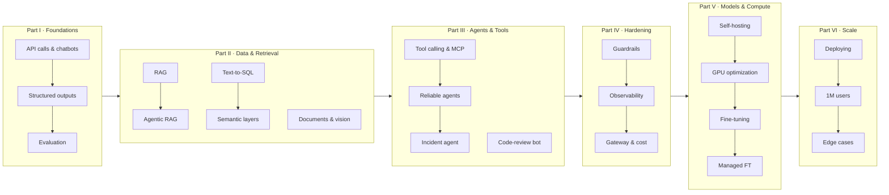

# LLM in Production

**An open-source, hands-on book about shipping large language models in real systems.**

Each chapter takes one engineering problem you will meet when you put an LLM behind a real
product, such as a support chatbot, a Slack bot that answers questions from the production
database, an agent that investigates incidents, or a fine-tuned model serving a million users.
It solves the problem end to end, in the same order every time:

> problem → requirements → schema and data (with a seeder) → a senior engineer's reasoning,
> including *why A, not B* → tested code → serving → what we learned

The code is runnable, the numbers come from real runs, and every decision explains its
trade-off. Concepts are explained in plain language first, and then built.

## Who this book is for

- Backend and platform engineers who have been asked to "add AI" to a product
- Data and analytics engineers building internal LLM tools
- ML engineers moving from notebooks to production services

You need comfortable Python and basic SQL. You don't need any ML background.

## The running example: ShopFlow

Every chapter works on **ShopFlow**, a fictional online shop with a real Postgres database:
5,000 customers, about 30,000 orders, payments, refunds, shipments, inventory, 1,560 support
tickets and a customer FAQ. One seeder sets it up in seconds, and every chapter builds
something for ShopFlow on top of it. See [datasets/shopflow](datasets/shopflow/README.md).

## Mental model



## Quick start

```bash
uv sync                                    # installs Python 3.12 deps into .venv
cp .env.example .env                       # then put your OpenRouter key in LLM_API_KEY
docker compose -f datasets/shopflow/docker-compose.yml up -d
uv run python datasets/shopflow/seed.py --reset
uv run jupyter lab                         # open ch01/01_main-chapter-code/ch01.ipynb
```

Full instructions, other providers (OpenAI direct, local Ollama) and troubleshooting:
[setup/README.md](setup/README.md).

## Chapters

| Chapter | Main code | All code |
|---|---|---|
| **Part I: Foundations** | | |
| [Ch 1: From API call to production chatbot](ch01/README.md) | [ch01.ipynb](ch01/01_main-chapter-code/ch01.ipynb) | [ch01/01_main-chapter-code](ch01/01_main-chapter-code) |
| [Ch 2: Structured outputs & extraction](ch02/README.md) | [ch02.ipynb](ch02/01_main-chapter-code/ch02.ipynb) | [ch02/01_main-chapter-code](ch02/01_main-chapter-code) |
| [Ch 3: Evaluating LLM systems](ch03/README.md) | [ch03.ipynb](ch03/01_main-chapter-code/ch03.ipynb) | [ch03/01_main-chapter-code](ch03/01_main-chapter-code) |
| **Part II: Data & Retrieval** | | |
| [Ch 4: RAG over internal docs](ch04/README.md) | [ch04.ipynb](ch04/01_main-chapter-code/ch04.ipynb) | [ch04/01_main-chapter-code](ch04/01_main-chapter-code) |
| [Ch 5: Agentic RAG](ch05/README.md) | [ch05.ipynb](ch05/01_main-chapter-code/ch05.ipynb) | [ch05/01_main-chapter-code](ch05/01_main-chapter-code) |
| [Ch 6: Text-to-SQL Slack bot over production data](ch06/README.md) | [ch06.ipynb](ch06/01_main-chapter-code/ch06.ipynb) | [ch06/01_main-chapter-code](ch06/01_main-chapter-code) |
| [Ch 7: Semantic layers](ch07/README.md) | [ch07.ipynb](ch07/01_main-chapter-code/ch07.ipynb) | [ch07/01_main-chapter-code](ch07/01_main-chapter-code) |
| [Ch 8: Document & multimodal processing](ch08/README.md) | [ch08.ipynb](ch08/01_main-chapter-code/ch08.ipynb) | [ch08/01_main-chapter-code](ch08/01_main-chapter-code) |
| **Part III: Agents & Tools** | | |
| [Ch 9: Tool calling & MCP](ch09/README.md) | [ch09.ipynb](ch09/01_main-chapter-code/ch09.ipynb) | [ch09/01_main-chapter-code](ch09/01_main-chapter-code) |
| [Ch 10: Reliable agents](ch10/README.md) | [ch10.ipynb](ch10/01_main-chapter-code/ch10.ipynb) | [ch10/01_main-chapter-code](ch10/01_main-chapter-code) |
| [Ch 11: Incident analysis agent](ch11/README.md) | [ch11.ipynb](ch11/01_main-chapter-code/ch11.ipynb) | [ch11/01_main-chapter-code](ch11/01_main-chapter-code) |
| [Ch 12: Code-review bot](ch12/README.md) | [ch12.ipynb](ch12/01_main-chapter-code/ch12.ipynb) | [ch12/01_main-chapter-code](ch12/01_main-chapter-code) |
| **Part IV: Production Hardening** | | |
| [Ch 13: Guardrails & security](ch13/README.md) | [ch13.ipynb](ch13/01_main-chapter-code/ch13.ipynb) | [ch13/01_main-chapter-code](ch13/01_main-chapter-code) |
| [Ch 14: Observability & LLMOps](ch14/README.md) | [ch14.ipynb](ch14/01_main-chapter-code/ch14.ipynb) | [ch14/01_main-chapter-code](ch14/01_main-chapter-code) |
| [Ch 15: Gateway, caching & cost control](ch15/README.md) | [ch15.ipynb](ch15/01_main-chapter-code/ch15.ipynb) | [ch15/01_main-chapter-code](ch15/01_main-chapter-code) |
| **Part V: Models & Compute** | | |
| [Ch 16: Self-hosting open models](ch16/README.md) | [ch16.ipynb](ch16/01_main-chapter-code/ch16.ipynb) | [ch16/01_main-chapter-code](ch16/01_main-chapter-code) |
| [Ch 17: GPU & compute optimization](ch17/README.md) | [ch17.ipynb](ch17/01_main-chapter-code/ch17.ipynb) | [ch17/01_main-chapter-code](ch17/01_main-chapter-code) |
| [Ch 18: Fine-tuning your own model](ch18/README.md) | [ch18.ipynb](ch18/01_main-chapter-code/ch18.ipynb) | [ch18/01_main-chapter-code](ch18/01_main-chapter-code) |
| [Ch 19: Managed fine-tuning (SageMaker, Vertex, OpenAI)](ch19/README.md) | [ch19.ipynb](ch19/01_main-chapter-code/ch19.ipynb) | [ch19/01_main-chapter-code](ch19/01_main-chapter-code) |
| **Part VI: Production at Scale** | | |
| [Ch 20: Deploying to production](ch20/README.md) | [ch20.ipynb](ch20/01_main-chapter-code/ch20.ipynb) | [ch20/01_main-chapter-code](ch20/01_main-chapter-code) |
| [Ch 21: Scaling to a million users](ch21/README.md) | [ch21.ipynb](ch21/01_main-chapter-code/ch21.ipynb) | [ch21/01_main-chapter-code](ch21/01_main-chapter-code) |
| [Ch 22: Edge cases from the field & what to expect](ch22/README.md) | [ch22.ipynb](ch22/01_main-chapter-code/ch22.ipynb) | [ch22/01_main-chapter-code](ch22/01_main-chapter-code) |
| **Appendices** | | |
| [A: Model selection & pricing snapshot](appendix-A/README.md) | [fetch_models.py](appendix-A/fetch_models.py) | [appendix-A](appendix-A) |
| [B: Glossary](appendix-B/README.md) | — | — |
| [C: References & further reading](appendix-C/README.md) | — | — |

## Hardware

- **Parts I–IV:** any laptop with Docker. Model calls go to a hosted API (OpenRouter by
  default) or to a local Ollama.
- **Part V:** the local runs use an NVIDIA GPU (Ollama, llama.cpp, vLLM, Unsloth) and were
  tested on one RTX 3090 (24 GB, Ampere) under Ubuntu 22.04. Each Part V chapter keeps its
  CUDA-only packages in a chapter-local `requirements-cuda.txt`. Cloud code (SageMaker, Vertex)
  comes from official docs and is marked **Not executed by the author** wherever that applies.

## Running the notebooks

```bash
uv run jupyter lab           # choose the ".venv" kernel
```

Headless, saving outputs in place:

```bash
uv run jupyter nbconvert --to notebook --execute --inplace ch01/01_main-chapter-code/ch01.ipynb
```

## Running the tests

```bash
uv run pytest                # unit tests; never calls a model, never re-seeds the database
uv run pytest -m "docker and not reseed"   # tests that need the ShopFlow Postgres container
uv run pytest -m llm         # tests that call the configured model (costs money)
uv run pytest -m reseed datasets   # seed invariants: re-seed the DB and drop chapter tables
```

## Repository layout

```
chNN/
  README.md                  # the chapter
  01_main-chapter-code/      # notebook + scripts used in the chapter
  02_bonus_*/                # optional extras
  images/                    # SVG diagrams and PNG screenshots
datasets/shopflow/           # shared database, seeder, docs corpus
src/llmprod/                 # tiny shared helpers: settings, clients, DB connection
docs/                        # style guide and chapter template
setup/                       # installation and provider setup
```

## Acknowledgements

Two books shaped this one: Sebastian Raschka's *Build a Large Language Model (From Scratch)*
(Manning, 2024) and its [companion repository](https://github.com/rasbt/LLMs-from-scratch),
whose hands-on, run-every-line style and repo layout we follow, and Chip Huyen's *AI
Engineering* (O'Reilly, 2025), whose plain-language explanations of how AI systems work we try to
match. Neither book is quoted here; read them both.

## License

- Code: [Apache-2.0](LICENSE)
- Prose and images: [CC BY-SA 4.0](LICENSE-CONTENT)
