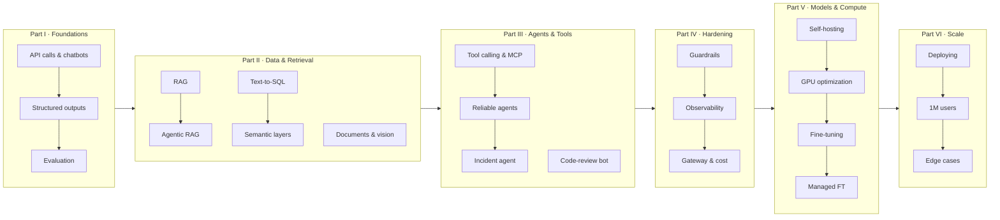

# LLM in Production

**An open-source, hands-on book about shipping large language models in real systems.**

Each chapter takes one engineering problem you will meet when you put an LLM behind a real
product, such as a support chatbot, a Slack bot that answers questions from the production
database, an agent that investigates incidents, or a fine-tuned model serving a million users.
It solves the problem end to end, in the same order every time:

> problem → requirements → schema and data (with a seeder) → a senior engineer's reasoning,
> including *why A, not B* → tested code → serving → what we learned

The code is runnable, the numbers come from real runs, and every decision explains its
trade-off. Concepts are explained in plain language first, and then built.

## Who this book is for

- Backend and platform engineers who have been asked to "add AI" to a product
- Data and analytics engineers building internal LLM tools
- ML engineers moving from notebooks to production services

You need comfortable Python and basic SQL. You don't need any ML background.

## The running example: ShopFlow

Every chapter works on **ShopFlow**, a fictional online shop with a real Postgres database:
5,000 customers, about 30,000 orders, payments, refunds, shipments, inventory, 1,560 support
tickets and a customer FAQ. One seeder sets it up in seconds, and every chapter builds
something for ShopFlow on top of it. See [datasets/shopflow](datasets/shopflow/README.md).

## Mental model



## Quick start

```bash
uv sync                                    # installs Python 3.12 deps into .venv
cp .env.example .env                       # then put your OpenRouter key in LLM_API_KEY
docker compose -f datasets/shopflow/docker-compose.yml up -d
uv run python datasets/shopflow/seed.py --reset
uv run jupyter lab                         # open ch01/01_main-chapter-code/ch01.ipynb
```

Full instructions, other providers (OpenAI direct, local Ollama) and troubleshooting:
[setup/README.md](setup/README.md).

## Chapters

| Chapter | Main code | All code |
|---|---|---|
| **Part I: Foundations** | | |
| [Ch 1: From API call to production chatbot](ch01/README.md) | [ch01.ipynb](ch01/01_main-chapter-code/ch01.ipynb) | [ch01/01_main-chapter-code](ch01/01_main-chapter-code) |
| Ch 2: Structured outputs & extraction | coming soon | coming soon |
| Ch 3: Evaluating LLM systems | coming soon | coming soon |
| **Part II: Data & Retrieval** | | |
| Ch 4: RAG over internal docs | coming soon | coming soon |
| Ch 5: Agentic RAG | coming soon | coming soon |
| [Ch 6: Text-to-SQL Slack bot over production data](ch06/README.md) | [ch06.ipynb](ch06/01_main-chapter-code/ch06.ipynb) | [ch06/01_main-chapter-code](ch06/01_main-chapter-code) |
| Ch 7: Semantic layers | coming soon | coming soon |
| Ch 8: Document & multimodal processing | coming soon | coming soon |
| **Part III: Agents & Tools** | | |
| Ch 9: Tool calling & MCP | coming soon | coming soon |
| Ch 10: Reliable agents | coming soon | coming soon |
| Ch 11: Incident analysis agent | coming soon | coming soon |
| Ch 12: Code-review bot | coming soon | coming soon |
| **Part IV: Production Hardening** | | |
| Ch 13: Guardrails & security | coming soon | coming soon |
| Ch 14: Observability & LLMOps | coming soon | coming soon |
| Ch 15: Gateway, caching & cost control | coming soon | coming soon |
| **Part V: Models & Compute** | | |
| Ch 16: Self-hosting open models | coming soon | coming soon |
| Ch 17: GPU & compute optimization | coming soon | coming soon |
| Ch 18: Fine-tuning your own model | coming soon | coming soon |
| Ch 19: Managed fine-tuning (SageMaker, Vertex, OpenAI) | coming soon | coming soon |
| **Part VI: Production at Scale** | | |
| Ch 20: Deploying to production | coming soon | coming soon |
| Ch 21: Scaling to a million users | coming soon | coming soon |
| Ch 22: Edge cases from the field & what to expect | coming soon | coming soon |
| **Appendices** | | |
| A: Model selection & pricing snapshot | coming soon | coming soon |
| B: Glossary | coming soon | coming soon |
| C: References & further reading | coming soon | coming soon |

## Hardware

- **Parts I–IV:** any laptop with Docker. Model calls go to a hosted API (OpenRouter by
  default) or to a local Ollama.
- **Part V:** the local runs use Apple Silicon (MLX, llama.cpp, Ollama) and were tested on an
  M2 Pro with 16 GB. CUDA and cloud code (vLLM, SGLang, Unsloth, SageMaker, Vertex) comes from
  official docs and is marked **Not executed by the author** wherever that applies.

## Running the notebooks

```bash
uv run jupyter lab           # choose the ".venv" kernel
```

Headless, saving outputs in place:

```bash
uv run jupyter nbconvert --to notebook --execute --inplace ch01/01_main-chapter-code/ch01.ipynb
```

## Running the tests

```bash
uv run pytest                # unit tests; never calls a model (llm marker is skipped)
uv run pytest -m docker      # tests that need the ShopFlow Postgres container
uv run pytest -m llm         # tests that call the configured model (costs money)
```

## Repository layout

```
chNN/
  README.md                  # the chapter
  01_main-chapter-code/      # notebook + scripts used in the chapter
  02_bonus_*/                # optional extras
  images/                    # SVG diagrams and PNG screenshots
datasets/shopflow/           # shared database, seeder, docs corpus
src/llmprod/                 # tiny shared helpers: settings, clients, DB connection
docs/                        # style guide and chapter template
setup/                       # installation and provider setup
```

## Acknowledgements

Two books shaped this one: Sebastian Raschka's *Build a Large Language Model (From Scratch)*
(Manning, 2024) and its [companion repository](https://github.com/rasbt/LLMs-from-scratch),
whose hands-on, run-every-line style and repo layout we follow, and Chip Huyen's *AI
Engineering* (O'Reilly, 2025), whose plain-language explanations of how AI systems work we try to
match. Neither book is quoted here; read them both.

## License

- Code: [Apache-2.0](LICENSE)
- Prose and images: [CC BY-SA 4.0](LICENSE-CONTENT)
