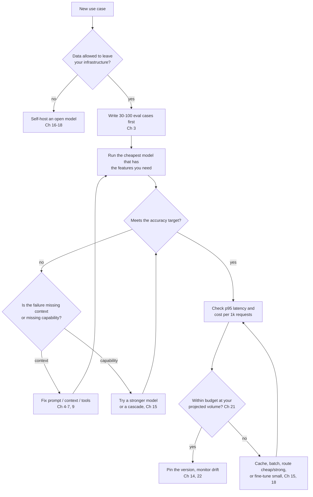

# Appendix A: Model selection and pricing snapshot

> **Tested on:** 2026-11-07 · Ubuntu 22.04 · Python 3.12 · OpenRouter public models API
> (no key needed) · [`fetch_models.py`](fetch_models.py) · raw data: [`models-2026-11-07.csv`](models-2026-11-07.csv)

The 22 chapters used a handful of models, picked for each job and priced as of 2026-11. This
appendix is for the moment you pick your own. Use it when you start a new project, or when a
model you rely on changes price or goes away.

Any table of models and prices goes stale within weeks. On the day of this snapshot, the newest
listing was one day old. Also, 15 models had a scheduled expiration date, and three of them
expired the very next day. So this appendix gives you two things. First, a **script** that
rebuilds every table below from OpenRouter's public catalog. Second, a **way to choose** that
doesn't depend on this month's leaderboard.

One command rebuilds the snapshot for today:

```bash
uv run python appendix-A/fetch_models.py      # prints the tables, writes models-<today>.csv
```

## The snapshot (2026-11-07)

Here is what the catalog looked like on the day we ran the script. All tables are the script's
output, unedited. Start with the big picture: who sells models, and how many.

**460 models from 69 vendors (16 free, 434 paid).**

| vendor | models |
|---|---|
| openai | 98 |
| google | 43 |
| qwen | 43 |
| anthropic | 30 |
| mistralai | 21 |
| z-ai | 19 |
| deepseek | 16 |
| nvidia | 11 |
| x-ai | 10 |
| moonshotai | 9 |
| meta | 9 |
| tencent | 8 |

The vendor list tells you who is in the market. The next question is what the models cost.

### Prices ($ per 1M tokens, paid models)

| percentile | p10 | p25 | p50 | p75 | p90 |
|---|---|---|---|---|---|
| input | $0.06 | $0.15 | $0.50 | $1.60 | $3.00 |
| output | $0.20 | $0.60 | $2.00 | $7.50 | $15.00 |

Look at the gap between the input and output rows. The median model charges **4.2×** more per
output token than per input token. So long prompts with short answers (RAG, classification,
extraction) are cheap, and long generations (reports, code) are not. The spread between models
is huge too. The 90th-percentile model costs 50× the 10th-percentile one per input token. That
is why "which model?" is mostly a cost question once quality is good enough.

Price only matters for models that can do the job. Here is how many support the features this
book relies on.

### Capabilities

| capability | models | share |
|---|---|---|
| tool calling | 398 | 87% |
| structured outputs (json_schema) | 387 | 84% |
| accepts temperature | 348 | 76% |
| reasoning is mandatory | 136 | 30% |
| image input | 313 | 68% |
| context ≥ 1M tokens | 203 | 44% |

Two numbers stand out. Nearly a third of models now *always* reason. They spend hidden reasoning
tokens you pay for, and some ignore sampling parameters (see Chapter 1). And almost half accept a
million tokens of context. For most applications, the context window is no longer the limit.
Cost and latency per request are.

With the market in view, here is where the book's own models sit. Note the price columns and
whether each one accepts `temperature`.

### The models used in this book

| model | context | $ in | $ out | temperature | reasoning mandatory |
|---|---|---|---|---|---|
| openai/gpt-6-luna | 1,050,000 | $0.10 | $0.50 | False | False |
| anthropic/claude-haiku-5.5 | 1,000,000 | $0.10 | $0.50 | False | False |
| anthropic/claude-sonnet-5.5 | 1,000,000 | $2.00 | $10.00 | False | True |
| qwen/qwen3.8-flash | 1,000,000 | $0.15 | $0.47 | True | False |

### Cheapest paid models with tools, structured outputs and ≥ 128k context

If you want the cheapest model that still has the features most chapters need, start here. This
is the minimum bar for most of this book's chapters, sorted by `input + 3 × output` price:

| model | context | $ in | $ out | $ cache read |
|---|---|---|---|---|
| mistralai/mistral-nemo | 131,072 | $0.03 | $0.03 | n/a |
| inclusionai/ling-3.0-tiny | 262,144 | $0.01 | $0.04 | $0.00 |
| openai/gpt-oss-120b | 131,072 | $0.02 | $0.07 | $0.02 |
| meta-llama/llama-3.1-8b-instruct | 131,072 | $0.05 | $0.08 | $0.02 |
| ~z-ai/glm-flash-latest | 1,048,576 | $0.03 | $0.09 | $0.03 |
| openai/gpt-oss-20b:batch | 131,072 | $0.02 | $0.11 | n/a |
| mistralai/ministral-3b-2512 | 131,072 | $0.10 | $0.10 | $0.01 |
| openai/gpt-oss-20b | 131,072 | $0.03 | $0.13 | $0.03 |
| openai/gpt-oss-120b:batch | 131,072 | $0.03 | $0.14 | n/a |
| inclusionai/ling-3.1-flash | 1,000,000 | $0.04 | $0.14 | $0.01 |
| prism-ml/ternary-bonsai-2-9b | 262,144 | $0.08 | $0.13 | $0.04 |
| deepseek/deepseek-v4-flash-0731:batch | 1,048,576 | $0.05 | $0.14 | $0.01 |

"Cheapest that supports the features" isn't the same as "good enough for your task". Chapter 6
showed an 8B model reaching 63% where frontier-small models reached 100% with the same prompt.
Treat this list as candidates for your eval set (Chapter 3), not as recommendations.

> [!WARNING]
> **Aliases move.** A model id like `~z-ai/glm-flash-latest` (the `~` and `-latest` both signal
> it) points at whatever the vendor currently serves. Pin dated or versioned ids in production,
> and re-run your evals when you deliberately move.

Choosing a model is not a one-time decision. Models also leave the catalog, sometimes with only
days of notice.

### Scheduled expirations

These are the models with a scheduled end date on the day of the snapshot:

| model | expires |
|---|---|
| inception/mercury-3 | 2026-11-08 |
| inception/mercury-2.5 | 2026-11-08 |
| inception/mercury-2 | 2026-11-08 |
| bytedance-seed/seed-2.0-code | 2026-11-11 |
| bytedance-seed/seed-1.6-flash | 2026-11-11 |
| bytedance-seed/seed-1.6 | 2026-11-11 |
| liquid/lfm-2.5-2.6b | 2026-11-13 |
| liquid/lfm-2.5-2.6b:free | 2026-11-13 |
| meta-llama/llama-3.2-1b-instruct | 2026-11-20 |
| meta-llama/llama-3.2-3b-instruct | 2026-11-20 |
| openai/gpt-5-image-mini | 2026-12-01 |
| dots-studio/dots-3-note-preview:free | 2026-12-31 |
| z-ai/glm-4.7 | 2026-12-31 |
| z-ai/glm-4.5v | 2026-12-31 |
| z-ai/glm-4.5 | 2026-12-31 |

Put the model ids you depend on in a config file, not in code, and check this list in CI.
Chapter 22 covers deprecation and silent drift.

## How to choose a model

The tables above will be out of date by the time you read them. The process for choosing a model
won't be. The flowchart sums up the order the chapters follow: data rules first, then evals, then
the cheapest model that passes, then cost at your real volume.



The flowchart gives the order. These rules of thumb, which we kept relearning while writing this
book, help at each step:

1. **Context before capability.** In Chapter 6, a model 20× more expensive per token fixed none
   of the naive bot's failures, and a 2,000-token context file fixed all of them.
2. **Small models for narrow, high-volume tasks.** Classification, extraction and routing are
   where small and fine-tuned models win on cost and latency (Chapters 2 and 18).
3. **Strong models as judges and planners, sparingly.** Use them where one call guides many cheap
   ones (Chapter 3 judges, Chapter 15 cascades).
4. **Check the parameters you rely on.** `supported_parameters` in the catalog tells you whether
   `temperature`, `tools`, `response_format` or `seed` will be honored. On OpenRouter,
   unsupported ones are silently dropped unless you set `provider.require_parameters`.
5. **Price is per token, not per request.** Count your real tokens (Chapter 1's
   `estimate_cost`), including reasoning tokens and the system prompt you resend each turn,
   minus whatever prompt caching saves you.

## References

- OpenRouter models API — accessed 2026-11-07. https://openrouter.ai/api/v1/models
- OpenRouter provider routing (`require_parameters`). https://openrouter.ai/docs/guides/routing/provider-selection
- GPT-6 Luna model page — OpenAI, accessed 2026-11-07. https://developers.openai.com/api/docs/models/gpt-6-luna
