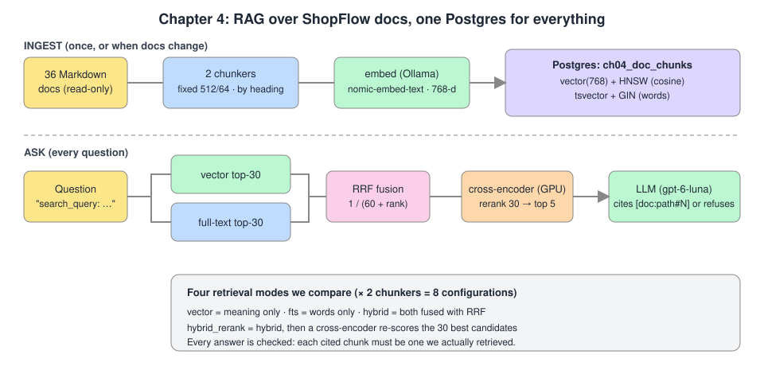
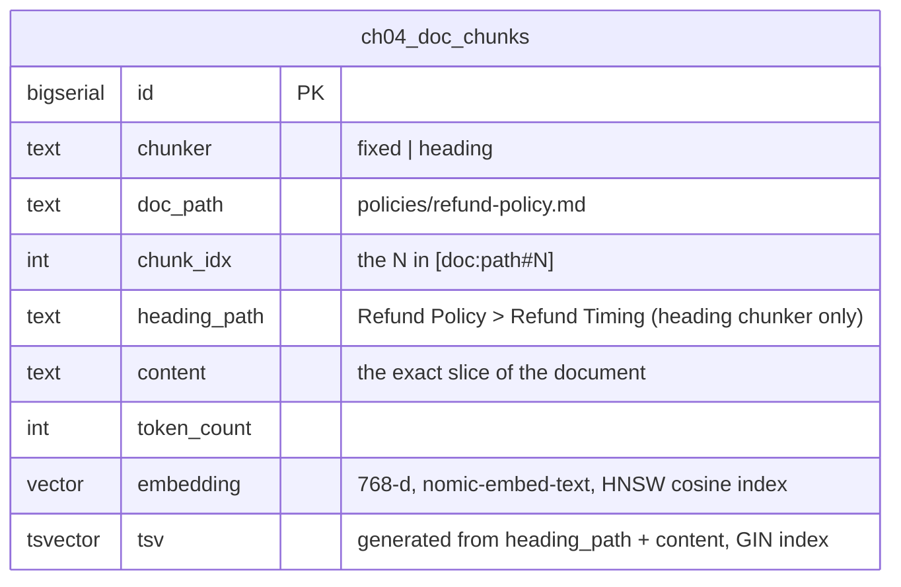
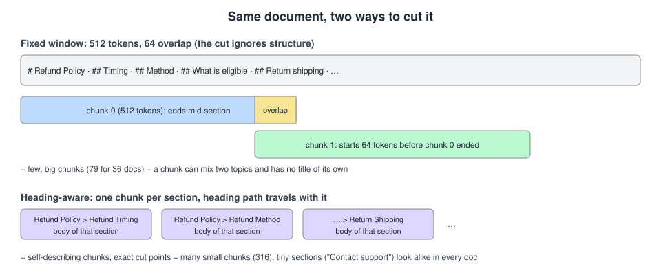
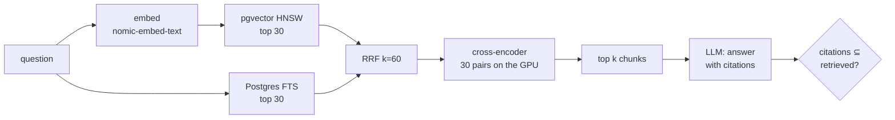
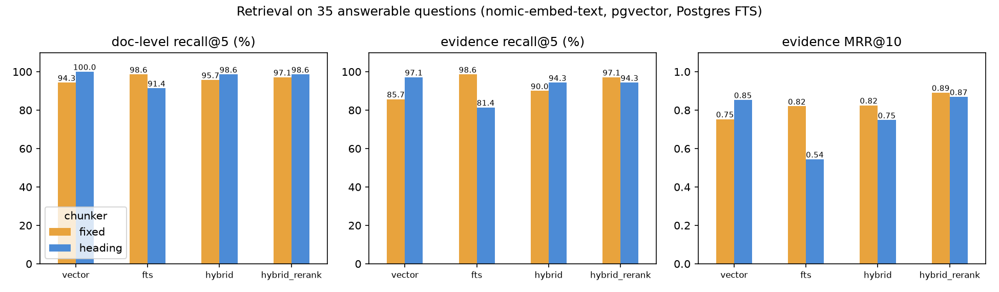
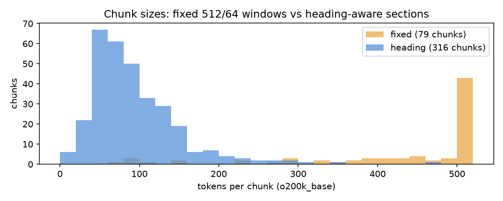
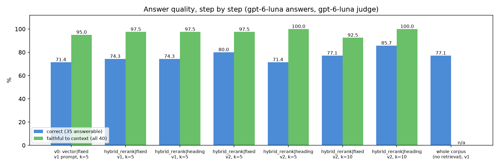

# Chapter 4: RAG over internal docs

> **Tested on:** 2026-11-09 · Ubuntu 22.04 (NVIDIA RTX 3090, 24 GB) · Python 3.12 · Postgres 18.6
> + pgvector 0.8.7 · openai/gpt-6-luna via OpenRouter; qwen3:8b and nomic-embed-text via Ollama 0.40.15 ·
> sentence-transformers 6.2.0 (CUDA, torch 2.15), fastapi 0.162

In May 2024, Stanford researchers tested the AI research tools of LexisNexis and Thomson Reuters,
both sold as retrieval-augmented and "hallucination-free". They hallucinated on 17% to 33% of the
benchmark queries ([Stanford RegLab](https://reglab.stanford.edu/publications/hallucination-free-assessing-the-reliability-of-leading-ai-legal-research-tools)).
Retrieval doesn't make a model honest. It gives the model the right page to read, *if* the
retriever finds it, and *if* the model sticks to it. Both "ifs" are measurable, and this chapter
measures them.

This chapter opens Part II of the book, on data and retrieval. In the first three chapters the
bots only knew what we put in the prompt: an FAQ, a ticket, a rubric. In Chapter 3 we built a
regression gate and a calibrated LLM judge to tell whether an answer is good. Now the knowledge
moves out of the prompt and into a search step, and we use that same judge to check whether the
search helps.

We build a documentation assistant for ShopFlow's 36 internal documents: policies, care guides,
the support handbook and the incident runbooks. It answers with citations like
`[doc:policies/refund-policy.md#2]`, says "I can't find that" when the documents don't say, and
runs entirely on one Postgres plus one small GPU model.



## The problem

A RAG system is only worth building if people have a real question it can answer. ShopFlow's
support agents and on-call engineers keep asking the same people the same questions:

> *Which feature flag do we flip to fail over between payment providers?*
> *A customer wants their refund on a new card because the old one expired. What do we tell them?*
> *Can we ship a fix during the Black Friday change freeze?*

The answers are all written down, spread over 36 Markdown files nobody reads end to end. The ask:
type a question, get a short answer in seconds, with a link to the paragraph it came from, so the
agent can check it before pasting it to a customer.

Three things make this harder than "embed the docs, ask GPT". The table lists each trap and why it
breaks the simple approach:

| Trap | Why it's hard |
|---|---|
| **Exact identifiers** | `payments.primary_provider`, `deployctl rollback checkout`, a Loki query. Embeddings blur exact strings; the question must match characters, not meaning. |
| **Paraphrases** | "My earbuds are getting dangerously hot" shares almost no words with the care guide's "overheating" section. Word matching fails here. |
| **Questions the docs don't answer** | "What's the support phone number?" There is none. A fluent invented number is worse than no answer. |

The first trap needs exact matching, the second needs meaning, and the third needs a model that
knows when to stop. Our design has to handle all three at once.

## Requirements

Those three traps tell us what to test. Before we write any code, let's turn the ask into a list
of things the assistant must do:

- **Find the right passage.** The chunk that holds the answer shows up in the top 5 results. We
  call this *evidence recall@5* and want it at 95% or higher on the eval set.
- **Answer correctly.** At least 90% of answerable questions get a correct answer, graded by an
  LLM judge against a human reference.
- **Say "I can't find that".** It refuses all of the questions the docs don't cover (5/5).
- **Stick to the text.** Every claim comes from the retrieved passages. We call this
  *faithfulness* and want it at 95% or higher.
- **Cite honestly.** Sources appear as `[doc:path#chunk]` and point only at chunks we actually
  retrieved: 100% of citations valid.

It also has to run like a real service:

- **Search fast.** Embedding the question, searching and reranking together take under 300 ms
  for 95% of questions (p95 < 300 ms).
- **Stay cheap.** Under $1 per 1,000 questions.
- **Use what we have.** It runs on the Postgres we already run, with no new vector database.

At the end of the chapter we check each item against measured numbers.

## The data

To meet those targets we need two things: documents to search and questions with known answers.
The corpus is [`datasets/shopflow/docs/`](../datasets/shopflow/docs/): 36 Markdown files, about
31,000 tokens (`o200k_base`), written in the voice of ShopFlow's teams and kept consistent with
the FAQ and the database schema. Here is how the files split by folder:

| folder | docs | what's in it |
|---|---|---|
| `faq.md` | 1 | the customer FAQ from chapters 2 and 3 |
| `policies/` | 13 | refunds, returns, shipping, warranty, VIP, privacy, payments... |
| `care/` | 8 | product care guides: cast iron, knives, earbuds, power banks, yoga mats... |
| `handbook/` | 11 | support escalation, refund approval limits, on-call, incident severity, metrics glossary |
| `runbooks/` | 3 | the three checkout incidents chapter 11 will inject: bad deploy, DB pool exhaustion, payment-provider timeout |

A typical document, trimmed:

```markdown
# ShopFlow Refund Policy

*Owner: Customer Experience · Last reviewed: 2026-10-14*

## Refund Timing

- **Returns:** Refunds are issued within **5-7 business days** after we receive and inspect your
  returned items. Your order status changes to *refunded* once the return is processed.
...
## Refund Method

Every refund goes back to the **original payment method** used for the order...
```

Each document is turned into chunks before we can search it. Everything we store lives in one
table that ch04 creates and owns. One row is one chunk of one document, cut by one of two
chunkers. The diagram shows the columns we will query later:



The `embedding` column serves meaning search and the `tsv` column serves word search. One command
fills the table:

```bash
cd ch04/01_main-chapter-code
uv run python ingest.py --reset      # chunk with both chunkers, embed, store (about 40 s)
```

With the documents stored, we need a way to score answers. The eval set,
[`eval/questions.yaml`](01_main-chapter-code/eval/questions.yaml), has 40
questions in five categories: 11 *keyword* (exact identifiers), 11 *paraphrase* (few shared
words), 8 *direct*, 5 *multi* (two documents needed) and 5 *unanswerable*. Each answerable
question lists **evidence slots**: the documents that state the fact, plus a regex (`verify`) the
fact must match. A unit test checks every gold path against its regex, so the labels can't drift
from the documents. Here is one multi-document question:

```yaml
- id: q32
  category: multi
  question: "Checkout p95 latency has been 3 seconds for 15 minutes and db_pool_connections_in_use
             equals db_pool_size. What severity is this and what is the first mitigation to consider?"
  reference: "SEV2 (p95 above 2s sustained for 10 minutes; SEV1 if checkout is effectively down).
              Mitigation depends on the cause: kill long-running queries, temporarily raise the
              pool size for a traffic spike, or roll back if a deploy leaks connections."
  evidence:
    - verify: '(?i)p95[^.|]{0,60}(>|above) ?2s'
      paths: auto              # every document that states the fact
    - verify: 'db_pool_connections_in_use'
      paths: auto
```

Look closely at q32: the reference has three facts (severity, metric, mitigation) and the
evidence slots cover two. We'll come back to that.

## Concepts

We now have documents, a table and a question set. Before building, we need a few ideas: what RAG
is, how documents are cut, and the three search tools we will combine.

### Retrieval-augmented generation

*RAG* means: before asking the model, search our own documents and paste the best passages into
the prompt. The model stops answering from memory and starts answering from an open book. It's
the difference between asking a colleague what the refund policy says and handing them the
policy.

Two things can go wrong, and we measure them separately:

1. **Retrieval** misses the passage. Then even a perfect model can't answer. We measure this
   without any LLM, with *recall@5* and *MRR*.
2. **Generation** ignores, misreads or embellishes the passage. We measure this with an LLM judge:
   *correctness* against a human reference and *faithfulness* to the retrieved text.

### Chunks

Retrieval can only be as good as the units it returns, so the first choice is how to cut. We don't
retrieve whole documents. We retrieve *chunks*: passages small enough that five of them fit easily
in a prompt. How we cut matters, and the picture compares the two ways we try:



- **Fixed windows**: every 512 tokens, with 64 tokens of overlap so a sentence cut at a boundary
  appears whole in one of the two chunks. Simple, but a chunk can start mid-section and mix two
  topics.
- **Heading-aware**: one chunk per Markdown section, with the heading path ("Refund Policy >
  Refund Timing") stored alongside. Long sections are split on paragraph boundaries. Chunks are
  self-describing but small.

Both chunkers work on character offsets into the original text. So chunks are exact slices of the
document, and "no text is lost" is a unit test, not a hope.

### Embeddings and the HNSW index

Once we have chunks, we need a way to find the ones that match a question. The first tool
searches by meaning. An *embedding* is a list of numbers (here 768) that places a text in a
"meaning space": texts about the same thing land close together, whatever words they use.
"Earbuds getting hot" lands
near "overheating while charging". We embed every chunk once at ingest and each question at query
time, then ask Postgres for the nearest chunks by cosine distance. `nomic-embed-text` expects a
task prefix: `search_document: ` for chunks and `search_query: ` for questions
([model card](https://huggingface.co/nomic-ai/nomic-embed-text-v1.5)).

Comparing a question with every chunk is exact but linear. An *HNSW* index (Hierarchical
Navigable Small World) is a multi-layer graph of "nearby" vectors that the search walks greedily,
like taking motorways first and side streets last. It's approximate: fast, but it can miss.

### Full-text search

Embeddings handle paraphrases but blur exact strings, which was our first trap. The second tool
fixes that. Postgres has had word search built in for twenty years.
`to_tsvector('english', text)` reduces a text to stemmed words ("refunds" → "refund"); a
`tsquery` matches them, and `ts_rank_cd` scores by
how many query words appear and how close together. It's blind to meaning but exact about
strings: `payments.primary_provider` matches only documents that contain it.

### Reciprocal Rank Fusion

We now have two ranked lists, one by meaning and one by words, and we want one. But vector search
and full-text search score on incompatible scales (a cosine of 0.71 vs a `ts_rank_cd` of 0.3).
*Reciprocal Rank Fusion* (RRF) ignores the scores and uses only ranks: each
list gives a chunk $1/(k + \text{rank})$, and we add them up. With $k = 60$ (the value from the
original paper), rank 1 is worth 0.0164 and rank 10 is worth 0.0143, so a chunk that's decent in
*both* lists beats one that's top in only one. The code is short; note how it skips duplicates
within one list:

```python
# ch04/01_main-chapter-code/ch04_rag/retrieve.py (excerpt)
def rrf(rankings: Sequence[Sequence[Hashable]], k: int = RRF_K) -> list[tuple[Hashable, float]]:
    scores: dict[Hashable, float] = defaultdict(float)
    first_seen: dict[Hashable, int] = {}
    for ranking in rankings:
        seen: set[Hashable] = set()
        for rank, item in enumerate(ranking, start=1):
            if item in seen:  # a duplicate in one list must not count twice
                continue
            seen.add(item)
            scores[item] += 1.0 / (k + rank)
            first_seen.setdefault(item, len(first_seen))
    return sorted(scores.items(), key=lambda kv: (-kv[1], first_seen[kv[0]]))
```

### Cross-encoder reranking

RRF only reorders what the two searches found. To judge relevance more closely, we add a third
tool. An embedding model encodes the question and each chunk *separately*, then compares two
vectors. A *cross-encoder* reads the question and one chunk *together* and outputs a relevance
score.
It's far more accurate, and far too slow to run on every chunk, so we run it only on the 30
candidates RRF returns and keep the top 5. We use `cross-encoder/ms-marco-MiniLM-L-6-v2`, a
22M-parameter model trained on MS MARCO passage ranking (real Bing queries), through
sentence-transformers. The diagram shows the full pipeline we are aiming for, end to end:



Each box is a step we will add and measure one at a time, starting from the simplest version.

## v0: the naive solution

Before we build the full pipeline, we build the simplest one and see where it breaks. This is the
version every tutorial builds: cut every document into 512-token windows, embed them, take
the 5 nearest chunks by cosine similarity and paste them into the prompt with "answer from the
context, cite your sources, at most 4 sentences" (prompt v1 in
[`answer.py`](01_main-chapter-code/ch04_rag/answer.py)).

```python
# ch04/01_main-chapter-code/ch04_rag/retrieve.py (excerpt)
def vector_search(conn: psycopg.Connection, query_vec, chunker: str, k: int) -> list[Hit]:
    rows = conn.execute(
        f"SELECT {_COLS}, 1 - (embedding <=> %s) AS cos FROM ch04_doc_chunks"
        " WHERE chunker = %s ORDER BY embedding <=> %s LIMIT %s",
        (query_vec, chunker, query_vec, k),
    ).fetchall()
    return _hits(rows, "vector")
```

Here are three questions, answered by `openai/gpt-6-luna` ($0.10 / $0.50 per 1M input/output
tokens on OpenRouter, as of 2026-11). This is real output from the notebook. Look at the ranks and
at the answers:

```
Q: What pattern do ShopFlow SKUs follow?
   1. [doc:handbook/warehouse-operations.md#1]             cos=0.694
   2. [doc:handbook/holiday-peak-playbook.md#2]            cos=0.661
   3. [doc:policies/price-adjustment-policy.md#1]          cos=0.648
   4. [doc:runbooks/checkout-db-pool-exhaustion.md#1]      cos=0.644
   5. [doc:faq.md#0]                                       cos=0.642
A: I can't find that in the ShopFlow documents.
   1027 ms, 2175+14 tokens, $0.000279

Q: Can I swap an item I bought for the same thing in a different size?
   1. [doc:policies/order-cancellation.md#1]               cos=0.591
   2. [doc:policies/price-adjustment-policy.md#1]          cos=0.590
   3. [doc:policies/returns-policy.md#0]                   cos=0.578
   4. [doc:policies/damaged-or-defective-items.md#1]       cos=0.570
   5. [doc:care/wireless-earbuds.md#1]                     cos=0.555
A: I can't find that in the ShopFlow documents.
   1053 ms, 2007+14 tokens, $0.000258

Q: What is ShopFlow's customer support phone number?
   1. [doc:policies/account-security.md#0]                 cos=0.732
   2. [doc:faq.md#0]                                       cos=0.720
   3. [doc:policies/privacy-policy.md#0]                   cos=0.720
   4. [doc:policies/damaged-or-defective-items.md#0]       cos=0.711
   5. [doc:policies/payment-methods.md#1]                  cos=0.707
A: I can't find that in the ShopFlow documents.
   1705 ms, 2551+14 tokens, $0.000326
```

Three polite refusals, and only the last one is right. The SKU pattern (`SF-<CAT>-<number>`) is in
`handbook/warehouse-operations.md`, and v0 even ranked that document first, but the wrong 512-token
window of it. Size exchanges are in the returns policy, which came third, again the wrong
window. The good news hides in the bad: given the wrong passage, the model said "I can't find
that" instead of inventing an answer.

## Measuring v0

Three hand-picked questions show the problem but don't size it. We measure retrieval and
generation separately, on the 40-question eval set.

**Retrieval** needs no LLM. For the 35 answerable questions we compute two strictness levels:

- *doc-level* recall@5: did any chunk from a gold document make the top 5? MRR@10: the mean of
  1/rank of the first such chunk (1.0 = always first; 0.5 = typically second).
- *evidence-level* recall@5 and MRR@10: same, but the chunk must also contain the fact itself
  (the slot's `verify` regex). A chunk from the right document about the wrong section doesn't
  count.

```python
# ch04/01_main-chapter-code/ch04_rag/evalset.py (excerpt)
def evidence_slots(q: Question, hit: Hit) -> set[int]:
    """Indexes of the slots this chunk proves: right document AND its text matches `verify`."""
    text = _norm(hit.embed_text)
    return {
        i for i, (slot, rx) in enumerate(zip(q.slots, q.verify, strict=True))
        if hit.doc_path in slot and re.search(rx, text)
    }
```

Running this over all configs gives the first numbers. v0 (`vector`, `fixed`) scores **94.3%**
doc-level recall@5 but only **85.7%** evidence recall@5,
with evidence MRR 0.753. On paraphrased questions, its evidence recall is 72.7%. Four
questions lose the fact entirely, and two multi-document questions lose one of their two facts.
The first line is v0; the other lines are configs we build next:

```
vector|fixed            6 misses: q03(0.0) q14(0.0) q15(0.0) q21(0.0) q33(0.5) q34(0.5)
vector|heading          1 misses: q03(0.0)
fts|fixed               1 misses: q34(0.5)
fts|heading             7 misses: q10(0.0) q12(0.0) q17(0.0) q20(0.0) q27(0.0) q34(0.0) q35(0.5)
hybrid|fixed            4 misses: q03(0.0) q14(0.0) q21(0.0) q34(0.5)
hybrid|heading          2 misses: q17(0.0) q34(0.0)
hybrid_rerank|fixed     1 misses: q03(0.0)
hybrid_rerank|heading   3 misses: q20(0.0) q31(0.5) q34(0.5)
```

The doc-level number is the one most tutorials report, and it flatters: on a 36-document corpus,
"some chunk of the right document" is easy. For the size-swap question (q14), v0 retrieved
`returns-policy.md#0` at rank 3. That's a doc-level hit, but the window doesn't contain the
exchange rule, and the model, reasonably, said it couldn't find it.

Retrieval tells us whether the fact reached the model. Whether the model then used it well is the
second half. **Generation** is graded by chapter 3's judge: `openai/gpt-6-luna` with a written
rubric and a
reference answer, strict JSON schema, reason before verdict. In chapter 3's calibration run
(`ch03/01_main-chapter-code/calibration/`) this setup agreed with the chapter's reference labels
(40 answers labelled by a blind AI annotator, not by a human) at Cohen's κ = 0.75–0.82 over three
runs (quadratic 0.94–0.97), on par with `qwen/qwen3.8-flash` (κ 0.78) and at the lowest price of
the judges tried. Treat that as a check of the method, not a human-validated judge. The reference
answers in this chapter's eval set were also written by the AI tooling used to write the chapter.
It returns two booleans per answer:

- **correct**: agrees with the reference on every key fact; for the 5 unanswerable questions,
  correct means it declined.
- **faithful**: every claim is supported by the retrieved context (a refusal is faithful).

v0 gets **71.4%** of the answerable questions right (25/35), refuses 5/5 unanswerable questions,
and is faithful in 95.0% of answers. It never cites a chunk it wasn't given. So v0 is honest but
misses too often, and the misses start in retrieval. That is where we start fixing.

## Iterating

v0 left two gaps: retrieval lost the fact in four questions and half the facts in two more, and
only 71.4% of answers were correct. We fix one weakness at a time and measure after each step.

### 1. Hybrid search: add Postgres full-text search and fuse with RRF

The SKU question showed the first weakness: an exact string that a search by meaning can't pin
down.

**What's wrong.** Vector search misses exact strings and rare tokens. "What pattern do ShopFlow SKUs
follow?" needs the chunk with `SF-<CAT>-<number>`, and no embedding has a strong opinion about
that.

**Options.** (a) Weight cosine and `ts_rank_cd` into one score: they're on different scales and
the weights need tuning per corpus. (b) Use full-text search alone: on our set, `fts|fixed` scores
98.6% evidence recall, better than vectors, because the documents use the same vocabulary as the
questions. (c) Run both and fuse by rank (RRF).

Full-text search has its own trap. The obvious function, `websearch_to_tsquery`, ANDs every
word of the question, and a natural-language question then matches almost nothing. Compare the
two ways of building the query:

```
websearch_to_tsquery (AND)   questions matching 0 chunks: 26/35, median matches 0
OR of plainto_tsquery terms  questions matching 0 chunks:  0/35, median matches 57
```

We OR the question's words instead and let `ts_rank_cd` sort it out:

```python
# ch04/01_main-chapter-code/ch04_rag/retrieve.py (excerpt)
def fts_search(conn: psycopg.Connection, question: str, chunker: str, k: int) -> list[Hit]:
    terms = or_terms(question)
    if not terms:
        return []
    query = " || ".join(["plainto_tsquery('english', %s)"] * len(terms))
    rows = conn.execute(
        f"WITH q AS (SELECT {query} AS tsq) SELECT {_COLS}, ts_rank_cd(tsv, q.tsq) AS score"
        " FROM ch04_doc_chunks, q WHERE chunker = %s AND tsv @@ q.tsq"
        " ORDER BY score DESC, id LIMIT %s",
        (*terms, chunker, k),
    ).fetchall()
    return _hits(rows, "fts")
```

With word search working, each retriever returns its top 30, and RRF fuses them. Here is what
fusion does to the Loki question (heading chunks), from the notebook:

```
fused vector  fts  rrf      chunk
    1      1    1  0.0328  [doc:runbooks/checkout-db-pool-exhaustion.md#2]
    2      4    3  0.0315  [doc:runbooks/checkout-db-pool-exhaustion.md#5]
    3      5    4  0.0310  [doc:runbooks/checkout-db-pool-exhaustion.md#3]
    4      8    2  0.0308  [doc:runbooks/payment-provider-timeout.md#3]
    5      3    8  0.0306  [doc:runbooks/checkout-db-pool-exhaustion.md#1]
    6      6    6  0.0303  [doc:runbooks/checkout-db-pool-exhaustion.md#4]
```

The top chunk was first in both lists. The second was 4th by meaning and 3rd by words, and the
fusion lifts it above chunks that only one retriever liked.

> [!IMPORTANT]
> **Decision: RRF (k = 60) over a weighted sum of scores.** RRF needs no score normalisation and
> no tuning, and its $k$ comes from the original paper, where it was fixed in a pilot study and
> never changed. A weighted sum can beat it once you have hundreds of labelled queries to tune the
> weights on; with 35, you'd be fitting noise.

**Measured effect.** On fixed chunks, evidence recall@5 went 85.7% → 90.0% and evidence MRR
0.753 → 0.825; paraphrase recall 72.7% → 81.8%. On heading chunks, hybrid *lowered* evidence
recall (97.1% → 94.3%): the full-text list on heading chunks is the weakest retriever we have (81.4%),
and RRF gives a weak list the same vote as a strong one. Fusion helped fixed chunks but not heading
chunks, and both lists still judge relevance from a rough distance.

> [!NOTE]
> **In the wild:** Anthropic's "Contextual Retrieval" study found that adding BM25 to embeddings
> and prepending chunk context cut failed retrievals by 49%, and by 67% with reranking on top
> ([Anthropic](https://www.anthropic.com/engineering/contextual-retrieval), 2024). A Hacker News
> practitioner who processed millions of documents put it more bluntly: dense retrieval "doesn't
> work well for technical words", and hybrid plus a reranker "basically eliminated" their search
> issues ([HN](https://news.ycombinator.com/item?id=45645349), 2025).

### 2. A cross-encoder reranker, on the GPU

Hybrid search found more of the right chunks, yet the order within the top 30 is still rough.

**What's wrong.** RRF only reorders what the two retrievers found, and both judge relevance from
a distance (a vector, or word overlap).

**Options.** A hosted rerank API (Cohere, Voyage, Jina): one more vendor, one more network hop
and a per-search price. An LLM as reranker: accurate, but seconds per question. A small
cross-encoder on our own hardware.

We rerank the 30 fused candidates with `cross-encoder/ms-marco-MiniLM-L-6-v2` and keep the top
k. The previous author of this chapter hit a wall here: on a Mac, the cross-encoder hung while
loading, and they're not alone
([transformers#30990](https://github.com/huggingface/transformers/issues/30990)). On the RTX
3090 server, sentence-transformers 6.2 with CUDA torch loads it in a few seconds. We pick the
device explicitly, and (see Production hardening) survive a GPU that
another process has filled:

```python
# ch04/01_main-chapter-code/ch04_rag/retrieve.py (excerpt)
    @staticmethod
    def _load_cross_encoder(device: str):
        from sentence_transformers import CrossEncoder

        ce = CrossEncoder(RERANK_MODEL, max_length=512, device=device)
        # Loading can succeed and the first matmul still fail (cuBLAS needs its own workspace),
        # so a warm-up prediction is part of "loaded".
        ce.predict([("warm-up", "warm-up")], show_progress_bar=False)
        return ce

    @classmethod
    def cross_encoder(cls):
        with cls._ce_lock:
            if cls._ce is None:
                import torch

                device = "cuda" if torch.cuda.is_available() else "cpu"
                try:
                    cls._ce = cls._load_cross_encoder(device)
                except RuntimeError as e:  # torch.AcceleratorError / OutOfMemoryError
                    if device == "cpu":
                        raise
                    cls._fall_back_to_cpu(e)
            return cls._ce
```

The fallback matters because the device sets the speed. From the notebook, scoring the same 30
(question, chunk) pairs:

```
rerank 30 pairs, shared model on cuda:0: p50 31.1 ms, p95 31.7 ms
rerank 30 pairs, CPU (16 cores, shared host): p50 566.4 ms, p95 621.1 ms
```

On the GPU, reranking is small next to the LLM call. On the CPU, it adds about half a second to
every question.

> [!IMPORTANT]
> **Decision: a local cross-encoder on the GPU over a hosted rerank API or the CPU.** 30 pairs
> take about 31 ms on the RTX 3090 and about 0.6 s on the CPU of this busy 16-core host, and
> nothing leaves our network. On a CPU-only box, rerank fewer candidates (10-15) or call a hosted
> reranker; on a laptop, test that the model actually loads before you design around it.

**Measured effect.** On fixed chunks, evidence recall@5 rose to 97.1% (from 90.0% hybrid,
85.7% v0) and evidence MRR to 0.891, the best of all eight configs. On heading chunks the
reranker restored MRR (0.748 → 0.869) but not recall. The chart puts all eight configs side by
side:



### 3. Heading-aware chunks

The chart shows that heading chunks were already strong with plain vector search. That suggests
the cut itself mattered, so we look at it next.

**What's wrong.** A 512-token window starts and stops wherever the token count says. The
returns-policy window that matches "swap for a different size" begins mid-way through the refund
section, and has no title saying what it's about.

**Options.** Smaller fixed windows (more chunks, same blindness), semantic chunking with an
embedding model at every sentence boundary (expensive to ingest, hard to debug), or cutting at the
Markdown headings that the authors already wrote.

```python
# ch04/01_main-chapter-code/ch04_rag/chunking.py (excerpt)
def heading_chunks(
    text: str, doc_path: str, max_tokens: int = HEADING_MAX, tok: Tokenizer | None = None
) -> list[Chunk]:
    tok = tok or default_tokenizer()
    out: list[Chunk] = []
    for path, body in split_sections(text):
        for piece in _pack_paragraphs(body, max_tokens, tok):
            out.append(
                Chunk(doc_path, len(out), "heading", path, piece, len(tok.token_starts(piece)))
            )
    return out
```

The heading path is embedded and indexed with the body ("ShopFlow Refund Policy > Refund
Method\nEvery refund goes back to..."), so even a short section says what it is about. The
result is many more, much smaller chunks:

```
chunker  chunks  min  mean  median  max
  fixed      79   70 430.1   512.0  512
heading     316   16  93.3    80.5  462
```



**Measured effect.** Plain vector search on heading chunks scores **97.1%** evidence recall@5
(v0's fixed windows: 85.7%), 100% on paraphrases, and the best doc-level MRR (0.986). Better
chunks did more for retrieval than hybrid search did.

**And then the answers didn't follow.** Retrieval improved, so we expected better answers. With
prompt v1 and k = 5, heading chunks retrieved better but answered no better than fixed windows:
74.3% vs 71.4% for plain vector search, a tie for
hybrid and for hybrid + rerank, and much worse for full-text search alone. The no-retrieval
baseline that stuffs all 36 documents into every prompt scored 77.1%, better than any RAG config,
at 36 times the prompt size. The table shows every config; compare `correct_answerable` with
`prompt_tokens`:

```
               config  correct_answerable  refused_unanswerable  false_refusal  faithful  bad_citations  uncited  latency_p50_ms  prompt_tokens  usd_per_1k
         vector|fixed                71.4                 100.0            5.7      95.0              0        0            1520           2285       0.308
       vector|heading                74.3                 100.0            2.9      97.5              0        0            1442            841       0.111
            fts|fixed                68.6                 100.0            0.0      97.5              0        0            1302           2708       0.363
          fts|heading                54.3                 100.0           17.1      92.5              0        0            1345           1109       0.152
         hybrid|fixed                68.6                 100.0            5.7      97.5              0        0            1474           2581       0.346
       hybrid|heading                68.6                 100.0            2.9      97.5              0        0            1386            941       0.126
  hybrid_rerank|fixed                74.3                 100.0            2.9      97.5              0        0            1533           2587       0.347
hybrid_rerank|heading                74.3                 100.0            0.0      97.5              0        0            1362            877       0.115
         whole_corpus                77.1                  80.0            2.9       NaN              0        0            1432          31887       4.008
```

Better retrieval did not mean better answers, so we read the nine `hybrid_rerank|heading`
failures. In every one the judge's complaint was an
**omission**: the answer said "No, don't machine-wash the yoga mat" and dropped "wipe it with mild
soap and air dry"; it gave the express price and dropped "US addresses only". Only one of the nine
was unfaithful. Then we checked whether the missing fact was even in the context (rank of the
first chunk containing it, top 10):

```
q19 /(?i)mild soap/ found at ranks [2, 5, 10]
q21 /(?i)lock/ found at ranks [4, 9]
q24 /US addresses only/ found at ranks [3]
q29 /(?i)photo/ found at ranks [2, 7]
q31 /deployctl rollback/ found at ranks [6, 9, 10]
q32 /(?i)kill long|raise the pool/ found at ranks none in top 10
q34 /(?i)quarantine/ found at ranks [9]
q35 /(?i)receive and inspect/ found at ranks [3, 10]
q20 /\*\*1 year\*\*/ found at ranks [7]
```

Two different causes. Five heading chunks are only about 500 tokens of context, so facts at rank
6-10 never reached the model (q31's rollback command, q34's quarantine rule, q20's "1 year"). And
when the fact *was* in the top 5 (q19's mild soap at rank 2, q35's "receive and inspect" at rank
3), prompt v1's "at most 4 sentences" let the model leave it out.

### 4. Prompt v2: complete, not short

The second cause, a prompt that asks for brevity, is the cheaper one to fix, so we start there.
We kept the grounding rules and replaced the sentence budget with an explicit completeness rule:

```python
# ch04/01_main-chapter-code/ch04_rag/answer.py (excerpt)
    "v2": _RULES + """
4. Answer every part of the question. For each part, include the conditions, exceptions and
   limits the context attaches to it (who, how much, how long, starting when, only if), and
   quote commands, flags and names exactly as written.
5. If the context answers only part of the question, answer that part and say what is missing.
6. No greetings and no advice the context doesn't give. Usually 2-6 sentences.""",
```

Here is how each config moved from prompt v1 to v2:

```
               config  correct_answerable_v1  faithful_v1  correct_answerable_v2  faithful_v2  prompt_tokens
         vector|fixed                   71.4         95.0                   74.3        100.0           2358
       vector|heading                   74.3         97.5                   71.4         97.5            914
            fts|fixed                   68.6         97.5                   77.1        100.0           2781
          fts|heading                   54.3         92.5                   62.9         97.5           1182
         hybrid|fixed                   68.6         97.5                   80.0         97.5           2654
       hybrid|heading                   68.6         97.5                   77.1        100.0           1014
  hybrid_rerank|fixed                   74.3         97.5                   80.0         97.5           2660
hybrid_rerank|heading                   74.3         97.5                   71.4        100.0            950
```

Faithfulness went up everywhere (5 of 8 configs at 100%). Correctness rose on the fixed-chunk
configs (hybrid + rerank: 74.3% → 80.0%) and moved by ±1 question on heading chunks. One question
is 2.9 points here; treat differences of one or two questions as noise. The prompt fixed part of
the problem. The other cause, facts sitting at ranks 6-10, still needs fixing.

### 5. Read more of the small chunks (k = 10)

Facts at ranks 6-10 never reached the model, so the obvious fix is to send it more chunks. Small
chunks make that affordable. Ten heading chunks (about 1,700 prompt tokens in total) are still
smaller than five fixed windows (about 2,650). We gave both reranked pipelines k = 10:

```
               config  correct_answerable  refused_unanswerable  false_refusal  faithful  bad_citations  uncited  latency_p50_ms  prompt_tokens  usd_per_1k
hybrid_rerank|heading                85.7                 100.0            0.0     100.0              0        0            1269           1679       0.241
  hybrid_rerank|fixed                77.1                 100.0            2.9      92.5              0        0            1284           4995       0.656
```

> [!IMPORTANT]
> **Decision: heading chunks, hybrid + rerank, k = 10, over fixed 512-token windows with k = 5.**
> It scored the most correct answers (85.7%, 30/35) with 100% faithfulness, using 37% fewer prompt
> tokens than fixed k = 5. Fixed windows with k = 10 got *worse* (77.1%, faithfulness 92.5%):
> 5,000 tokens of loosely related text gave the model more to misread. Choose fixed windows when
> your documents have no reliable structure (PDF extractions, transcripts); there, the heading
> chunker degenerates to "one chunk per document".



The chart sums up the whole path from v0 to the final config. The judge still failed five
answers, so we read the five remaining failures ourselves:

| id | what the answer missed | our call |
|---|---|---|
| q19 | "wipe with mild soap and air dry" after a correct "No, don't machine-wash it" | judge too strict: the question was yes/no |
| q24 | "US addresses only" for the $14.99 express price | real: an international customer would be misled |
| q32 | named one cause-specific mitigation, not the three options | real, *and* our gold evidence for q32 didn't include the mitigation section |
| q34 | "never restock" (it did say "quarantine in a fire-safe area") | judge too strict |
| q35 | said the 5-7 days start when the refund is issued, not after the return is inspected | real: a wrong promise to a customer |

So the judge's 85.7% is, by our reading, 32/35 (91.4%). We report the judge's number in the
results, as chapter 3 recommends: a judge you overrule when convenient isn't a measurement.

> [!NOTE]
> **In the wild:** LinkedIn's customer-service RAG stopped treating past support tickets as flat
> text and retrieved over a graph of ticket sections and links between tickets instead. Retrieval
> MRR rose 77.6% over their baseline, and after six months in production, median per-issue
> resolution time was down 28.6% ([Xu et al., SIGIR 2024](https://arxiv.org/abs/2404.17723)).
> Their lesson matches our heading chunker at a larger scale: keep the structure the authors
> already wrote.

## Production hardening

The pipeline now answers well on our eval set. Running it every day brings problems the eval set
doesn't show. Here is what we found and how the code handles it.

- **Filtered vector queries can silently return fewer rows.** pgvector applies `WHERE` *after*
  the HNSW scan, so "nearest 30 among `chunker = 'fixed'`" can come back short. At 395 rows
  Postgres doesn't use the index at all (an exact sort is cheaper), so we forced it in the
  notebook to see what a large table would do:

  ```
  planner's choice at 395 rows:                     Index Cond: (chunker = 'fixed'::text)
  forced: Limit  (cost=184.82..1062.79 rows=10 width=16) / ->  Index Scan using ch04_chunks_hnsw on ch04_doc_ / Order By: (embedding <=> '[0.09185793,0.06606061,-
  iterative_scan=off          chunker=fixed    asked 30, got 11
  iterative_scan=off          chunker=heading  asked 30, got 29
  iterative_scan=strict_order chunker=fixed    asked 30, got 30
  iterative_scan=strict_order chunker=heading  asked 30, got 30
  ```

  `open_db()` sets `hnsw.iterative_scan = strict_order` (pgvector ≥ 0.8), which keeps scanning
  until `LIMIT` is satisfied. The alternatives are a partial index per chunker, or a table per
  chunker.

> [!NOTE]
> **In the wild:** In August 2026 the Honcho memory library found its filtered pgvector search
> "can silently return fewer than `top_k`, including zero, even when many matching embedded rows
> exist", for exactly this reason; the fix turned iterative scans on by default
> ([plastic-labs/honcho#1048](https://github.com/plastic-labs/honcho/issues/1048),
> [PR #1060](https://github.com/plastic-labs/honcho/pull/1060)). pgvector's README describes the
> mechanism: with the default `hnsw.ef_search` of 40 and a filter matching 10% of rows, only about
> 4 rows come back ([pgvector](https://github.com/pgvector/pgvector#filtering)).

- **Citations are verified, not trusted.** `generate()` parses every `[doc:path#N]` and checks it
  against the chunks it was given; the API returns `invalid_citations`. Across the 720 RAG answers
  luna wrote for this chapter (8 configs × 2 prompts at k = 5, plus 2 configs at k = 10), it cited
  a chunk it wasn't given 0 times. Keep the check anyway: it's free, and it's the only thing that
  would catch a regression.
- **Refusal is a feature with a test.** Practitioners report that confidently answering from the
  wrong passage hurts more than not finding one
  ([HN](https://news.ycombinator.com/item?id=38703943)). All RAG configs refused 5/5 unanswerable
  questions. The
  whole-corpus baseline didn't: asked about same-day delivery in Manhattan, it said the documents
  don't cover it and then listed shipping times anyway, which the judge failed.
- **A shared GPU can be full.** While we were finishing this chapter, another workload took 22.6
  of the 3090's 24 GB and our reranker failed to load with `CUDA error: out of memory`. We saw three
  different failures: `CUDA error: out of memory` while loading, `CUBLAS_STATUS_ALLOC_FAILED` on
  the first prediction, and `OutOfMemoryError` mid-eval after a successful warm-up.
  `Retriever.cross_encoder()` now treats a warm-up prediction as part of loading, and
  `Retriever.rerank_scores()` moves the model to the CPU on any CUDA error, with a warning (a unit
  test fakes the OOM). Reranking gets about 18× slower (31 ms → 566 ms for 30 pairs), but answers
  keep flowing. Alert on the warning; don't let it become the silent steady state.
- **Load models before traffic.** The cross-encoder takes about 7 s to load and its first CUDA
  call is slow (159 ms vs about 35 ms warm in the CLI run below). The FastAPI app loads it in its
  `lifespan` hook, before it accepts requests.
- **Re-ingest is a transaction.** `ingest()` deletes and inserts one chunker's rows inside one
  transaction, so a reader never sees a half-indexed corpus. Run it from CI when `docs/` changes.
  At 36 documents it took 0.7-1.5 s per chunker with embeddings on the GPU (an earlier full run,
  [`gpu_embeddings_run_2026-11-07.txt`](01_main-chapter-code/eval/results/gpu_embeddings_run_2026-11-07.txt)),
  23 s per chunker on 2026-11-08, when Ollama was CPU-only on a loaded host, and 16-17 s in the
  2026-11-09 run, where embeddings were served by a CPU-only Ollama instance (port 11435,
  `CUDA_VISIBLE_DEVICES` empty) while chat models ran on the GPU. A single GPU Ollama, the reader
  default, embeds faster (0.7-1.5 s per chunker in that earlier GPU run).
- **Embedding prefixes must match.** `nomic-embed-text` expects `search_document:` on chunks and
  `search_query:` on questions. Changing the model or the prefix means re-embedding everything;
  store the model name with the vectors if you expect to switch.
- **Ollama's limits.** Ollama serves `nomic-embed-text` with a 2,048-token context (`ollama show`
  reports `context_length 2048`); our largest chunk is 512 `o200k` tokens, well inside it. If you
  feed whole documents, check the server log for truncation: users have found Ollama quietly
  embedding only the first 512 tokens of their input despite an 8,192 setting
  ([ollama#7008](https://github.com/ollama/ollama/issues/7008)).
- **Access control.** Every document here is internal-but-shared. If some aren't (HR, legal),
  filter by the caller's groups *in the SQL* (a `visibility` column in the `WHERE` clause), never
  by asking the model to ignore what it was given.
- **Documents are untrusted input too.** A runbook that says "ignore previous instructions" is a
  prompt injection waiting for a retriever. Chapter 13 covers this.

Two bigger choices sit behind all of this: where the vectors live, and whether to retrieve at all.

> [!IMPORTANT]
> **Decision: pgvector in the Postgres we already run over a dedicated vector database.** One
> database holds the chunks, the vectors, the full-text index and (in later chapters) the
> business data. Hybrid search is one SQL query, re-ingest is one transaction, backups and access
> control already exist. Embedding the question and both searches take about 33 ms at p50, most
> of it the embedding call to a CPU-only Ollama on this busy host, (p50), a rounding error
> next to the LLM's 1.3 s. Move to a dedicated engine when the vectors no longer fit in RAM on your
> Postgres box, or when you need features like multi-tenant sharding that pgvector leaves to you.

> [!IMPORTANT]
> **Decision: RAG over stuffing the whole corpus into the prompt.** The corpus is 31k tokens, so
> long context is a real option, and it did answer 77.1% correctly under prompt v1 (RAG v1:
> 74.3%). Our final RAG pipeline beats it (85.7%) at 1,679 prompt tokens instead of 31,887,
> $0.24 instead of $4.01 per 1,000 questions, and gives citations that point at a section, not a
> whole document. Long context wins when the corpus is small, changes rarely, and questions need
> synthesis across many documents.

## Serving it

A pipeline that only runs in a notebook helps nobody at the support desk. We expose the same code
two ways: a command-line tool and an HTTP API.

### From the terminal

The quickest check is one question from the shell. Note the timings line at the end:

```bash
cd ch04/01_main-chapter-code
uv run python cli.py "A customer wants their refund sent to their new credit card because the old one expired. What do we tell them?"
```

```
reranker loaded on cuda:0 in 6.8 s

Tell the customer that refunds can only be sent to the original payment method, even if the old card has expired or been replaced; ShopFlow cannot send it to a different card or account. [doc:policies/refund-policy.md#2] Their card issuer can explain how refunds to replaced cards are handled, since the refund is typically routed to the same account. [doc:policies/refund-policy.md#2] If the original card is closed and the money doesn’t appear, tell them to contact their card issuer. [doc:handbook/refund-approval-limits.md#3]

  1. [doc:handbook/refund-approval-limits.md#3] (Refund Approval Limits and Process > Original payment method only)  score=3.480
  2. [doc:handbook/support-tone-guide.md#4] (Support Tone Guide > Good vs. bad examples)  score=3.208
  3. [doc:policies/refund-policy.md#2] (ShopFlow Refund Policy > Refund Method)  score=1.251
  ...
  10. [doc:policies/order-cancellation.md#4] (Order Cancellation Policy > Refunds for Cancelled Orders)  score=-1.930

retrieval {'embed_ms': 9, 'vector_ms': 3, 'fts_ms': 5, 'rerank_ms': 159} ms | llm 2244 ms | 1808+126 tokens | $0.000081
```

The answer cites the refund policy. The timings line shows that the LLM call, not retrieval,
takes most of the time.

### Over HTTP

Other tools need an API, not a terminal. [`app.py`](01_main-chapter-code/app.py) wraps the same
pipeline in FastAPI. `POST /ask` takes a
question (and optionally `mode`, `chunker`, `k`) and returns the answer, the sources with scores
and snippets, any invalid citations, per-stage timings and the cost.

```bash
cd ch04/01_main-chapter-code
uv run uvicorn app:app --port 8004
curl -s localhost:8004/ask -H 'content-type: application/json' \
  -d '{"question": "Which feature flag do we flip to fail over between payment providers?"}'
```

```
{
    "answer": "Flip the `payments.primary_provider` feature flag to the other provider (`stripe` or `paypal`). [doc:runbooks/payment-provider-timeout.md#4]",
    "refused": false,
    "sources": [
        {
            "citation": "[doc:runbooks/payment-provider-timeout.md#4]",
            "heading_path": "Runbook: Payment Provider Timeout (Checkout) > Mitigation",
            "score": 5.1856,
            "snippet": "1. **Fail over to the healthy provider** by changing the feature flag `payments.primary_provider` to the other provider (`stripe` or `paypal`).\n2. Watch Checkout Overview for 5-10 minutes. Expect:\n   "
        },
        {
            "citation": "[doc:handbook/incident-severity.md#3]",
            "heading_path": "Incident Severity Definitions > Mapping Checkout Scenarios",
            "score": 2.6201,
            ...
        },
        ...
    ],
    "invalid_citations": [],
    "timing_ms": {"embed_ms": 7, "vector_ms": 3, "fts_ms": 2, "rerank_ms": 48, "llm_ms": 1609},
    "prompt_tokens": 1923,
    "completion_tokens": 37,
    "cost_usd": 3.8e-05
}
```

Asked "Does ShopFlow have a mobile app?", the same endpoint returned (`answer`, `refused`,
`timing_ms`):

```
I can't find that in the ShopFlow documents. True {'embed_ms': 5, 'vector_ms': 3, 'fts_ms': 2, 'rerank_ms': 33, 'llm_ms': 946}
```

Invalid input (`k` above 20, a question under 3 characters) gets FastAPI's `422`; a dead
database or Ollama gets `503 retrieval failed: ...`, and a failing LLM call `502`, so the
caller can tell which dependency broke.

## Results

We have built and served the pipeline. Now we put all the numbers in one place and check them
against the requirements. Retrieval on the 35 answerable questions (no LLM involved;
`eval/results/retrieval.json`):

| mode | chunker | doc recall@5 | doc MRR@10 | **evidence recall@5** | **evidence MRR@10** | evidence recall@5: keyword / paraphrase / multi |
|---|---|---|---|---|---|---|
| vector | fixed | 94.3% | 0.938 | 85.7% | 0.753 | 90.9 / 72.7 / 80.0 |
| vector | heading | 100.0% | 0.986 | 97.1% | 0.853 | 90.9 / 100.0 / 100.0 |
| fts | fixed | 98.6% | 0.868 | 98.6% | 0.820 | 100.0 / 100.0 / 90.0 |
| fts | heading | 91.4% | 0.759 | 81.4% | 0.544 | 90.9 / 72.7 / 70.0 |
| hybrid (RRF) | fixed | 95.7% | 0.901 | 90.0% | 0.825 | 90.9 / 81.8 / 90.0 |
| hybrid (RRF) | heading | 98.6% | 0.949 | 94.3% | 0.748 | 100.0 / 90.9 / 80.0 |
| hybrid + rerank | fixed | 97.1% | 0.925 | 97.1% | 0.891 | 90.9 / 100.0 / 100.0 |
| hybrid + rerank | heading | 98.6% | 0.977 | 94.3% | 0.869 | 100.0 / 90.9 / 80.0 |

Retrieval is only half the story. The next table covers answers, graded by `openai/gpt-6-luna`
with chapter 3's rubric pattern (`eval/results/answers_*.json`).
Correct is over 35 answerable questions; refused is over 5 unanswerable; faithful is over all 40.
Latency is the LLM call only; cost is OpenRouter's `usage.cost` for generation, per 1,000
questions; prices as of 2026-11.

| generator | retrieval | prompt | k | correct | refused | faithful | prompt tokens | LLM p50 | $ / 1k questions |
|---|---|---|---|---|---|---|---|---|---|
| openai/gpt-6-luna | vector, fixed (v0) | v1 | 5 | 71.4% | 5/5 | 95.0% | 2,285 | 1,520 ms | $0.308 |
| openai/gpt-6-luna | hybrid + rerank, fixed | v1 | 5 | 74.3% | 5/5 | 97.5% | 2,587 | 1,533 ms | $0.347 |
| openai/gpt-6-luna | hybrid + rerank, heading | v1 | 5 | 74.3% | 5/5 | 97.5% | 877 | 1,362 ms | $0.115 |
| openai/gpt-6-luna | none: whole corpus in the prompt | v1 | all | 77.1% | 4/5 | n/a | 31,887 | 1,432 ms | $4.008 |
| openai/gpt-6-luna | vector, fixed | v2 | 5 | 74.3% | 5/5 | 100% | 2,358 | 1,365 ms | $0.325 |
| openai/gpt-6-luna | hybrid + rerank, fixed | v2 | 5 | 80.0% | 5/5 | 97.5% | 2,660 | 1,297 ms | $0.363 |
| openai/gpt-6-luna | hybrid + rerank, heading | v2 | 5 | 71.4% | 5/5 | 100% | 950 | 1,318 ms | $0.117 |
| openai/gpt-6-luna | hybrid + rerank, fixed | v2 | 10 | 77.1% | 5/5 | 92.5% | 4,995 | 1,284 ms | $0.656 |
| **openai/gpt-6-luna** | **hybrid + rerank, heading** | **v2** | **10** | **85.7%** | **5/5** | **100%** | **1,679** | **1,269 ms** | **$0.241** |
| qwen3:8b (Ollama) | hybrid + rerank, heading | v2 | 10 | 82.9% | 5/5 | 95.0% | 1,730 | 1,091 ms | $0 |

Retrieval latency of the final pipeline (hybrid + rerank, heading chunks, k = 10) over the 40
questions, 2026-11-09 run; reranker on the RTX 3090 (shared with another process using ~2.3 GB),
embeddings served by a CPU-only Ollama instance (port 11435, `CUDA_VISIBLE_DEVICES` empty) while
chat models ran on the GPU. A single GPU Ollama, the reader default, embeds faster: in an earlier
full run with embeddings on the GPU, `embed_ms` was 5.8 ms at p50 and the total 47.5 ms (see
[`eval/results/gpu_embeddings_run_2026-11-07.txt`](01_main-chapter-code/eval/results/gpu_embeddings_run_2026-11-07.txt)):

```
     embed_ms  vector_ms  fts_ms  rerank_ms  total_ms
50%      16.1        2.0     1.5       36.8      56.6
95%      21.6        2.2     4.3       49.0      70.2
max      26.5        2.5     6.9       49.7      75.4
```

What the tables say:

- **Better chunks beat fancier retrieval.** Moving from fixed windows to heading-aware chunks took
  plain vector search from 85.7% to 97.1% evidence recall@5. Hybrid search and the reranker each
  helped fixed windows a lot (to 97.1% together) and heading chunks little or not at all.
- **Doc-level recall flatters.** Every config but one scores ≥ 94% doc-level recall@5. The
  evidence-level metric is what separated them, and it matched what the answers showed.
- **Retrieval wasn't the bottleneck for long.** At 94-97% evidence recall, the answers were 71-80%
  correct, and almost every failure was an omission, not a fabrication. Faithfulness was ≥ 95% in
  every RAG config.
- **How much the model reads matters as much as what it finds.** k = 10 small chunks beat k = 5
  big ones on correctness (85.7% vs 80.0%) and on prompt size (1,679 vs 2,660 tokens).
- **The final config misses the ≥ 90% correctness target by the judge (85.7%)** and meets it by our
  own reading of the five failures (91.4%). Refusals (5/5), faithfulness (100%), citation validity
  (100%), retrieval latency (p95 70 ms) and cost ($0.24 per 1,000 questions) all meet their
  targets. Evidence recall@5 for the final retriever is 94.3%, just under the 95% target (the
  final pipeline reads the top 10, which we didn't score separately).
- **A local 8B model comes close on correctness, not on faithfulness.** `qwen3:8b` on Ollama
  (same retrieval, prompt v2, k = 10, reasoning off) scored 82.9% correct (29/35) against luna's
  85.7% (30/35), refused all 5 unanswerable questions, and was 95.0% faithful (38/40) against
  100%. One question apart on correctness is within noise; the faithfulness gap is not: on q16 and
  q20 it added claims the context doesn't support (q20 applied the 30-day damaged-item remedies to
  a warranty question). Its LLM p50 was 1,091 ms on the shared RTX 3090 at $0 per call; prompt
  tokens (1,730 vs 1,679) differ because the two models tokenize the same context differently. If
  you swap in a local generator, re-run the faithfulness eval, not just correctness.

Run history: the committed notebook outputs are from 2026-11-09 against the ShopFlow DB reseeded
that day (2026-11-09 seed, 30,433 orders); the docs corpus, retrieval scores and cached luna answers
are unchanged from the 2026-11-08 run, while timings, per-call costs and the planner output moved.

Reproduce everything (re-ingests ch04's table, re-runs retrieval, loads cached answers; delete a
file in `eval/results/` to re-run that eval and re-spend its cost):

```bash
cd ch04/01_main-chapter-code
uv run jupyter nbconvert --to notebook --execute --inplace --ExecutePreprocessor.timeout=1800 ch04.ipynb
uv run pytest ../../ch04          # 26 offline tests: chunkers, RRF, metrics, gold-label audit
```

## Exercises

The exercises start from the failures we left open above.

1. q20 asks about "headphones"; the warranty table says "Electronics | **1 year**" and was ranked
   7th. Add the document title and section to the *content* of table rows (not just the heading
   path), re-ingest, and re-run the retrieval eval. Does q20 move into the top 5?
2. Implement "small-to-big" retrieval: rank heading chunks, but send the model each hit plus its
   neighbouring sections from the same document. Compare correctness and prompt tokens with
   k = 10.
3. q32's gold evidence doesn't cover the mitigation section. Add a third evidence slot with a
   `verify` regex for it, run `uv run python -m ch04_rag.evalset audit`, and re-run the retrieval
   eval. Which config's evidence recall drops, and why does that make the metric more honest?
4. Generate locally: `answer_eval(..., model="qwen3:8b", configs=[("hybrid_rerank", "heading")],
   k=10, whole_corpus=False)` sends generation to Ollama (any model id without a `/` is routed
   there by `client_for()`). Ten heading chunks are about 1.7k tokens, inside Ollama's context.
   How far behind luna is an 8B model on correctness and faithfulness?

## What we learned

- RAG has two failure points, retrieval and generation. Measure them separately: retrieval
  without any LLM (recall, MRR), generation with a calibrated judge (correctness, faithfulness).
- Measure retrieval at the *evidence* level (does the chunk contain the fact?), not the document
  level. Doc-level recall@5 was ≥ 94% almost everywhere and hid an 11-point gap.
- Chunk along the structure the authors wrote. Heading-aware chunks did more for recall than
  hybrid search or reranking.
- Hybrid search (Postgres FTS + pgvector, fused with RRF k = 60) rescues exact identifiers; OR
  the question's words, because `websearch_to_tsquery` ANDs them and matched nothing for 26 of
  35 questions.
- A small cross-encoder is a cheap, big win on the GPU (about 34 ms for 30 pairs) and a ~0.9 s
  tax on a busy CPU. Load it before traffic, and check it loads at all on your hardware.
- When retrieval is good, answers fail by omission. "Be short" in a prompt costs conditions and
  exceptions; ask for them explicitly, and give the model enough small chunks to contain them.
- Verify citations in code. The model never cited an unseen chunk here, and the check costs
  nothing.
- pgvector filters after the HNSW scan: turn on `hnsw.iterative_scan`, or a filtered query can
  return 11 rows when you asked for 30.

This pipeline answers well when the answer is written in a document. Many support questions also
need facts about one customer or one order, and those live in the database, not the docs. In
Chapter 5 we keep this retriever as one tool and give an agent a second one for SQL. The agent
then decides what to look up, checks whether it found enough, and cites both.

## References

- Magesh et al., "Hallucination-Free? Assessing the Reliability of Leading AI Legal Research Tools" — Stanford RegLab, 2024 (Journal of Empirical Legal Studies, 2025). https://reglab.stanford.edu/publications/hallucination-free-assessing-the-reliability-of-leading-ai-legal-research-tools
- "Contextual Retrieval in AI Systems" — Anthropic, 2024-09-19. https://www.anthropic.com/engineering/contextual-retrieval
- Xu et al., "Retrieval-Augmented Generation with Knowledge Graphs for Customer Service Question Answering" — LinkedIn, SIGIR 2024. https://arxiv.org/abs/2404.17723
- Cormack, Clarke and Büttcher, "Reciprocal Rank Fusion outperforms Condorcet and individual Rank Learning Methods" — SIGIR 2009. https://plg.uwaterloo.ca/~gvcormac/cormacksigir09-rrf.pdf
- pgvector README (filtering, iterative index scans) and CHANGELOG (0.8.7, 2026-10-01) — GitHub, accessed 2026-11-07. https://github.com/pgvector/pgvector
- "Filtered pgvector HNSW conclusion queries silently under-return with iterative scans off" — plastic-labs/honcho issue #1048, 2026-08-23, and fix PR #1060. https://github.com/plastic-labs/honcho/issues/1048 · https://github.com/plastic-labs/honcho/pull/1060
- "Production RAG: what I learned from processing 5M+ documents" — Hacker News, 2025-10-20. https://news.ycombinator.com/item?id=45645349
- "Build a search engine, not a vector DB" — Hacker News discussion, 2023-12-20. https://news.ycombinator.com/item?id=38703943
- "/api/embed uses 512 token context window even though model was configured with 8192" — ollama/ollama issue #7008, 2024-09-27. https://github.com/ollama/ollama/issues/7008
- "Sentence Transformers Gets Stuck loading" — huggingface/transformers issue #30990, 2024-05-23. https://github.com/huggingface/transformers/issues/30990
- nomic-embed-text-v1.5 model card (task prefixes) — Nomic AI, Hugging Face. https://huggingface.co/nomic-ai/nomic-embed-text-v1.5
- cross-encoder/ms-marco-MiniLM-L6-v2 model card — Hugging Face. https://huggingface.co/cross-encoder/ms-marco-MiniLM-L6-v2
- Sentence Transformers: pretrained cross-encoders — SBERT docs, accessed 2026-11-07. https://www.sbert.net/docs/cross_encoder/pretrained_models.html
- PostgreSQL docs: Full Text Search (`to_tsvector`, `plainto_tsquery`, `websearch_to_tsquery`, `ts_rank_cd`). https://www.postgresql.org/docs/current/textsearch-controls.html
