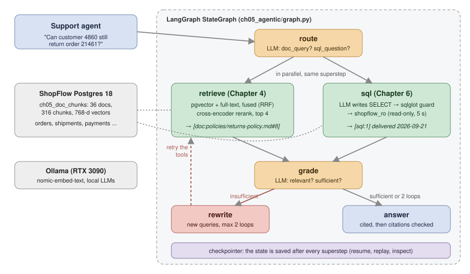
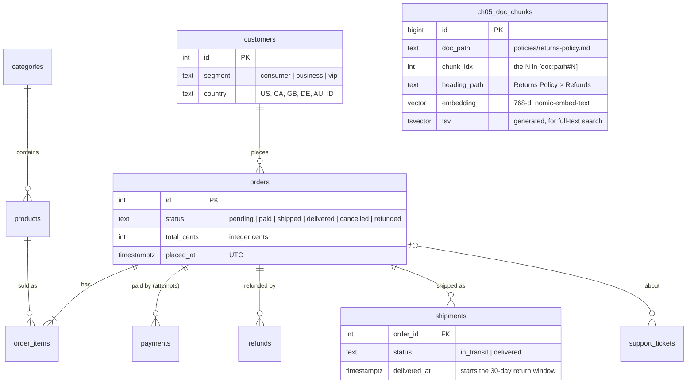
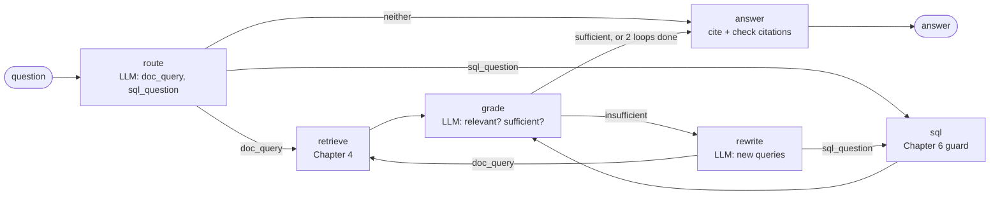
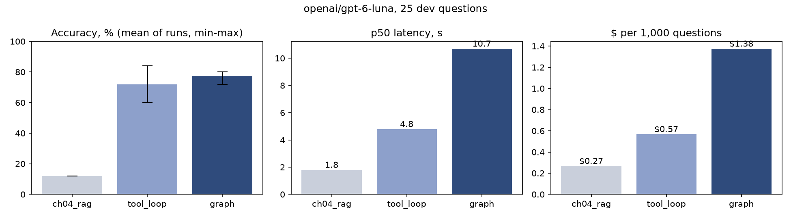
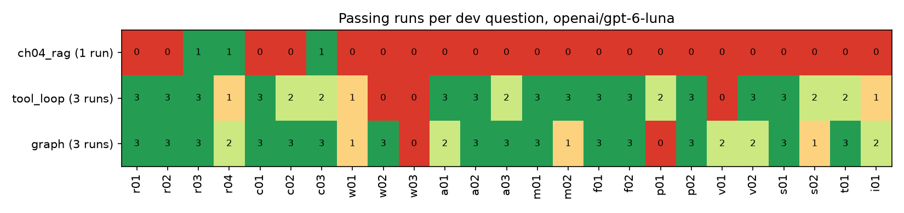

# Chapter 5: Agentic RAG over documents and data

> **Tested on:** 2026-11-09 · Ubuntu 22.04 (NVIDIA RTX 3090, 24 GB) · Python 3.12 · Postgres 18 +
> pgvector · openai/gpt-6-luna, anthropic/claude-haiku-5.5 (judge), anthropic/claude-sonnet-5.5
> (judge check) via OpenRouter; nomic-embed-text via Ollama · langgraph 1.2.20, openai 3.46,
> sqlglot 30.30, sentence-transformers 6.2 · local chat model: qwen3:8b via Ollama 0.40.15 (GPU,
> context 8192, 4 parallel slots), **measured** 2026-11-09 (see [Results](#results))

In April 2025, Cursor's support bot, "Sam", told a developer that being logged out when switching
machines was "expected behavior" under a one-device-per-subscription policy. No such policy
existed. The bot made it up. Users posted their cancellations on Reddit, and a co-founder had to
apologize on Hacker News ([WIRED / Ars Technica](https://www.wired.com/story/cursor-ai-hallucination-policy-customer-service/)).
A support answer has two halves: the *rule* (what the policy says) and the *facts* (what
happened to this customer). A bot that has only one of them fills in the other.

Chapter 4 gave ShopFlow a cited answer engine over its 36 policy documents. It finds the right
policy, but it only knows what the documents say. Chapter 6 builds a safe way to query the
database, and here we borrow it as a ready-made tool. Support agents ask questions that need both
at once. *"Can customer 4226 still return order 21063?"* needs the order's delivery date **and**
the 30-day return window.

This chapter, the second in the data and retrieval part of the book, builds an agent for those
questions. It decides what to look up, checks whether what it found is enough, looks again if
not, and answers with citations to both sources. We build it twice: once as a plain tool loop
and once as a LangGraph state machine. Then we measure both against Chapter 4's pipeline on 25
questions of this kind.



## The problem

The opening question is not a rare case at ShopFlow. The company has about 40 support agents, and
a typical ticket needs both a policy lookup and an order lookup:

> *Order 28460 arrived damaged and customer 4775 prefers a full refund. Who has to approve it?*

The handbook says agents approve up to $100.00, team leads up to $500.00, and Finance anything
above that. The order says the total is $578.97. Neither source answers the question alone.
Today an agent opens the admin tool, then the wiki, and then does the arithmetic. A wrong answer
costs either a customer (refused when they shouldn't be) or money (refunded when they shouldn't
be, or approved by someone who wasn't allowed to).

So what happens if we hand the headline question to the system we already have? Chapter 4's
pipeline says the honest thing and stops. This is real output from the notebook; note which
documents it retrieved:

```
Q: Can customer 4226 still return order 21063?
A: I can't find that in the ShopFlow documents.
retrieved: ['[doc:faq.md#1]', '[doc:faq.md#3]', '[doc:policies/returns-policy.md#0]', '[doc:policies/returns-policy.md#5]', ...]
```

The returns policy was in its context, and the pipeline correctly refused to guess the rest. The
missing half lives in the database, in `shipments.delivered_at`: 2026-09-21. That is 49 days
before the run, so the answer is no. We need a system that can fetch both halves.

## Requirements

That gives us the goal. Before we build anything, let's agree on what "done" means. The agent
must do four things:

- **Answer questions that need both halves.** A question that needs a database fact and a policy
  rule gets a fully correct answer. We test this with 25 hard questions and want at least 80% of
  them fully correct.
- **Show its evidence.** Every answer cites both kinds of evidence: documents as `[doc:path#N]`
  and query results as `[sql:N]`. Invented citations: zero.
- **Never change the data.** All SQL is read-only and guarded. We use Chapter 6's AST guard (a
  check on the parsed query) plus the read-only `shopflow_ro` role, and expect zero writes.
- **Retry, but not forever.** When the evidence is not enough, the agent may rewrite its queries
  at most 2 times.

It also has to work as a tool for busy people:

- **Answer within half a minute.** A support agent is waiting, not a customer. So p95 latency
  (the time that 95% of questions finish within) must stay under 30 s.
- **Stay cheap.** Under $5 per 1,000 questions.
- **Survive a provider failure mid-answer.** The agent resumes from a checkpoint (a saved copy of
  its state) instead of redoing finished work.

At the end of the chapter we check this list against measured numbers.

## The data

Both halves of every answer live in the same Postgres 18 database
([datasets/shopflow](../datasets/shopflow/README.md)). The first source is the 36 Markdown
documents (policies, FAQ, internal handbook, runbooks). We chunk them and embed them into
`ch05_doc_chunks`. The second source is the ShopFlow tables, which the agent reads through the
read-only role `shopflow_ro`.

The diagram shows the tables the questions touch most. Look at `shipments.delivered_at`: it
starts the 30-day return window, so many answers depend on it.



These commands start the database, load the documents and build the question sets:

```bash
docker compose -f datasets/shopflow/docker-compose.yml up -d
cd ch05/01_main-chapter-code
uv run python setup_db.py                    # chunk + embed the docs into ch05_doc_chunks
uv run python -m ch05_agentic.evalset        # build the 25 questions from today's data
```

```
{'chunker': 'heading', 'docs': 36, 'chunks': 316, 'seconds': 15.7, 'rows': 316}
(30433, 29138, 1560) <- orders, shipments, tickets
```

The output confirms 316 chunks from the 36 documents, plus the order, shipment and ticket counts
that the questions are drawn from.

### 25 questions that need both halves

With the data in place, we need questions that force the agent to use both sources. "Can they
still return it?" depends on today's date, so the questions can't be a static file.
[`evalset.py`](01_main-chapter-code/ch05_agentic/evalset.py) has 25 templates. Each one picks a
real row that fits, such as a Beauty order delivered 5–15 days ago, a pending order, or a
customer just short of VIP. It then computes the gold facts (the facts a correct answer must
state) with hand-written SQL plus [`policy.py`](01_main-chapter-code/ch05_agentic/policy.py).
That file holds the policies written as code, with a comment citing the document behind each
constant. The table lists the templates and what each one forces the agent to combine:

| Templates | What the agent must combine |
|---|---|
| return window open / closed, opened Beauty, damaged opened Grocery | delivery date + category + returns policy |
| cancel a paid order / a shipped order, a pending order | order status + payments + cancellation policy |
| Electronics warranty, expired 90-day warranty, open 90-day warranty | delivery date + category + warranty table |
| who approves a full refund (3 amounts) | order total + approval limits |
| "delivered but never arrived" open / closed | delivery date + 14-day claim window |
| refund for "changed my mind" / for a defect | subtotal, shipping + deductions |
| price adjustment open / closed | *payment* date (not order date) + 7-day window |
| does a VIP pay shipping; how far from VIP | segment, yearly completed spend + VIP rules |
| was shipping charged right (twice) | subtotal, discount + "$75 *after discounts*" |
| a support ticket about a swelling power bank | ticket body + safety escalation rules |
| when will an order to Australia arrive | ship date, country + international shipping |

Two choices keep the gold answers honest. First, every case sits at least 3 days away from a
policy boundary. That way an off-by-one reading of "within 30 days" can't flip a verdict. The
boundaries themselves are unit-tested in `policy.py`. Second, there are two sets. We looked at
the **dev set** while improving prompts. The **held-out set** uses the same templates on
different rows, and we ran it once at the end. Two of the 25 held-out questions reuse the dev
row, because only one row in the data fits the template: the finance-sized damaged order and the
swelling power bank ticket.

One of the questions found a real data bug. The original seed applied the $75.00 free-shipping
threshold *before* discounts, while the
[shipping policy](../datasets/shopflow/docs/policies/shipping-policy.md) says *after*. That is
now fixed in the data (2026-11-09 seed). The old `s01` template probed the bug: an order that
wrongly paid $0.00 shipping. So we rewrote it as `shipping_after_discount`. Its customer had a
cart over $75 before a discount and under $75 after it, and was correctly charged $5.99. The
agent must apply the threshold after the discount and say the charge was right. `s02` keeps the
opposite case: free shipping that was correct.

## Concepts

We now have the data and a test. Before we build the agent, four ideas help: what makes a system
an agent, why these questions are "multi-hop", how to grade evidence before answering, and how
LangGraph structures the control flow.

### From pipeline to agent: who decides the next step?

Chapter 4's pipeline is a fixed recipe: retrieve, then generate. The code decides every step.
An *agent* lets the model decide some of them: which tool to call, with what input, and whether
it has enough to stop. Think of the pipeline as a form letter, and the agent as a clerk who can
walk to two filing cabinets.

Anthropic's widely cited guide draws the same line. *Workflows* run LLMs and tools "through
predefined code paths". *Agents* "dynamically direct their own processes and tool usage". The
guide recommends the simplest thing that works, because agentic systems "often trade latency and
cost for better task performance" ([Anthropic](https://www.anthropic.com/research/building-effective-agents),
2024). That trade is exactly what this chapter measures.

We build two agents that sit at different points on that line. Compare the rows to see how much
each one leaves to the model:

| | plain tool loop | LangGraph graph |
|---|---|---|
| who picks the next step | the model, every turn | the model fills in *what* to look up; edges in code decide *what runs next* |
| when it stops | when the model stops calling tools, or after 8 turns | after a grader says "sufficient", or after 2 rewrites |
| retries | whatever the model decides | a rewrite node with an explicit loop counter |
| parallel tool calls | if the model emits several | both tools fan out in the same step |
| state | a growing message list | a typed dict with reducers, saved after each step |

The tool loop trusts the model with everything. The graph keeps the model for the judgment calls
and moves stopping, retries and parallel calls into code.

### Multi-hop: the answer is a join

Both agents exist to solve one kind of question. "Multi-hop" means the answer needs facts that
live in different places, combined. Here the hops are almost always *database → document →
arithmetic*: the delivery date (SQL), the window (docs), and then "2026-09-21 + 30 days =
2026-10-21, today is 2026-11-09, so no". Retrieval alone can't answer, because the order isn't in
any document. Text-to-SQL alone can't either, because the 30 days aren't in any table.

> [!NOTE]
> **In the wild:** In April 2025, Cursor's AI support agent told a user that being logged out on
> other machines was "expected behavior" under a one-device-per-subscription policy that didn't
> exist; a co-founder later apologized and said AI support replies are now labeled
> ([WIRED / Ars Technica](https://www.wired.com/story/cursor-ai-hallucination-policy-customer-service/),
> 2025-04-19). The bot had a fact (sessions were being invalidated, a backend bug) and no rule, and
> filled the gap. Half the evidence is the most dangerous amount.

### Grade, then rewrite: corrective RAG

Getting both halves is only part of the job. The agent also has to know when it has them. A
retriever always returns *something*: five nearest chunks exist even when none of them is
relevant. The fix the research community settled on is to grade what came back before
answering. The CRAG paper adds "a lightweight retrieval evaluator" that scores the retrieved
documents and triggers different actions when they're poor
([Yan et al., 2024](https://arxiv.org/abs/2401.15884)). LangGraph's own agentic RAG tutorial
implements it as a `grade_documents` edge, which routes to `rewrite_question` when the documents
aren't relevant
([LangChain docs](https://docs.langchain.com/oss/python/langgraph/agentic-rag)).
We grade the *combination*: do we have both the facts about this order and the rule that applies
to them?

### LangGraph in five words: state, nodes, edges, checkpoints

A grade-and-rewrite loop needs a place to keep what it has found and a rule for where to go
next. [LangGraph](https://docs.langchain.com/oss/python/langgraph/graph-api) (1.2 here) gives us
both. It models an agent as a state machine:

- **State** is a typed dict shared by every node. Ours holds the question, the queries, the
  evidence found so far, the loop counter and the answer.
- **Nodes** are plain functions `state -> partial update`. A node never calls the next node.
- **Edges** decide what runs next. A *conditional edge* is a function of the state. So "loop at
  most twice" is an `if` in our code, not a sentence in a prompt.
- **Reducers** say how updates merge. `evidence: Annotated[list[dict], operator.add]` lets the
  retrieve and SQL nodes run in parallel and both append, instead of one overwriting the other.
- **Checkpoints** save progress. With a checkpointer, LangGraph saves the state after every
  *superstep* (the set of nodes that run together). A failed run can resume from the last
  checkpoint, and every past state can be inspected or replayed.

One company reports running a support assistant on LangGraph:

> [!NOTE]
> **In the wild:** Klarna's AI assistant, built on LangGraph, handled 2.5 million conversations
> and does work LangChain equates to 700 full-time staff. LangChain credits a "controllable agent
> architecture" that routed requests by task, and reports average resolution time down 80%
> ([LangChain](https://www.langchain.com/blog/customers-klarna), 2025; a vendor case study, so
> read the numbers as Klarna's best case).

> [!NOTE]
> **In the wild:** Lyft's support agents use a LangGraph router that dispatches each rider or
> driver request to a specialized subgraph, and a custom `DynamoDBSaver` checkpointer for state
> across turns, used for "conversation replay, debugging, and state inspection in production".
> New configurable agents went from about six months to about two weeks of development
> ([Lyft guest post on the LangChain blog](https://www.langchain.com/blog/lyft-built-a-self-serve-ai-agent-platform-for-customer-support-with-langgraph-and-langsmith), 2026-05-27).

## v0: the Chapter 4 pipeline

Before we build anything new, we need a baseline to beat. It is Chapter 4's best configuration,
unchanged. It uses heading-aware chunks and hybrid search (pgvector plus Postgres full text,
fused with Reciprocal Rank Fusion). A cross-encoder reranker then keeps the top 5 chunks, and the
cited-answer prompt must refuse when the context doesn't hold the answer. Note that the question
goes straight to retrieval:

```python
# ch05/01_main-chapter-code/ch05_agentic/variants.py (excerpt)
def ch04_rag(question: str, llm: LLM, docs: DocSearch, today: str | None = None) -> Result:
    """Chapter 4 unchanged: the question goes straight to retrieval, no tools, no database."""
    hits = docs.search(question, k=5)
    context = "\n\n---\n\n".join(h.render() for h in hits)
    text = llm.text([{"role": "system", "content": prev.RAG_SYSTEM},
                     {"role": "user", "content": f"Context:\n\n{context}\n\nQuestion: {question}"}],
                    usage, "answer")
```

There is no database tool anywhere in this path. Whatever is not in the documents, v0 cannot
know.

## Measuring v0

We already saw v0 fail on the headline question. One example is not a measurement, so we run it
on both question sets. The model is `openai/gpt-6-luna` ($0.10 / $0.50 per 1M input/output
tokens on OpenRouter, as of 2026-11), with one run on each set. Look at the gap between the
retrieval row and the accuracy rows:

| | dev (25) | held-out (25) |
|---|---|---|
| fully correct (every gold fact stated) | 12.0% (3/25) | 8.0% (2/25) |
| gold facts stated | 19.5% | 19.5% |
| a chunk from the right policy document retrieved | 88.0% | 88.0% |
| answers that cite the database | 0% | 0% |
| p50 / p95 latency | 1.8 s / 2.6 s | 1.8 s / 3.0 s |

Retrieval wasn't the problem: 88% of the time the right policy was in the context. The problem
is that no document contains order 21063. Five of the 25 answers on each set were the exact
refusal string. Most of the rest stated the rule and said the order details were missing. That
is honest, and useless to a support agent. The three dev passes were the three questions whose
answer doesn't depend on the order:

- *"they opened the Beauty item and don't like it"*: opened Beauty is never returnable.
- *"the Grocery item arrived damaged and was opened"*: the damaged-item exception covers opened
  Grocery.
- *"the order is still pending: was the customer charged?"*: failed payment attempts are never
  charged, and pending orders cancel themselves after 48 hours.

On the held-out set the first two passed again, and the pending-order question didn't. Chapter
4's pipeline is a good documentation search. It isn't a support agent.

## Iterating

v0 can read the policy but not the order. Each step below starts from what the previous version
got wrong, either in the numbers or in its traces.

### 1. Give the model tools: a plain tool loop

**What's wrong:** the pipeline can read the policy but not the order. **Options:** (a) always
run a fixed SQL template per question type, or (b) let the model write SQL itself and call it as
a tool, next to document search. Fixed templates break on the first question nobody planned
for. So we give the model two tools and a loop, the shape every agent framework starts from:

```python
# ch05/01_main-chapter-code/ch05_agentic/variants.py (excerpt)
for turn in range(max_turns):
    last = turn == max_turns - 1
    resp = llm.complete(messages, usage, f"turn{turn + 1}", tools=TOOLS,
                        tool_choice="none" if last else "auto")
    msg = resp.choices[0].message
    if not msg.tool_calls:
        text = (msg.content or "").strip()
        break
    messages.append(msg.model_dump(exclude_none=True))
    for call in msg.tool_calls:
        out = _call_tool(call.function.name, call.function.arguments, docs, evidence)
        messages.append({"role": "tool", "tool_call_id": call.id, "content": out})
```

The loop calls two tools. `search_docs(query)` is Chapter 4's retriever (top 4). `run_sql(sql)`
is Chapter 6's guard plus the read-only role. A rejected query comes back to the model as the
tool result, so the model can fix it. The system prompt holds the answer rules: cite every
sentence with `[doc:…]` or `[sql:N]`, apply the rule to the facts, and show date arithmetic. It
also holds a 30-line schema summary condensed from Chapter 6's semantic context.

On the headline question it made two tool calls and got the answer right. Here is the trace from
the notebook; note that it queried the database first and the policy second:

```
{'step': 'run_sql', 'args': '{"sql":"SELECT o.id AS order_id, o.customer_id, o.status, (s.delivered_at AT TIME
  ZONE \'America/New_York\') AS delivered_at_local, (now() AT TIME ZONE \'America/New_York\')::date - ...'}
{'step': 'search_docs', 'args': '{"query":"return window number of days after delivery return eligibility policy unused condition"}'}

No—the order was delivered on 2026-09-21, and 49 days have elapsed as of 2026-11-09, beyond the 30-day
return window. [sql:1] Items generally must be returned within 30 days of delivery, unused and in their
original packaging; the category-specific rules may also apply. [doc:policies/returns-policy.md#1]

4405 ms, 2 LLM calls, $0.00042
```

This is the answer v0 couldn't give: the delivery date from `[sql:1]`, the 30-day rule from the
returns policy, and the arithmetic in between.

> [!TIP]
> OpenAI's docs say gpt-6-luna supports function calling on Chat Completions only with
> `reasoning_effort="none"`. Through OpenRouter, with `require_parameters` so nothing is silently
> dropped, we got the same `run_sql` tool call with `"none"`, `"low"` and no setting at all (see
> the notebook). We use `"none"` everywhere anyway: it is also what turns off qwen3's thinking on
> Ollama. Claude Sonnet 5.5 is the opposite: it rejects `"none"` with HTTP 400, "Reasoning is
> mandatory for this endpoint".

### 2. Make the control flow explicit: a LangGraph state machine

The loop works, but everything about *how* it works lives in the model's head. The model decides
whether to search docs at all, when it has enough, and how many times to retry. When it fails we
can read the message list, but we can't point at the step that should have gone differently.
We also can't test the control flow without a model. So we write the steps down as a graph.
Follow the arrows out of `grade`: they are the only way the agent can loop.



`retrieve` and `sql` run in parallel, in the same superstep, because `dispatch` returns both
names. The edges and their conditions are the whole control flow:

```python
# ch05/01_main-chapter-code/ch05_agentic/graph.py (excerpt)
def dispatch(state: AgentState) -> list[str]:
    targets = [n for n, key in (("retrieve", "doc_query"), ("sql", "sql_question"))
               if state.get(key)]
    return targets or ["answer"]

def after_grade(state: AgentState) -> str:
    if state["sufficient"] or state["loops"] >= max_loops:
        return "answer"
    return "rewrite"

g = StateGraph(AgentState)
...
g.add_edge(START, "route")
g.add_conditional_edges("route", dispatch, ["retrieve", "sql", "answer"])
g.add_conditional_edges("rewrite", dispatch, ["retrieve", "sql", "answer"])
g.add_edge("retrieve", "grade")
g.add_edge("sql", "grade")
g.add_conditional_edges("grade", after_grade, ["answer", "rewrite"])
g.add_edge("answer", END)
```

Nothing in this code asks the model whether to stop. The cap on loops is the `if` in
`after_grade`.

The state is plain JSON. The lists that two nodes may write in the same step get a reducer, so
neither write is lost:

```python
# ch05/01_main-chapter-code/ch05_agentic/graph.py (excerpt)
class AgentState(TypedDict, total=False):
    question: str
    doc_query: str | None
    sql_question: str | None
    loops: int
    evidence: Annotated[list[dict], operator.add]  # retrieve and sql both append
    grades: Annotated[list[dict], operator.add]    # every grade decision, to explain loops
    ...
```

Every node is a plain function, and the model is passed in. That makes the control flow
unit-testable with a scripted fake model and no network. The tests check that the fan-out runs
`grade` once after both tools, that the rewrite loop stops at exactly 2, and that a rewrite can
target one tool. They also check that SQL citations keep counting across loops and that an
invented citation is flagged
([`tests/test_ch05_graph.py`](01_main-chapter-code/tests/test_ch05_graph.py)).

Here is the graph running in the terminal, on the approval question. Watch the `grade` lines. The
first retrieval missed the approval table, and the grader said so. One rewrite, with the dollar
amount in the query, found it. This is real output, recorded on the 2026-11-07 data before the
re-seed, when customer 4775's $578.97 order had the id 28455. Times include loading the reranker:

```
$ uv run python cli.py "Order 28455 arrived damaged and customer 4775 prefers a full refund. Who has to approve it?"
[route     1389 ms] doc_query='approval requirements for full refunds on damaged orders' sql_question='Order
                    28455: order status, total and paid amounts, delivery date, product category, ...'
[sql       5168 ms] [sql:1] 1 row(s)
[retrieve  7235 ms] [doc:handbook/refund-approval-limits.md#5] [doc:handbook/refund-approval-limits.md#2]
                    [doc:handbook/refund-approval-limits.md#4] [doc:handbook/support-escalation.md#8]
[grade     1490 ms] sufficient=False relevant=['[doc:handbook/refund-approval-limits.md#2]',
                    '[doc:handbook/refund-approval-limits.md#5]', '[sql:1]']
[rewrite   1940 ms] doc_query='Full refund approval thresholds and required approver for a $578.97
                    damaged-order refund' sql_question=None
[retrieve    94 ms] [doc:handbook/refund-approval-limits.md#1]
[grade     1232 ms] sufficient=True relevant=['[doc:handbook/refund-approval-limits.md#1]', '[sql:1]']
[answer    1534 ms]

Finance has to approve the full refund through the `finance-approvals` channel: the order's total is
$578.97, which is above $500.00. [sql:1] The order was delivered on 2026-11-02 and has no prior refunds, so
the full refund amount is $578.97; the policy requires posting the order ID, amount, reason, and ticket
link, and waiting for Finance to confirm before issuing it. [sql:1] [doc:handbook/refund-approval-limits.md#1]

total 14926 ms, model=openai/gpt-6-luna
```

The rewrite used a fact from `[sql:1]`, the $578.97, to sharpen the document query. That's why
the rewrite node gets the SQL rows. The first `retrieve` took 7.2 s because it loaded the
reranker (on the CPU here, see [Production hardening](#production-hardening)). The second took
94 ms.

> [!IMPORTANT]
> **Decision: LangGraph over a hand-written loop, once there are branches and retries.** The plain
> tool loop is about 40 lines and was our first working agent. It stays the right choice while the
> flow is "call tools until done", and on this eval it was within run-to-run noise of the graph
> (see [Results](#results)).
> We moved to a graph for what the loop can't give us: retries with a hard cap enforced in code,
> two tools in parallel, a grader whose decision we can log and test, and checkpoints to resume
> or replay a question. In a hand loop each of those is more `if`s around one growing message
> list; in LangGraph they're nodes and edges we can unit-test one by one with a fake model.
> Practitioners split the same way: on Hacker News one called LangChain "a meaningless
> abstraction" while finding LangGraph's graph "a very useful mental model for thinking about an
> agentic flow" ([HN](https://news.ycombinator.com/item?id=43468435), 2025). Stay with the hand
> loop for one or two tools and no business branches, or when you can't absorb a dependency that
> has shipped breaking changes. Move to the graph when the flow has steps someone must be able to
> audit: an approval gate, a human in the loop, a retry budget.

### 3. Stop the grader from chasing evidence that doesn't exist

The graph gave us control, but control isn't free. The first graph we ran was only a little more
accurate than the tool loop, about twice as slow, and made more than twice as many LLM calls per
question. (The development runs are archived in `eval/results/pre-reseed/`. They ran on the
database before it was re-seeded, so we don't compare their numbers with the final results.)
Reading the traces showed two kinds of waste:

- **The grader asked for things no system holds.** For *"the price of an item dropped today"* it
  wanted price history. For a defect report it wanted the customer's photo. For a missing parcel
  it wanted proof the customer checked with the neighbours. Each request triggered a rewrite, a
  new SQL query that found nothing, and another rewrite, until the loop cap. The slowest
  questions used every allowed loop and still hedged.
- **The rewrite was blind.** It saw what was missing but not what SQL had already found. Take the
  power bank that "stopped charging". Three searches for the warranty kept asking about the
  *Premium Power Bank* instead of the *Electronics* warranty period. The answer then said the
  warranty period "is not specified in the evidence".

We made three prompt changes, all generic. The grader treats what the customer says, photos,
price history and live tracking as "never missing". The rewrite node gets the SQL rows. The
answer node takes the question's premise as given and states unverifiable conditions instead of
refusing. The router also asks SQL, in one query, for everything a policy can depend on: status,
amounts, dates, category, segment and country. Each change raised dev accuracy and lowered the
number of calls. The final graph is what [Results](#results) measures.

### 4. Grade what was asked, not everything we knew

Some failures were not the agent's fault: they came from how we graded. The first gold answers
listed every fact we could compute. For *"Can customer 4860 still return order 21461?"* (a
development question on the pre-reseed data), they required the verdict, the delivery date
**and** the date the window closed. Answers that said "No, delivered 2026-09-21, 47 days ago,
beyond the 30-day window" failed. That measured verbosity, not correctness. The gold facts now
keep the claim the question asks for and put supporting details in parentheses. The judge must
not see those details contradicted, but doesn't require them:

```python
# ch05/01_main-chapter-code/ch05_agentic/evalset.py (excerpt)
add(Question("r02", "return_closed",
             f"Can customer {r['customer_id']} still return order {r['id']}?",
             [("No, the 30-day return window has closed (delivered "
               f"{day(r['delivered_at'])}, {r['days']} days ago)")], ret_docs, r))
```

We also made the judge write its reasons *before* its booleans. In one development run, Haiku
wrote "fact 2 is actually stated" and then returned `false` for it. Generating the verdict after
the reasoning keeps the two consistent. The judge itself needed a check too:

> [!IMPORTANT]
> **Decision: a cheap judge with gold facts, checked against a strong judge, over grading every
> run with the strong model.** `anthropic/claude-haiku-5.5` grades 25 answers for about $0.004,
> because it only compares an answer with a short list of facts. We paid
> `anthropic/claude-sonnet-5.5` once ($0.0385) to re-grade the first 12 graph answers of the
> final dev run: they agreed on 10. Both disagreements went the same way, Haiku failing an answer
> that Sonnet passed: one said a support agent can approve the $47.96 refund without repeating
> the $100.00 limit, a detail the gold fact puts in parentheses; the other offered the full refund
> but said its amount wasn't established. An earlier check during development agreed on 11 of 12,
> with the same parenthetical pattern, so Haiku is, if anything, slightly strict. Twelve answers
> is a small sample: re-check agreement whenever you change the judge prompt or the gold format.

> [!WARNING]
> Changing the grading changes every number. We changed prompts and gold facts in the same
> development rounds, so we can't say how much each change contributed. All numbers in
> [Results](#results) use the final prompts and the final grading, on one consistent database.

### 5. Survive a failure halfway through: checkpoints

The last requirement is about bad days at the provider. A question costs the graph about 6 LLM
calls. If the provider times out on the last one, a plain loop starts over. With a checkpointer,
LangGraph has saved the state after every superstep. So we resume the thread, and only the failed
node runs again. To test this, the notebook makes the `answer` node raise an error once:

```
run 1 failed: simulated provider timeout | LLM steps so far: ['route', 'sql_plan', 'grade', 'answer']
next node to run: ('answer',) | evidence saved: ['[doc:handbook/support-escalation.md#8]',
  '[doc:handbook/refund-approval-limits.md#6]', '[doc:policies/price-adjustment-policy.md#7]',
  '[doc:policies/returns-policy.md#1]', '[sql:1]']
run 2 (resumed) LLM steps: ['route', 'sql_plan', 'grade', 'answer', 'answer']
No, the 30-day return window has passed: the order was delivered on 2026-09-21, and 30 days later was
2026-10-21; today is 2026-11-09, 49 days after delivery. [sql:1] [doc:handbook/support-escalation.md#8] ...

6 checkpoints in this thread, newest first:
  step  4  next=()
  step  3  next=('answer',)
  step  2  next=('grade',)
  step  1  next=('retrieve', 'sql')
  step  0  next=('route',)
  step -1  next=('__start__',)
```

The resume made exactly one more LLM call: `answer` appears twice in run 2's list, and nothing
else repeats. Step 1's `next=('retrieve', 'sql')` is the parallel fan-out: both tools ran in the
same superstep.

The same mechanism gives us `get_state_history`: every intermediate state of every question.
That is how we read the grader's `missing` strings in step 3.

> [!IMPORTANT]
> **Decision: `InMemorySaver` in the chapter, a database saver in production.** The in-memory
> saver keeps the demo and the tests self-contained, and disappears with the process. A real
> deployment needs `PostgresSaver` (Chapter 10) or a custom saver like Lyft's DynamoDB one, plus a
> retention job (see [Production hardening](#production-hardening)).

## Production hardening

The agent now works in the lab. Running it for real means every part
that can loop, invent, grow or break needs a hard limit. Here is what we put in place, and what
broke while we ran this chapter.

**Every loop has a number on it.** Rewrites stop at 2 (`MAX_LOOPS`, an edge condition). Chapter
6's SQL self-correction stops at 2 plans per question, and the tool loop at 8 model turns.
LangGraph's own `recursion_limit` (25 supersteps; our graph needs at most 10) is the backstop in
case we break an edge one day. Practitioners have hit the unbounded version. One text-to-SQL
agent on LangGraph kept retrying the same failing query "until recursion limit error is hit",
and its stop condition was written only in the prompt
([langgraph#6731](https://github.com/langchain-ai/langgraph/issues/6731), 2026). A prompt is a
request; an edge is a guarantee.

> [!WARNING]
> The default `recursion_limit` counts supersteps, not dollars. A graph that loops 20 times on a
> large model can spend real money before it raises `GraphRecursionError`. Put the business
> limit (loops, calls, tokens) in your own state and edges, and keep the recursion limit as a
> crash barrier above it.

**Check citations in code, not in the prompt.** The answer node extracts every `[doc:…]` and
`[sql:N]` tag and compares it with the evidence the graph actually holds
(`tools.check_citations`). An invented tag is flagged, and the grader can't mark unknown
evidence as relevant either (both are unit-tested).

**The database guard is Chapter 6's, unchanged.** The model writes SQL. `validate_sql` parses it
with sqlglot and rejects anything but a single `SELECT` over the ten allowed tables. Our own
`ch05_doc_chunks` is not on the list. `run_query` then runs the query as `shopflow_ro` with a
5-second timeout. A guard rejection or Postgres error goes back to the SQL planner once; the tool
loop receives it as a tool result.

**Shared hardware fails in boring ways.** Three things broke while we ran this chapter, and none
of them was the model:

- The cross-encoder reranker died with `CUDA out of memory` halfway through an eval. Another
  user's job had taken 22 of the GPU's 24 GB *after* our process started. Chapter 4 chose "cuda"
  whenever a GPU existed. Our copy (`rerank_device` in `previous_chapters.py`) uses the GPU only
  when 1 GiB is free, and otherwise the CPU, where 30 pairs still score in well under a second.
- Query embeddings stalled for minutes. The single Ollama server was busy generating text for
  other jobs, and our 4 embedding calls per question waited in its queue. On this host the fix
  was a second Ollama instance just for embeddings (one URL change in `.env`). In production,
  don't put latency-critical embeddings behind the same queue as batch generation.
- The first version of the eval printed dates with `strftime("%a")`, which follows the machine's
  locale. On this server it printed "Sel 2026-11-24", Indonesian for Tuesday. A judge comparing
  "Sel" with "Tue" is a coin flip. The gold facts now use ISO dates only.

**Checkpoint storage grows.** `InMemorySaver` is for notebooks and tests. In production, use a
database-backed saver (`langgraph-checkpoint-postgres`, used in Chapter 10). Plan the cleanup
from day one, because every superstep writes a checkpoint. One user asked how to keep Postgres
checkpoint tables "from growing unbounded". The answer: TTLs are a feature of the hosted
LangGraph Platform, and open-source users should sweep old threads themselves
([langgraphjs#1138](https://github.com/langchain-ai/langgraphjs/issues/1138), 2025). Keep large
payloads (whole documents, big row sets) out of the state, or store references to them.

**Answers act on the user's premise.** "The price dropped today" can't be verified, because
ShopFlow has no price history table. Early versions of the agent kept rewriting queries to look
for one, and then answered "no adjustment is due". The answer prompt now says to take the
question's statements as given. It also says to state any unverifiable condition ("if the item is
unused") instead of refusing. That's a product decision, not a prompt trick: the support agent
asking the question is the one who saw the price drop.

## Serving it

With the limits in place, the agent is ready to put in front of support agents. It is a library
call, `GraphAgent(llm, docs)(question)`, plus a terminal front end. The front end streams each
node as it finishes (`app.stream(..., stream_mode="updates")`):

```bash
cd ch05/01_main-chapter-code
uv run python setup_db.py                     # once: chunks + embeddings into ch05_doc_chunks
uv run python cli.py "Can customer 4226 still return order 21063?"
uv run python cli.py "..." --variant tool_loop          # the plain loop, for comparison
uv run python cli.py "..." --model qwen/qwen3.8-flash   # any OpenRouter id, or an Ollama tag
```

Streaming node updates is the cheapest progress UI there is. A support agent who sees
`[sql] 1 row` and `[grade] sufficient=False` after three seconds waits patiently for the other
ten. To put it behind HTTP, wrap the same `stream` call in the Server-Sent Events endpoint from
Chapter 1. Use one LangGraph `thread_id` per support ticket, so a follow-up question resumes the
same checkpointed state.

**Local models.** Every component accepts an Ollama tag. `--model qwen3:8b` sends chat to
`OLLAMA_BASE_URL` (default `http://localhost:11434/v1`), with `reasoning_effort="none"` to turn
off qwen3's thinking. The graph's largest prompt (the grade node, with four chunks plus SQL rows)
is about 3.5k tokens. The tool loop's prompt grows with every turn, so give Ollama a context of
at least 8,192 tokens. We measured `qwen3:8b` (Ollama 0.40.15 on the RTX 3090, context 8,192, 4
parallel slots) with `uv run python eval/run_eval.py --model qwen3:8b`. On the dev set it reached
12% with Chapter 4's pipeline, 0% with the tool loop and 32% with the graph. gpt-6-luna reached
12%, 72.0% and 77.3% (details in [Results](#results)). The 8B model keeps up only where there is
nothing to look up. Once it has to drive the tools, it falls 45 points or more behind. The
notebook runs one live local question when `RUN_LOCAL=1` is set. On the headline question,
qwen3:8b's graph answered "Yes, customer 4226 can still return order 21063" and then explained
that the window had passed.

## Results

Now we can check every variant against the requirements. `eval/run_eval.py` runs the questions,
and `anthropic/claude-haiku-5.5` judges each answer against the gold facts. All runs used the
same database and question files (2026-11-09 seed, questions built 2026-11-09 08:32 ET). The
tool loop and the graph ran three times on the dev set with `openai/gpt-6-luna`, because one run
of 25 questions moves by several questions from run to run. `qwen3:8b` ran once. Latency is the
median over runs of each run's p50/p95, measured end to end from this server. It includes query
embeddings, which on this run came from a CPU-only Ollama instance while chat models used the
GPU. Cost is OpenRouter's reported `usage.cost` (prices as of 2026-11). It includes
prompt-cache discounts that vary run to run. Local runs cost $0 in tokens (the hosted judge is
not included).

In the table, v0 is Chapter 4's pipeline, v1 the tool loop and v2 the graph. p50 is the median
latency, and p95 is the time that 95% of questions finish within.

| set | model | variant | runs | accuracy, mean (min-max) | facts stated | p50 | p95 | LLM calls / question | $ / 1k questions |
|---|---|---|---|---|---|---|---|---|---|
| dev | gpt-6-luna | ch04_rag (v0) | 1 | 12.0% | 19.5% | 1.8 s | 2.6 s | 1.00 | $0.268 |
| dev | gpt-6-luna | tool_loop (v1) | 3 | 72.0% (60.0-84.0) | 82.9% | 4.8 s | 7.9 s | 2.48 | $0.570 |
| dev | gpt-6-luna | **graph (v2)** | 3 | **77.3% (72.0-80.0)** | 85.4% | 10.7 s | 28.1 s | 6.08 | $1.376 |
| dev | qwen3:8b (Ollama) | ch04_rag (v0) | 1 | 12.0% | 26.8% | 1.8 s* | 2.5 s* | 1.00 | $0 |
| dev | qwen3:8b (Ollama) | tool_loop (v1) | 1 | 0.0% | 12.2% | 1.2 s* | 1.9 s* | 2.12 | $0 |
| dev | qwen3:8b (Ollama) | graph (v2) | 1 | 32.0% | 34.1% | 5.1 s* | 20.3 s* | 5.84 | $0 |
| held-out | gpt-6-luna | ch04_rag (v0) | 1 | 8.0% | 19.5% | 1.8 s | 3.0 s | 1.00 | $0.255 |
| held-out | gpt-6-luna | tool_loop (v1) | 1 | 80.0% | 87.8% | 5.7 s | 9.6 s | 2.44 | $0.583 |
| held-out | gpt-6-luna | graph (v2) | 1 | 84.0% | 90.2% | 11.4 s | 35.0 s | 5.88 | $1.482 |

\* RTX 3090 with only another user's ~2.3 GB application on the card, Ollama 0.40.15 with 4
parallel slots and a context of 8192. Query embeddings still came from the CPU-only Ollama
instance, as for the hosted rows.

Every gpt-6-luna tool-loop and graph run cited both a document and a database result in at least
96% of questions, no answer cited evidence it hadn't retrieved, no SQL query failed, and no run
crashed. Per-run numbers are in the notebook and in `eval/results/`.

The first chart shows accuracy, latency and cost on the dev set. The second shows which dev
questions pass, and in how many runs:





What the numbers say:

- **Tools are the win, not the graph.** Giving the model the database moved accuracy from 12% to
  60-84%. The graph and the tool loop are within run-to-run noise of each other. On the dev set
  the graph's mean is 5.3 points higher, with a smaller spread (72-80 vs 60-84). On the held-out
  set the graph won by 4 points (84 vs 80). Nine dev questions passed in some tool-loop runs and
  failed in others; for the graph it was eight. A single 25-question run can't rank these two.
- **The graph costs 2.4× more, and its p95 is 3.6× slower.** It averages 6.1 LLM calls per
  question (route, SQL planner, grade, answer, plus rewrites), against the loop's 2.5. Of the
  graph's 75 dev answers, the 42 with no rewrite were 83.3% accurate at an 8.9 s median. The 33
  that needed one or two rewrites were 69.7% accurate at 21.4 s. Rewrites mostly happen on
  questions that are hard anyway, and they buy latency more than accuracy.
- **Requirements:** accuracy ≥ 80% is borderline for both agents. The graph reached it in 3 of 4
  runs (72, 80 and 80% on dev, 84% held-out). The tool loop reached it in 2 of 4 (84% and 80%
  held-out, but 60% and 72%). The graph meets the citation, read-only SQL, bounded-retry and
  checkpoint-resume requirements. p95 < 30 s is borderline for the graph: 27.8-35.0 s per run,
  over the target in 1 of 4, the held-out one. Both agents meet the cost target (< $5 per 1,000)
  by a wide margin.
- **What still fails** (see the heatmap): neither agent got the open 90-day warranty (`w03`) in
  any dev run. Both found the closed 30-day window and stopped there. (The tool loop got it on the
  held-out set.) The tool loop also missed `w02` in every dev run: each time it opened with "Yes"
  to "is it still under warranty?" and then explained it had expired. It also missed `v01`, where
  it saw $0.00 shipping but never said the customer is VIP. The graph never passed `p01`: it
  hedged on whether the price had really dropped. The international delivery question (`i01`)
  passed in 1 of 3 tool-loop and 2 of 3 graph dev runs, and in both held-out runs. The rewritten
  `s01` (shipping correctly charged after a discount) passed in every gpt-6-luna agent run.

**Local model: qwen3:8b can't drive the tool loop, and the graph only partly helps.** With no
tools to drive, Chapter 4's pipeline scored the same 12% with qwen3:8b as with gpt-6-luna. In the
tool loop, qwen3:8b called exactly one tool and then answered in 22 of 25 questions (17 only
`run_sql`, 5 only `search_docs`). It used both tools in 2 questions and none in 1. No answer
cited both kinds of evidence, the right policy was retrieved for only 20% of questions, and it
passed none. The graph runs both tools on every question. That lifted retrieval to 80% and
accuracy to 32%. But its SQL planner hit 10 errors on 4 questions, and only 12% of answers cited
both a document and a row. Several answers also misread the numbers they had: "-$224.83" instead
of $91.27 more to VIP; the $79.78 total including shipping instead of the $73.79 after the
discount; an order delivered 2026-06-05 called "within the 30-day window". On the uncontended
card the local graph's p50 was 5.1 s at 5.84 calls per question, against 10.7 s at 6.08 for
hosted gpt-6-luna (both including CPU-side query embeddings). So the local model is not the
bottleneck; its accuracy is.

To reproduce every row of the table:

```bash
cd ch05/01_main-chapter-code
uv run python eval/run_eval.py --model openai/gpt-6-luna                      # dev, all 3 variants
uv run python eval/run_eval.py --model openai/gpt-6-luna --variants tool_loop graph --tag=-r2
uv run python eval/run_eval.py --model openai/gpt-6-luna --variants tool_loop graph --tag=-r3
uv run python eval/run_eval.py --model openai/gpt-6-luna --holdout
uv run python eval/judge_check.py eval/results/graph-openai_gpt-6-luna.json --limit 12
uv run python eval/run_eval.py --model qwen3:8b                               # local, dev set
```

Run history: the numbers above come from a full rerun on 2026-11-09 (started 08:31 ET). It ran
against the 2026-11-09 seed of the ShopFlow database (re-seeded 2026-11-09 00:26 ET: 30,433
orders, with the free-shipping-after-discount fix). This rerun replaced the 2026-11-07 results
and two earlier runs the same day. The question sets were rebuilt from that data, so they differ
from the 2026-11-07 runs. The saved eval runs in `eval/results/` (this rerun plus the archived
development runs) cost $0.86 in total. On top of that come the replaced runs, about $0.10 in runs
that were cut short (two database re-seeds on the shared server dropped our table mid-eval), and
smoke tests.

## Exercises

The results leave some questions open: the order of the tools, the cost of the grader, durable
checkpoints and refusals. These exercises let you measure each one.

1. **Sequential instead of parallel.** Our router sends the doc query and the SQL question out
   at the same time, so the doc query can't use what SQL finds (the product's category, the
   customer's country). Change the graph so `sql` runs first and `route` writes the doc query
   *after* seeing the rows. Re-run `eval/run_eval.py --variants graph`. What happens to accuracy on
   the warranty and international questions, and to p50 latency?
2. **A cheaper grader.** The grade node is one of the most frequent LLM calls. Replace it with a
   rule ("at least one `[sql:N]` without error and at least one doc chunk with a reranker score
   above a threshold") and measure accuracy, calls and cost against the LLM grader.
3. **Persist it.** Swap `InMemorySaver` for `PostgresSaver` from `langgraph-checkpoint-postgres`
   (Chapter 10 uses it) in its own `ch05` schema. Kill the CLI process in the middle of a
   question, start it again with the same `thread_id`, and resume. How many rows did one question
   write?
4. **Grow the eval.** Add a template for a question that should be *refused* (a request to issue
   the refund, or for a customer's email address). Which variant refuses, and which tries?

## What we learned

- A RAG pipeline answers questions about documents. A support question is usually a join between
  a document (the rule) and a database row (the facts); without a database tool, Chapter 4's
  pipeline scored 12% even though it retrieved the right policy 88% of the time.
- Giving the model two tools, Chapter 4's retriever and Chapter 6's guarded SQL, did almost all
  of the work: 60-84% across runs, at least 96% of answers citing both kinds of evidence.
- An explicit graph did not clearly beat a plain tool loop on accuracy with a capable model (77%
  vs 72% mean on dev, inside the run-to-run spread). It cost 2.4× as much and was 2.2× as slow at
  p50. Its value is control: retries capped in code, a grader whose decisions are logged, nodes
  testable with a fake model, and resume from checkpoints.
- With a small local model the structure matters more. qwen3:8b in the plain loop usually called
  one tool and answered, and passed none of the 25 questions; the graph, which always runs both
  tools, reached 32%. That is still far from usable: an 8B model needs the control flow in code,
  and even then it isn't enough here. Without tools (Chapter 4's pipeline) it tied gpt-6-luna at
  12%: model size starts to matter once the model has to decide what to look up.
- Put limits in edges, not prompts. "At most 2 rewrites" is an `if` in `after_grade` with a unit
  test; LangGraph's `recursion_limit` is only a crash barrier.
- A grader will ask for evidence that can't exist (photos, price history) unless told what is
  never missing, and every loop it triggers costs seconds.
- One run of 25 questions is not a measurement: identical code moved by 24 points between runs.
  Repeat runs, keep a held-out set, and check the cheap judge against a strong one.
- Grade what was asked. Gold facts that demand every computable detail measure verbosity.
- Shared infrastructure fails first: a full GPU, a busy embedding queue, a locale, a re-seeded
  database. Fall back, separate queues, use ISO dates, and make setup idempotent.

This chapter treated the database as one of two tools and borrowed Chapter 6's guard to keep it
safe. Many questions need no documents at all, only data: "how many orders today?" Chapter 6
builds that guarded SQL path as a Slack bot, measures how the obvious version fails, and fixes it
layer by layer.

## References

- "An AI Customer Service Chatbot Made Up a Company Policy—and Created a Mess" — Benj Edwards, Ars Technica (via WIRED), 2025-04-19. https://www.wired.com/story/cursor-ai-hallucination-policy-customer-service/
- "Building effective agents" — Anthropic, 2024-12-19. https://www.anthropic.com/research/building-effective-agents
- "Corrective Retrieval Augmented Generation" — Yan, Gu, Zhu, Ling, arXiv, 2024-01-29. https://arxiv.org/abs/2401.15884
- "Build a custom RAG agent with LangGraph" — LangChain docs, accessed 2026-11-07. https://docs.langchain.com/oss/python/langgraph/agentic-rag
- "Graph API overview" — LangChain docs, accessed 2026-11-07. https://docs.langchain.com/oss/python/langgraph/graph-api
- "Checkpointers" — LangChain docs, accessed 2026-11-07. https://docs.langchain.com/oss/python/langgraph/checkpointers
- "GRAPH_RECURSION_LIMIT" — LangChain docs, accessed 2026-11-07. https://docs.langchain.com/oss/python/langgraph/errors/GRAPH_RECURSION_LIMIT
- "How Klarna's AI assistant redefined customer support at scale for 85 million active users" — LangChain, 2025-02-12. https://www.langchain.com/blog/customers-klarna
- "How Lyft Built a Self-Serve AI Agent Platform for Customer Support with LangGraph and LangSmith" — Akshay Sharma (Lyft), LangChain blog, 2026-05-27. https://www.langchain.com/blog/lyft-built-a-self-serve-ai-agent-platform-for-customer-support-with-langgraph-and-langsmith
- "LangGraph [1.0.6] Bug - Agent infinite looping until recursion limit error is hit" — GitHub issue langchain-ai/langgraph#6731, 2026-01-30. https://github.com/langchain-ai/langgraph/issues/6731
- "How do I keep data in Postgres checkpointer database from growing unbounded?" — GitHub issue langchain-ai/langgraphjs#1138, 2025-04-29. https://github.com/langchain-ai/langgraphjs/issues/1138
- "We chose LangGraph to build our coding agent" — Hacker News discussion, 2025-03-25. https://news.ycombinator.com/item?id=43468435
- langchain-ai/langgraph — GitHub. https://github.com/langchain-ai/langgraph
- sqlglot — GitHub. https://github.com/tobymao/sqlglot
