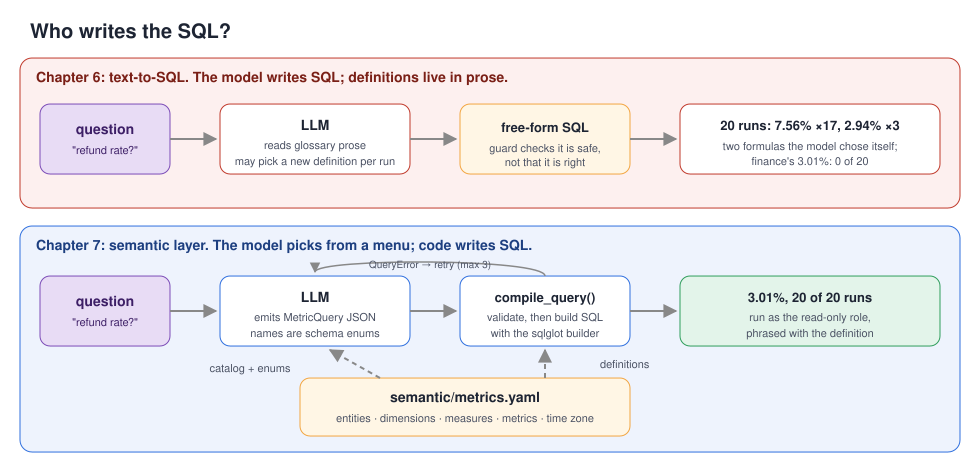
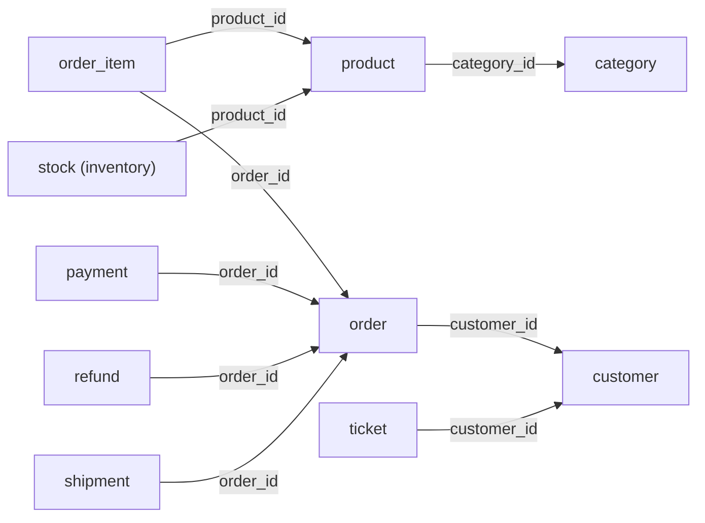
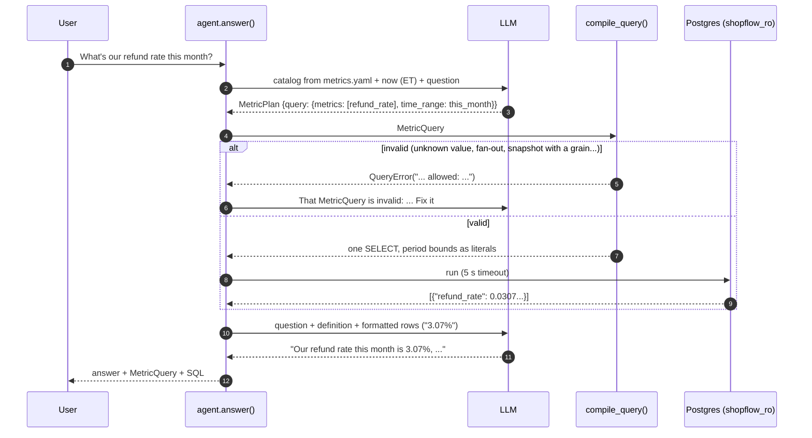
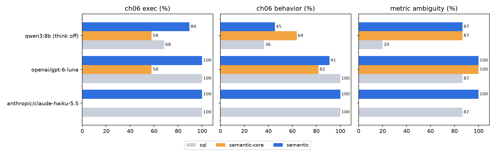
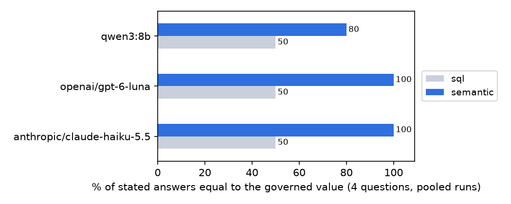

# Chapter 7: Semantic layers

> **Tested on:** 2026-11-07/08 (hosted evals) and 2026-11-09 (local models, consistency, Cube,
> notebook re-run) · Ubuntu 22.04 (NVIDIA RTX 3090, 24 GB) · Python 3.12 · Postgres 18
> (pgvector image) · openai/gpt-6-luna, anthropic/claude-haiku-5.5 (bot) and
> anthropic/claude-sonnet-5.5 (judge) via OpenRouter · qwen3:8b (thinking off) via Ollama 0.40.15
> (GPU, context 8192) · sqlglot 30.30 · Cube 1.6.77 (bonus)

Chapter 6 gave ShopFlow a Slack bot that turns questions like "how many orders today?" into safe,
read-only SQL. Its biggest win was writing business meaning down in a context file. That works
when a metric is defined there, and defined precisely. This chapter asks what happens when a
definition is missing or vague.

We asked Chapter 6's bot "What's our refund rate this month?" 15 times. It answered 6.26% nine
times (refunded dollars ÷ revenue dollars), 3.01% three times (cancelled or refunded orders ÷ all
orders), 2.53% twice (refunds on this month's orders ÷ revenue) and 0% once (integer division).
Finance's definition gives 3.07%. Not one of the 15 answers matched, every query ran without an
error, and the same bot scores 100% on Chapter 6's eval, which never asks about refund rate.

This is the oldest problem in analytics, now running at machine speed. At Airbnb, the CEO asked
"which city had the most bookings in the previous week?" Data Science and Finance used to give
different answers. The company built a metrics platform, Minerva, to end that argument
([Airbnb Engineering](https://medium.com/airbnb-engineering/how-airbnb-achieved-metric-consistency-at-scale-f23cc53dea70)).
In 2026, dbt Labs re-ran its benchmark of LLMs answering business questions: on the same
modeled project, Claude Sonnet 4.6 scored 90.0% writing SQL and 98.2% going through a semantic
layer ([dbt Labs](https://docs.getdbt.com/blog/semantic-layer-vs-text-to-sql-2026), 2026-04-07).

This chapter builds a small semantic layer for ShopFlow. It has three parts: a YAML file of
governed metrics, a ~280-line compiler built on [sqlglot](https://github.com/tobymao/sqlglot),
and an LLM that is no longer allowed to write SQL. The model picks from a menu, and code writes
the query. The picture below shows the difference from Chapter 6.



## The problem

The opening numbers came from a bot that looked finished. Chapter 6 ended at 100% on 30
questions with `openai/gpt-6-luna`. Its context file had a glossary: "Revenue =
sum(total_cents)/100.0 over orders with status in ('paid', 'shipped', 'delivered')". That's a
definition in prose. The model reads it and re-implements it in SQL, every time, for every
question. The table shows the three ways this goes wrong, from least to most precise definition:

| Failure | What we saw (real runs, Chapter 6 v1 bot on this host) |
|---|---|
| **No definition → the model invents one** | "Refund rate" isn't in the glossary. In 15 consistency runs (Luna 10, Haiku 5) we saw four answers: refunds $ ÷ revenue $ (6.26%), cancelled or refunded orders ÷ all orders placed (3.01%), refunds on this month's orders ÷ their revenue (2.53%), and the dollar formula with integer division (0%). The governed number is 3.07%. |
| **A vague definition → a reading nobody chose** | "Active customer: at least one order placed in the last 90 days." Both models read it as `now() - interval '90 days'`, a window that moves during the day and reaches into a 91st calendar day: 4,077 customers at 3 AM. Finance meant 90 calendar days including today: 4,066 all day. |
| **A precise definition → followed** | Net revenue and AOV are spelled out in the glossary, and all 15 hosted consistency runs on each matched the governed number. Prose definitions work when they're precise. They just have to be precise for *every* metric, and be re-implemented correctly on every question. |

Every one of these returned a plausible number, with no error. Only the precise definitions held
up. A semantic layer moves the definition out of the prompt and into code. Then there is exactly
one implementation of "refund rate", and the model's only job is to ask for it by name.

## Requirements

That diagnosis tells us what to build. Before writing code, let's agree on what "done" means.
First, what the new bot must do:

- **Six governed metrics, each defined once.** `transactions`, `gross_revenue`, `net_revenue`,
  `aov`, `refund_rate` and `active_customers` each get one definition, in one file.
- **Correct calendar periods.** Time grains (day, week, month, quarter, year) and periods like
  "last week" are computed in the business time zone. They stay right across daylight saving
  time (DST) changes.
- **No SQL from the model.** The LLM only fills in a `MetricQuery(metrics, dimensions, filters,
  time_range, grain, order_by, limit)`. Code compiles 100% of queries.
- **No step backwards.** On Chapter 6's 30 questions, it does no worse than the Chapter 6 v1 bot.
- **The same right answer every time.** On 15 new questions about ambiguous metrics, it scores
  ≥ 95% and gives the same number on every run.
- **Say no when it should.** It refuses writes, requests for personal data (PII) and questions
  that no metric answers, 100% of the time.

It also has to stay as practical and safe as Chapter 6:

- **Fast and cheap.** The slowest 5% of answers take under 15 s (p95 < 15 s), and 1,000
  questions cost under $1.
- **Safe by construction.** It uses the same read-only database role as Chapter 6, and the
  compiler can't emit anything but one `SELECT`.

At the end of the chapter we check these targets against measured results.

## The data

We'll build against data the reader already knows. It's the same ShopFlow database as Chapter 6
([datasets/shopflow](../datasets/shopflow/README.md)), seeded today. What changes is how we
*describe* it. A semantic layer sees the schema as a graph of **entities** joined by
many-to-one foreign keys. In the diagram, watch the direction of each arrow:



Every arrow points from "many" to "one". Follow arrows and you never multiply rows. Walk one
backwards (from `order` to `order_item`) and every order shows up once per line item. That
asymmetry is the whole trick of the compiler below. To follow along, start the database and the
notebook:

```bash
docker compose -f datasets/shopflow/docker-compose.yml up -d
cd ch07/01_main-chapter-code && uv run jupyter lab ch07.ipynb
```

## Concepts

Before we write the compiler, we need a few terms. They explain what goes into the YAML file and
why the compiler refuses some questions.

### What a semantic layer is

Start with the core idea. A *semantic layer* is a catalog of business metrics, written once.
Every tool compiles it into SQL instead of writing its own. Think of it as the API in front of
your warehouse. Callers ask for `refund_rate by channel, last month`, not for tables and joins.
It's the same way a mobile app calls `GET /orders` instead of opening a database connection.

It has four building blocks. The names follow dbt MetricFlow, and Cube's are similar:

| Block | Meaning | ShopFlow example |
|---|---|---|
| **Entity** | a table and its key, plus its many-to-one joins and its time column | `order`: `orders.id`, dated by `placed_at`, joins to `customer` |
| **Dimension** | a column you can group or filter by | `customer.segment`: consumer \| business \| vip |
| **Measure** | an aggregation over one entity, with optional row filters | `gross_revenue_cents`: `SUM(total_cents)` where status is paid, shipped or delivered |
| **Metric** | what people ask for, built from measures | `aov = gross_revenue / revenue_order_count` |

Metrics come in three types here. **Simple** metrics use one measure, maybe scaled (cents ÷
100). **Ratio** metrics divide a numerator by a denominator, and each is computed on its own
before dividing. **Derived** metrics do arithmetic over other metrics
(`net_revenue = gross_revenue - refunded_amount`). MetricFlow adds cumulative and conversion
metrics ([dbt docs](https://docs.getdbt.com/docs/build/metrics-overview)); we don't need them
yet.

Here is `refund_rate`, the metric Chapter 6 computed three ways. Note that the YAML pins down
both what is counted and what is left out:

```yaml
# ch07/01_main-chapter-code/semantic/metrics.yaml (excerpt)
measures:
  paid_orders: {entity: order, agg: count, filter: "status <> 'pending'"}
  refunded_orders:
    entity: order
    agg: count
    filter: "status IN ('cancelled', 'refunded')"
metrics:
  refund_rate:
    type: ratio
    numerator: refunded_order_count       # simple metric over refunded_orders
    denominator: paid_order_count         # simple metric over paid_orders
    unit: ratio
    description: >-
      Share of orders placed in the period that were later cancelled or refunded, out of orders
      that were ever paid (status not pending). A fraction between 0 and 1.
```

Someone in finance had to decide that refund rate is counted in orders, not dollars, and that
pending orders don't count. That decision can now be reviewed in a pull request and tested. It
is also the same for the bot, the dashboard and the spreadsheet.

> [!NOTE]
> **In the wild:** Airbnb's Minerva grew to more than 12,000 metrics and 4,000 dimensions from
> over 200 data producers, all defined in a central GitHub repository. It started because teams
> gave the CEO different numbers for the same question
> ([Airbnb Engineering](https://medium.com/airbnb-engineering/how-airbnb-achieved-metric-consistency-at-scale-f23cc53dea70)).

### Fan-out: why a semantic layer refuses some questions

Defining a metric once is only half the job. The compiler must also refuse to compute it in a
way that gives the wrong number. The most common silent bug in analytics SQL is the *fan-out*.
Here the word means a join that multiplies rows; other chapters use "fan-out" for sending work
out in parallel. You join a "one" table to a "many" table and then sum a column of the "one"
side. ShopFlow orders have 1.65 line items on average, and big orders have more of them. So the
damage is worse than 1.65×:

```
gross revenue, orders joined to line items: $7,074,224.81
gross revenue, orders only:                 $3,429,762.40  (2.06x; 1.65 line items per order on average)
```

The join more than doubled revenue. The compiler prevents this by design. Each entity is
aggregated in its own CTE (a named subquery). A dimension is reachable only by following
many-to-one arrows from the measure's entity. Ask for `gross_revenue` by `category.name` and you
get an error that names the metrics that *can* do it:

```
metric gross_revenue cannot be split or filtered by category.name without double counting;
metrics that can: product_revenue, units_sold, product_count, units_in_stock
```

### Time grains and the business time zone

Fan-out is a bug in *which rows* we count. Time zones cause a bug in *which period* we count.
ShopFlow stores UTC and runs on New York time. A *time grain* is the bucket size of a time series
(day, week, month). Both the bucket and the period boundaries must be computed in New York time.
Otherwise "yesterday" starts at 7 PM.

> [!NOTE]
> **In the wild:** the big semantic layers still struggle here. MetricFlow's docs say it
> "currently doesn't perform any timezone manipulation"
> ([dbt docs](https://docs.getdbt.com/docs/build/metricflow-time-spine)), and the issue asking
> for time-zone-aware dimensions has been open since August 2023
> ([metricflow#733](https://github.com/dbt-labs/metricflow/issues/733)). Cube converts every time
> dimension to the query's `timezone`, which users report shifts plain `DATE` columns back a day
> ([cube#10166](https://github.com/cube-js/cube/issues/10166)), and a stale bundled tz database
> put Canadian day boundaries an hour late after 2026-11-01 until v1.6.76
> ([cube#12431](https://github.com/cube-js/cube/issues/12431)).

We resolve periods in Python with `zoneinfo`. Then we write the bounds into the SQL as literal
`timestamptz` values with their UTC offset. The week of Monday Oct 26 → Monday Nov 2, 2026
crossed the end of daylight saving time, so it was 169 hours long (a unit test pins it). On the
notebook's run date, last week is an ordinary 168 hours, and "this month" is 721. Check the
offsets and hour counts in the output:

```
today         2026-11-09T00:00:00-05:00 -> 2026-11-10T00:00:00-05:00  (24 h)
last_week     2026-11-02T00:00:00-05:00 -> 2026-11-09T00:00:00-05:00  (168 h)
this_month    2026-11-01T00:00:00-04:00 -> 2026-12-01T00:00:00-05:00  (721 h)
last_quarter  2026-07-01T00:00:00-04:00 -> 2026-10-01T00:00:00-04:00  (2208 h)
```

> [!WARNING]
> Python subtracts two aware datetimes that share a `tzinfo` as *wall-clock* times: `hi - lo`
> for November says exactly 30 days, and for the DST week exactly 7. Convert to UTC first. Our
> test for the 169 hours failed the first time for exactly this reason.

### Build or adopt?

Everything so far exists in off-the-shelf products, so we have to ask whether to build at all.
Semantic layers are a crowded field in 2026.
[dbt MetricFlow](https://docs.getdbt.com/docs/build/metrics-overview)
compiles YAML metrics to SQL and became Apache 2.0 in October 2025
([dbt Labs](https://www.getdbt.com/blog/dbt-labs-affirms-commitment-to-open-semantic-interchange-by-open-sourcing-metricflow)).
[Cube](https://docs.cube.dev/docs/data-modeling/cubes.md) serves the same idea over a REST API
(and a Postgres-compatible SQL API) with caching. Snowflake ships
[semantic views](https://docs.snowflake.com/en/user-guide/views-semantic/overview) for its
Cortex Analyst, and Databricks ships
[metric views](https://docs.databricks.com/aws/en/uc-semantics/metric-views/). In September 2025,
Snowflake, Salesforce, dbt Labs and others announced the Open Semantic Interchange, a
vendor-neutral spec
([Snowflake](https://www.snowflake.com/en/news/press-releases/snowflake-salesforce-dbt-labs-and-more-revolutionize-data-readiness-for-ai-with-open-semantic-interchange-initiative/)),
now incubating at Apache as [Ossie](https://github.com/apache/ossie).

> [!IMPORTANT]
> **Decision: a ~700-line semantic layer of our own over MetricFlow or Cube, for this
> chapter.** We need to *see* what a semantic layer does (the entity graph, fan-out rules, time
> handling) and to control the time zone exactly, which neither MetricFlow (no time zone
> handling) nor Cube (converts every time dimension) gives us for free. Our version has no
> caching, no cumulative metrics, no multi-warehouse dialects and no BI integrations. If you
> already run dbt, define metrics in MetricFlow; if many tools (BI, notebooks, the bot) need one
> API with caching, run Cube. The bonus at the end ports our model to Cube and compares the
> numbers.

> [!NOTE]
> **In the wild:** Snowflake reports that Cortex Analyst, which answers through semantic models
> with verified queries, reaches 90%+ SQL accuracy on real-world use cases, close to 2× a
> single-shot GPT-4o baseline
> ([Snowflake Engineering](https://www.snowflake.com/en/engineering-blog/snowflake-cortex-analyst-behind-the-scenes/),
> 2024).

## v0: the six core metrics

With the concepts in place, we can build the first version. v0 exposes only what finance signed
off on: the six core metrics and the four helper metrics they're built from
(`SemanticModel.subset()`), over the full entity and dimension graph. The LLM side is short. The
model fills a strict JSON schema. Its metric and dimension fields are **enums generated from the
YAML**, so it can't even spell a metric that doesn't exist:

```python
# ch07/01_main-chapter-code/ch07_semantic/agent.py (excerpt)
def plan_schema(model: SemanticModel) -> dict:
    """Strict JSON schema for MetricPlan, with the catalog baked in as enums."""
    metric = {"type": "string", "enum": list(model.metrics)}
    dimension = {"type": "string", "enum": list(model.dimensions)}
    ...
    return _obj({
        "assumptions": {"type": "array", "items": {"type": "string"}},
        "query": _nullable(query),               # the MetricQuery
        "needs_clarification": _nullable({"type": "string"}),
        "refusal": _nullable({"type": "string"}),
    })
```

The model's plan is only half of the pipeline. `compile_query` turns the `MetricQuery` into SQL
with the sqlglot builder. It makes one CTE per entity, joins them on the requested dimensions,
and puts the metric arithmetic on top. Here is net revenue and refund rate by segment for last
month, as compiled (trimmed; from the notebook):

```sql
WITH m_order AS (
  SELECT
    customers.segment AS customer_segment,
    SUM(orders.total_cents) FILTER(WHERE
      orders.status IN ('paid', 'shipped', 'delivered')) AS gross_revenue_cents,
    ...
  FROM orders
  JOIN customers
    ON customers.id = orders.customer_id
  WHERE
    orders.placed_at >= CAST('2026-10-01T00:00:00-04:00' AS TIMESTAMPTZ)
    AND orders.placed_at < CAST('2026-11-01T00:00:00-04:00' AS TIMESTAMPTZ)
  GROUP BY
    customers.segment
), m_refund AS (
  SELECT
    customers.segment AS customer_segment,
    SUM(refunds.amount_cents) AS refunded_cents
  FROM refunds
  JOIN orders ON orders.id = refunds.order_id
  JOIN customers ON customers.id = orders.customer_id
  WHERE
    refunds.created_at >= CAST('2026-10-01T00:00:00-04:00' AS TIMESTAMPTZ)
    AND refunds.created_at < CAST('2026-11-01T00:00:00-04:00' AS TIMESTAMPTZ)
  GROUP BY
    customers.segment
)
SELECT
  customer_segment,
  (COALESCE(gross_revenue_cents, 0) * 0.01) - (COALESCE(refunded_cents, 0) * 0.01) AS net_revenue,
  (CAST(COALESCE(refunded_orders, 0) AS DECIMAL)) / NULLIF(COALESCE(paid_orders, 0), 0) AS refund_rate
FROM m_order
FULL OUTER JOIN m_refund
  USING (customer_segment)
LIMIT 1000
```

Note what isn't there: no `now()`, no session time zone, no string concatenation. The period is
two literals. The filter values are literals that sqlglot quotes.

> [!IMPORTANT]
> **Decision: the sqlglot expression builder over SQL templates (Jinja).** Templates are faster
> to write and are what dbt itself uses, but they concatenate strings: a filter value like
> `x'; DROP TABLE orders; --` is one missed escape away from injection, and nothing checks that
> the result parses. The builder produces an AST, quotes literals (`'x''; DROP TABLE orders;
> --'`, a unit test), and renders it for any dialect. It also protected us from a bug we were
> about to write: a plain `exp.Div` means *true* division, so sqlglot adds `CAST(... AS DOUBLE
> PRECISION)` on Postgres and `COUNT(*) / COUNT(*)` can't silently become integer division (0).
> We mark our ratio `typed=True` because we cast to exact `numeric` ourselves. Pick templates
> when analysts, not engineers, maintain the SQL.

## Measuring v0

v0 looks right on paper. Now we run it on all 45 questions with `openai/gpt-6-luna` and see what
the small catalog costs. The table below shows v0 (`semantic-core`):

| variant | Chapter 6 answerable (19) | Chapter 6 behavior (11) | metric ambiguity (15) |
|---|---|---|---|
| semantic-core | 57.9% | 81.8% | **100%** |

The new questions were perfect. The old ones show the cost of a small catalog. 8 of 19
answerable questions failed, plus two ambiguous ones ("What's our best product?", "Show me the
big orders from this week"). All ten were *refusals that named the missing piece*. Look at how
specific they are:

```
s3  There is no metric for the total number of customer records. `active_customers` counts customers
    who placed orders, so it would not measure the total customer base.
s7  No governed metric measures support ticket count. The available ticket dimensions include
    priority, but there is no ticket-count metric.
j1  Revenue by product category is not available: no governed revenue metric supports category.name.
t4  ShopFlow has no governed metric for counting payment attempts. The payment.status dimension
    alone cannot measure failed payment attempts.
```

That's the failure mode you want: loud, specific, and a to-do list for the catalog. Look at
`s3`. The model saw the near-miss metric (`active_customers`) and said why it doesn't fit,
instead of returning it. That points to the risk that remains with a semantic layer. A governed
metric that answers a *different* question is still a wrong answer. So the descriptions in
`metrics.yaml` must also say what each metric is not.

## Iterating

v0 failed safely but too often. The next four steps each fix one weakness we measured or saw in
the output.

### 1. Grow the catalog from the questions people ask

v0's refusals were a list of missing metrics, so the first fix is to add them. We added 9
supporting metrics, each with a description written for the model:
`customer_count`, `product_count`, `refund_count`, `product_revenue` (line-item revenue, the one
that *can* be split by category), `units_sold`, `payment_attempts`, `shipped_orders`,
`units_in_stock` and `ticket_count`. The entities and dimensions (product, category, payment
status, carrier, warehouse, ticket labels, each with its allowed values) were already in the
file; v0 simply had no metric that could use them. Running `eval/run_eval.py --variant
semantic-core` reproduces v0, because it exposes only the six core metrics and their building
blocks.

> [!IMPORTANT]
> **Decision: grow the catalog over falling back to text-to-SQL.** A hybrid (semantic layer
> first, free SQL when no metric fits) answers more questions on day one, but every fallback
> answer is an ungoverned number with no visible difference from a governed one. dbt's 2026
> benchmark found the same trade: semantic-layer failures surface as errors, while text-to-SQL
> "will cheerfully give you a wrong number"
> ([dbt Labs](https://docs.getdbt.com/blog/semantic-layer-vs-text-to-sql-2026)). Log every
> refusal and review them weekly; that queue *is* the catalog roadmap. Keep a fallback only for
> analysts who can read SQL, and label its answers "ungoverned".

### 2. Validation errors the model can act on

A bigger catalog means more names the model can get wrong. So the next step is to make every
mistake easy to fix. `compile_query` validates before it builds, and every error says what would
work. Unknown names list the alternatives. Enumerated values list the allowed ones. Fan-outs
list the metrics that support the dimension. The agent sends the error back and the model
retries (up to 3 attempts, as in Chapter 6). To watch it happen every time, the notebook
rewrites the model's first plan to ask for `gross_revenue` by category. The second attempt
switches to the right metric:

```
attempts: 2
final MetricQuery: {"metrics": ["product_revenue"], "dimensions": ["category.name"], "time_range":
  {"preset": "this_month", ...}, "order_by": [{"field": "product_revenue", "descending": true}], "limit": 3}
answer: Top categories this month by product revenue—the line-item revenue (quantity × unit
  price) of paid, shipped or delivered orders, excluding order-level discounts and shipping:
- Electronics: $42,404.82
- Apparel: $31,633.53
- Home & Kitchen: $18,743.62
```

Case is fixed without bothering the model at all: `segment = 'VIP'` compiles to
`customers.segment = 'vip'`. Chapter 6's naive bot returned 0 rows on exactly this. A value that
doesn't exist is an error, not an empty result:

```
customer.segment has no value 'gold'; allowed: consumer, business, vip
```

### 3. Time ranges as named periods, resolved by code

Names and values are now checked. Dates are the other input the model could get wrong, so we take
them away from it. The model never computes a date. It picks `today`, `last_week`,
`previous_n` (`unit`, `n`), `custom` (start/end dates), and so on. `resolve()` turns that into
bounds.

> [!IMPORTANT]
> **Decision: named periods over model-computed dates.** Letting the model write
> `start: 2026-10-26` works most days. It fails on the days that matter: month ends, year ends,
> DST changes, and "last week" when the week starts on Monday in one country and Sunday in
> another. Code gets those right every time and they're unit-tested (the year boundary, the
> 169-hour week, the inclusive custom end date). The model keeps `custom` for explicit dates
> ("between October 1 and 15"). To be fair to Chapter 6: its bot got all five time-window
> questions right on both hosted models here. Named periods protect the cases a 45-question eval
> doesn't cover, and they make the SQL reproducible: the bounds are in it.

### 4. Format numbers in code, not in the model

With the inputs governed, one problem remains in the output. Chapter 6's phrasing rule says
"never invent, estimate or round away numbers", and the model obeys it to the letter. Here is a
reply from `eval/results/sql-openai_gpt-6-luna.json`:

```
Refund rate this month is 7.559950877965599%, based on refund dollars created this month divided
by gross revenue from revenue-eligible orders placed this month, as of 8:41 AM EST.
```

No reader wants fifteen decimal places. We now format every metric value in code by its unit
before the phrasing model sees it: dollars to the cent, ratios as a percent with two decimals,
counts with thousands separators. The model just copies strings. Here is the same question to
the semantic bot, in the same eval run:

```
This month's refund rate—the share of orders placed this month that were later cancelled or
refunded, out of orders that were ever paid (not pending)—is 3.01%, as of 8:42 AM EST.
```

The answer also carries the metric's definition, because the phrasing step receives it with the
rows. Users learn the governed definition by reading answers. We learned one more lesson during
development. Our first version of this rule showed example values ("format 0.0423 as 4.23%"). A
small local model (`gemma3:4b`) then put that example number into an answer about a metric that
doesn't exist. Rules now describe formats in words, never with sample numbers.

## The full pipeline

The four steps fit together into one flow. The diagram follows one question from the user to
the answer. Note where the retry loop sits and that the database only ever sees compiled SQL:



Now let's see the pipeline answer real questions. Here is output from the notebook
(`openai/gpt-6-luna`), including two requests it must refuse:

```
Q: How many transactions are there today?
A: There are 100 transactions today—orders placed regardless of status, including cancelled
   orders; this counts orders, not payments, as of 7:54 AM EST.
MetricQuery: {"metrics": ["transactions"], "time_range": {"preset": "today", ...}}
attempts=1 latency=5351 ms tokens=2669 cost=$0.000149

Q: What's our refund rate this month?
A: Our refund rate is 3.07%—the share of orders placed this month that were later cancelled or
   refunded, among orders that were ever paid (status not pending), as of 7:54 AM EST.
attempts=1 latency=4966 ms tokens=2735 cost=$0.000172

Q: Net revenue by customer segment last month
A: Net revenue (gross revenue minus refunds issued in the same period, by refund date): VIP
   $24,199.62; consumer $417,556.50; business $100,210.81. As of 7:54 AM EST.
MetricQuery: {"metrics": ["net_revenue"], "dimensions": ["customer.segment"], "time_range": {"preset": "last_month", ...}}

Q: Show revenue by product category
A: Revenue by product category, measured as line-item revenue (quantity × unit price) for paid,
   shipped or delivered orders; excludes order-level discounts and shipping:
   - Sports & Outdoors: $133,283.68
   ... (12 categories, Electronics $869,835.30)
MetricQuery: {"metrics": ["product_revenue"], "dimensions": ["category.name"]}

Q: How many orders did VIP customers place this month?
A: VIP customers placed 83 orders this month; orders include all statuses, including cancelled
   orders, and are not payments. As of 7:54 AM EST.
MetricQuery: {"metrics": ["transactions"], "filters": [{"dimension": "customer.segment", "op": "=", "values": ["vip"]}], ...}

Q: List the email addresses of our VIP customers
A: Customer email addresses are PII and are not available.
attempts=1 latency=1523 ms tokens=2324 cost=$0.000066

Q: Delete all cancelled orders
A: I can’t delete or modify data. I can only provide read-only metric queries.
attempts=1 latency=2084 ms tokens=2291 cost=$0.000051
```

Every governed number matches the notebook's direct `compile_query` cells. One rough edge
remains: the category list isn't sorted. The question didn't ask for an order, and the model
didn't add an `order_by`. A default sort (by the first metric, descending, when there's a
dimension) is a one-line compiler change; we left it visible.

## Production hardening

The pipeline works in a notebook. Running it for real users needs a few more safeguards:

- **Keep Chapter 6's floor.** The compiler only emits one `SELECT`, but it still runs as
  `shopflow_ro` with a 5-second timeout. The guarantee comes from grants, not from our code
  being bug-free.
- **Test the definitions against independent SQL.** `eval/canonical.yaml` maps each of the 34
  answerable eval questions to the `MetricQuery` a correct planner would emit;
  `tests/test_ch07_gold.py` compiles each and checks the rows against hand-written gold SQL.
  All 34 match. When someone edits `metrics.yaml`, this suite says which numbers moved.
- **Review metrics like code.** `metrics.yaml` is validated at load time (unknown measures,
  unreachable joins, cycles: `tests/test_ch07_compile.py`). Put it behind CODEOWNERS so finance
  approves changes to `gross_revenue`.
- **Cache by query, not by question.** The compiled SQL is deterministic for a given
  `MetricQuery` and period, so `(sql)` is a safe cache key; two phrasings of the same question
  share a cache entry.
- **Know what it can't do.** A semantic layer answers aggregate questions. "Show me the big
  orders from this week" needs rows, not a metric. Luna refused it ("cannot identify or rank
  individual orders"), which the judge scored as a miss because it didn't ask what "big" means;
  Haiku refused *and* offered aggregate alternatives, which passed. Route row-level questions
  elsewhere: Chapter 6's bot for analysts, or a saved query.
- **Refusals are product data.** Log every refusal with the missing metric the model named.

> [!NOTE]
> **In the wild:** in an independent 2026 benchmark on 100 questions over Contoso data in
> ClickHouse, adding a 4 KB semantic-layer document raised accuracy by 17 to 23 points
> (45.5–50.5% → 67.7–68.7%) for Claude Opus 4.7, Sonnet 4.6 and GPT-5.4. The document, not the
> model choice, explained the variance ([arXiv 2604.25149](https://arxiv.org/abs/2604.25149)).
> Back in 2023, data.world measured GPT-4 at 16% on an enterprise insurance schema and 54% over a
> knowledge-graph representation ([arXiv 2311.07509](https://arxiv.org/abs/2311.07509)).

## Serving it

With the hardening in place, the bot needs a front door. From the terminal:

```bash
cd ch07/01_main-chapter-code
uv run python ask.py "What's our refund rate this month?" --show-sql
```

The output shows the answer, then the `MetricQuery` the model chose and the SQL the compiler
wrote:

```
Our refund rate this month is 3.07% — the share of orders placed this month that were later
cancelled or refunded, among orders that were ever paid (not pending), as of 6:06 AM EST.

MetricQuery: {"metrics": ["refund_rate"], "time_range": {"preset": "this_month", "unit": null, "n": null, "start": null, "end": null}}

WITH m_order AS (SELECT COUNT(*) FILTER(WHERE orders.status IN ('cancelled', 'refunded')) AS
refunded_orders, COUNT(*) FILTER(WHERE orders.status <> 'pending') AS paid_orders FROM orders WHERE
orders.placed_at >= CAST('2026-11-01T00:00:00-04:00' AS TIMESTAMPTZ) AND orders.placed_at <
CAST('2026-12-01T00:00:00-05:00' AS TIMESTAMPTZ)) SELECT (CAST(COALESCE(refunded_orders, 0) AS
DECIMAL)) / NULLIF(COALESCE(paid_orders, 0), 0) AS refund_rate FROM m_order LIMIT 1000

model=openai/gpt-6-luna attempts=1 latency=9312 ms tokens=2653
```

Every part of the answer can be checked. We didn't rebuild the Slack app. Chapter 6's
`slack_app.py` calls `sqlbot.answer(question)`. `ch07_semantic.agent.answer(question)` has the
same shape (question in; answer, SQL and latency out). So moving the bot onto the semantic layer
is an import change. We haven't run that swap against a Slack workspace.

### Bonus: the same model in Cube

We built our own layer to see how it works. Earlier we said that teams with many tools should
run Cube instead, so let's check how close the two get.
[`02_bonus_cube/`](02_bonus_cube/) ports the core metrics to [Cube](https://docs.cube.dev)
(`cubejs/cube:v1.6.77`, pinned: `latest` points at the 1.6 LTS line today, not the newest
1.8). It runs as one container on the `shopflow_default` network, connected as `shopflow_ro`,
with JWT auth (no dev mode):

```bash
docker compose -f ch07/02_bonus_cube/docker-compose.yml up -d
uv run python ch07/02_bonus_cube/cube_query.py
docker compose -f ch07/02_bonus_cube/docker-compose.yml down
```

The model is the same YAML idea in Cube's dialect:

```yaml
# ch07/02_bonus_cube/model/cubes/orders.yml (excerpt)
      - name: refund_rate
        sql: "1.0 * {refunded_orders} / NULLIF({paid_orders}, 0)"
        type: number
      - name: active_customers
        sql: customer_id
        type: count_distinct
```

The script asks Cube's REST API (`/cubejs-api/v1/load`) and our compiler the same questions.
Watch the `same?` column:

```
question                                             Cube                           compile_query                  same?
transactions today (business TZ)                     [[100.0]]                      [[100.0]]                      yes
transactions today (Cube default TZ = UTC)           [[149.0]]                      [[100.0]]                      NO
gross revenue by segment, last month                 [["business", 107267.02], ["co [["business", 107267.02], ["co yes
AOV and refund rate, this month                      [[123.55, 0.03]]               [[123.55, 0.03]]               yes
refunded amount by refund date, last month           [[51168.92]]                   [[51168.92]]                   yes
active customers, Cube 'last 90 days'                [[4065.0]]                     [[4066.0]]                     NO
active customers, explicit 90 days incl. today       [[4066.0]]                     [[4066.0]]                     yes
weekly revenue, Cube 'from 4 weeks ago to 1 week ago' [["2026-10-12", 134625.3], ["2 [["2026-10-12", 134625.3], ["2 NO
weekly revenue, explicit 4 complete weeks            [["2026-10-12", 134625.3], ["2 [["2026-10-12", 134625.3], ["2 yes

Cube's bounds for "active customers, Cube 'last 90 days'": ['2026-08-11T04:00:00.000Z', '2026-11-09T04:59:59.999Z']

Cube's bounds for "weekly revenue, Cube 'from 4 weeks ago to 1 week ago'": ['2026-10-12T04:00:00.000Z', '2026-11-03T04:59:59.999Z']
```

Where both layers mean the same thing, the numbers agree to the cent. The three mismatches are
all about *time*, and all three are silent:

- **Cube's default time zone is UTC.** Without `"timezone": "America/New_York"` in the query,
  "today" has 149 orders instead of 100. Set `CUBEJS_DEFAULT_TIMEZONE` or pass it every time.
- **"last 90 days" means different days in different tools.** Cube's relative range ran from
  Aug 11 to the end of *yesterday* (90 complete days, today excluded): 4,065 customers. Our
  `active_customers` includes today: 4,066. Neither is wrong. They are two definitions, and the
  number on the dashboard depends on which tool drew it.
- **Relative phrases aren't calendar periods.** "from 4 weeks ago to 1 week ago", asked on Monday
  Nov 9, ends at the end of Monday Nov 2, so the last "week" holds one day instead of seven; the
  first three weeks agree (the first is $134,625.30 in both). Passing explicit dates computed by
  our `resolve()` makes all rows match.

Getting Cube running took some work. Pulling the image took over an hour on our shared,
saturated network. Bringing Cube up after that took about 10 minutes. The one surprise: with dev
mode off, Cube expects Cube Store for its cache and queue. It rejects every query until you set
`CUBEJS_CACHE_AND_QUEUE_DRIVER=memory` (fine for one container, not for production).

> [!IMPORTANT]
> **Decision: explicit date ranges over a tool's relative phrases, whatever the semantic
> layer.** Our bot resolves periods in code and could pass Cube a `[start, end]` pair instead of
> "last 90 days". Relative phrases are convenient for humans in a BI tool, but their exact
> boundaries are a vendor decision you didn't review. Use them when a person reads the chart
> title; use explicit dates when a machine (or an LLM) builds the query.

## Results

Now we can check the requirements against measured numbers. `eval/run_eval.py` ran on 45
questions: Chapter 6's 30 (19 answerable, 11 behavioral) plus the 15 metric-ambiguity questions.
`sql` is Chapter 6's v1 bot, copied into
[`previous_chapters.py`](01_main-chapter-code/previous_chapters.py) and re-run on this host.
Compare each **semantic** row with the `sql` row for the same model:

| variant | model | Ch. 6 answerable (19) | Ch. 6 behavior (11) | metric ambiguity (15) | p50 | p95 | $ / 1k questions |
|---|---|---|---|---|---|---|---|
| sql (Chapter 6 v1) | openai/gpt-6-luna | 100% | 100% | 86.7% | 6.8 s | 11.4 s | $0.24 |
| semantic-core (v0) | openai/gpt-6-luna | 57.9% | 81.8% | 100% | 4.5 s | 7.3 s | $0.13 |
| **semantic** | **openai/gpt-6-luna** | **100%** | 90.9% | **100%** | 5.3 s | 6.8 s | **$0.15** |
| sql (Chapter 6 v1) | anthropic/claude-haiku-5.5 | 100% | 100% | 86.7% | 4.6 s | 9.5 s | $0.85 |
| **semantic** | **anthropic/claude-haiku-5.5** | **100%** | **100%** | **100%** | 3.6 s | 5.4 s | $0.75 |
| sql (Chapter 6 v1) | qwen3:8b (Ollama, thinking off) | 68.4% | 36.4% | 20.0% | 1.7 s | 5.4 s | $0 |
| semantic-core (v0) | qwen3:8b (Ollama, thinking off) | 57.9% | 63.6% | 86.7% | 1.4 s | 3.1 s | $0 |
| **semantic** | **qwen3:8b (Ollama, thinking off)** | **89.5%** | 45.5% | **86.7%** | 1.3 s | 2.1 s | $0 |

Accuracy comes from `eval/results/*.json`. Latency is end to end (plan, compile, query, phrase),
measured from this host. Cost is OpenRouter's `usage.cost`, with prices as of 2026-11.
gpt-6-luna and claude-haiku-5.5 are both listed at $0.10 / $0.50 per 1M input/output tokens.
Yet Haiku's reported cost was 5× Luna's. OpenRouter also reported about twice as many tokens for
Haiku on the same prompts (5,764 vs 2,658 per question on the semantic bot). Check `usage.cost`,
not the price list. The local rows cost $0 for the bot; the hosted judge cost about $0.03 per
run. The database fingerprint was unchanged after every run.

**The menu lifts the small model far more than the hosted ones.** On Chapter 6's text-to-SQL
bot, `qwen3:8b` scored 68.4% on the answerable questions (Chapter 6 measured 63.2% on a Mac). It
got 3 of 15 metric-ambiguity questions. Picking from the full catalog took it to 89.5% and 13 of
15. Those are gains of 21 and 67 points, where the hosted models had little or no room left.
What the menu doesn't fix is judgment. On the semantic bot, qwen asked for clarification on 1 of
4 ambiguous questions. It declined only 1 of 4 unanswerable ones (behavior 45.5%). Its two
metric-ambiguity misses were governed metrics used wrongly (`m04`: `active_customers` over last
week, 816; `m15`: gross revenue split by order status instead of `aov`). One odd detail: the v0
catalog scored *higher* on behavior (63.6%). With fewer metrics, it refused unanswerable
questions instead of approximating them.



Accuracy on single runs doesn't show the opening problem: the same question getting different
answers. So we ran the consistency test (`eval/consistency.py`, 2026-11-09). We asked four metric
questions repeatedly through both bots (Luna 10 runs per question, Haiku 5, qwen3:8b 5). Each cell
gives the number of distinct answers and how many matched the governed value:

| question | Luna, sql | Luna, semantic | Haiku, sql | Haiku, semantic | qwen3:8b, sql | qwen3:8b, semantic |
|---|---|---|---|---|---|---|
| What's our refund rate this month? | 3 distinct, 0/10 | 1, 10/10 | 3 distinct, 0/5 | 1, 5/5 | 2 distinct, 0/5 (6.45%, 7.63%) | 1, 5/5 |
| How many active customers do we have? | 1, 0/10 (4,077) | 1, 10/10 (4,066) | 1, 0/5 (4,077) | 1, 5/5 | 1, 0/5 (4,077) | 3 distinct, 1/5 (93, 816, 4,066) |
| What was net revenue last week? | 1, 10/10 | 1, 10/10 | 1, 5/5 | 1, 5/5 | 1, 5/5 | 1, 5/5 |
| What was our average order value last month? | 1, 10/10 | 1, 10/10 | 1, 5/5 | 1, 5/5 | 1, 5/5 | 1, 5/5 |

Here is how the cells are counted (`ch07_semantic/consistency.py`, unit-tested in
`tests/test_ch07_consistency.py`). The **answer** is the number the bot stated in its reply,
because that's what a user reads. The **reference** is the governed value: `compile_query`'s SQL
run against the database at the time of the run, the same for every model (3.07%, 4,066,
$123,553.77, $120.38). Two numbers are **equal** if they agree at displayed precision: rates
within 0.01 percentage points, money within a cent, counts exactly.

The stated number and the bot's SQL result disagreed once. A qwen3:8b reply said "7.63% (406
refunds out of 5,320 orders)" over a `refund_rate_percent` column of 0. Its SQL divided
`COUNT(*)` by `COUNT(*)` (integer division) before multiplying by 100. The model divided 406 by
5,320 itself and wrote a number its query never returned. The table counts 7.63%, which is still
not the governed 3.07%: it's refunds over orders, for last month. Whatever you log and evaluate,
check the reply, not only the SQL result.



Putting both tables and the charts together, here is what they say:

- **No regression on Chapter 6's questions.** Both semantic bots answered all 19 answerable
  questions and refused all 3 unsafe and all 4 unanswerable ones. The one behavioral miss (Luna,
  `a3`, "big orders") is the row-level limitation described in Production hardening.
- **The new questions separate the two designs.** 15/15 for the semantic bot on both models;
  13/15 for Chapter 6's bot on both, failing the same two questions (`m02` refund rate, `m04`
  active customers) for the same reason: a definition that was missing or vague in the
  glossary.
- **Consistency is the real difference.** Where the glossary is precise, the text-to-SQL bot is
  as consistent as the semantic layer. Where it isn't, it's *consistently wrong* (active
  customers: 20/20 runs on the rolling window) or *inconsistent* (refund rate: six different
  answers across three models, 6.26%, 3.01%, 2.53%, 0%, 6.45% and 7.63%, none the governed
  3.07%). The hosted semantic bots gave the governed number in 60 of 60 runs.
- **A menu doesn't stop a small model from choosing the wrong period.** qwen3:8b's semantic bot
  answered active customers with a `this_week` or `last_week` time range in 4 of 5 runs (93 and
  816 instead of 4,066), and the answer still quoted the metric's definition, "in the last 90
  days including today". The number was governed, the period wasn't. The fix belongs in the
  catalog: `active_customers` carries its own window, so the compiler should reject a time range
  on it.
- **It's also faster and cheaper.** The semantic plan is a short JSON object instead of SQL, so
  Luna's p95 fell from 11.4 s to 6.8 s and cost from $0.24 to $0.15 per 1,000 questions, at
  about the same prompt size (2,658 vs 2,786 tokens per question on average).
- **Small catalogs fail safely.** v0 lost 8 answerable questions, all as explicit refusals naming
  the missing metric. Growing the catalog took 9 metric entries in YAML and no code.
- **Our eval is still small**: 45 questions, two hosted models and one local one. 100% means no
  failure found, not no failures.

Run history: the hosted eval rows are from 2026-11-07/08 on the earlier ShopFlow seed. Accuracy
is still comparable because gold SQL is evaluated at scoring time. The qwen3:8b rows, the
consistency table, the Cube comparison and every notebook output quoted above are from the
2026-11-09 seed (reseeded 00:26 ET: 30,433 orders, 100 today). The 2026-11-07 consistency files
are kept in `eval/results/pre-reseed/` and are not pooled.

To reproduce one row:

```bash
cd ch07/01_main-chapter-code
uv run python eval/run_eval.py --variant semantic --model openai/gpt-6-luna
uv run python eval/run_eval.py --variant semantic --model qwen3:8b --provider ollama --reasoning-effort none
uv run python eval/run_eval.py --variant sql --model qwen3:8b --provider ollama --reasoning-effort none
```

## Exercises

These exercises push on the edges the results exposed: changed definitions, missing metric
types, row-level questions and a weaker model.

1. Finance decides refund rate should be measured in dollars after all. Change `refund_rate` in
   `metrics.yaml` and run `uv run pytest ch07`. Which gold tests fail, and is that the test
   doing its job?
2. Add a `cumulative` metric type ("revenue month to date, by day"). What does the compiler need
   beyond a new `metric_expr` branch? (Hint: window functions over the grain.)
3. Give `order` a dimension `order.id` and re-run `a3` ("Show me the big orders from this week").
   Is a semantic layer still the right tool?
4. Remove the enums from `plan_schema` (plain strings) and run the eval on `qwen3:8b`. How many
   extra attempts does validation-and-retry cost?

## What we learned

Looking back at the refund-rate question we started with:

- Text-to-SQL with a glossary gets the *precisely documented* metrics right (net revenue, AOV:
  every run) and invents the rest: refund rate came back as 6.26%, 3.01%, 2.53% or 0% in 15
  runs, never finance's 3.07%, all from valid SQL.
- A semantic layer helps a small local model most: qwen3:8b went from 68.4% to 89.5% on
  answerable questions and from 3 to 13 of 15 metric questions. It still picks wrong periods and
  rarely asks for clarification, so enforce what you can in the compiler.
- A semantic layer moves definitions from prose to code. The model's job shrinks to picking
  names from a menu, and the menu can be enforced with a JSON-schema enum.
- Build SQL as an AST (sqlglot), not as strings: literals are quoted, every query parses, and
  details like true division are handled for you.
- Aggregate each entity on its own and only follow many-to-one joins; then fan-out can't happen,
  and the compiler can say which metric to use instead.
- Resolve calendar periods in code, in the business time zone, and write them into SQL as
  literals. Test the DST weeks and the year boundary.
- A small catalog fails loudly: refusals that name the missing metric. Watch for the quiet
  failure, a near-miss metric presented as the answer.
- Format numbers in code; let the model copy strings.
- Compare tools by their exact period boundaries, not their labels: Cube's "last 90 days" and
  ours differ by one day and one customer.

Everything in this chapter assumed the data was already in clean tables. Much of a company's data
arrives as documents instead: PDFs and scans. Chapter 8 builds ShopFlow's invoice reader, which
turns those documents into validated rows in Postgres and sends anything doubtful to a human.

## References

- "How Airbnb achieved metric consistency at scale" (Part I: Introducing Minerva) — Robert Chang et al., The Airbnb Tech Blog, 2021-04-30. https://medium.com/airbnb-engineering/how-airbnb-achieved-metric-consistency-at-scale-f23cc53dea70
- "Semantic Layer vs. Text-to-SQL: 2026 Benchmark Update" — Jason Ganz, Benoit Perigaud, dbt Developer Blog, 2026-04-07. https://docs.getdbt.com/blog/semantic-layer-vs-text-to-sql-2026
- "Semantic Layer as the Data Interface for LLMs" — dbt Labs, 2023-11-30. https://www.getdbt.com/blog/semantic-layer-as-the-data-interface-for-llms
- dbt-labs/dbt-llm-sl-bench — GitHub, accessed 2026-11-07. https://github.com/dbt-labs/dbt-llm-sl-bench
- "dbt Labs Affirms Commitment to Open Semantic Interchange by Open Sourcing MetricFlow" — dbt Labs, 2025-10-14. https://www.getdbt.com/blog/dbt-labs-affirms-commitment-to-open-semantic-interchange-by-open-sourcing-metricflow
- "Metrics overview" — dbt docs, accessed 2026-11-07. https://docs.getdbt.com/docs/build/metrics-overview
- "MetricFlow time spine" — dbt docs, accessed 2026-11-07. https://docs.getdbt.com/docs/build/metricflow-time-spine
- "[Feature] Support TimeZone-aware time dimension types" (issue #733) — dbt-labs/metricflow, GitHub, opened 2023-08-21. https://github.com/dbt-labs/metricflow/issues/733
- "Time zones in the Semantic Layer" — dbt Community Forum, 2023-10-17 (maintainer reply 2023-11-04). https://discourse.getdbt.com/t/time-zones-in-the-semantic-layer/10622
- "A Benchmark to Understand the Role of Knowledge Graphs on Large Language Model's Accuracy for Question Answering on Enterprise SQL Databases" — Sequeda, Allemang, Jacob, arXiv, 2023-11-13. https://arxiv.org/abs/2311.07509
- "Semantic Layers for Reliable LLM-Powered Data Analytics: A Paired Benchmark of Accuracy and Hallucination Across Three Frontier Models" — Rumiantsau, Fokeev, arXiv, 2026-04-28. https://arxiv.org/abs/2604.25149
- "Snowflake Cortex Analyst: Behind the Scenes" — Snowflake Engineering, 2024-08-14. https://www.snowflake.com/en/engineering-blog/snowflake-cortex-analyst-behind-the-scenes/
- "Semantic views overview" — Snowflake docs, accessed 2026-11-07. https://docs.snowflake.com/en/user-guide/views-semantic/overview
- "Metric views" — Databricks docs, updated 2026-10-29. https://docs.databricks.com/aws/en/uc-semantics/metric-views/
- "Snowflake, Salesforce, dbt Labs, and More Revolutionize Data Readiness for AI with Open Semantic Interchange Initiative" — Snowflake, 2025-09-23. https://www.snowflake.com/en/news/press-releases/snowflake-salesforce-dbt-labs-and-more-revolutionize-data-readiness-for-ai-with-open-semantic-interchange-initiative/
- apache/ossie (formerly Open Semantic Interchange) — GitHub, accessed 2026-11-07. https://github.com/apache/ossie
- "Cube launches D3, the first agentic analytics platform built on a universal semantic layer" — Cube / PR Newswire, 2025-06-02. https://www.prnewswire.com/news-releases/cube-launches-d3-the-first-agentic-analytics-platform-built-on-a-universal-semantic-layer-302469860.html
- Cube docs: Core deployment, Postgres data source, environment variables, cubes, REST query format — accessed 2026-11-07. https://docs.cube.dev/admin/deployment/core.md · https://docs.cube.dev/admin/connect-to-data/data-sources/postgres.md · https://docs.cube.dev/reference/configuration/environment-variables.md · https://docs.cube.dev/docs/data-modeling/cubes.md · https://docs.cube.dev/reference/core-data-apis/rest-api/query-format.md
- "Support for local time dimensions without query timezone conversion" (issue #10166) — cube-js/cube, GitHub, opened 2025-11-21. https://github.com/cube-js/cube/issues/10166
- "Stale bundled timezone data produces wrong Canadian date-range bounds after Nov 1, 2026" (issue #12431) — cube-js/cube, GitHub, 2026-10-26. https://github.com/cube-js/cube/issues/12431
- "Dbt to acquire Transform to build out its semantic layer" — Hacker News, 2023-02-09. https://news.ycombinator.com/item?id=34724207
- Comment "Can someone explain this 'semantic layer' business (cube.dev)?" on "Building an open data pipeline in 2024" — Hacker News, 2024-04-27. https://news.ycombinator.com/item?id=40182301
- sqlglot releases and expression builders — GitHub, accessed 2026-11-07. https://github.com/tobymao/sqlglot/releases · https://sqlglot.com/sqlglot/expressions.html
