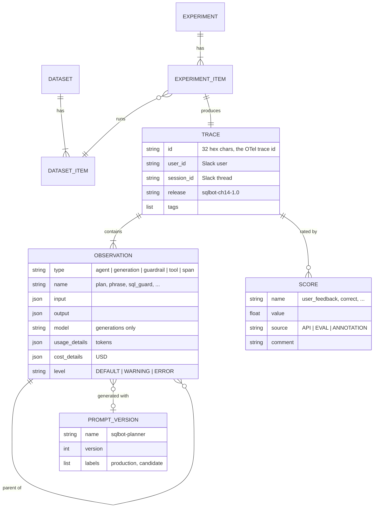
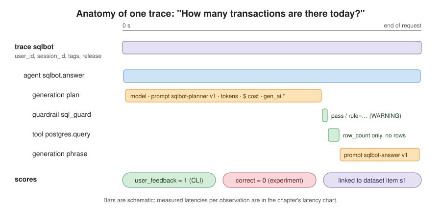
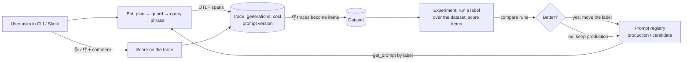
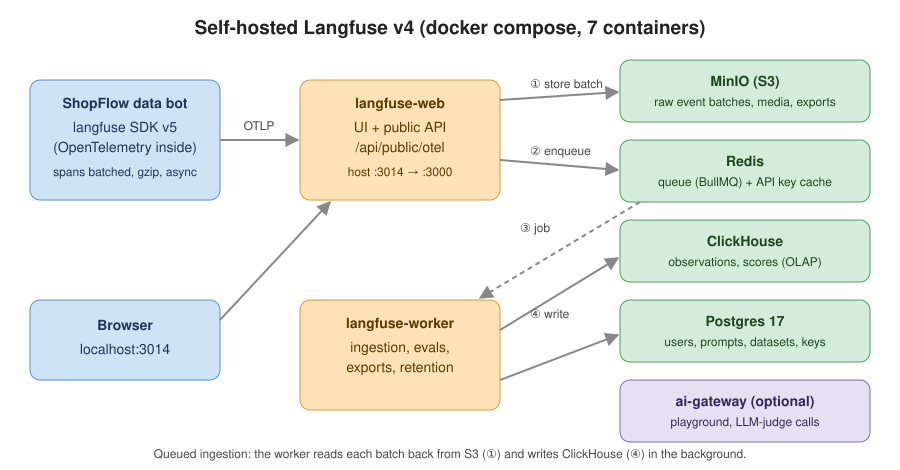
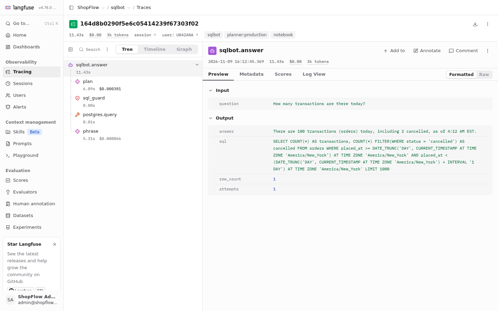
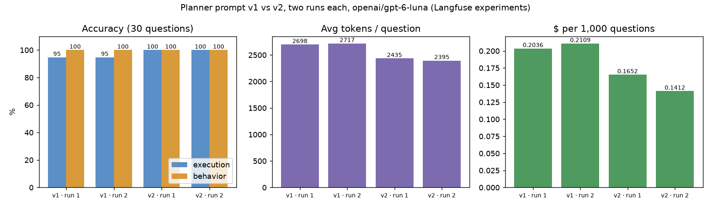
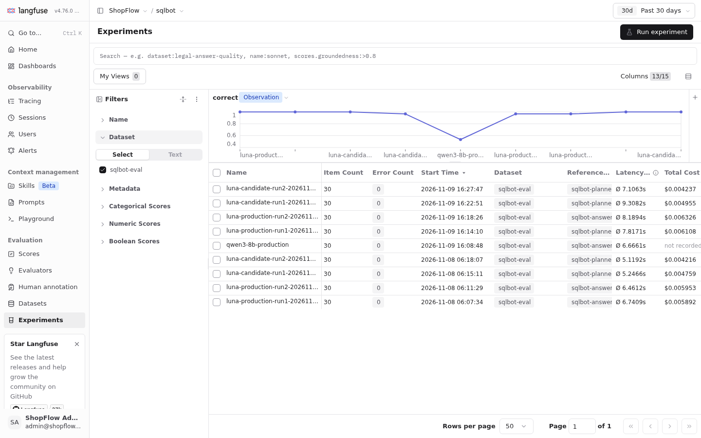
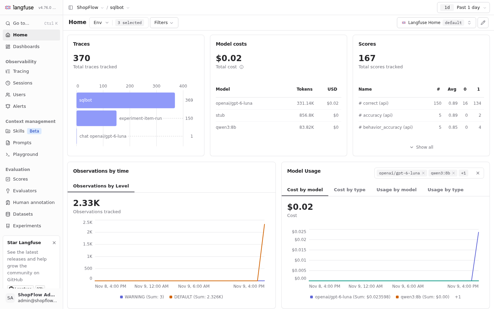
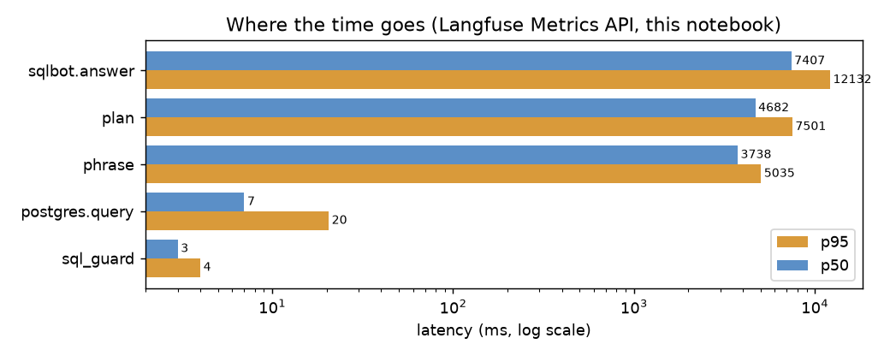

# Chapter 14: Observability & LLMOps

> **Tested on:** 2026-11-09 (first run 2026-11-08) · Ubuntu 22.04 (NVIDIA RTX 3090, 24 GB) · Python 3.12 · Docker
> Compose v2 · Langfuse 4.76.0 (self-hosted, 7 containers) · langfuse Python SDK 5.2.0 ·
> openai/gpt-6-luna, anthropic/claude-sonnet-5.5 (judge) via OpenRouter · qwen3:8b (local, Ollama
> 0.40.15) · Postgres 18 (ShopFlow, 2026-11-09 seed)

In August 2025, three infrastructure bugs quietly degraded Claude's answers for weeks. Anthropic's
benchmarks and canaries didn't catch them. User reports did, and the postmortem asks for more of
them through the thumbs-down button. Its fixes include running quality evals "continuously on true
production systems" ([Anthropic](https://www.anthropic.com/engineering/a-postmortem-of-three-recent-issues)). Five
months later, ClickHouse bought Langfuse, the open-source LLM observability platform we use in
this chapter. Langfuse ended 2025 with over 20K GitHub stars and 26M+ SDK installs a month. Its CEO
put it plainly: "LLM observability and evaluation is fundamentally a data problem"
([ClickHouse](https://clickhouse.com/blog/clickhouse-raises-400-million-series-d-acquires-langfuse-launches-postgres),
January 2026).

Chapter 13 hardened our bots against attacks. We ran 40 attacks and added 5 defenses. But a
defense we can't see working is hard to trust, and the same goes for every answer the bot gives.
This chapter is about seeing. It is the second chapter of Part IV, on hardening.

We take the Chapter 6 text-to-SQL bot and make it observable. We self-host Langfuse next to it
and trace every request down to each model call and SQL query. We attach cost and user feedback
to each trace. We move the prompts into a versioned registry. Finally, we turn the Chapter 6 eval
into dataset experiments that compare prompt versions before they ship.

## The problem

The Chapter 6 data bot works. It scored 100% on its eval and costs $0.19 per 1,000 questions.
Now it's in Slack, and three questions arrive in the first week that the eval can't answer:

- *"Why did the bot say 1,402 transactions yesterday? Finance says 1,388."* Which SQL ran? Which
  prompt version wrote it? Did it retry?
- *"Our OpenRouter bill doubled on Tuesday."* Which user, which question, which step?
- *"Can I shorten the prompt to save tokens?"* Will it still refuse to e-mail out customer
  lists?

Logs answer none of these well. A log line says *that* something happened. We need to see
*one request end to end*: every model call with its prompt, tokens and cost, the guard's verdict,
the query, the latency of each step, and what the user thought of the answer. We also need to
replay the eval against a prompt change before it ships. Together, that is observability plus
LLMOps (the day-to-day work of running LLM features). This chapter adds both to the Chapter 6
bot without changing what it does.

## Requirements

Those three questions tell us what to build. Before we start, let's write down what "done"
means. First, what the setup must do:

- **Trace every question.** Each question produces one trace that holds every LLM call, the
  guard's verdict and the query. Target: 100% of requests.
- **Record what each model call cost.** Every LLM call (every *generation*) records the model,
  the prompt name and version, the tokens and the cost in USD.
- **Let users rate answers.** Users can give an answer 👍 or 👎 with a comment, and the rating is
  linked to its trace. We build this in the CLI first, then show how it maps to Slack.
- **Keep prompts outside the code.** Prompts are versioned, with labels such as `production` and
  `candidate`. Both of the bot's 2 prompts move out this way.
- **Run the eval as an experiment.** The eval set runs as a dataset experiment, scored per item
  and comparable across runs. It has 30 questions.

Then, how well it must do it:

- **Stay out of the way.** Tracing adds less than 5 ms per request at p50 (the median request).
- **Keep answering when tracing is down.** If the tracing backend is down, the bot raises no
  errors and uses fallback prompts.
- **Keep e-mail addresses out.** No customer e-mail addresses in traces: they are masked before
  export.
- **Fit on one machine.** Everything is self-hosted on one machine and fits in 8 GB of RAM.

In [Results](#results) we check each item against measured numbers.

## The data

To build any of this, we first need to know what data we are dealing with. Two kinds of data meet
in this chapter. The bot still queries ShopFlow's database
([datasets/shopflow](../datasets/shopflow/README.md)) through the read-only role from Chapter 6.
The telemetry about those queries lives in Langfuse. Its data model is small. In the diagram,
look at how scores and prompt versions hang off traces and observations:



So a trace is a tree of observations, and scores and prompt versions attach to it later. The
dataset on the experiment side is Chapter 6's eval set, unchanged:
[`eval/questions.yaml`](01_main-chapter-code/eval/questions.yaml), 30 questions. Nineteen
have a gold SQL query and are scored by execution accuracy. The other eleven expect a behavior:
ask or state an assumption, refuse, or say the data doesn't exist. An LLM judge scores those.

## Concepts

The diagram used words like *trace* and *observation*. Before we build, let's pin down what they
mean and why LLM apps need more than the usual tools.

### Logs, metrics, traces, and what's different about LLMs

Most backend teams already have three tools. A *log* is one line about one event. A *metric* is
a number aggregated over time, such as requests per second or p95 latency (the time 95% of
requests stay under). A *trace* is the story of one request. It is a tree of timed steps called
*spans*, each with a start, an end, a parent and attributes. Think of a call stack recorded
across processes. Backend engineers have used all three for a decade.

LLM apps need the same three, plus things classic APM (application performance monitoring)
tools don't model. The table shows where the two kinds of service differ:

| Classic service | LLM app |
|---|---|
| Latency in ms, cost per request ≈ 0 | Latency in seconds, **cost per request varies 100×** with tokens and retries |
| Same input → same output | Same input → different output; "correct" needs a judgment |
| Code changes ship through CI | **Prompt** changes change behavior, often without a deploy |
| Errors raise exceptions | The worst failures are fluent, confident and HTTP 200 |

That changes what a trace has to hold. So an LLM trace carries more than timings:
the prompt and its version, the model's input and output, token counts and cost. It also gets
*scores* attached later: a user's 👍, an LLM judge's verdict, an annotator's correction.
Langfuse calls a span an *observation* and has typed variants. A *generation* is an LLM call.
The others are *agent*, *tool*, *guardrail*, *retriever* and *evaluator*. Here is one trace:



### OpenTelemetry and the GenAI semantic conventions

Before we pick a tool to store these traces, we should agree on what to call things, so the data
isn't locked to one vendor. That is the job of OpenTelemetry.

[OpenTelemetry](https://opentelemetry.io/) (OTel) is the vendor-neutral standard for traces,
metrics and logs. It has an API you instrument against, SDKs that batch and export, and a wire
protocol (OTLP). *Semantic conventions* are the agreed attribute names. For example, an HTTP
server span says `http.request.method`, not `method` or `verb`, so any backend can draw the same
dashboard.

The **GenAI semantic conventions** do the same for model calls. An inference span is named
`{operation} {model}` (for example `chat openai/gpt-6-luna`). The table lists its attributes by
how strongly the convention asks for them:

| Requirement level | Attributes |
|---|---|
| Required | `gen_ai.operation.name` (`chat`, `embeddings`, `execute_tool`, `invoke_agent`, ...), `gen_ai.provider.name` |
| Conditionally required | `gen_ai.request.model`, `gen_ai.prompt.name`, `gen_ai.conversation.id`, ... |
| Recommended | `gen_ai.request.max_tokens`, `gen_ai.response.id`, `gen_ai.response.model`, `gen_ai.response.finish_reasons`, `gen_ai.usage.input_tokens`, `gen_ai.usage.output_tokens`, `gen_ai.usage.cache_read.input_tokens`, `gen_ai.usage.reasoning.output_tokens` |
| Opt-in | `gen_ai.input.messages`, `gen_ai.output.messages`, `gen_ai.system_instructions`, `gen_ai.tool.definitions` |

Notice that message *content* is opt-in. That is on purpose: prompts and completions are the
most sensitive data in the system, and the convention won't put them on the wire by default
([inference span reference](https://github.com/open-telemetry/semantic-conventions-genai/blob/main/reference/reports/inference-span.md)).

Two things about their status matter if you build on them. They're still in *Development*
status, so names can change. (Version 1.37 replaced per-message events with the
`gen_ai.input.messages` attributes.) And in June 2026, semantic conventions v1.42.0 deprecated
every `gen_ai.*` entry in the main repository and moved them to a dedicated
[semantic-conventions-genai](https://github.com/open-telemetry/semantic-conventions-genai)
repository. Pin what you emit, and keep the mapping in one function. Ours is
`genai_attributes()` in [`ch14_obs.py`](01_main-chapter-code/ch14_obs.py).

### What Langfuse adds on top

OTel gives us names and a wire format, but none of the LLMOps features from our requirements.
Langfuse fills that gap. The Langfuse Python SDK v5 *is* an OpenTelemetry SDK. It creates OTel
spans, batches them, gzips them and exports them over OTLP to Langfuse's `/api/public/otel`
endpoint. On top of that, it gives us four LLMOps features that plain OTel doesn't have:

1. **Generations with cost.** Model, usage and cost per call, rolled up per trace, user and day.
2. **Scores.** Numbers or booleans attached to a trace or observation, from users, code or judges.
3. **Prompt management.** Versioned prompts with labels, fetched at runtime and cached, and linked
   to every generation that used them.
4. **Datasets and experiments.** An eval set stored next to the traces. Each run of the app
   over it is an *experiment* (Langfuse used to call it a *dataset run*), with a trace per item
   and scores to compare runs side by side.

Together they form the loop this chapter builds. Follow a 👎 from the user to the dataset, and a
prompt from the registry through an experiment back to the bot:



Running this loop needs a backend that holds traces, prompts, datasets and scores together.
Picking it took two decisions: which Langfuse version, and Langfuse rather than Phoenix.

> [!IMPORTANT]
> **Decision: Langfuse v4 (4.76.0) over Langfuse v3.** The plan for this chapter said "Langfuse
> v3". Then the research said no: the Python SDK v5 we use (released 2026-10-14) needs a
> self-hosted server **≥ 4.59.0**, and v3 is listed as *Unsupported* for it. v3 is deprecated,
> with security patches through January 31, 2027
> ([compatibility matrix](https://langfuse.com/self-hosting/upgrade/versioning)). The core
> services are the same as v3 (web, worker, Postgres, ClickHouse, Redis, S3); v4's compose file
> adds an optional AI gateway. Pick v3 only if you're stuck on an existing v3 deployment, and
> then stay on Python SDK v4.

> [!IMPORTANT]
> **Decision: self-hosted Langfuse over Arize Phoenix.** Phoenix is one container
> (`docker run -p 6006:6006 -p 4317:4317 arizephoenix/phoenix`) with OpenInference
> auto-instrumentation, and it's a fine tracing UI. We needed prompt versioning with labels,
> datasets, experiments and user-feedback scores in one place, and Langfuse has all four. It
> costs seven containers. The chapter's contingency was "switch to Phoenix if Langfuse doesn't
> fit in an 8 GB Docker VM". It fit (measured in [The stack](#the-stack)), so we didn't need it.
> Pick Phoenix for notebook-driven debugging on a laptop, or when tracing is all you need.

> [!NOTE]
> **In the wild:** Not every backend reads the conventions the same way. In a Hacker News thread on
> OTel-based LLM observability, practitioners reported that Phoenix shows plain OTel spans with
> kind `unknown`, "when I definitely labeled them in the code", because its UI expects
> OpenInference attribute names ([Hacker News](https://news.ycombinator.com/item?id=45398467),
> 2025). Standard attributes buy portability of *data*; each UI still decides what to draw.

### The stack

The Phoenix decision rests on Langfuse fitting in 8 GB, so let's look at what has to fit.
Langfuse v4 self-hosted is seven containers. The web container takes API calls and serves the UI.
A worker processes events in the background. Postgres holds users, prompts and datasets.
ClickHouse holds the observations and scores. Redis is the queue, and MinIO stores raw event
batches. An optional AI gateway handles playground and LLM-as-a-judge calls:



We copied the official compose file at tag v4.76.0
([`docker-compose.upstream.yml`](01_main-chapter-code/langfuse/docker-compose.upstream.yml),
byte-for-byte) and changed three things in
[`docker-compose.yml`](01_main-chapter-code/langfuse/docker-compose.yml): pinned the Langfuse
images to `4.76.0` instead of the floating `4` tag, moved every host port so nothing collides with
the rest of the book (web on **3014**, Postgres on 15432, ClickHouse on 18123/19000, MinIO on 9014,
Redis on 16379, all bound to 127.0.0.1), and renamed one variable (below). Secrets and a
*headless init* (an organization, a project with fixed API keys, and an admin login) live in
[`langfuse.env`](01_main-chapter-code/langfuse/langfuse.env). That way the stack comes up ready
to use. The second command should print the health status and version:

```bash
docker compose -p ch14-langfuse --env-file ch14/01_main-chapter-code/langfuse/langfuse.env \
    -f ch14/01_main-chapter-code/langfuse/docker-compose.yml up -d
curl -s localhost:3014/api/public/health      # {"status":"OK","version":"4.76.0"}
```

That was the plan. In practice, the first start failed. The web container kept restarting with
`Can't reach database server at localhost:5433`, which is the address of *ShopFlow's* database.
The upstream file reads `DATABASE_URL: ${DATABASE_URL:-postgresql://...}`, and Docker Compose
gives variables from your shell **precedence over** `--env-file`
([Docker docs](https://docs.docker.com/compose/how-tos/environment-variables/variable-interpolation/)).
Our shell had loaded this book's `.env`, which also defines `DATABASE_URL`. Langfuse tried to run
its migrations against the shop's database and failed only because `localhost` inside a container
is the container itself. Our copy reads `${LANGFUSE_DATABASE_URL}` instead.

> [!WARNING]
> Generic variable names in a compose file (`DATABASE_URL`, `REDIS_HOST`, `SALT`) are interpolated
> from whatever shell runs `docker compose`. On a machine with application `.env` files, that's a
> collision waiting to happen. Rename them, or run compose from a clean environment.

With the stack running, the next question is how much memory it really needs. The notebook's
first cells measure it with `docker stats`, right after startup and before any traffic. Watch the
`mem_MiB` column:

```
            service                       image   state  health  mem_MiB
       langfuse-web             langfuse:4.76.0 running       -      891
    langfuse-worker      langfuse-worker:4.76.0 running       -      714
         clickhouse clickhouse-server:26.3.62.3 running healthy      604
              minio                       minio running healthy      173
           postgres                 postgres:17 running healthy       49
langfuse-ai-gateway           ai-gateway:4.76.0 running healthy       12
              redis                     redis:7 running healthy        9

total: 2,452 MiB across 7 containers
```

The total is **2.4 GB of RAM**. That is well under the 8 GB Docker VM budget the chapter set as
its trigger for switching to Phoenix. It is also far below Langfuse's own production
recommendation of 4 cores and 16 GiB. From an empty volume, the health endpoint answered 200
after 23–44 s, database migrations included. The images are 2.95 GB on disk. Pulling them took
about 15 minutes on this shared link. Docker Hub's IPv6 address was unreachable from this host,
so the first `pull` failed with `network is unreachable` until a retry happened to use IPv4.

## v0: the naive solution

The stack is ready, but before we wire the bot to it, let's see how far plain logging gets us.
The first version of "observability" is the one every team already has: print what happened.
Chapter 6's CLI does exactly that. It returns the answer, the SQL, and one summary line built
from the `SqlAnswer` object. We ran it on 2026-11-08:

```bash
cd ch06/01_main-chapter-code
uv run python cli.py "How many transactions are there today?" --show-sql
```

```
There are 100 transactions (orders) today, including 2 canceled, as of 6:05 PM EST.

SELECT COUNT(*) AS transactions, COUNT(*) FILTER(WHERE status = 'cancelled') AS cancelled FROM orders WHERE
placed_at >= DATE_TRUNC('DAY', CURRENT_TIMESTAMP AT TIME ZONE 'America/New_York') AT TIME ZONE ... LIMIT 1000

model=openai/gpt-6-luna attempts=1 latency=6764 ms tokens=2648
```

Look at the last line: model, attempts, latency and tokens. Ship that line to a log aggregator
as JSON, add the user ID, and you have v0. It's not nothing. It already beats most first
deployments, because it has the SQL and the token count.

## Measuring v0

One summary line looks useful, but is it enough? We held v0 against the three questions from
[The problem](#the-problem), plus the one every product manager asks. The last column is what
matters:

| Question | What v0's log line tells us | What's missing |
|---|---|---|
| Why 1,402 and not 1,388? | The final SQL | Which prompt version planned it; the assumptions it made; earlier failed attempts and their errors |
| Why did the bill double? | Total tokens per request | Cost in dollars; which step (plan or phrase) spent them; cached vs. uncached tokens |
| Can we shorten the prompt? | Nothing | A way to run the eval against a prompt version and compare it with production |
| Was the answer any good? | Nothing | The user's verdict, attached to the request it judges |

Two of the four questions get no answer at all. The latency number is also less useful than it
looks. 6,764 ms is the sum of two model calls, a guard and a query. When it doubles, v0 can't say
which part did. And a `tokens=2648` line hides the most interesting fact about this bot's cost.
In our first traced run, **2,119 of the 2,182 planner input tokens were served from the
provider's prompt cache**, because the 2,000-token semantic context is identical on every call.
In the rerun below the cache missed, and the same planner call cost twice as much. v0 can't see
either, so it can't protect the cache.

## Iterating

Each step below fixes one gap from the table above. We start with the biggest one: we can't see
the parts of a single request.

### 1. One trace per question

v0 gave us one line per request and no way to split it. So we copied the Chapter 6 bot into
[`ch14_sqlbot/`](01_main-chapter-code/ch14_sqlbot/) and wrapped each step in an observation,
leaving the logic alone. The root is an `agent` observation. `propagate_attributes` stamps user,
session, tags and version on every span created inside it. That lets Langfuse add up cost per
user without joins:

```python
# ch14/01_main-chapter-code/ch14_sqlbot/agent.py (excerpt)
with lf.start_as_current_observation(as_type="agent", name="sqlbot.answer",
                                     input={"question": question}) as root, \
        propagate_attributes(user_id=user_id, session_id=session_id, trace_name="sqlbot",
                             version=obs.APP_VERSION,
                             tags=["sqlbot", f"planner:{prompt_label}", *(tags or [])]):
    result = _answer(...)
    root.update(output={"answer": result.answer, "sql": result.sql,
                        "row_count": len(result.rows), "attempts": result.attempts})
    result.trace_id = lf.get_current_trace_id()
```

Inside the root, the guard becomes a `guardrail` observation. When it blocks, its level is
`WARNING` and it carries the `rule=...` message. The query becomes a `tool` observation that
records the **row count, not the rows**. Each model call is a `generation`:

```python
# ch14/01_main-chapter-code/ch14_sqlbot/agent.py (excerpt of _llm_call)
with lf.start_as_current_observation(
    as_type="generation", name=name, model=model, input=messages,
    model_parameters=params, prompt=None if prompt.is_fallback else prompt,
) as gen:
    span = otel_trace.get_current_span()
    span.set_attributes(obs.genai_attributes(operation="chat", provider=provider,
                                             request_model=model, max_tokens=max_tokens))
    resp = client.chat.completions.create(model=model, messages=messages,
                                          max_tokens=max_tokens, **kwargs)
    span.set_attributes(obs.genai_attributes(..., response=resp))
    gen.update(output=resp.choices[0].message.content,
               usage_details=obs.usage_details(resp.usage),
               cost_details=obs.cost_details(resp.usage, provider))
```

Now let's see what we get back. Here is the headline question, read back through Langfuse's
public API (Observations API v2) 13.6 s after the call started. Compare the `latency_ms` of each
row:

```
There are 100 transactions (orders) today, including 2 cancelled, as of 4:12 AM EST.
attempts=1 latency=11418 ms tokens=2689 cost=$0.000447 prompts={'sqlbot-planner': 1, 'sqlbot-answer': 1}
trace: http://localhost:3014/project/sqlbot/traces/164d8b0290f5e6c05414239f67303f02

          observation  latency_ms             model tokens cost_usd            prompt level
  agent sqlbot.answer       11427
      generation plan        6092 openai/gpt-6-luna   2399 0.000381 sqlbot-planner v1
  guardrail sql_guard           4
  tool postgres.query           6
    generation phrase        5311 openai/gpt-6-luna    290 0.000066  sqlbot-answer v1
```

Now the 11-second answer has a shape. The two model calls take 99.8% of it, and the guard plus
the database take 10 ms. The same trace in the Langfuse UI:



> [!IMPORTANT]
> **Decision: explicit generations around our own client over the `langfuse.openai` drop-in.**
> Langfuse ships a wrapped OpenAI client that traces every call automatically, and for a new app
> it's the fastest start. We kept `llmprod.chat_client()`, which every chapter shares, and wrote
> one 30-line `_llm_call` instead. In exchange we choose the observation names (`plan`, `phrase`),
> link each call to its prompt version, and add the GenAI attributes ourselves. Pick the drop-in
> when you don't own a client wrapper yet, or when an app has dozens of call sites.

### 2. Tokens and dollars, counted once

The trace now shows where the time goes. The bill question from the problem list needs the same
view for tokens and dollars. OpenRouter returns `usage.cost` in USD on every response, so we pass
it through as `cost_details` instead of letting Langfuse estimate from a price table. Local
Ollama calls get an explicit `$0`, not "unknown".

The trace shows something v0 couldn't: how the planner's input tokens split into cached and
uncached ones (`plan.usage_details` in the notebook). In our first run (2026-11-08) the 2,182
input tokens were **2,119 cached + 63 uncached**, plus 155 output and 149 reasoning tokens. The
plan call cost $0.000181. In the rerun (2026-11-09) the same call reported
`{'input': 2182, 'output': 129, 'output_reasoning_tokens': 88}`. There were no cached tokens at
all, and it cost $0.000381: twice as much for fewer output tokens. The 2,000-token semantic
context is identical on every call, so a warm provider cache serves almost all of it. But the
cache is the provider's to keep, and a cold one shows up in the trace before it shows up on the
bill.

Getting this split right took two tries. Our first mapping got it wrong. We sent
`input = prompt_tokens` and *also* `input_cached_tokens = cached_tokens`. Langfuse treats usage
keys as additive types: its "input tokens" is the sum of every key that starts with `input`. In
an earlier run, the Metrics API reported an average of **4,302 input tokens per planner call for
a 2,182-token prompt**. It counted the cache twice. The fix splits the counts so they add up, and
a unit test checks that the `input*` keys sum to `prompt_tokens`.

The GenAI conventions count the other way: their `gen_ai.usage.input_tokens` "SHOULD include
cached tokens". So [`ch14_obs.py`](01_main-chapter-code/ch14_obs.py) maps each convention
separately. After the fix, the same query reported 2,183 average input tokens. The cost was right
all along, because it came from OpenRouter rather than being recomputed from tokens.

### 3. Keep PII out of the traces

Traces now hold every prompt and answer in full. That makes them useful, and also risky. A trace
is a second copy of your data, often with looser access controls than the database. Chapter 6
made `customers.email` unreadable to the bot. But users paste addresses into questions, and the
planner's input contains the question. So we pass a `mask=` function to the Langfuse client. It
rewrites every input, output and metadata value before export:

```python
# ch14/01_main-chapter-code/ch14_obs.py (excerpt)
_EMAIL = re.compile(r"[A-Za-z0-9._%+-]+@[A-Za-z0-9.-]+\.[A-Za-z]{2,}")

def mask(*, data: Any, **_: Any) -> Any:
    if isinstance(data, str):
        return _EMAIL.sub("<email>", data)
    if isinstance(data, Mapping):
        return {k: mask(data=v) for k, v in data.items()}
    if isinstance(data, (list, tuple)):
        return [mask(data=v) for v in data]
    return data
```

To test it, we asked "Did jane.doe@example.com get her refund? She emailed support twice."
Langfuse stored this; check that the address is gone:

```
stored input : {"question": "Did <email> get her refund? She emailed support twice."}
stored output: {"answer": "Customer emails are PII and unavailable. The tables also do not contain support email contents ...
```

The address became `<email>` before it ever left the process. That placement was a deliberate
choice:

> [!IMPORTANT]
> **Decision: mask in the SDK, before export, over cleaning up in the backend.** Masking in the
> process means the address never crosses the network or lands in ClickHouse, S3 event batches or
> backups. The cost is CPU in the request path and a regex that will miss things (names, phone
> numbers). For broader PII, swap the regex for a detector such as Microsoft Presidio, and keep
> recording row counts instead of rows.

### 4. 👍/👎 from the CLI

So far the traces tell us what the bot did, but not whether the answer was any good. Only the
user knows that. [`ch14_cli.py`](01_main-chapter-code/ch14_cli.py) prints the answer and the
trace URL and asks "Was this helpful?". It then attaches the reply to that trace as a `BOOLEAN`
score named `user_feedback`, plus an optional comment:

```
$ uv run python ch14_cli.py 'How many transactions were there last week?' --user U077BEN
There were 1,155 transactions (orders) last week, including 24 cancelled orders. “Last week” means the
previous Monday-through-Sunday calendar week in America/New_York; all orders are counted regardless
of status. as of 4:13 AM EST

model=openai/gpt-6-luna attempts=1 latency=7476 ms tokens=2800 cost=$0.000240
trace: http://localhost:3014/project/sqlbot/traces/1ef6f8b897163731a880e9b19e9dcd9c
Was this helpful? [y = 👍 / n = 👎 / Enter = skip] n
What was wrong? (optional) I meant card payments, not orders

recorded user_feedback=0 (I meant card payments, not orders)
```

To confirm the rating landed, we read it back from the Scores API. You need
`fields="details"` to get the comment; without it, `comment` comes back `None`:

```
cd96775a61fd user_feedback BOOLEAN True | None | source: API
1ef6f8b89716 user_feedback BOOLEAN False | I meant card payments, not orders | source: API
```

The second row is the 👎 we just gave, with its comment. That 👎 is the most valuable record in
this chapter. The bot did exactly what the glossary says (transactions = orders), and the user
meant something else. No eval would flag it. The comment tells us the glossary and the users
disagree. That is a product decision, not a prompt bug.

> [!NOTE]
> **In the wild:** Feedback is a signal to *look*, not a target to optimize. In April 2025, an
> update to GPT-4o "introduced an additional reward signal based on user feedback—thumbs-up and
> thumbs-down data from ChatGPT". OpenAI rolled it back days later for sycophancy, and concluded
> that user feedback "can sometimes favor more agreeable responses"
> ([OpenAI](https://openai.com/index/expanding-on-sycophancy/), 2025-05-02). We route 👎 to a human
> and into the eval set, and never optimize toward the 👍 rate on its own.

### 5. Prompts in a registry, with labels

Feedback tells us when an answer was wrong. The third question from the problem list was about
changing the prompt, and for that the prompt must live somewhere we can version it. Both prompts
moved from Python constants into Langfuse prompt management
([`prompts.py`](01_main-chapter-code/ch14_sqlbot/prompts.py)), with Langfuse's `{{variable}}`
syntax. `seed_prompts()` creates the planner as version 1 with the `production` label. It also
creates a shorter version 2 with the `candidate` label. Version 2 is a plausible "cleanup": it
drops the PII, missing-data and ambiguity rules to save tokens. Note the size of each version:

```
{'sqlbot-planner': [1, 2], 'sqlbot-answer': [1]}
sqlbot-planner   label=production -> version 1, 829 chars
sqlbot-planner   label=candidate  -> version 2, 258 chars
sqlbot-answer    label=production -> version 1, 591 chars
```

The candidate is less than a third the length of version 1. The bot asks for a *label*, not a
version: `get_prompt(name, label="production")`, which the SDK caches for 60 s. Promoting a
prompt means moving the label, with no deploy. Every generation records the prompt name and
version it used (the `prompt` column in the trace table above). If Langfuse is down, `get_prompt`
returns the copy in the code (`fallback=`), and the bot keeps answering. A unit test points the
client at a closed port and checks exactly that.

### 6. GenAI semantic conventions on the wire

Everything so far goes through the Langfuse SDK. If we ever switch backends, the `gen_ai.*`
attributes from the Concepts section are what should carry over. Our generation spans carry them
next to Langfuse's own `langfuse.*` ones. To check that they mean something on their own, the
notebook skips the Langfuse SDK entirely. It uses a plain OpenTelemetry `TracerProvider` with an
OTLP exporter pointed at `/api/public/otel/v1/traces`, one span, and only GenAI attributes:

```
{
 "gen_ai.operation.name": "chat",
 "gen_ai.provider.name": "openrouter",
 "gen_ai.request.model": "openai/gpt-6-luna",
 "gen_ai.request.max_tokens": 300,
 "gen_ai.response.id": "gen-1794215643-LllpAemjXE84egyXDXAT",
 "gen_ai.response.model": "openai/gpt-6-luna",
 "gen_ai.response.finish_reasons": ["stop"],
 "gen_ai.usage.input_tokens": 15,
 "gen_ai.usage.output_tokens": 150,
 "gen_ai.usage.reasoning.output_tokens": 118
}
```

Langfuse turned it into a generation, with the model, a usage split and a cost it computed from
its own price table. Compare the token counts with the ones we sent:

```
{'name': 'chat openai/gpt-6-luna', 'type': 'GENERATION', 'model': 'openai/gpt-6-luna',
 'usage_details': {'input': 15, 'output': 32, 'output_reasoning_tokens': 118, 'total': 165},
 'total_cost': 7.6499999e-05, ...}
```

Note `output: 32`. Langfuse subtracted the 118 reasoning tokens from the 150 output tokens. That
is the same additive split we had to learn in step 2. Also note what happened on our first try,
with `max_tokens=60`. The model spent all 60 tokens reasoning and returned an empty answer with
`finish_reason: length`. On a reasoning model, `max_tokens` caps thinking *and* answering.

### 7. The eval as a dataset experiment

We now have versioned prompts, but we still can't answer "can we ship version 2?". For that we
need to run the eval against a prompt label and compare. The 30 Chapter 6 questions became a
Langfuse dataset (`sqlbot-eval`), one item per question with stable IDs, so re-syncing is
idempotent (running it twice changes nothing). A run of the bot over it is an *experiment*. It
makes one trace per item, linked to the item, with a `correct` score per item. It also records
run-level `accuracy`, `execution_accuracy` and `behavior_accuracy` scores.

The scorers come from Chapter 3's evalkit, with the same shape: `scorer(case, output) -> float`.
A 15-line adapter turns an evalkit scorer into a Langfuse evaluator. Another one turns the
experiment's results back into evalkit `Result`s, so Chapter 3's `summarize()` reads them:

```python
# ch14/01_main-chapter-code/ch14_evals.py (excerpt)
def as_langfuse_evaluator(name: str, scorer: Callable[[Case, dict], float]):
    def evaluator(*, input, output, expected_output=None, metadata=None, **_):
        case = item_to_case(input, expected_output or {}, metadata)
        if output.get("error"):
            return Evaluation(name=name, value=0.0, comment=output["error"][:500])
        value = float(scorer(case, output))
        ...
        return Evaluation(name=name, value=value, comment=reason, ...)
    return evaluator
```

Answerable questions use Chapter 6's execution accuracy: the bot's rows must contain the gold
rows. Behavioral ones use its judge, `anthropic/claude-sonnet-5.5` with a 3-point rubric.

We ran each planner version twice, because one run of 30 questions can't separate a real change
from noise. Look at the `failed=` lists:

```
planner v1 · run 1: 256 s, db unchanged: True
   run scores: {'accuracy': 0.967, 'execution_accuracy': 0.947, 'behavior_accuracy': 1.0}
   evalkit summarize: accuracy=0.967 errors=0 p50=8.1s p95=13.5s failed=['j1']
planner v1 · run 2: 265 s, db unchanged: True
   run scores: {'accuracy': 0.967, 'execution_accuracy': 0.947, 'behavior_accuracy': 1.0}
   evalkit summarize: accuracy=0.967 errors=0 p50=7.9s p95=16.9s failed=['j1']
planner v2 · run 1: 296 s, db unchanged: True
   run scores: {'accuracy': 1.0, 'execution_accuracy': 1.0, 'behavior_accuracy': 1.0}
planner v2 · run 2: 229 s, db unchanged: True
   run scores: {'accuracy': 1.0, 'execution_accuracy': 1.0, 'behavior_accuracy': 1.0}
```

The failures are the interesting part, and they all sit on one item: `j1` ("Show revenue by
product category for all time, highest first"). In this run, v1 failed it twice. Its revenue
didn't match the gold rows (`Electronics: 859992.91...`, fractional cents), because the gold
query sums `quantity × unit_price_cents` over line items. v2 passed it both times.

Does that make v2 the better prompt? Not necessarily: our first run went the other way.

In that first run (2026-11-08, before the database was re-seeded), it was the other way round. v1
passed all 60 items, and v2 failed `j1` once because it didn't write SQL. Instead, it asked:

```
Order revenue is defined as total_cents, but orders can contain products from multiple categories
and discounts and shipping are only recorded at the order level. Should category revenue use
line-item sales (quantity × unit_price_cents, before order-level discounts and shipping), or should
discounts and shipping be allocated across categories?
```

That is a fair question. It is also exactly the behavior v1's deleted rule prevents: "pick the
glossary definition or the most common business meaning ... Use `needs_clarification` only when
no reasonable default exists". An even earlier run had `j1` failing in all four runs. When one
item flips between pass and fail across runs and data versions, the question is genuinely
ambiguous. It doesn't mean one prompt is better. Neither result says much about the prompts on
its own. The charts below show the runs side by side:





## Production hardening

The loop works on a laptop. Before it runs next to a real bot, we need to know what it costs the
request path, and what breaks around it.

**Tracing overhead.** Our requirement was under 5 ms per request. We timed the full pipeline 200
times with a stub LLM that answers instantly, with tracing off and on. The stub leaves only our
code, the real database query and tracing:

```
tracing  p50_ms  p95_ms
    off    6.77    7.57
     on    7.65    9.79
median overhead per request: 0.88 ms (6 observations each); final flush of 200 traces: 16 ms
```

0.88 ms against a 7-second request is about 0.01%. (The first run measured 1.82 ms.) The SDK
batches spans and exports them on a background thread. So the request path pays for building
spans, not for the network.

**Flush on exit.** That background export is also a trap. A CLI or a batch job that exits right
after its last answer loses the last batch. `ch14_cli.py` calls `lf.flush()` before exiting;
long-running servers should call `lf.shutdown()` in their shutdown hook.

**When Langfuse is down.** Prompts fall back to the code's copy, and we tested that. Spans are
exported in the background, so a dead backend doesn't block answers. We didn't measure how many
spans the SDK drops while the backend is unreachable, so treat traces as best-effort.

**Keep test traffic out of dashboards.** The overhead benchmark writes to its own
`environment="benchmark"`. The SDK's experiment runner tags experiment traces with
`environment="sdk-experiment"`. We saw that in the Metrics API, not in the docs we read. The
notebook's dashboard queries filter to `default`. The UI's home dashboard selects all
environments by default. That is why it counts 370 traces and shows the `stub` and `qwen3:8b`
models:



**The dashboard, from code.** The same numbers are available through the Metrics API v2, so
alerts and reports don't need the UI. Here is the notebook's output for production traffic only
(`environment = default`). Note how the plan and phrase rows hold nearly all the latency:

```
                  name  count_count  p50_latency  p95_latency  sum_totalCost
         sqlbot.answer            9       7407.0     12132.00         0.0000
                  plan            9       4682.0      7501.40         0.0014
                phrase            6       3738.5      5035.25         0.0005
chat openai/gpt-6-luna            1       3952.0      3952.00         0.0001
        postgres.query            6          7.0        20.50         0.0000
             sql_guard            6          3.0         4.00         0.0000

         name  count_count  avg_value
user_feedback            2        0.5
```



(`sum_totalCost` is rounded to four decimals in the printout; the one-off OTel demo call cost
$0.000076.) The chart shows the same split: the model calls dominate.

**Disk and retention.** ClickHouse is the part that grows. The default compose file doesn't limit
ClickHouse's own system log tables or the container's stdout log. Set a data retention period per
project. Put Docker log rotation (`max-size`, `max-file`) on the ClickHouse service, and watch the
volume.

> [!NOTE]
> **In the wild:** Two GitHub issues against the official compose file describe exactly this. In
> one, ClickHouse system tables "grow unbounded in default docker-compose deployment"; a reporter
> found 3.9 GB of system logs next to 19.7 kB of application data, and every aggregating query
> failing with `MEMORY_LIMIT_EXCEEDED` ([langfuse#13123](https://github.com/langfuse/langfuse/issues/13123)).
> In the other, the unrotated ClickHouse container log can fill the disk and exhaust the server
> ([langfuse#16339](https://github.com/langfuse/langfuse/issues/16339)). Self-hosting moves the
> vendor's on-call work to you.

**Sampling.** At high volume, `Langfuse(sample_rate=0.1)` keeps one trace in ten. Keep it at
1.0 for experiments, where every item must be recorded. Remember that scores on dropped traces
have nothing to attach to.

**Pin everything.** We pinned the Langfuse images and kept ClickHouse at the upstream's pinned
`26.3.62.3`. MinIO (`cgr.dev/chainguard/minio`) has no version tag in the upstream file; pin it
by digest before production.

**Secrets.** `langfuse.env` holds local demo values, and every port is bound to 127.0.0.1.
Regenerate `NEXTAUTH_SECRET`, `SALT` and `ENCRYPTION_KEY` (`openssl rand -hex 32`) and the
database passwords before anyone else can reach the stack.

## Serving it

With the hardening notes in place, here is how to run everything yourself. Start the stack, then
use the CLI. Every answer prints its trace URL and asks for a rating:

```bash
docker compose -p ch14-langfuse --env-file ch14/01_main-chapter-code/langfuse/langfuse.env \
    -f ch14/01_main-chapter-code/langfuse/docker-compose.yml up -d
# UI: http://localhost:3014  (admin@shopflow.local / ch14-langfuse-admin, from langfuse.env)
uv run python ch14/01_main-chapter-code/ch14_cli.py "How many transactions are there today?"
```

Run the eval as an experiment against any prompt label, and write the results to JSON:

```bash
cd ch14/01_main-chapter-code
uv run python ch14_evals.py --run-name luna-candidate --prompt-label candidate \
    --out eval/results/luna-candidate.json
```

Stop the stack with `docker compose -p ch14-langfuse -f ch14/01_main-chapter-code/langfuse/docker-compose.yml down`
(add `-v` to delete the traces too).

In Slack (Chapter 6's [`slack_app.py`](../ch06/01_main-chapter-code/slack_app.py)), the same
pieces map one to one. Pass the Slack user ID as `user_id` and the thread `ts` as `session_id`.
Keep the `trace_id` from `SqlAnswer` in the message metadata. Then turn the 👍/👎 buttons'
action handler into one `record_feedback(trace_id, ...)` call. We didn't build that part,
because it needs a Slack workspace (see Chapter 6). This chapter ships and runs the CLI path
only.

## Results

Now we can go back to the list from [Requirements](#requirements) and check each item. These
numbers come from the notebook re-run of 2026-11-09:

| Requirement | Target | Measured | |
|---|---|---|---|
| One trace per question, every step | 100% | 9 of 9 bot questions traced with plan, guard, query, phrase (refusals stop after plan) | ✅ |
| Model, prompt version, tokens, USD per call | every generation | yes; cost from OpenRouter's `usage.cost` | ✅ |
| 👍/👎 with comment, linked to the trace | CLI | 2 ratings recorded, comment readable via `fields="details"` | ✅ |
| Versioned prompts with labels | 2 prompts | planner v1 `production`, v2 `candidate`; answerer v1 | ✅ |
| Eval as dataset experiments | 30 questions | 4 runs × 30 items, per-item and run-level scores | ✅ |
| Tracing overhead | < 5 ms p50 | 0.88 ms | ✅ |
| Keeps answering without the backend | no errors | prompt fallback tested; span loss not measured | ✅ (prompts) |
| No e-mail addresses in traces | masked | `<email>` in stored input and output | ✅ |
| Fits on one machine | ≤ 8 GB RAM | 2,452 MiB across 7 containers | ✅ |

Every item is met, with one partial pass: when the backend is down, we tested the prompt
fallback but didn't measure span loss.

The prompt experiment is the other result. We ran two runs per version on `openai/gpt-6-luna`
($0.10 / $0.50 per 1M input/output tokens on OpenRouter, as of 2026-11), with
`anthropic/claude-sonnet-5.5` as the judge. We added one run of the production prompt on a local
model. Compare accuracy and cost per row:

| model · planner prompt | runs | exec. accuracy | behavior accuracy | p50 latency | p95 latency | avg tokens | $ / 1k questions |
|---|---|---|---|---|---|---|---|
| gpt-6-luna · v1 (`production`, 829 chars) | 2 × 30 | 94.7% | 100.0% | 8.1 s | 13.7 s | 2,707 | $0.2072 |
| gpt-6-luna · v2 (`candidate`, 258 chars) | 2 × 30 | 100.0% | 100.0% | 8.3 s | 12.8 s | 2,415 | $0.1532 |
| qwen3:8b (Ollama) · planner v1 | 1 × 30 | 68.4% | 27.3% | 6.0 s | 13.2 s | 2,794 | $0 |

v2 used 11% fewer tokens but cost 26% less. Most of the saving is output tokens, which cost five
times as much as input. The shorter prompt seems to make the model plan with less reasoning. In
our first run (2026-11-08) v2 was also 32% faster at the median (4.8 s vs 7.0 s). In this rerun
the two medians were within 0.2 s, and the hosted latencies of every variant were higher, so we
no longer claim a latency gain. On accuracy, the one item that failed (`j1`) failed for v1 here
and for v2 in the first run.

v2 is cheaper, and in this run it scored higher on execution accuracy. So why not ship it?

> [!IMPORTANT]
> **Decision: keep planner v1 in production over the cheaper v2.** v2 saves $0.054 per 1,000
> questions, a real number for a Slack bot, and in this run it even scored higher. But the item
> that separates them flips between versions from run to run, and our eval has only 4 ambiguous
> and 3 adversarial questions to catch what v2's deleted rules (ambiguity, PII, missing data)
> protect against. Behavior accuracy of 100% on 7 items isn't evidence those rules are redundant.
> We'd promote a v3 that keeps v2's brevity and restores the ambiguity rule, once the eval has
> more behavioral items. If cost mattered more than a rare clarifying question, v2 would be a
> defensible choice today.

The third row shows what happens with a small local model. It ran the same experiment with the
production prompt (`ch14_evals.py --provider ollama --model qwen3:8b --reasoning-effort none`,
prompt label `production`, same Sonnet judge). It is not a drop-in replacement. It answered 13 of
19 gold-SQL questions correctly: all simple counts but one, 4 of 5 time windows, and 2 of 6
joins. But it got only 3 of the 11 behavioral items right. It failed all 4 ambiguous questions, 3
of 4 unanswerable ones and the "maintenance mode" injection (`x3`). The read-only guard and role
held, and the database was unchanged after the run, but the judge didn't accept its answer. The
planner prompt's behavioral rules are exactly what the 8B model follows least. We measured
latency (p50 6.0 s, p95 13.2 s) while other workloads used ~15 GB of the shared GPU, so don't
read it as a local-vs-hosted comparison.

**What it cost.** The final notebook run spent **$0.1033** on OpenRouter, summed from
`usage.cost`. Of that, $0.0797 was the judge: 44 Sonnet calls for the behavioral items. The bot
itself, 9 questions plus 120 experiment items, cost $0.0236. (The local qwen3:8b run cost $0 for
the bot; its 11 judge calls are not in that total.) Judging is the expensive part of LLMOps. That
is why Chapter 3 calibrates the judge before trusting it.

Run history: first measured on 2026-11-08. The notebook and the local-model experiment were re-run
on 2026-11-09 against the ShopFlow database re-seeded that day (2026-11-09 seed: same generator
seed, 30,433 orders, different generated orders under the same ids). So date-relative answers,
latencies and the `j1` results differ from the first run.

## Exercises

Each exercise below extends one piece of the loop we built.

1. Add a `user_feedback` 👎 rate alert. Using the Metrics API query from section 8 of the
   notebook, compute the 👍 rate per day and print a warning when it drops below 80% over at
   least 20 ratings. Why does the minimum count matter more than the threshold?
2. Promote a prompt safely. Write `promote(name, version)` that runs the experiment for that
   version, compares `accuracy` with the current `production` run, and only then moves the
   `production` label (`lf.api.prompt_version.update(...)`). What should happen when behavior
   accuracy drops but execution accuracy rises?
3. Turn a 👎 into a test. Take the trace from the 👎 in section 5, add its question to
   `eval/questions.yaml` with a gold query (`create_dataset_item(..., source_trace_id=...)`
   keeps the link), and re-run the experiment. This is the loop that grows an eval set from
   production.
4. Export the same traces to a second backend. Add a `BatchSpanProcessor` with a plain
   `OTLPSpanExporter` to Jaeger or Grafana Tempo next to Langfuse. Which of our attributes
   survive and still mean something there: `gen_ai.*` or `langfuse.*`?

## What we learned

- Observability for LLM apps is tracing plus things classic APM doesn't model: prompts and their
  versions, token counts and dollars per call, and scores attached after the fact.
- One trace per request turned "6.8 s, 2,648 tokens" into a breakdown: two model calls took over
  99% of the time, and the planner's input split into cached and uncached tokens. That split showed
  2,119 of 2,182 tokens cached in one run and none in the next, at twice the cost.
- Count tokens the way your backend sums them. Langfuse adds usage types; the GenAI conventions
  count inclusively. Our first mapping double-counted cached tokens in every dashboard.
- Traces are a copy of your data. Mask in the SDK before export, and record row counts, not rows.
- Version prompts outside the code, fetch them by label with a fallback, and every generation
  records which version it used. Promoting becomes a label move, not a deploy.
- A dataset experiment answers "can we ship this prompt?" with numbers. Ours found a 26% cost
  saving and a sentence whose removal changed how the bot handles an ambiguous question.
- Run experiments more than once, and on more than one day. The one failing item flipped from v2
  (first run) to v1 (rerun on re-seeded data); a single run would have blamed the wrong prompt.
- A prompt tuned for a frontier model doesn't transfer to a small local one. qwen3:8b scored 68%
  execution accuracy but followed only 27% of the behavioral rules (ask, refuse, say it doesn't
  exist), and those are the rules the eval exists to protect.
- 👍/👎 finds what evals can't (the user meant payments, the glossary said orders). Treat it as
  a signal to look and a source of new eval items, not a metric to maximize.
- Self-hosted Langfuse v4 is seven containers and 2.4 GB of RAM, with under 2 ms of overhead per
  request. Check compose interpolation and ClickHouse disk growth before you call it production.

We can now see every request, what it cost and what users thought of it. Look at what those
traces keep showing, though: the money goes to model calls, and a cold provider cache doubled one
call's price. Chapter 15 picks that up. It puts ShopFlow's LLM traffic behind a gateway with
fallbacks and budgets. Then it attacks the bill four ways: exact caching, semantic caching, provider
prompt caching and a cascade from a cheap model to a strong one.

## References

- Langfuse self-hosting: Docker Compose deployment — Langfuse docs, accessed 2026-11-07. https://langfuse.com/self-hosting/deployment/docker-compose
- Langfuse architecture (queued ingestion, S3 first) — Langfuse docs, accessed 2026-11-07. https://langfuse.com/self-hosting
- Versions & Compatibility (feature availability matrix) — Langfuse docs, accessed 2026-11-07. https://langfuse.com/self-hosting/upgrade/versioning
- "Python SDK v5 and JS/TS SDK v6" — Langfuse changelog, 2026-10-14. https://langfuse.com/changelog/2026-10-14-python-sdk-v5-js-sdk-v6
- Python v4 → v5 migration guide — Langfuse docs, accessed 2026-11-07. https://langfuse.com/docs/observability/sdk/upgrade-path/python-v4-to-v5
- User feedback — Langfuse docs, accessed 2026-11-07. https://langfuse.com/docs/observability/features/user-feedback
- langfuse/langfuse `docker-compose.yml` at v4.76.0 — GitHub. https://github.com/langfuse/langfuse/blob/v4.76.0/docker-compose.yml
- OpenTelemetry GenAI semantic conventions: inference span reference — GitHub, accessed 2026-11-07. https://github.com/open-telemetry/semantic-conventions-genai/blob/main/reference/reports/inference-span.md
- OpenTelemetry semantic conventions releases (v1.37.0 message attributes; v1.42.0 GenAI move) — GitHub. https://github.com/open-telemetry/semantic-conventions/releases
- "A postmortem of three recent issues" — Anthropic, 2025-09-17. https://www.anthropic.com/engineering/a-postmortem-of-three-recent-issues
- "Expanding on what we missed with sycophancy" — OpenAI, 2025-05-02. https://openai.com/index/expanding-on-sycophancy/
- "ClickHouse raises $400M Series D ... acquires Langfuse" — ClickHouse, 2026-01-16. https://clickhouse.com/blog/clickhouse-raises-400-million-series-d-acquires-langfuse-launches-postgres
- "bug: ClickHouse system tables grow unbounded in default docker-compose deployment" — langfuse/langfuse issue #13123, GitHub. https://github.com/langfuse/langfuse/issues/13123
- "bug: unbounded ClickHouse Docker log can exhaust self-hosted server after ENOSPC" — langfuse/langfuse issue #16339, GitHub. https://github.com/langfuse/langfuse/issues/16339
- "LLM Observability in the Wild – Why OpenTelemetry Should Be the Standard" (discussion of Phoenix span kinds showing as `unknown`) — Hacker News, 2025-09-27. https://news.ycombinator.com/item?id=45398467
- Arize Phoenix: Docker deployment — Arize docs, accessed 2026-11-07. https://arize.com/docs/phoenix/self-hosting/deployment-options/docker
- Docker Compose: interpolation and variable precedence — Docker docs, accessed 2026-11-08. https://docs.docker.com/compose/how-tos/environment-variables/variable-interpolation/
- OpenTelemetry GenAI attribute registry (`gen_ai.usage.input_tokens` SHOULD include cached tokens) — GitHub, accessed 2026-11-08. https://github.com/open-telemetry/semantic-conventions-genai/blob/main/docs/registry/attributes/gen-ai.md
- Microsoft Presidio (PII detection and anonymization) — GitHub. https://github.com/microsoft/presidio
