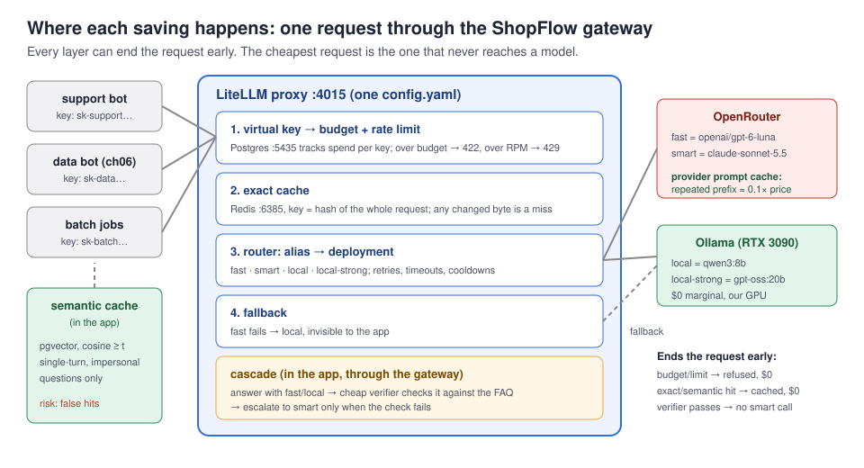
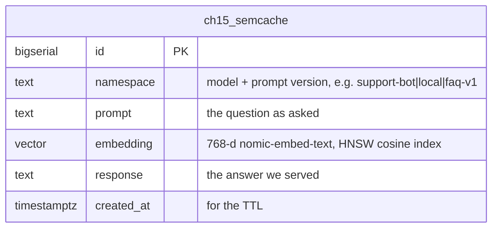
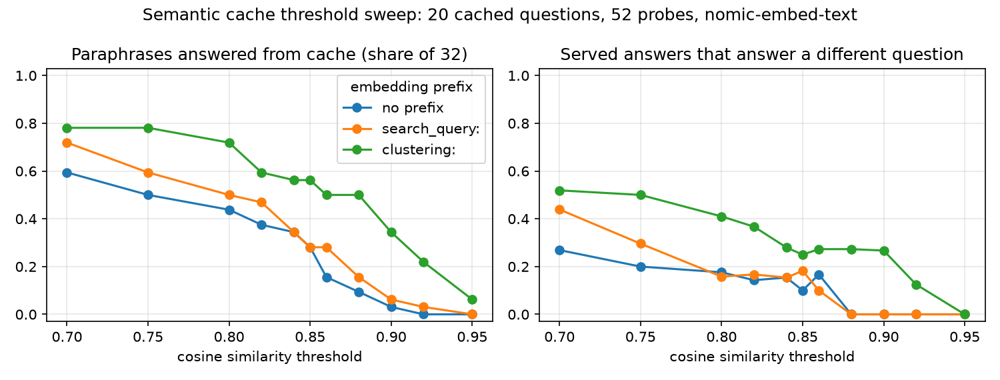
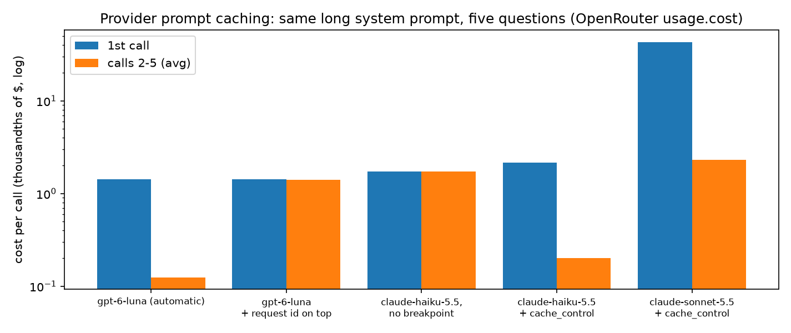
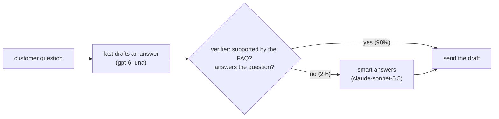
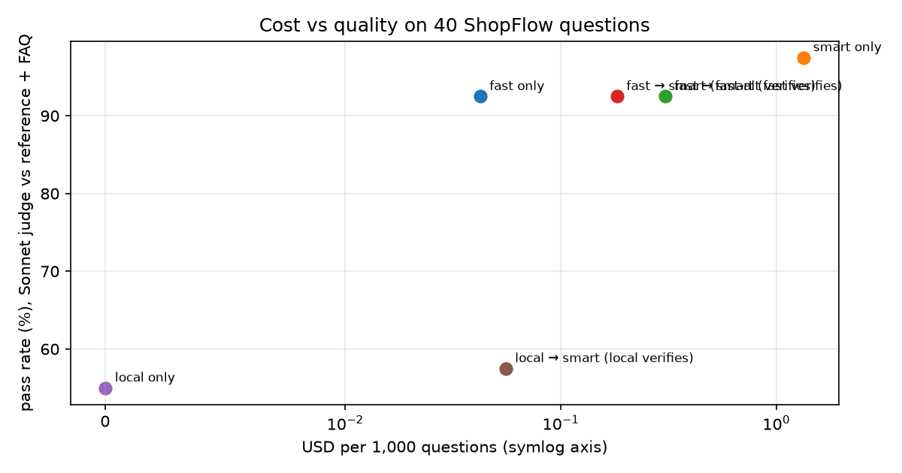
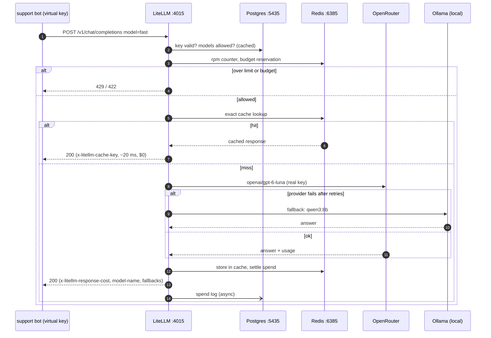

# Chapter 15: Gateway, caching & cost control

> **Tested on:** 2026-11-09 · Ubuntu 22.04 (NVIDIA RTX 3090, 24 GB) · Python 3.12 · LiteLLM proxy
> `ghcr.io/berriai/litellm:v1.108.2-lts` · Postgres 17 (gateway), Postgres 18 + pgvector 0.8.7
> (ShopFlow), Redis 8.10 · openai/gpt-6-luna, anthropic/claude-haiku-5.5,
> anthropic/claude-sonnet-5.5 via OpenRouter; nomic-embed-text via Ollama · openai 3.46,
> psycopg 3.3, pgvector-python 0.5, redis-py 8.1 · local `qwen3:8b` via Ollama 0.40.15 (GPU,
> context 8192): measured 2026-11-09 (GPU shared with other workloads using ~15 GB)

On March 24, 2026, two releases of the `litellm` Python package, 1.82.7 and 1.82.8, shipped with
credential-stealing malware. The second one ran on every Python start-up, before any `import`
([Datadog Security Labs](https://securitylabs.datadoghq.com/articles/litellm-compromised-pypi-teampcp-supply-chain-campaign/)).
The project's maintainers pointed out that users of the proxy's Docker image were not affected,
because the image pins its dependencies
([Hacker News](https://news.ycombinator.com/item?id=47501426)). That's a strange way to open a
chapter that recommends LiteLLM, and it's deliberate: an LLM gateway holds every provider key you
own and sees every prompt. It's the most valuable box in the stack, so we run it like one.

Why have one at all? Because by the time a company has three LLM features, it has three copies of
the provider key, no idea which feature spends what, no limit on what a buggy loop can spend
overnight, and an outage plan that reads "wait for OpenAI". This chapter puts ShopFlow's LLM
traffic behind a gateway, then attacks the bill four ways: exact caching, semantic caching,
provider prompt caching and a cheap→strong cascade. We measure what each one saves and what
each one costs in quality.



## The problem

ShopFlow now runs three LLM features: the support bot from Chapter 1, the data bot from
Chapter 6 and a nightly batch job that tags support tickets. Each one reads `LLM_API_KEY` from
its own `.env` and calls OpenRouter directly. Finance asks three questions nobody can answer:

> *Which feature spent last month's bill?*
> *What stops a bug from spending a month's budget overnight?*
> *What happens to checkout support when OpenRouter is down?*

And engineering has a fourth: *the support bot answers "How long do refunds take?" a few hundred
times a day, and pays full price every time. Can we stop that without serving wrong answers?*

## Requirements

| Type | Requirement | Target |
|---|---|---|
| Functional | Apps call stable aliases (`fast`, `smart`, `local`), never a provider directly | 100% of traffic |
| Functional | One key per app, with its own budget, rate limit and model allow-list | over budget or over limit → refused |
| Functional | If the hosted `fast` model fails, answer from our own GPU | no error reaches the app |
| Functional | Identical requests are served from a cache | 0 tokens billed on a hit |
| Functional | Paraphrased questions served from a semantic cache | false hits **0** on our probe set |
| Non-functional | Quality of a cost-saving strategy vs always using `smart` | ≤ 5 points lower pass rate |
| Non-functional | Cost per 1,000 support questions | ≥ 50% below always-`smart` |
| Non-functional | Gateway overhead and cache latency | cache hit < 50 ms; lookup < 100 ms |
| Non-functional | Supply chain | gateway image pinned to a release tag, secrets only from env |

## The data

No new business data. The support bot answers from the ShopFlow FAQ
([`datasets/shopflow/docs/faq.md`](../datasets/shopflow/docs/faq.md)), and we add two test sets.
Their labels (which probe each cached answer is right for, and the reference answers) were written
against the FAQ by the AI tooling used to write this chapter, not by a human reviewer; read them
before you trust the false-hit rates built on them:

- [`semcache_probes.yaml`](01_main-chapter-code/data/semcache_probes.yaml): 20 FAQ questions that
  are already in the cache (*seeds*) and 52 new questions (*probes*). 32 probes are paraphrases of
  a seed ("Where's my package?" → "How do I track my order?"). 20 are **near misses**: they look
  like a seed, but its answer would be wrong ("How much does shipping to Canada cost?" vs "How long
  does shipping to Canada take?").
- [`cascade_questions.yaml`](01_main-chapter-code/data/cascade_questions.yaml): 40 customer
  questions with a reference answer each. 15 direct look-ups, 13 that combine two FAQ entries or
  need a small inference ("My cart is $70 and I have a $10 coupon. Is shipping free?"), 8 the FAQ
  doesn't cover, 4 off-topic or manipulative.

Two new stores: the gateway's own Postgres (keys, budgets, spend logs; port 5435) and Redis (exact
cache; port 6385). The semantic cache is one table in the ShopFlow database:



```bash
docker compose -f ch15/01_main-chapter-code/docker-compose.yml up -d     # LiteLLM + Postgres + Redis
cd ch15/01_main-chapter-code
uv run jupyter nbconvert --to notebook --execute --inplace ch15.ipynb    # creates ch15_semcache
```

## Concepts

### A gateway is a reverse proxy that speaks the OpenAI API

An *LLM gateway* sits between your apps and the model providers, like nginx sits between
browsers and your web servers. Apps send ordinary Chat Completions requests to it with a
gateway key and a model *alias* (`fast`). The gateway looks up which real model that alias means
today, adds the real provider key, applies limits and caching, forwards the request, and records
what it cost. Because it speaks the same API, the app's code doesn't change: only `base_url`,
`api_key` and the model name do.

We use the [LiteLLM proxy](https://docs.litellm.ai/docs/proxy/configs), configured by one
[`config.yaml`](01_main-chapter-code/config.yaml). It needs Postgres for keys and spend, and
Redis for a shared cache (with more than one instance, also for shared rate-limit counters).

### Four caches, four different things

"Caching" means four different mechanisms here. They differ in what counts as "the same request",
and that decides how wrong each one can be:

| Cache | Where | Same request means | Saves | Can be wrong? |
|---|---|---|---|---|
| Exact | gateway (Redis) | hash of the whole request, byte for byte | the whole call | only if the world changed (TTL) |
| Semantic | app (pgvector) | an embedding within a cosine threshold | the whole call | **yes**: serves another question's answer |
| Provider prompt cache | provider | the same token *prefix* as a recent request | ~90% of the prefix's input price | no: the model still runs on the full prompt |
| Cascade | app | — (not a cache; a routing decision) | the expensive model on easy questions | yes, if the verifier passes a bad draft |

An *embedding* is a list of numbers (here 768) that places a text in space so that texts with
similar meaning land close together. *Cosine similarity* measures how close: 1.0 is the same
direction, 0 is unrelated. "Close in meaning" isn't "same answer", and that gap is what the
semantic-cache section measures.

### Prompt caching is about prefixes

A model processes the prompt left to right. If a provider has just processed the same first
11,000 tokens for someone, it can keep that work and bill it at a fraction of the price. So the
rule is: **static content first** (instructions, documents, tools), **variable content last**
(the user's question). One timestamp at the top of the system prompt makes every request a
different prefix and turns the discount off.

> [!NOTE]
> **In the wild:** Anthropic launched prompt caching in 2024, claiming up to 90% lower cost and
> up to 85% lower latency for long prompts; in their example of chatting with a 100,000-token
> book, time to first token fell from 11.5 s to 2.4 s
> ([Anthropic](https://www.anthropic.com/news/prompt-caching)). Today's docs: writes cost 1.25×
> the input price (5-minute TTL), reads 0.1×, and only 0.05× on Sonnet 5.5
> ([Anthropic docs](https://platform.claude.com/docs/en/build-with-claude/prompt-caching)).

### A cascade spends the strong model only where it matters

A *cascade* asks the cheap model first and escalates to the expensive one only when needed. The
whole difficulty is deciding "when needed" without paying the expensive model to decide. We use a
*verifier*: a second cheap call that checks the draft against the same FAQ.

> [!NOTE]
> **In the wild:** FrugalGPT (Stanford, 2023) chained several LLM APIs with a learned scorer
> deciding when to stop, and matched the best single model (then GPT-4) with up to 98% lower cost
> ([arXiv:2305.05176](https://arxiv.org/abs/2305.05176)). RouteLLM (LMSYS, 2024) trained routers
> that cut cost by over 85% on MT Bench while keeping 95% of GPT-4's quality
> ([LMSYS](https://lmsys.org/blog/2024-07-01-routellm/)). Those are benchmark numbers; ours are
> below.

## v0: the naive solution

Every app does what the Chapter 1 bot does: read the OpenRouter key from its own `.env`, put a
model name in code, call the provider.

```python
# ch15/01_main-chapter-code/ch15.ipynb, "v0"
direct = chat_client(max_retries=0)          # base_url and key straight from .env
c = chat(direct, settings.llm_model, [{"role": "system", "content": SYSTEM_PROMPT},
                                      {"role": "user", "content": q}], 400)
```

## Measuring v0

The same question, three times, from the notebook:

```
call 1: 1156 prompt tokens, 1153 cached, $0.000033, 1236 ms | 'Refunds are sent to your original payment method within 5–7 business d'
call 2: 1156 prompt tokens, 1153 cached, $0.000033, 1363 ms | 'Refunds are sent to your original payment method within 5–7 business d'
call 3: 1156 prompt tokens, 1153 cached, $0.000033, 1144 ms | 'Refunds are sent to your original payment method within 5–7 business d'
```

Two things to notice. First, every call is paid for and takes over a second, although the answer
didn't change. Second, `1153 cached`: the provider is *already* caching our 1,156-token system
prompt, because OpenAI caches long prefixes automatically and this prompt had been sent minutes
before. v0 benefits from provider caching by accident. We'll make it deliberate in
[iteration 6](#6-provider-prompt-caching).

What v0 can't do at all is the more serious list:

| Question | v0's answer |
|---|---|
| Which app spent what? | Unknown: one key, one bill. |
| What stops a runaway loop? | Nothing but the provider's account-wide limit. |
| What if OpenRouter is down? | Every app fails. Each would need its own retry and fallback code. |
| Can we switch `gpt-6-luna` for something cheaper? | Edit and deploy every app. |
| Revoke a leaked key? | Rotate the one key every app uses. |

## Iterating

### 1. One gateway, three aliases

We start LiteLLM, its Postgres and Redis with
[`docker-compose.yml`](01_main-chapter-code/docker-compose.yml). The model list lives in
[`config.yaml`](01_main-chapter-code/config.yaml):

```yaml
# ch15/01_main-chapter-code/config.yaml (excerpt)
model_list:
  - model_name: fast                       # cheap default for most traffic
    litellm_params:
      model: openrouter/openai/gpt-6-luna
      api_key: os.environ/LLM_API_KEY
      timeout: 30
      max_tokens: 512                      # default when a caller forgets (OpenRouter reserves 65k)
      input_cost_per_token: 0.0000001      # $0.10 / 1M
      output_cost_per_token: 0.0000005     # $0.50 / 1M
    model_info:                            # without these, cached tokens are priced at $0
      cache_read_input_token_cost: 0.00000001        # 0.1x input
      cache_creation_input_token_cost: 0.000000125   # 1.25x input
  - model_name: smart
    litellm_params:
      model: openrouter/anthropic/claude-sonnet-5.5
      reasoning_effort: low                # see the warning below
      ...
  - model_name: local
    litellm_params:
      model: openai/qwen3:8b               # Ollama's OpenAI-compatible endpoint
      api_base: http://127.0.0.1:11434/v1
      reasoning_effort: none               # qwen3 "thinks" for minutes unless told not to
      ...
```

The app changes three strings: `base_url` becomes `http://127.0.0.1:4015/v1`, the key becomes a
gateway key, the model becomes an alias. The notebook's first gateway calls:

```
aliases: ['fast', 'smart', 'fast-alt', 'local', 'local-strong', 'fast-outage-drill']
fast   served by openrouter/openai/gpt-6-luna           cost header $0.0000111   1331 ms  'Paris'
smart  served by openrouter/anthropic/claude-sonnet-5.5 cost header $0.0000880   1040 ms  'Paris'
local  served by openai/qwen3:8b                        cost header $0.0000000    219 ms  'Paris'
```

Every response now carries headers the app never had: `x-litellm-response-cost`,
`x-litellm-model-name` (the real deployment behind the alias), `x-litellm-attempted-fallbacks`,
and `x-litellm-overhead-duration-ms`. We measured the gateway's own overhead at 32 ms on a normal
call and 620 ms on the first call after a restart.

Two provider quirks moved into the config, out of every app. Both cost us an hour while writing:

> [!WARNING]
> `claude-sonnet-5.5` always reasons through OpenRouter: asking for `reasoning_effort: "none"`
> returns `400 Reasoning is mandatory for this endpoint and cannot be disabled`. At the default
> effort it spent 329 hidden reasoning tokens on a one-line JSON grade, hit `max_tokens=400` and
> returned truncated JSON (`{"pass": false, "reason": "The answer omits the`), for $0.0051. At
> `low` it spent 0 reasoning tokens and $0.0018. `gpt-6-luna` reasons by default too: with
> `max_tokens=30`, a one-field JSON answer came back **empty** (`finish_reason="length"`, 30 of 30
> tokens spent on reasoning).

> [!IMPORTANT]
> **Decision: the LiteLLM proxy over a client-side SDK or a hosted gateway.** A routing library
> inside each app (LiteLLM's Python SDK, or our own wrapper) gives no central place for keys,
> budgets or a shared cache, and puts provider keys in every service. A hosted gateway (OpenRouter
> itself, Cloudflare AI Gateway, Portkey) is less to run, but your prompts and keys then pass
> through another company, and local models on your own GPU need a tunnel. The proxy is one
> container with an OpenAI-compatible API, and its config is a file we review in pull requests.
> Its reputation is mixed: practitioners on Hacker News describe bugs that "never should have made
> it to a release", latency, and "multiple ways budget limits aren't enforced"
> ([HN](https://news.ycombinator.com/item?id=45985220)). So we pin the image, test our config
> (`test_ch15_config.py`), and verify budgets ourselves (next section). Pick a hosted gateway when
> you have no platform team to run one more stateful service.

### 2. A key per app, with a budget and a rate limit

*Virtual keys* are gateway-issued keys that map to the real provider key, stored (hashed) in the
gateway's Postgres, each with its own model allow-list, budget and limits:

```python
# ch15/01_main-chapter-code/ch15_gateway/gateway.py (excerpt)
def generate_key(alias, models, max_budget=None, rpm_limit=None, tpm_limit=None, budget_duration=None):
    body = {"key_alias": alias, "models": models, "max_budget": max_budget,
            "rpm_limit": rpm_limit, "tpm_limit": tpm_limit, "budget_duration": budget_duration}
    return _admin("POST", "/key/generate", json={k: v for k, v in body.items() if v is not None})["key"]
```

A key limited to 3 requests per minute, hit five times in a loop, then used for a model it isn't
allowed:

```
rpm key, request 1: 200 OK
rpm key, request 2: 200 OK
rpm key, request 3: 200 OK
rpm key, request 4: 429 Error code: 429 - Rate limit exceeded for api_key: 140b4a... Limit type: requests. Current limit: 3, Remaining: 0. ...
rpm key, request 5: 429 Error code: 429 - Rate limit exceeded for api_key: 140b4a... Limit type: requests. Current limit: 3, Remaining: 0. ...
rpm key asking for smart: 403 Error code: 403 - The requested model 'smart' is not available for this API key, ...
```

Budgets were less obvious. A key with `max_budget=0.0002`, hammered with the support prompt and
`max_tokens=400`:

```
request  1: 200 OK   | cost of successful calls so far $0.000164
request  2: 422 Error code: 422 - Budget has been exceeded! Key=ch15-support-budget (sk-...HJTQ) Current cost: 0.0002, Max budget: 0.0002 | ...
key spend recorded by the gateway: $0.000000 (max_budget $0.0002)
```

The key spent 82% of its budget and was cut off, and when we read its spend back a moment later
the gateway still showed $0 (in the previous run: 15% spent, $0.000030 recorded). We read the
gateway's source to find out why
(`litellm/proxy/spend_tracking/budget_reservation.py` in the image): at admission LiteLLM 1.108
**reserves the worst-case cost** of the request (input estimate plus `max_tokens` × output price,
here about $0.00032) and shrinks that reservation to whatever budget is left. It settles to the
real cost when the response is logged, asynchronously. In a tight loop, request 2 arrives before
request 1 has settled and sees the full reservation. In an earlier run with `max_budget=0.0005`,
the gateway's log shows the opposite end: the 13th request was refused at
`Current cost: 0.00050165, Max budget: 0.0005`, an overshoot of 0.3%.

> [!NOTE]
> **In the wild:** In April 2026 a LiteLLM user reported a key with `max_budget: 0.05` whose spend
> reached 0.54 while requests kept succeeding, and another user confirmed it on a later version
> ([BerriAI/litellm#26672](https://github.com/BerriAI/litellm/issues/26672)). The reservation
> logic we hit in 1.108.2 is the fix for that class of bug, and it errs on the side of refusing.

> [!IMPORTANT]
> **Decision: budgets as a circuit breaker, metering from spend logs.** A budget's job is to stop
> a runaway loop at roughly the right amount, and that's what we observed (refused at 15%–100.3%
> of the budget). Invoices and chargeback come from the spend logs in the gateway's Postgres
> (and the provider's bill), never from the budget check. Set budgets at a multiple of expected
> spend with `budget_duration` (for example `30d`), and keep `max_tokens` honest, because it
> sizes every reservation.

### 3. Fallbacks, tested with a game day

```yaml
# ch15/01_main-chapter-code/config.yaml (excerpt)
router_settings:
  fallbacks: [{"fast": ["local"]}, {"fast-outage-drill": ["local"]}]
  num_retries: 1
  allowed_fails: 3                         # failures per minute before a deployment cools down
  cooldown_time: 30
```

A fallback you've never seen fire is a hope, not a feature. LiteLLM used to accept a
`mock_testing_fallbacks` flag; since 1.85 the proxy strips it from requests. So the config has a
*game-day* alias: `fast-outage-drill` is `fast` pointed at `http://127.0.0.1:9`, where nothing
listens, with the configured fallback to `local` (qwen3:8b on Ollama):

```
fast                -> served by openrouter/openai/gpt-6-luna               2412 ms 'Paris' {'attempted-retries': '0', 'attempted-fallbacks': '0'}
fast-outage-drill   -> served by openai/qwen3:8b                            2550 ms 'Paris' {'attempted-retries': '0', 'attempted-fallbacks': '1'}
```

The app got its answer from a model on our own GPU, about as fast as the healthy path (2.6 s vs
2.4 s; GPU shared with other workloads using ~15 GB during this run), and can see that it
happened in a header. Without `RUN_LOCAL=1` the notebook overrides the fallback per request
(`fallbacks: ["fast-alt"]`, claude-haiku-5.5); in the previous run that drill answered in 3.4 s.

It wasn't always this easy. On an earlier day the GPU was held by another workload and Ollama ran
qwen3:8b on CPU: a "Capital of France? One word." request through `local` took **493 s**, and the
drill to `local` failed with `Fallback to local also failed: litellm.Timeout ... timeout
value=60.0` (copied from the gateway log). That is the lesson of this section: **a fallback
target is only as good as its spare capacity**. A local model that is busy, cold or CPU-bound
turns a provider outage into a timeout; drill it on the day, not once.

> [!WARNING]
> A request-level `fallbacks` list overrides the configured one. Any caller with a key can do
> that, so if fallback order is a policy (for data residency, say), don't rely on
> `router_settings` alone: restrict which aliases each key may call (the 403 in iteration 2).

### 4. Exact cache in Redis

```yaml
# ch15/01_main-chapter-code/config.yaml (excerpt)
litellm_settings:
  cache: true                              # exact-match cache, shared by every worker
  cache_params:
    type: redis                            # host/port from REDIS_HOST / REDIS_PORT
    ttl: 3600                              # seconds; answers change when policies change
```

Same request twice, then the same question with one extra space:

```
first        cache hit: False cost header $0.000036  1171.1 ms
repeat       cache hit: True  cost header $0.000000    15.1 ms
extra space  cache hit: False cost header $0.000036  1182.3 ms
```

A hit takes 15 ms and costs nothing; one space makes it a miss. Exact caching is safe (it can
only replay an answer to the identical request) and useless for paraphrases. It shines for
retries, batch re-runs, evals and many users clicking the same suggested question.

> [!WARNING]
> Your cost benchmark measures your cache. Re-running an eval through a caching gateway "costs"
> $0 and takes milliseconds. Every measurement call in this chapter sends LiteLLM's per-request
> control `{"cache": {"no-cache": true}}` (`gateway.NO_CACHE`). And when a hit does happen,
> `calls.parse_cost` books it at $0 instead of trusting whatever `usage` the cached body carries.

### 5. A semantic cache with pgvector

A semantic cache embeds the question and serves the nearest stored answer if it's similar
enough. Ours is ~100 lines in
[`ch15_gateway/semcache.py`](01_main-chapter-code/ch15_gateway/semcache.py):

```python
# ch15/01_main-chapter-code/ch15_gateway/semcache.py (excerpt)
def nearest(self, prompt: str) -> Hit | None:
    [vec] = self.embed([normalize(prompt)])
    row = self.conn.execute(
        f"""SELECT prompt, response, 1 - (embedding <=> %(v)s::vector) AS similarity
            FROM {TABLE}
            WHERE namespace = %(ns)s
              AND (%(ttl)s::int IS NULL OR created_at > now() - make_interval(secs => %(ttl)s))
            ORDER BY embedding <=> %(v)s::vector
            LIMIT 1""",
        {"v": vec, "ns": self.namespace, "ttl": self.ttl_seconds},
    ).fetchone()
    return Hit(row[0], row[1], float(row[2])) if row else None

def lookup(self, prompt: str) -> Hit | None:
    hit = self.nearest(prompt)
    return hit if hit is not None and hit.similarity >= self.threshold else None
```

The `namespace` is the model plus the prompt version (`support-bot|fast|faq-v1`): when either
changes, old answers must stop being served. We fill the cache with 20 FAQ questions answered by
`fast`, then run the 52 probes. A median lookup (embedding plus HNSW query) takes 15 ms, with the
embeddings served by a CPU-only Ollama instance on this run.

```
 threshold  served  correct  false hits  hit rate (of 32)  false-hit rate (of served)
      0.70      26       19           7             0.594                       0.269
      0.75      20       16           4             0.500                       0.200
      0.80      17       14           3             0.438                       0.176
      0.85      10        9           1             0.281                       0.100
      0.86       6        5           1             0.156                       0.167
      0.88       3        3           0             0.094                       0.000
      0.90       1        1           0             0.031                       0.000
```



There is no good threshold. To get zero false hits we need 0.88, and then the cache answers 3 of
32 paraphrases. At 0.85, a common default, it answers 9 and serves one wrong answer per ten. The
near misses that score highest are exactly the dangerous ones:

```
0.869  'How much does shipping to Canada cost?'
       matched 'How long does shipping to Canada take?'
       would serve: 'Shipping to Canada takes 5–8 business days.'

0.841  'How long does shipping to Japan take?'
       matched 'How long does shipping take?'
       would serve: 'Shipping takes 3–5 business days within the US (standard) or 1–2 business days (express). Canada takes 5–8 business days; the UK, Germany, Australia, and Indonesia take 7...'

0.788  'How do I cancel a return I started?'
       matched 'How do I start a return?'
       would serve: 'Go to **Account → Orders → Return items**, choose the items and a reason, then print the prepaid label. ...'
```

Meanwhile true paraphrases score as low as 0.616 ("Do you ship with UPS or FedEx?" vs "Which
carriers do you use?"). Similarity measures *topic*; the cache needs *same answer*. A cost
question and a time question about Canada share a topic.

The threshold isn't even portable. nomic-embed-text expects task prefixes; adding `clustering: `
to every text, with nothing else changed, moves the whole curve: at 0.88 it serves 16 correct
and **6 false hits** instead of 3 and 0. Change the embedding model, its version or its prefix,
and the threshold you tuned means something else.

> [!NOTE]
> **In the wild:** Vercel's write-up on semantic caching found that loosening the threshold
> toward 0.85 pushes false positives "into the double digits", and calls out negation blindness
> ("the theory is applicable" vs "is not applicable"); it also notes that tool-call requests
> carried 58.9% of its AI Gateway's tokens by April 2026, traffic a prompt-level cache can't serve
> ([Vercel](https://vercel.com/i/semantic-caching-llm-apps), 2026). LiteLLM had to add
> `cache_params.max_messages` after its semantic cache replayed the turn-1 answer on every later
> turn of an agent loop ([BerriAI/litellm#43878](https://github.com/BerriAI/litellm/pull/43878)).

Two fixes that do work. First, decide what may be cached at all:

```
True  | How long do refunds take?
False | Where is order #48213?
False | I'm ana@example.com, did my refund go through?
False | And for VIPs?
```

`is_cacheable` admits only single-turn questions with no email, order number or amount, so one
customer can never receive another's answer. Second, a *second opinion*: retrieve at a loose
0.75, then ask `fast` whether the cached question and the new one have the same answer:

```
retrieve at 0.75 + fast confirms: served 8, correct 8, false hits 0, hit rate 0.250; 20 confirmation calls, median 3059 ms, $0.000947 total
   false hits: []
retrieve at 0.75 + local confirms: served 13, correct 12, false hits 1, hit rate 0.375; 20 confirmation calls, median 380 ms, $0.000000 total
   false hits: ["Where's my package?"]
fresh answer from fast: median 1195 ms over 5 questions
fresh answer from local: median 1413 ms over 5 questions
```

With `fast` confirming: zero false hits and 8 of 32 paraphrases answered, 2.7× the safe
threshold's 3. And it is **pointless here**: the confirmation (gpt-6-luna reasons first) takes a
median 3.1 s and $0.000047, while a fresh answer takes 1.2 s and, with provider prompt caching,
about $0.000035. The semantic cache's whole value is skipping an expensive generation. Our
generation isn't expensive.

`local` (qwen3:8b, no reasoning) confirms in a median 0.38 s for $0, against 1.4 s for a fresh
`local` answer (GPU shared with other workloads using ~15 GB during this run). It is also more
permissive: it served 13 paraphrases and let one wrong one through, answering "Where's my
package?" with the "says delivered but I don't have it" advice. A fast confirmer that isn't
strict brings back the false hits the confirmation step was there to remove.

> [!IMPORTANT]
> **Decision: no semantic cache in front of the support bot; keep the module for expensive
> calls.** Measured on ShopFlow's FAQ questions, a safe threshold answers ~10% of paraphrases, an
> unsafe one serves wrong answers, and the LLM-confirmed version is slower and pricier than just
> answering. A semantic cache pays off when a generation is expensive (long agent runs, big
> reports, Sonnet with long outputs), questions are single-turn and impersonal, and a wrong replay
> is cheap to correct. We built it in the app, on the Postgres we already run, rather than with
> LiteLLM's `redis-semantic` cache: namespaces, TTL, the cacheability rule and the threshold are
> our code and our tests, and we can measure them as above.

### 6. Provider prompt caching

The cheapest cache is the one the provider runs. We send a long system prompt (FAQ plus all 13
policies, ~11k tokens for OpenAI's tokenizer and ~17k for Anthropic's) with five different short
questions, straight to OpenRouter, in five variants. A tag unique to the notebook run sits at the
top of the prompt so that every run starts cold.

```
                                   prompt tokens  1st call $  calls 2-5 avg $  warm cached share  1st call s  calls 2-5 avg s  warm saving
gpt-6-luna (automatic)                   11140.0    0.001418         0.000125              0.999        1.58             1.49        0.912
gpt-6-luna + request id on top           11152.0    0.001420         0.001406              0.000        1.68             1.34        0.010
claude-haiku-5.5, no breakpoint          16967.0    0.001738         0.001727              0.000        1.98             1.48        0.006
claude-haiku-5.5 + cache_control         16967.0    0.002161         0.000201              0.999        1.27             1.09        0.907
claude-sonnet-5.5 + cache_control        16967.0    0.043170         0.002300              0.999        1.49             1.31        0.947
```



- **OpenAI caches by itself**: calls 2–5 cost 91% less. The first call paid a cache *write*
  (11,137 tokens, 1.25× the input price on gpt-6-luna).
- **One request id at the top kills it**: `cached` stays 0 on every call. Timestamps, user names
  and request ids belong at the *end* of the prompt.
- **Anthropic needs a breakpoint**: without `cache_control`, Haiku cached nothing. With it, the
  first call costs 24% *more* (the write is 1.25× input) and the next four 88% less.
- **Sonnet 5.5 reads its cache at 0.05×**: $0.0432 for the first call, $0.0023 after, 95% off.
- **Same text, different token counts**: the same documents are 11,140 tokens for gpt-6-luna and
  16,967 for Claude, 52% more. Price per token isn't price per document.
- **Latency barely moved** at this size (1.1–1.5 s warm vs 1.3–2.0 s cold). Prompt caching here
  is a cost lever. Anthropic's 2024 launch figures (time to first token from 11.5 s to 2.4 s) are
  for a 100,000-token prompt.

> [!IMPORTANT]
> **Decision: mark the static prefix of every prompt as cacheable, by default.** It's free for
> OpenAI models (automatic), one `cache_control` block for Anthropic models, and the gateway
> passes it through (we checked: `cached_tokens` came back through LiteLLM for `smart`, `fast` and
> `fast-alt`). The only cost is a 1.25× write on the first call, repaid by the second call within
> the TTL (5 minutes for Anthropic by default, refreshed on each hit). Skip it only for prompts
> that are never repeated within the TTL. `ch15_gateway.cascade.cached_system()` builds the block;
> the verifier and the judge prompts were reordered to put the FAQ first and the question last for
> the same reason.

LiteLLM computes its own cost header from `config.yaml` prices, and logged this at startup for
every custom-priced model:

```
register_model: model=openrouter/openai/gpt-6-luna has custom pricing but not in built-in cost map ...;
cache_creation_input_token_cost and cache_read_input_token_cost will default to 0 for this model
```

Cached tokens would have been booked at $0, so budgets and spend logs would under-count. The
`model_info` cache prices in `config.yaml` fix that.

### 7. A cheap → strong cascade with a verifier



```python
# ch15/01_main-chapter-code/ch15_gateway/cascade.py (excerpt)
for i, model in enumerate(tiers):
    draft = chat(model, answer_messages(system, question), max_tokens, None)
    calls.append(draft)
    if i == len(tiers) - 1:                       # the last tier is final: nothing to escalate to
        return CascadeResult(question, draft.text, model, i > 0, verdict, calls)
    verdict, check = verify(chat, verifier, faq, question, draft.text)
    calls.append(check)
    if verdict.ok:                                # strict JSON booleans; anything else escalates
        return CascadeResult(question, draft.text, model, i > 0, verdict, calls)
```

The verifier returns `{"supported": bool, "answers": bool, "reason": str}` under a strict JSON
schema, and `parse_verdict` fails closed: a string `"true"`, a missing key or an HTML error page
all mean "escalate" (unit-tested). [`eval/run_cascade.py`](01_main-chapter-code/eval/run_cascade.py)
runs four hosted strategies on the 40 questions (six with `--local`, which adds `local only` and
`local → smart (local verifies)`), and `smart` grades each answer against the reference and the FAQ.

Our first grading run was wrong, and it's worth showing why. The judge saw only the short
reference, so it failed any answer that added a true detail the reference didn't mention: the
support email, the 30-day window. Sonnet "scored" 37.5% in that first run (its outputs were
overwritten when we re-ran; the failure reasons above are quoted from it). We gave the judge the
FAQ as its source of truth (as a cached prefix: 88% of `smart`'s prompt tokens in the eval were
cache reads) and the rubric "key facts of the reference; everything else supported by the FAQ".
Re-grading three of the cases that had failed, the two with true extra details passed and the
invented-price answer still failed.

```
                                 pass rate direct combine not covered off topic escalated $ / 1k questions p50 s p95 s saving vs smart
fast only                            92.5%  15/15   12/13         6/8       4/4        0%           0.0423   1.5   4.1             97%
smart only                           97.5%  15/15   12/13         8/8       4/4        0%           1.3407   1.4   2.1              0%
fast → smart (fast verifies)         92.5%  15/15   12/13         6/8       4/4       12%           0.3042   4.9   9.4             77%
fast → smart (fast-alt verifies)     92.5%  15/15   12/13         6/8       4/4        2%           0.1825   2.9   6.6             86%
local only                           55.0%  13/15    5/13         1/8       3/4        0%           0.0000   1.5   2.3            100%
local → smart (local verifies)       57.5%  13/15    5/13         1/8       4/4        2%           0.0555   2.8   4.3             96%
```

Local latencies (`local only`, `local → smart`) were measured with the GPU shared with other
workloads using ~15 GB during this run; read them as an upper bound, not a comparison with hosted.

- **`fast` checking itself is worse than no check.** It escalated 12% of questions, cost 7× more
  than `fast` alone, and caught none of `fast`'s three failures (c05, n03, n07). On n03 ("How
  much does shipping to Germany cost?") `fast` presented the US prices as Germany's, and `fast`
  the verifier agreed: "The FAQ lists these shipping prices and free-shipping conditions, which
  answer the question." Four of its five escalations were *correct refusals* of off-topic
  requests: the verifier sees the FAQ but not the bot's rules, so "I can only help with ShopFlow"
  looked like dodging (o01: "the draft does not provide the requested Python function"). We paid
  Sonnet to refuse a second time.
- **A verifier from another family was cheap but, this time, caught nothing**: `fast-alt`
  (claude-haiku-5.5, same price) escalated 2% (one correct answer, n01) at 86% lower cost than
  `smart`, and passed all three of `fast`'s failures. In the previous run (2026-11-08) it
  escalated 5%, fixed c05 (the 2 PM cut-off question) and matched `smart`'s 97.5%. Same code, same
  questions, different draws: the c05 fix was not reproducible.
- **`smart` alone failed c08** (refund to a new card), as in the previous run. The expensive model
  isn't a quality ceiling.
- **`local` (qwen3:8b) isn't a support-bot answerer, and it isn't a verifier either.** Alone it
  passed 55%: 13 of 15 direct questions, but 5 of 13 that combine two facts and 1 of 8 that the
  FAQ doesn't cover. It invents policy where the FAQ is silent ("We don't offer gift wrapping",
  "we ship to Japan and it takes 7–14 business days") and gets arithmetic rules wrong (a 3 PM
  order "will ship the same day"; $600 qualifies for the $1,000 VIP tier). As its own verifier it
  accepted 16 of its 17 failed drafts and escalated only o04, so the cascade added 2.5 points for
  $0.06 per 1,000 questions.
- Every gap among the hosted strategies is one or two questions out of 40, and the fast-alt
  cascade moved by two questions between runs. The ranking among them is noise at this sample
  size; the gap to `local` (15+ questions) is not.

> [!IMPORTANT]
> **Decision: cascade `fast → smart` with a cross-family verifier (`fast-alt`), not self-
> verification, not a local verifier, and not "always smart"; keep re-measuring.** At $0.18
> instead of $1.34 per 1,000 questions it is the cheapest way to *get a chance* at Sonnet's
> quality: it matched Sonnet's 97.5% on 2026-11-08 and fell 2 questions short (92.5%) on
> 2026-11-09. The p95 latency rises from 2.1 s to 6.6 s, which a support chat can afford. A model
> grading its own draft shares its blind spots, so the check has to come from a different, and
> competent, model: qwen3:8b waved through almost every bad draft. If `fast` alone is good enough
> for a use case (92.5% here at $0.04 per 1,000), the cheapest cascade is no cascade; measure
> before adding one, and measure more than once.



## Production hardening

- **Pin and verify the gateway.** Pin a release tag (`v1.108.2-lts`, which is also on Docker Hub
  as `litellm/litellm` with the same index digest `sha256:d8b4ac35…`; we pulled from there when the
  ghcr.io blob CDN served this host at ~50 KB/s). Never `:latest`, never an unpinned `pip install
  litellm` on a box that holds provider keys.
- **Secrets only from the environment.** `config.yaml` says `os.environ/LLM_API_KEY`; a test
  fails if a literal key appears. Apps get virtual keys, so revoking one app is one API call.
- **Every deployment has a price and a `max_tokens`.** Without a price, spend is 0 and budgets
  never trigger; without `max_tokens`, OpenRouter reserves credit for 65k output tokens and the
  gateway's own budget reservation is sized from it. Both are tested.
- **Cache TTLs follow your content.** One hour for the exact cache; the semantic cache keys on a
  namespace that includes the prompt version. When a policy changes, bump the version.
- **Never cache personal or multi-turn requests** in a shared cache (`is_cacheable`).
- **Game days.** Keep a drill alias and run it on a schedule. Our first drill found that the
  local fallback was unusable while the GPU was taken; the same drill passed in 2.6 s once it wasn't.
- **Watch the gateway itself.** It is now a single point of failure for every LLM feature: run two
  replicas behind a load balancer (Redis is required then, for shared caches and rate-limit
  counters), and alert on its overhead header, error rate and Postgres health. Chapter 11 covers
  the dashboards.

## Serving it

```bash
docker compose -f ch15/01_main-chapter-code/docker-compose.yml up -d
curl -s localhost:4015/health/liveliness                  # "I'm alive!"
```

Any OpenAI client works against it; this is the whole app-side change:

```python
# ch15/01_main-chapter-code/ch15_gateway/gateway.py (excerpt)
def client(api_key: str = MASTER_KEY, timeout: float = 120, max_retries: int = 0) -> openai.OpenAI:
    return openai.OpenAI(base_url=f"{GATEWAY_URL}/v1", api_key=api_key,
                         timeout=timeout, max_retries=max_retries)
```



The host runs the gateway with `network_mode: host` because Ollama listens on `127.0.0.1` only.
On Docker Desktop, drop host networking, publish `4015:4015` and point `local` at
`http://host.docker.internal:11434/v1` (comment in `docker-compose.yml`).

The local paths are opt-in: `RUN_LOCAL=1` adds `local` to the alias demo, drills the fallback to
`local` instead of `fast-alt`, adds `local` as a semantic-cache confirmer and to the fresh-answer
timing, and `eval/run_cascade.py --local` adds `local only` and `local → smart (local verifies)`
to the cascade table.

```bash
cd ch15/01_main-chapter-code
RUN_LOCAL=1 uv run jupyter nbconvert --to notebook --execute --inplace ch15.ipynb
```

Stop the stack when you're done: `docker compose -f ch15/01_main-chapter-code/docker-compose.yml down`.

## Results

What each layer bought on the ShopFlow support workload, all from the notebook's saved outputs
(2026-11-09, `RUN_LOCAL=1`). Prices as of 2026-11 on OpenRouter: gpt-6-luna and claude-haiku-5.5
$0.10 / $0.50, claude-sonnet-5.5 $2 / $10 per 1M input/output tokens; `local` is qwen3:8b on
Ollama 0.40.15, and its latencies were measured with the GPU shared with other workloads using
~15 GB during this run.

| Layer | Measured effect | Risk measured |
|---|---|---|
| Gateway (aliases, headers) | one URL and key per app; 32 ms overhead per call (620 ms cold; measured 2026-11-08, outside the notebook) | one more service to run |
| Virtual keys | 4th request in a minute → 429; wrong model → 403 | budgets refuse early (15%–82% used) or late (100.3%) |
| Fallback | outage → `local` (qwen3:8b) answered in 2.6 s vs 2.4 s normal | a busy or CPU-only local model times out (60 s, earlier run) |
| Exact cache | hit in 15 ms, $0 | none; paraphrases always miss |
| Semantic cache, threshold 0.88 | 3 of 32 paraphrases served, 0 wrong | at 0.85: 1 wrong per 10 served |
| Semantic cache + LLM confirm | `fast`: 8 of 32 served, 0 wrong; `local`: 13 served, 1 wrong | `fast` confirm slower (3.1 s) and pricier than a fresh answer (1.2 s) |
| Provider prompt caching | −91% (gpt-6-luna), −91% (Haiku), −95% (Sonnet) per warm call | first Anthropic call +24% |
| Cascade, cross-family verifier | 92.5% pass at $0.18 / 1k vs Sonnet's 97.5% at $1.34 / 1k (−86%) | p95 2.1 s → 6.6 s; matched Sonnet on 2026-11-08, not on 2026-11-09 |
| Local model (qwen3:8b) | $0 per call; `local only` 55% pass, `local → smart` 57.5% | invents policy; as verifier accepted 16 of 17 failed drafts |

Measured against our requirements: the gateway, keys, limits, both fallbacks (hosted and local)
and exact cache meet them. The semantic cache meets "0 false hits" only at a threshold where it
barely hits, so we don't deploy it for this bot. The cascade meets the cost bar (−86%) and, only
just, the quality bar (≤ 5 points below `smart`): 0 points below in the 2026-11-08 run, exactly 5
points (2 questions) below in this one. qwen3:8b met the fallback requirement (no error reached
the app) but, at 55%, is no substitute for the hosted models on this bot's quality bar.

The notebook's own hosted calls cost $0.0751 and the cascade eval $0.2564 (OpenRouter
`usage.cost` and the gateway's cost header).

Run history: written and measured on 2026-11-08 (hosted only); re-run on 2026-11-09 with
`RUN_LOCAL=1` against the 2026-11-09 ShopFlow seed (reseeded 00:26 ET, 30,433 orders), which
replaced every notebook output and the cascade results quoted above.

## Exercises

1. Add `budget_duration: "1d"` and `tpm_limit` to the support key. Write a test that hammers the
   key with `max_tokens=4000` and one with `max_tokens=100`. How many requests get through
   each time, and why does `max_tokens` matter even when the answers are short?
2. Add 10 near misses of your own to `semcache_probes.yaml` (negations work well: "Can I return
   opened items?" vs "Which items can't I return?"). Where does the safe threshold move?
3. Replace the verifier in `fast → smart` with `local` (qwen3:8b) on a free GPU. Is a free,
   different-family verifier as good as `fast-alt`?
4. The verifier escalated correct refusals because it never saw the bot's rules. Add the
   system prompt's rules to `VERIFIER_SYSTEM` and re-run `eval/run_cascade.py`. How many
   escalations disappear, and does any real failure slip through?

## What we learned

- A gateway turns provider keys, model choice, limits, caching and fallbacks into one reviewed
  config file. It is also the most sensitive box you run: pin it, keep secrets in the environment.
- Budgets in LiteLLM 1.108 reserve the worst-case cost at admission and settle later. They stopped
  our loops between 15% and 100.3% of the budget: a circuit breaker, not a meter.
- A fallback you haven't drilled is a hope. Our drills showed a local fallback is only as good as
  the GPU it needs: a 60 s timeout on a CPU-bound day, a 2.6 s answer on a GPU day.
- Exact caching is safe and narrow. Make sure your benchmarks bypass it.
- Semantic caching serves the answer to a *similar* question. On ShopFlow's FAQ, zero false hits
  meant answering ~10% of paraphrases; an LLM confirmation from `fast` fixed accuracy but cost more
  than answering fresh, and a fast local confirmer let a wrong answer back in. Thresholds don't
  transfer across embedding models or even prefixes.
- Provider prompt caching cut warm-call cost by 91–95% for the price of putting static content
  first. One timestamp at the top of the prompt switches it off.
- A cascade with a verifier from another model family costs 86% less than Sonnet; it matched
  Sonnet's pass rate in one run and fell two questions short in the next, so a single eval run
  is not a decision. The same model verifying itself added cost and caught nothing.
- A free local model is a fallback, not a replacement: qwen3:8b answered the outage drill in
  2.6 s but passed 55% of the support questions, and as a verifier it approved 16 of its 17 bad
  drafts. A verifier has to be competent, not just different.
- Judges need the source of truth. Grading against a short reference alone made Sonnet look
  37.5% correct; grading against the FAQ, 97.5%.

## References

- "LiteLLM compromised on PyPI: TeamPCP supply chain campaign" — Datadog Security Labs, 2026-03-24. https://securitylabs.datadoghq.com/articles/litellm-compromised-pypi-teampcp-supply-chain-campaign/
- "LiteLLM PyPI package compromised" discussion — Hacker News, 2026-03-24. https://news.ycombinator.com/item?id=47501426
- Comment thread on LiteLLM quality and budget enforcement — Hacker News, 2025-11-19. https://news.ycombinator.com/item?id=45985220
- "Key max_budget not enforced" — BerriAI/litellm issue #26672, 2026-04-28. https://github.com/BerriAI/litellm/issues/26672
- "Semantic cache replays stale answers in agent loops" (`max_messages`) — BerriAI/litellm PR #43878, 2026-09-30. https://github.com/BerriAI/litellm/pull/43878
- LiteLLM docs: proxy config, caching, semantic caching, virtual keys, reliability/fallbacks, deploy — accessed 2026-11-07. https://docs.litellm.ai/docs/proxy/configs, https://docs.litellm.ai/docs/proxy/caching, https://docs.litellm.ai/docs/proxy/caching_semantic, https://docs.litellm.ai/docs/proxy/virtual_keys, https://docs.litellm.ai/docs/proxy/reliability, https://docs.litellm.ai/docs/proxy/deploy
- LiteLLM releases (v1.108.2 LTS) — GitHub, accessed 2026-11-07. https://github.com/BerriAI/litellm/releases
- "Prompt caching" — Anthropic docs, accessed 2026-11-07. https://platform.claude.com/docs/en/build-with-claude/prompt-caching
- "Prompt caching with Claude" — Anthropic, 2024. https://www.anthropic.com/news/prompt-caching
- "Prompt caching" — OpenAI docs, accessed 2026-11-07. https://developers.openai.com/api/docs/guides/prompt-caching
- "Prompt caching" — OpenRouter docs, accessed 2026-11-07. https://openrouter.ai/docs/features/prompt-caching
- Chen, Zaharia, Zou. "FrugalGPT: How to Use Large Language Models While Reducing Cost and Improving Performance" — arXiv, 2023-05-09. https://arxiv.org/abs/2305.05176
- "RouteLLM: An Open-Source Framework for Cost-Effective LLM Routing" — LMSYS, 2024-07-01. https://lmsys.org/blog/2024-07-01-routellm/
- "Semantic caching for LLM apps" — Vercel, 2026-08-03. https://vercel.com/i/semantic-caching-llm-apps
- pgvector — GitHub. https://github.com/pgvector/pgvector
- nomic-embed-text task prefixes — Nomic, Hugging Face model card. https://huggingface.co/nomic-ai/nomic-embed-text-v1.5
