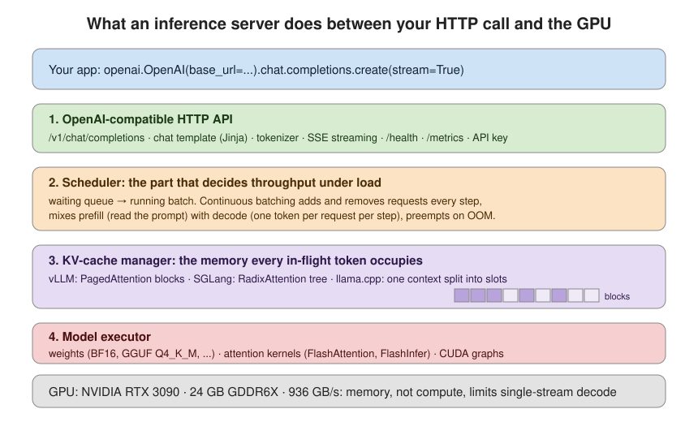
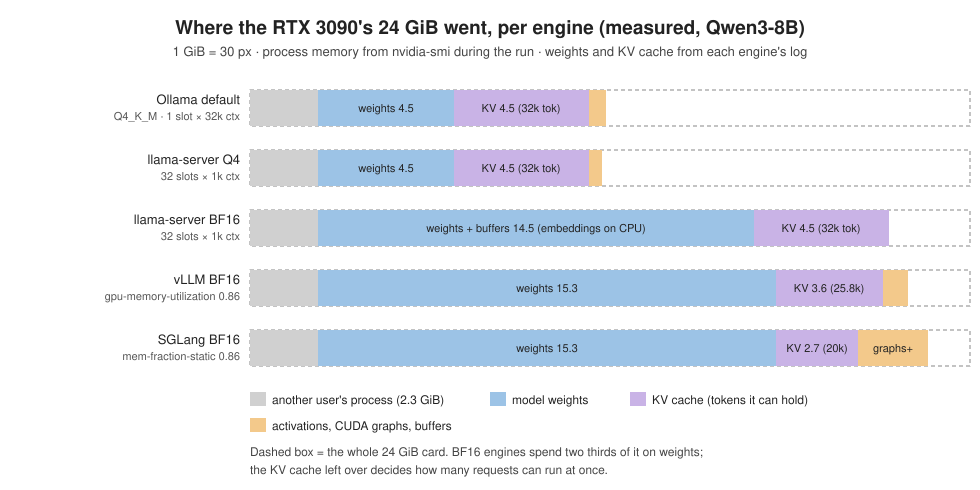
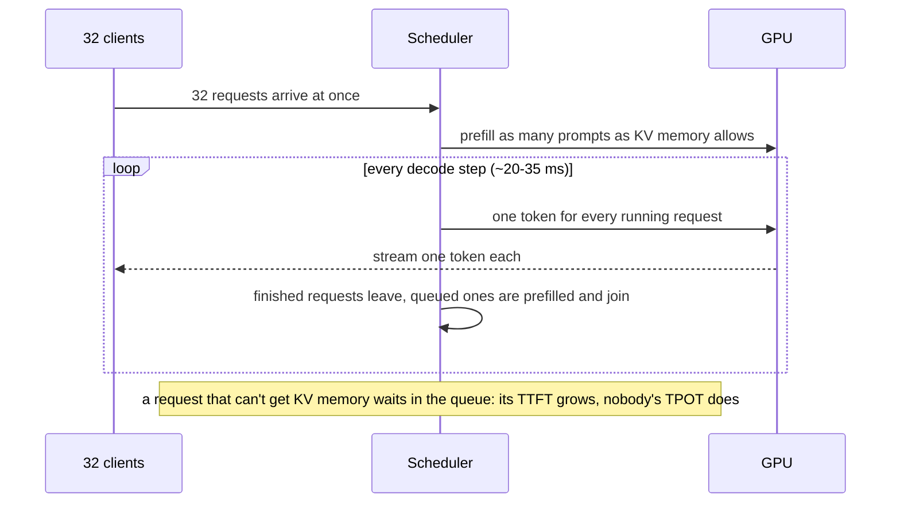
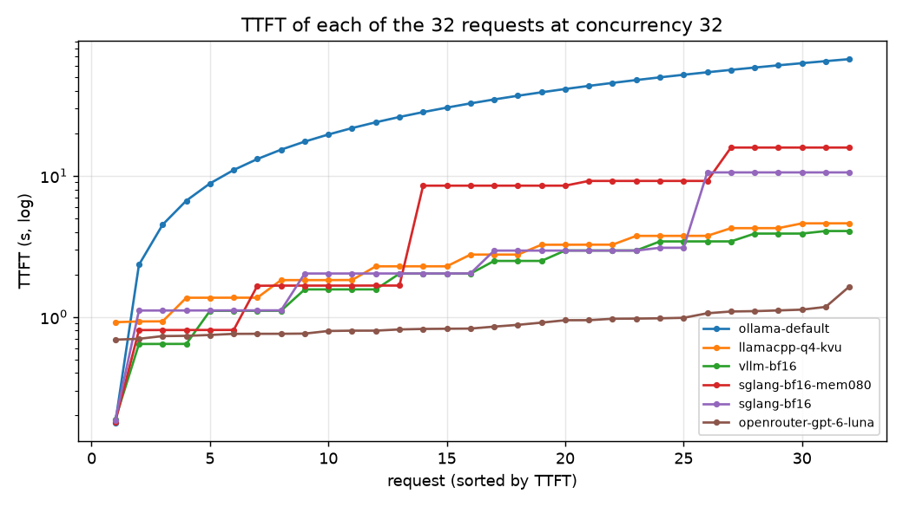
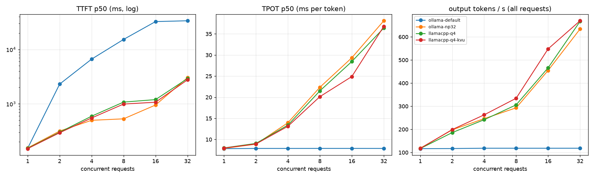
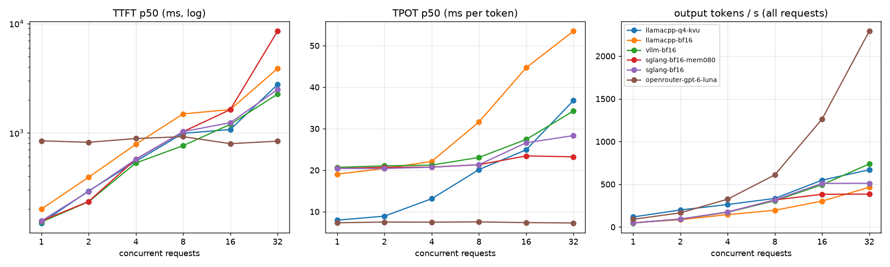
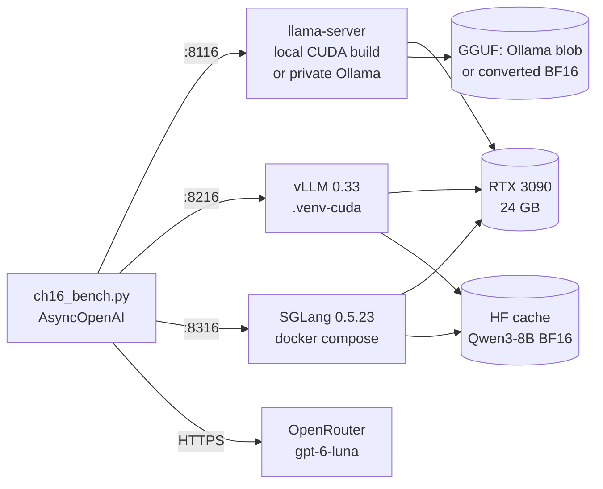
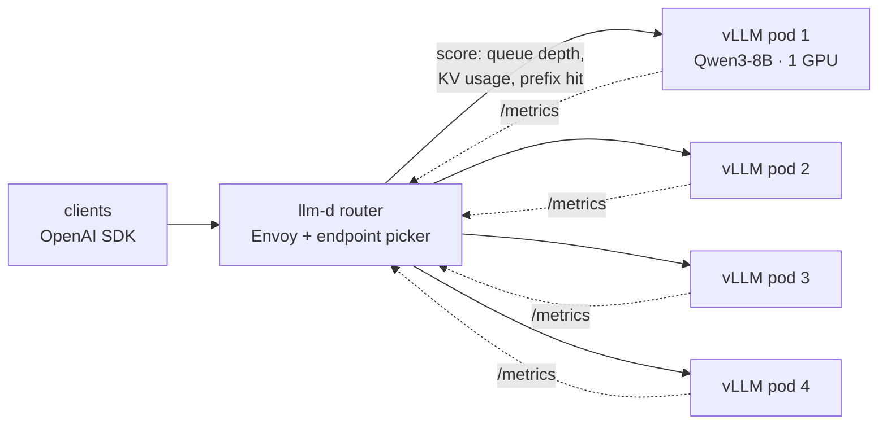

# Chapter 16: Self-hosting open models

> **Tested on:** 2026-11-09 · Ubuntu 22.04 (NVIDIA RTX 3090, 24 GB; a single RTX 3090 shared with
> another process using ~2.3 GB) · driver 595.99 · Python 3.12 · Qwen3-8B via Ollama 0.40.15
> (Q4_K_M), llama.cpp `llama-server` 0.9.0-dev (commit 9f0e509, built with CUDA 12.4), vLLM 0.33.0
> (pip, torch 2.14 + CUDA 13), SGLang 0.5.23 (official Docker image) · openai/gpt-6-luna via
> OpenRouter (hosted baseline, run 2026-11-07) · openai 3.46 · llm-d on Kubernetes: **not
> executed** (see [Serving it](#serving-it))

In September 2026, IBM Research and Red Hat served GLM-5.2, a 753-billion-parameter open model,
on 544 H100 GPUs for up to 3,000 concurrent coding agents. Their estimate: at cloud rental
rates it cost 5 to 10 times less per token than equivalent commercial API pricing
([IBM Research](https://research.ibm.com/blog/running-open-models-on-h100-gpus-with-llmd)). A
month later the serving stack they used, llm-d, shipped its 1.0 release
([llm-d](https://llm-d.ai/blog/llm-d-v1.0-state-of-the-art-inference-ready-for-day-2)).
Self-hosting has stopped being a hobby.

Most teams don't start with 544 GPUs. They start with one card in a server room or one rented
instance, a model that fits on it, and a question: *how many users can this thing actually
serve, and with which software?* That's this chapter. We take one RTX 3090, one model
(Qwen3-8B) and four serving engines, Ollama, llama.cpp's `llama-server`, vLLM and SGLang, and
we load-test all of them with the same 360-line benchmark. At 32 concurrent users the best
configuration produced 6.3 times the tokens per second of the default one, on the same card.
The reasons are worth knowing even if you never run a GPU yourself.



## The problem

Three ShopFlow teams want a model they control:

- **Support** wants ticket triage on data that shouldn't leave the building: tickets carry names,
  addresses and order history.
- **Finance** pays per token for a nightly batch that summarizes every ticket of the day, and
  the volume keeps growing.
- **Platform** got paged twice last quarter while a provider was rate-limiting, and wants a local
  fallback that can take real traffic. Chapter 1's fallback was one Ollama call at a time.

The ops team has one server with an RTX 3090 (24 GB), which it shares with a data-science job.
The question for this chapter: **which engine serves Qwen3-8B on that card well enough, and how
many concurrent users is "well enough"?**

## Requirements

| Type | Requirement | Target |
|---|---|---|
| Functional | OpenAI-compatible Chat Completions with streaming, so existing code changes only `base_url` | all engines |
| Functional | Same model everywhere; Qwen3's "thinking" switched off per request | Qwen3-8B, thinking off |
| Non-functional | Time to first token (TTFT) at the target load | p95 < 2 s (Chapter 1's target) |
| Non-functional | Streaming speed per user: time per output token (TPOT) | p50 < 50 ms (20+ tokens/s, faster than anyone reads) |
| Non-functional | Concurrent streams on one GPU within both targets | ≥ 16 |
| Non-functional | Cost per request on a rented card | below `openai/gpt-6-luna` |
| Operational | API key, metrics, health check, restart on crash, pinned versions | all |

## The data

The load comes from the 36 ShopFlow docs (`datasets/shopflow/docs/`). Every request gets a
unique ticket number, a different 512-token window of the docs and the same instruction: write a
400-word briefing. A unique start matters. Engines cache the KV of prompt prefixes they've
already seen (Chapter 17), and a benchmark that repeats one prompt measures that cache, not
the engine. From the notebook:

```
22,822 words, 31,225 o200k tokens in the corpus
512 tokens in this prompt

Ticket 00001-7b00c7f4. Documents:

. Security & Data Platform reviews it. Approved access is time-limited.
3. Access is logged and reviewed quarterly.
...
You are a ShopFlow support analyst. Using only the documents above, write a detailed briefing
for a new support agent: summarize every rule, number and exception, with examples. Write at
least 400 words.
```

The servers counted about 545 prompt tokens per request with Qwen's tokenizer and chat template
(519 for gpt-6-luna). Every request produced exactly 256 output tokens: vLLM, SGLang and
llama-server got `ignore_eos: true`, and Ollama, which doesn't support it, simply never finished
a 400-word briefing within 256 tokens.

## Concepts

### What "serving a model" means

A model on disk is a few files of numbers: 16.4 GB of BF16 weights for Qwen3-8B
(`total_size: 16381470720` in its `model.safetensors.index.json`). An **inference server**, or
*engine*, loads them onto a GPU and turns HTTP requests into tokens. Every engine does the four
jobs in the diagram above and differs mostly in the middle two: how it schedules requests and how
it manages GPU memory.

All four engines expose the same **OpenAI-compatible API**: `/v1/chat/completions` with the same
JSON and the same server-sent-events stream. Our client is `openai.AsyncOpenAI(base_url=...)` for
all of them, and for OpenRouter. That's the most useful fact in this chapter: self-hosting is a
deployment decision, not a rewrite.

### Prefill and decode: two different bottlenecks

Generating an answer has two phases:

1. **Prefill** reads the whole prompt in one pass. All 545 prompt tokens go through the model in
   parallel, which keeps the GPU's arithmetic units busy. Prefill is most of the **time to first
   token (TTFT)**.
2. **Decode** produces one token per step, and every step reads *every weight* from GPU memory.
   A little math on a lot of memory: decode is limited by **memory bandwidth**, not compute. The
   time between tokens is the **time per output token (TPOT)**.

The napkin math for decode is one division. The RTX 3090 moves 936 GB/s. One BF16 decode step
reads 16.4 GB, so a single request can't go faster than 16.4 / 936 ≈ 17.5 ms per token (57
tokens/s). Ollama's `qwen3:8b` is a 4-bit `Q4_K_M` file of 4.9 GB, which gives a floor of about
5.2 ms. We measured 19.0–20.7 ms for BF16 and 7.8–8.0 ms for Q4_K_M at one request at a time,
85–92% and 65% of the ceilings respectively.

The trick that makes GPUs worth their price is **batching**. If 32 requests decode together,
one pass over the weights serves all 32. Each request's TPOT grows a little; the server's total
tokens per second grows a lot. Total throughput is what you pay for, so the engine that batches
best is the cheapest per token.

### The KV cache: the memory that limits the batch

While decoding, the model keeps a *key* and a *value* vector for every token it has seen, in
every layer: the **KV cache**. It's the request's short-term memory, so the model doesn't
re-read the prompt at each step. Its size per token follows from the model's shape, and the
notebook computes it from Qwen3-8B's `config.json`:

```
ModelShape(num_layers=36, num_kv_heads=8, head_dim=128) -> 147,456 bytes/token = 144 KiB
one 768-token request: 108 MiB; 32 of them: 3.38 GiB
```

On a 24 GB card already holding 16.4 GB of weights (and, on our box, someone else's 2.3 GB),
3.38 GiB is most of what's left. vLLM's startup log agrees with the napkin math to within ten
tokens:

```
vLLM log: Model loading took 15.27 GiB memory and 10.616572 seconds
vLLM log: Available KV cache memory: 3.55 GiB
vLLM log: GPU KV cache size: 25,840 tokens, Maximum concurrency for 8,192 tokens per request: 3.15x
our math for 3.55 GiB: 25,850 tokens
```



When the KV cache is full, new requests wait. **How an engine manages KV memory decides how many
requests it can batch, and therefore its throughput:**

- **llama.cpp** (and Ollama, which runs llama.cpp's `llama-server` underneath) allocates one
  context of `--ctx-size` tokens and, by default with an explicit `--parallel N`, splits it into
  N fixed *slots*.
- **vLLM** cuts the cache into small blocks allocated on demand (**PagedAttention**, like virtual
  memory pages), so a short request doesn't reserve room for a long one.
- **SGLang** keeps the cache in a radix tree (**RadixAttention**) so requests that share a prefix
  share its blocks ([LMSYS](https://lmsys.org/blog/2024-01-17-sglang/)).

### Continuous batching

Static batching waits for N requests, runs them together, and returns when the longest one is
done. **Continuous batching** re-forms the batch at every step: finished requests leave, waiting
ones join after their prefill. vLLM, SGLang and llama-server all do it. So does Ollama, but only
up to `OLLAMA_NUM_PARALLEL` requests per model ("default 1" in the
[FAQ](https://docs.ollama.com/faq)); the rest queue.



### What we measure

| metric | definition | what the user feels |
|---|---|---|
| TTFT | request sent → first token received | "is it doing anything?" |
| TPOT | (last token − first token) / (output tokens − 1) | reading speed of the stream |
| E2E latency | request sent → stream closed | the whole answer |
| output throughput | all output tokens / wall time of the level | your cost per token |

These match the definitions in vLLM's benchmark docs
([vLLM](https://docs.vllm.ai/en/latest/benchmarking/cli/)). Each concurrency level is a *closed
loop*: exactly `c` requests in flight, a new one starts when one finishes, 32 requests per level.
At the start of each level all `c` requests arrive together, which is a burst, the worst case
for TTFT.

> [!IMPORTANT]
> **Decision: our own 360-line benchmark over `vllm bench serve`** — vLLM's and SGLang's
> benchmark tools are better (open-loop arrival rates, goodput), but each one is shipped with one
> engine and assumes its extra parameters. `ch16_bench.py` uses only the OpenAI SDK, so the same
> code measures Ollama, llama-server, vLLM, SGLang and OpenRouter, and it has unit tests. Reach
> for `vllm bench serve` once you've picked an engine and need arrival-rate curves for capacity
> planning.

The core of the benchmark is a streamed request that timestamps the first and the last token:

```python
# ch16/01_main-chapter-code/ch16_bench.py (excerpt)
stream = await client.chat.completions.create(
    model=model, messages=[{"role": "user", "content": prompt}],
    max_tokens=max_tokens, temperature=0, stream=True,
    stream_options={"include_usage": True}, **extra,
)
async for chunk in stream:
    now = time.perf_counter()
    if chunk.usage is not None:
        usage = chunk.usage
    if not chunk.choices:
        continue
    delta = chunk.choices[0].delta
    text = (delta.content or "") + (getattr(delta, "reasoning_content", None) or "")
    text += getattr(delta, "reasoning", None) or ""
    if text:
        chunks += 1
        first = first if first is not None else now
        last = now
...
return RequestRecord(
    ok=True, ttft=first - start, e2e=end - start, decode=last - first,
    prompt_tokens=usage.prompt_tokens if usage else None,
    # Servers may pack several tokens into one chunk; trust usage when it is there.
    completion_tokens=usage.completion_tokens if usage else chunks,
)
```

and an `asyncio.Semaphore(concurrency)` keeps exactly `c` of them in flight. Reasoning deltas
count as tokens (a thinking model's first token is usually reasoning), and the token count comes
from `usage`, because vLLM packs several tokens into one chunk under load. The unit tests
(`uv run pytest ch16`) run it against a fake streaming server to pin both behaviors down, plus
the concurrency limit, error handling, percentiles and prompt uniqueness.

## v0: Ollama, as everyone runs it

Ollama is how most people first run a local model, and it's what Chapter 1 used. We start a
private Ollama 0.40.15 on the GPU with no settings at all, and point the benchmark at it:

```bash
OLLAMA_HOST=127.0.0.1:8116 ~/.local/ollama/bin/ollama serve &
uv run python ch16/01_main-chapter-code/ch16_bench.py --base-url http://127.0.0.1:8116/v1 \
  --model qwen3:8b --label ollama-default --concurrency 1,2,4,8,16,32 --requests 32 \
  --prompt-tokens 512 --max-tokens 256 --reasoning-effort none
```

Ollama starts a `llama-server` process per model, and its command line shows what it decided
(`results/logs/ollama-default.runner.txt`):

```
.../lib/ollama/llama-server --model .../blobs/sha256-a3de86cd... --port 42057 ... -c 32768 -np 1
  --no-jinja --chat-template chatml --flash-attn auto -b 1024 -ub 1024 --context-shift --keep 4
```

`-np 1`: one request at a time. `-c 32768`: a 32k context, because Ollama sizes the default
context by VRAM (`"vram-based default context" total_vram="23.6 GiB" default_num_ctx=32768` in
its log). Defaults sized for an empty card go wrong on a shared one: earlier in the week, while
another job held 22.6 GB, the shared Ollama on this server (32k context × 4 slots) ran
`qwen3:8b` 98% on the CPU at a fraction of a token per second.

## Measuring v0

```
=== ollama-default
       ok  TTFT p50 ms  TTFT p95 ms  TPOT p50 ms  TPOT p95 ms  E2E p95 s  out tok/s
c
1   32/32        152.7        177.0          7.8          8.5        2.3      116.5
2   32/32       2305.1       2505.9          7.9          8.4        4.7      117.0
4   32/32       6640.3       6671.9          7.9          7.9        8.7      118.4
8   32/32      15292.4      15310.6          7.9          7.9       17.3      118.3
16  32/32      32566.9      32632.8          7.9          7.9       34.6      118.3
32  32/32      33706.6      63857.3          7.9          7.9       65.9      118.3
```

For one user, this is excellent: 153 ms to the first token and 7.8 ms per token, 128 tokens per
second. For two users it's already broken. Throughput is flat at 118 tokens/s whatever the load,
TPOT never moves, and TTFT grows linearly with the queue: at 32 concurrent users the median user
waits 34 seconds for the first word and the unlucky one 64 seconds. Every request was answered;
none was fast. The staircase chart shows each of the 32 requests waiting its turn:



> [!NOTE]
> **In the wild:** Red Hat benchmarked Ollama against vLLM on one A100 with Llama-3.1-8B and
> found vLLM reaching a peak of 793 tokens/s against Ollama's 41. Even with
> `OLLAMA_NUM_PARALLEL=32`, they found Ollama "becomes erratic under load"
> ([Red Hat Developer](https://developers.redhat.com/articles/2025/08/08/ollama-vs-vllm-deep-dive-performance-benchmarking),
> 2025-08-08). An Ollama maintainer explains the queueing in
> [ollama#9054](https://github.com/ollama/ollama/issues/9054): requests beyond the parallel
> slots "are queued up".

## Iterating

### 1. Turn on parallelism: Ollama with 32 slots, then llama-server itself

**What's wrong:** one slot. **Options:** raise `OLLAMA_NUM_PARALLEL`; or run the engine
underneath Ollama, `llama-server`, directly. The FAQ warns that memory scales with
`OLLAMA_NUM_PARALLEL × OLLAMA_CONTEXT_LENGTH`, so 32 slots at the 32k default would need 144 GiB
of KV cache. We set 32 slots of 2,048 tokens:

```bash
OLLAMA_NUM_PARALLEL=32 OLLAMA_CONTEXT_LENGTH=2048 OLLAMA_HOST=127.0.0.1:8116 ollama serve
# runner: llama-server ... -c 65536 -np 32 ...
```

And, on the same GGUF file (Ollama's blob, used as-is), llama-server built from source with CUDA
12.4 ([`build_llama_cpp.sh`](01_main-chapter-code/build_llama_cpp.sh)):

```bash
# ch16/01_main-chapter-code/run_gpu_benchmarks.sh (excerpt)
"$LLAMA_SERVER_BIN" --model "$Q4_GGUF" --alias qwen3-8b --host 127.0.0.1 --port 8116 \
  --n-gpu-layers 999 --ctx-size 32768 --parallel 32 ${5:-} \
  --flash-attn on --jinja --metrics
```

| config (Q4_K_M) | c=1 TPOT | c=8 TTFT p95 | c=16 TTFT p95 | c=32 TTFT p95 | c=32 out tok/s |
|---|---|---|---|---|---|
| Ollama default (1 slot) | 7.8 ms | 15,311 ms | 32,633 ms | 63,857 ms | 118 |
| Ollama, 32 slots × 2k | 7.9 ms | 1,167 ms | 2,339 ms | 4,980 ms | 634 |
| llama-server, 32 slots × 1k | 8.0 ms | 1,102 ms | 2,175 ms | 4,499 ms | 667 |
| llama-server, 32 slots, `--kv-unified` | 8.0 ms | 1,054 ms | 2,145 ms | 4,602 ms | 670 |



One environment variable took Ollama from 118 to 634 tokens/s, 5.4×, and the median TTFT at
c=32 from 34 s to 3 s. Ollama with 32 slots and llama-server with 32 slots are within 5% of each
other, as they should be: it's the same engine. The interesting differences are elsewhere.

**The slot split bites.** With `--ctx-size 32768 --parallel 32`, llama-server gives each slot
1,024 tokens (`n_slots = 32, n_ctx_slot = 1024, kv_unified = 'false'` in its log). A 1,061-token
request then fails, even though the server is idle and 31 slots are empty:

```
BadRequestError: Error code: 400 - request (1061 tokens) exceeds the available context size (1024 tokens), try increasing it
```

That's [llama.cpp#11681](https://github.com/ggml-org/llama.cpp/issues/11681) ("Context size
is being divided by number of parallel inferences"). The fix is `--kv-unified`, one shared pool
for all slots (`n_ctx_slot = 32768, kv_unified = 'true'`). It also raised mid-range throughput
(548 vs 466 tokens/s at c=16, 263 vs 242 at c=4); we didn't dig into why.

**Ollama fails silently instead.** Ollama with 2,048-token slots accepted the same 4,234-token
prompt, reported `prompt_tokens: 1026` and answered in 280 ms. It dropped three quarters of the
prompt and said nothing. A fast wrong answer is worse than a 400.

> [!WARNING]
> When you raise `OLLAMA_NUM_PARALLEL`, you usually lower `OLLAMA_CONTEXT_LENGTH` to fit memory,
> and from then on long prompts are truncated without an error. Log `usage.prompt_tokens` and
> alert when it's lower than what you sent.

> [!IMPORTANT]
> **Decision: llama-server with `--kv-unified` over Ollama for the shared GPU server** — the
> throughput is the same (670 vs 634 tokens/s), but llama-server fails loudly when a prompt
> doesn't fit, exposes Prometheus metrics (`--metrics`) and per-slot state, and we pin the exact
> llama.cpp commit we tested. Ollama stays the right tool on a developer's laptop, where one
> person sends one request at a time and model management (`ollama pull`) is worth more than
> control.

### 2. vLLM: PagedAttention and full-precision weights

**What's wrong:** the Q4 GGUF is a 4-bit copy. It's fast for one user, but quantization can cost
quality (Chapter 17 measures how much), and llama.cpp's scheduler isn't built for many users.
**Options:** vLLM or SGLang on the original BF16 weights. We start with vLLM 0.33.0, installed
from PyPI into a chapter-local `.venv-cuda` (never the main `.venv`):

```bash
uv venv ch16/01_main-chapter-code/.venv-cuda --python 3.12
uv pip install -r ch16/01_main-chapter-code/requirements-cuda.txt \
    --python ch16/01_main-chapter-code/.venv-cuda       # vllm==0.33.0
```

```bash
# ch16/01_main-chapter-code/serve_vllm.sh (excerpt)
export VLLM_USE_FLASHINFER_SAMPLER="${VLLM_USE_FLASHINFER_SAMPLER:-0}"
export LD_LIBRARY_PATH="$HERE/.venv-cuda/lib/python3.12/site-packages/nvidia/cu13/lib..."
export PYTORCH_CUDA_ALLOC_CONF="${PYTORCH_CUDA_ALLOC_CONF:-expandable_segments:True}"
exec "$HERE/.venv-cuda/bin/vllm" serve "$MODEL" \
  --host 127.0.0.1 --port 8216 \
  --gpu-memory-utilization "${VLLM_GPU_UTIL:-0.86}" \
  --max-model-len "${VLLM_MAX_LEN:-8192}" \
  --max-num-seqs "${VLLM_MAX_SEQS:-64}" \
  --reasoning-parser qwen3
```

Three lines in that script are scars from this server:

- `VLLM_USE_FLASHINFER_SAMPLER=0`: otherwise vLLM 0.33 JIT-compiles a FlashInfer sampler on
  the first request, which needs `nvcc` and `ninja` on `PATH`. We picked the environment variable
  over putting CUDA 12.4's `nvcc` next to a CUDA 13 PyTorch.
- `LD_LIBRARY_PATH`: some kernels compile at runtime through NVRTC and need
  `libnvrtc-builtins.so.13.0`, which ships inside the pip CUDA wheels but isn't on the loader
  path.
- `--gpu-memory-utilization 0.86`: the share of the *whole card* vLLM may claim. Another
  process held 2.3 GB, and at 0.88 a sibling chapter's vLLM ran out of memory during warm-up. At
  0.80, BF16 weights left only about 1.8 GB for the KV cache. This is the knob behind
  [vllm#5274](https://github.com/vllm-project/vllm/issues/5274), where a second process on the
  GPU made one value OOM and a lower one fail with "No available memory for the cache blocks".

Qwen3 thinks by default. Per the
[vLLM reasoning docs](https://docs.vllm.ai/en/latest/features/reasoning_outputs/), it's switched
off per request with `chat_template_kwargs`, which our benchmark passes through `extra_body`
(Ollama wants `reasoning_effort="none"` instead):

```python
extra_body={"chat_template_kwargs": {"enable_thinking": False}, "ignore_eos": True}
```

| engine (same BF16 weights) | c=1 TPOT | c=8 TTFT p95 | c=16 TTFT p95 | c=32 TTFT p95 | c=32 TPOT p50 | c=32 out tok/s |
|---|---|---|---|---|---|---|
| llama-server BF16 (32 slots) | 19.0 ms | 1,891 ms | 2,981 ms | 6,118 ms | 53.5 ms | 464 |
| vLLM 0.33 | 20.7 ms | 1,051 ms | 2,007 ms | 3,969 ms | 34.2 ms | 738 |

To separate the engine from the quantization, we converted the same Hugging Face checkpoint to
a BF16 GGUF ([`convert_bf16_gguf.sh`](01_main-chapter-code/convert_bf16_gguf.sh)) and ran
llama-server on it. With identical weights, vLLM produced 59% more tokens per second at c=32,
and its TPOT barely moved with load (20.7 → 34.2 ms) where llama.cpp's nearly tripled (19.0 →
53.5 ms). vLLM even beat llama-server's 4-bit model at c=32 (738 vs 670 tokens/s) while serving
full-precision weights. For one user, the 4-bit model is still 2.6× faster per token (8.0 vs
20.7 ms): decode reads weights, and the 4-bit weights are a third of the size.

> [!IMPORTANT]
> **Decision: vLLM with BF16 weights for the shared ShopFlow server, llama-server Q4 for
> single-user fallbacks** — above about 8 concurrent users vLLM delivers more throughput with
> unquantized weights and flatter per-user latency. With 1–4 users, the Q4 model on llama-server
> streams 2.6× faster per user and starts in 2 seconds instead of 59. If the only consumer is
> one developer or one batch job running sequentially, pick llama-server.

> [!NOTE]
> **In the wild:** LinkedIn runs vLLM for more than 50 generative-AI use cases "on thousands of
> hosts across our platform", and for its hiring assistant "over 50% of requests share prefix
> tokens", which is what prefix caching exploits
> ([LinkedIn Engineering](https://www.linkedin.com/blog/engineering/ai/how-we-leveraged-vllm-to-power-our-genai-applications),
> 2025-08-26). Amazon built a multi-node leader/follower architecture *into* vLLM to serve
> Rufus across tens of thousands of Trainium chips on Prime Day
> ([AWS](https://aws.amazon.com/blogs/machine-learning/how-amazon-scaled-rufus-by-building-multi-node-inference-using-aws-trainium-chips-and-vllm/),
> 2025-08-13).

### 3. SGLang, and the memory knob that decided the race

SGLang runs from its official image (CUDA 13 only now; `v0.5.19-cu129` was the last CUDA 12
tag, per the [install docs](https://docs.sglang.io/docs/get-started/install)). Our compose file mounts the
Hugging Face cache read-only and runs offline:

```yaml
# ch16/01_main-chapter-code/docker-compose.yml (excerpt)
image: lmsysorg/sglang:v0.5.23-runtime@sha256:3ce6da3e5ea0fee2dac6a23b528cb294fedd31ca74a55a4511f709c5e01e8652
ports: ["127.0.0.1:8316:30000"]
ipc: host # NCCL and the tokenizer/detokenizer processes talk through shared memory
volumes:
  # Read-only: the container runs as root and must not write root-owned files into our cache.
  - ${HF_HOME:-${HOME}/.cache/huggingface}:/root/.cache/huggingface:ro
environment:
  HF_HUB_OFFLINE: "1"
command: >
  python3 -m sglang.launch_server --model-path ${SGLANG_MODEL:-Qwen/Qwen3-8B}
  --host 0.0.0.0 --port 30000 --mem-fraction-static ${SGLANG_MEM_FRACTION:-0.80}
  --context-length 8192 --reasoning-parser qwen3 --enable-metrics
```

`ipc: host` is there because SGLang's processes exchange data through shared memory. Docker's
default 64 MB `/dev/shm` is a classic first-run failure
([sglang#4259](https://github.com/sgl-project/sglang/issues/4259)).

We ran it twice, at the "safe start" of `--mem-fraction-static 0.80` and at 0.86, the same
budget as vLLM. SGLang's log shows what the extra 6% bought:

```
sglang-bf16-mem080: KV Cache is allocated. dtype: torch.bfloat16, #tokens: 10845, K size: 0.74 GB, V size: 0.74 GB
sglang-bf16:        KV Cache is allocated. dtype: torch.bfloat16, #tokens: 20013, K size: 1.37 GB, V size: 1.37 GB
```

| engine | KV cache (tokens) | c=8 out tok/s | c=16 TTFT p95 | c=32 TTFT p95 | c=32 out tok/s |
|---|---|---|---|---|---|
| SGLang, mem 0.80 | 10,845 | 317 | 8,026 ms | 15,863 ms | 385 |
| SGLang, mem 0.86 | 20,013 | 317 | 2,012 ms | 10,570 ms | 512 |
| vLLM, util 0.86 | 25,840 | 308 | 2,007 ms | 3,969 ms | 738 |



Up to 8 users, vLLM and SGLang are indistinguishable (308 vs 317 tokens/s, 21–23 ms TPOT). Past
that, each one is exactly as good as its KV cache is large. 32 requests of ~800 tokens need
about 25,600 tokens of cache. vLLM had 25,840 and ran all 32 at once; SGLang had 20,013 (or
10,845) and queued the rest, which is the second step of its staircase above, at 10.6 s (or
15.9 s). SGLang's TPOT stayed *lower* than vLLM's (28.3 vs 34.2 ms) because it was decoding a
smaller batch. Same card, same budget, but SGLang spent about a gigabyte on CUDA graphs for
prefill (`Capture target prefill CUDA graph end. elapsed=42.17 s, mem usage=0.83 GB`), and that
gigabyte is 7,000 tokens of KV cache.

> [!IMPORTANT]
> **Decision: vLLM over SGLang on this card** — at the same memory budget, vLLM kept 29% more
> KV cache and served 44% more tokens per second at 32 users (738 vs 512). That's a statement
> about one 24 GB card shared with another tenant, not about the engines in general: on an
> 80 GB GPU both have KV cache to spare, and SGLang's RadixAttention pays off when many requests
> share a long prefix (agents, few-shot prompts), which our unique-prompt benchmark deliberately
> avoids. Re-run the benchmark on your hardware and your prompts before choosing.

> [!NOTE]
> **In the wild:** xAI uses SGLang to serve Grok 3, and the SGLang team says it's deployed at a
> scale "generating trillions of tokens every day"
> ([PyTorch blog](https://pytorch.org/blog/sglang-joins-pytorch/), 2025).

### 4. Prefill: the measurement Chapter 1 promised

Chapter 1 found a warm Ollama answering in 0.12 s because it reused the cached FAQ prompt. Here
every prompt is new, one request at a time, 16 output tokens:

| engine | ~280 prompt tokens | ~1,070 | ~4,234 |
|---|---|---|---|
| Ollama default (Q4) | 86 ms | 245 ms | 974 ms |
| llama-server Q4, `--kv-unified` | 80 ms | 234 ms | 914 ms |
| vLLM (BF16) | 113 ms | 241 ms | 829 ms |
| SGLang (BF16, 0.86) | 114 ms | 245 ms | 830 ms |
| llama-server Q4 or BF16, 32 × 1k slots | 80 / 132 ms | 400 error | 400 error |
| Ollama, 32 × 2k slots | 88 ms | 245 ms | 280 ms, **only 1,026 tokens read** |

Prefill runs at 4,300–5,100 tokens/s on every engine, and the 4-bit model is *not* faster
here: prefill is compute-bound, and dequantizing 4-bit weights costs compute. Quantization buys
decode speed, not prefill speed. A 4k-token RAG prompt costs under a second of TTFT on this
card. A 32k one will cost several.

## Production hardening

An inference server is a network service that executes untrusted input on expensive hardware.
Treat it like a database, not like a library.

- **An API key is not an access policy.** We started vLLM with `VLLM_API_KEY` set and probed it:

  ```
  GET /v1/models without key -> 401
  GET /v1/models with key    -> 200
  GET /metrics without key   -> 200
  ```

  That's documented behavior: the key only protects `/v1` and a few other prefixes
  ([vLLM docs](https://docs.vllm.ai/en/latest/serving/online_serving/openai_compatible_server/)).
  `/metrics` tells anyone who can reach it your traffic and model. Every port in our setup binds
  to `127.0.0.1`. Put a gateway (Chapter 15's LiteLLM, or nginx) in front for TLS, per-user keys
  and rate limits.
- **Pin and patch the engine.** Every engine in this chapter is pinned: vLLM `==0.33.0`,
  llama.cpp by commit, the SGLang image by digest.

  > [!CAUTION]
  > In February 2026, CVE-2026-22778 (CVSS 9.8) let unauthenticated attackers run code on vLLM
  > servers ≥ 0.8.3 and < 0.14.1 by sending a crafted video URL to the API
  > ([Orca Security](https://orca.security/resources/blog/cve-2026-22778-vllm-rce-vulnerability/)).
  > An inference server that's reachable from the internet and three months behind on patches is
  > an open door, whatever the API key says.

- **Pin the weights.** `HF_HUB_OFFLINE=1` plus a read-only mount means the server serves what's
  in the cache and never pulls a new revision when it restarts. We downloaded Qwen3-8B at
  revision `b968826d…`; record the revision next to your eval results.
- **Health checks, restarts, start-up time.** The compose file restarts SGLang on a crash and
  reports healthy only once `/health` answers. Start-up times differ a lot, and they matter for
  autoscaling and deploys:

  | engine | ready after | GPU memory (engine process) |
  |---|---|---|
  | llama-server Q4 | 2 s | 9,696 MiB |
  | Ollama (first request loads the model) | 4 s | 9,844 MiB |
  | llama-server BF16 | 9 s | 19,484 MiB |
  | vLLM BF16 | 59 s | 20,146 MiB |
  | SGLang BF16 (0.86) | 81 s | 20,828 MiB |

  vLLM spends its minute loading weights (10.6 s), compiling (14.2 s) and capturing CUDA
  graphs. SGLang spent 42 s on prefill CUDA graphs alone.
- **Share the GPU deliberately.** Our runner refuses to start an engine when more than 4 GB of
  the card is already in use, and we checked with `nvidia-smi` after each run that our processes
  were gone (vLLM's `EngineCore` can outlive its parent briefly).
- **Watch the queue, not just latency.** vLLM exports `vllm:num_requests_waiting`,
  `vllm:kv_cache_usage_perc` and `vllm:num_preemptions_total`
  ([metrics docs](https://docs.vllm.ai/en/latest/usage/metrics/)); llama-server and SGLang
  export equivalents with `--metrics` and `--enable-metrics`. After the whole vLLM run:

  ```
  vllm:num_preemptions_total{engine="0",model_name="Qwen/Qwen3-8B"} 0.0
  vllm:generation_tokens_total{engine="0",model_name="Qwen/Qwen3-8B"} 49168.0
  vllm:request_success_total{engine="0",finished_reason="length",model_name="Qwen/Qwen3-8B"} 193.0
  ```

  Zero preemptions: at c=32 the 25,840-token cache was just enough. Alert on waiting requests
  and KV usage near 1.0. They tell you to add a GPU before TTFT does.
- **"OpenAI-compatible" has dialects.** Turning off Qwen3's thinking takes
  `chat_template_kwargs` on vLLM, SGLang and llama-server and `reasoning_effort` on Ollama, and
  each server ignores the other's switch without complaint. vLLM 0.33 returns reasoning in
  `message.reasoning` (per its docs), llama.cpp in `reasoning_content`; our benchmark reads
  both. The model name is whatever the server says
  it is (`qwen3:8b`, `qwen3-8b`, `Qwen/Qwen3-8B`). Keep the per-engine differences in one config
  file, and test the *behavior* (no `<think>` in the output) rather than the parameters you send.
  Qwen's maintainers add that "It is not recommended to disable thinking modes completely"
  ([Qwen3#1286](https://github.com/QwenLM/Qwen3/issues/1286)); for triage and summaries we
  disable it and measure quality instead (Chapter 17).

## Serving it

The chapter's code ([`01_main-chapter-code/`](01_main-chapter-code/)) runs every engine the same
way, one at a time on the one card:



```bash
cd ch16/01_main-chapter-code
bash build_llama_cpp.sh                        # once, ~9 minutes
LLAMA_CPP=/path/to/llama.cpp bash convert_bf16_gguf.sh   # once, for the BF16 GGUF
docker compose pull                            # SGLang image, ~35 GB unpacked
bash run_gpu_benchmarks.sh ollama-default ollama-np32 llamacpp-q4 llamacpp-q4-kvu \
     llamacpp-bf16 vllm-bf16 sglang-bf16-mem080 sglang-bf16
uv run jupyter nbconvert --to notebook --execute --inplace ch16.ipynb
```

Using a self-hosted model from the rest of the book is a `.env` change. Every chapter talks to
`llmprod.chat_client()`, so pointing `LLM_BASE_URL` at `http://localhost:8216/v1`,
`LLM_MODEL` at `Qwen/Qwen3-8B` and `LLM_API_KEY` at vLLM's key moves a chapter to our server.
The thinking switch above is the one change the code itself needs.

### Beyond one GPU: llm-d on Kubernetes

One card runs one engine. The next step is several replicas behind a router that knows each
replica's load and what's in its KV cache, so a request whose prefix is cached on replica 3 goes
to replica 3. That's llm-d: vLLM (or SGLang) pods, the Gateway API Inference Extension's
`InferencePool`, and a scheduler that scores pods on queue depth, KV usage and prefix hits. It
was launched by Red Hat with Google Cloud, IBM Research, CoreWeave and NVIDIA in May 2025
([Red Hat](https://www.redhat.com/en/about/press-releases/red-hat-launches-llm-d-community-powering-distributed-gen-ai-inference-scale))
and reached 1.0 on 2026-10-20.



> [!CAUTION]
> **Not executed by the author** — requires a Kubernetes cluster with 4+ NVIDIA GPU nodes.
> Written against the llm-d v1.0 quickstart, https://llm-d.ai/docs/getting-started/quickstart
> (accessed 2026-11-07), and checked with `kustomize build` (v5.7.1), which rendered the
> Deployment from the guide's remote base (`results/logs/llm-d-kustomize-build.yaml`).

```yaml
# ch16/01_main-chapter-code/k8s/llm-d-qwen3-8b/patch-vllm.yaml (excerpt)
spec:
  replicas: 4
  template:
    spec:
      containers:
        - name: modelserver
          command: ["vllm", "serve"]
          args:
            - "Qwen/Qwen3-8B"
            - "--tensor-parallel-size=1"
            - "--gpu-memory-utilization=0.90"
            - "--max-model-len=8192"
            - "--max-num-seqs=64"
            - "--reasoning-parser=qwen3"
            - "--shutdown-timeout=45"
          resources:
            limits: {nvidia.com/gpu: 1, cpu: "8", memory: 48Gi}
```

The overlay ([`k8s/llm-d-qwen3-8b/`](01_main-chapter-code/k8s/llm-d-qwen3-8b/)) patches the
guide's `optimized-baseline` model server, which defaults to two replicas of Qwen3-32B split
across two GPUs each, down to the single-GPU configuration we measured. You install the router
exactly as the quickstart says, then `kubectl apply -k` the overlay. Rendering it taught us two
things before any cluster was involved. The guide pins `vllm/vllm-openai:v0.31.0`, two minor
versions behind what we measured. And the pods keep the label `llm-d.ai/model=Qwen3-32B`,
because it's part of the base Deployment's selector, which Kubernetes doesn't let you change on
a live Deployment.

## Results

All numbers are 32 requests per level, ~545-token prompts, 256 output tokens, Qwen3-8B, one RTX
3090 shared with a 2.3 GB process. The hosted row is the same benchmark against OpenRouter.

| engine | max concurrency within targets¹ | c=1 TTFT p50 | c=1 TPOT p50 | c=32 TTFT p95 | c=32 out tok/s |
|---|---|---|---|---|---|
| Ollama default (Q4, 1 slot) | 1 | 153 ms | 7.8 ms | 63.9 s | 118 |
| Ollama, 32 slots (Q4) | 8 | 155 ms | 7.9 ms | 5.0 s | 634 |
| llama-server Q4, `--kv-unified` | 8 | 150 ms | 8.0 ms | 4.6 s | 670 |
| llama-server BF16 | 8 | 201 ms | 19.0 ms | 6.1 s | 464 |
| **vLLM 0.33 BF16** | 8 | 153 ms | 20.7 ms | **4.0 s** | **738** |
| SGLang 0.5.23 BF16 (mem 0.86) | 8 | 156 ms | 20.4 ms | 10.6 s | 512 |
| openai/gpt-6-luna via OpenRouter | 32 | 845 ms | 7.3 ms | 1.1 s | 2,292 |

¹ TTFT p95 < 2 s and TPOT p50 < 50 ms. The 16-user requirement **was not met** by any local
engine. vLLM missed it by 7 ms (TTFT p95 2,007 ms at c=16) and SGLang by 12 ms; at 8 users all
engines met both targets. Our closed loop starts each level with all requests arriving at once,
a worst case. Steadier arrivals would pass, but a real lunch-time spike would not.

Cost, if the card is busy 100% of the time at the c=32 throughput (RunPod's RTX 3090 at
$0.22/h Community or $0.50/h Secure Cloud, [as of 2026-11-04](https://www.runpod.io/pricing);
`openai/gpt-6-luna` at $0.10 / $0.50 per 1M input/output tokens on OpenRouter, as of 2026-11):

| engine | out tok/s | $ per 1k requests @ $0.22/h | @ $0.50/h |
|---|---|---|---|
| Ollama default | 118 | 0.1322 | 0.3004 |
| llama-server Q4, `--kv-unified` | 670 | 0.0234 | 0.0531 |
| vLLM BF16 | 738 | 0.0212 | 0.0482 |
| SGLang BF16 | 512 | 0.0306 | 0.0695 |
| **openai/gpt-6-luna** (API) | n/a | 0.1799 | 0.1799 |

```
break-even utilization of vLLM at community $0.22/h: 12% (output-only break-even: 122 tok/s)
break-even utilization of vLLM at secure $0.50/h: 27% (output-only break-even: 278 tok/s)
```

A rented 3090 running vLLM beats the API on price as soon as it's busy more than 12–27% of the
day. Ollama with its defaults never does: on the secure tier it costs 1.7× the API. The API wins
on everything else: a flat 0.8–0.9 s TTFT at any load we could generate, 7.3 ms per token,
3× our throughput at c=32, and nothing to patch. The OpenRouter runs for this chapter cost about
$0.035.

> [!IMPORTANT]
> **Decision: self-host the batch and private workloads, keep the API for the customer-facing
> chatbot** — the nightly summaries and PII-heavy ticket triage are throughput-bound and keep a
> card busy, so vLLM on one 3090 does them at a quarter of the API price, and the data never
> leaves. The chatbot's traffic is spiky and latency-bound, and one card can't absorb a spike
> of 16 users within our TTFT target. Revisit when traffic is steady enough to keep two or more
> GPUs busy behind a router (llm-d above), or when a regulation forbids the API.

## Exercises

1. Run `ch16_bench.py` against vLLM with `--prompt-tokens 2048 --concurrency 8,16`. How does the
   TTFT staircase change when prefill dominates? Then restart vLLM with a smaller
   `--max-num-batched-tokens` and see which of TTFT and TPOT it trades.
2. Restart vLLM with `--kv-cache-dtype fp8` and check the "GPU KV cache size" line in its log.
   Does c=32 throughput change, and does the eval from Chapter 17 notice?
3. Change `run_level` to an *open loop*: requests arrive at a fixed rate (say 1 per second)
   whether or not earlier ones have finished. Find the arrival rate at which vLLM's TTFT p95
   crosses 2 s. That's the number to give the capacity planner.
4. Point Chapter 1's chatbot at your vLLM server through `.env`, and make the thinking switch
   per-provider. Then repeat the injection test from Chapter 1. Does Qwen3-8B hold up as well as
   gpt-6-luna?

## What we learned

- Every engine here speaks the OpenAI Chat Completions API, so moving a workload from a hosted
  model to your own GPU is a `base_url` change, plus the few dialect differences (thinking
  switch, `ignore_eos`, model names) that you should keep in one place.
- Decode is memory-bandwidth-bound: one user gets about `card bandwidth / weight bytes` tokens
  per second. That's why 4-bit weights stream 2.6× faster per user (8.0 vs 20.7 ms per token on
  our card) and why they don't speed up prefill at all.
- Throughput comes from batching, and batching is limited by KV-cache memory. On a 24 GB card
  holding 16.4 GB of BF16 weights, the engine that kept the largest KV cache won: vLLM (25,840
  tokens, 738 tokens/s) over SGLang (20,013 tokens, 512 tokens/s) at the same memory budget.
- Defaults are built for a single user. Ollama's single slot gave 118 tokens/s and a 64-second
  p95 TTFT at 32 users; one environment variable gave 5.4× the throughput.
- Slot-based context splitting fails long prompts: llama-server rejects them with a 400, and
  Ollama silently truncates them (a 4,234-token prompt became 1,026). Use `--kv-unified`, and
  monitor `usage.prompt_tokens`.
- One 3090 met our latency targets for 8 concurrent users, not 16. Measure your SLO at the load
  you expect, with bursts, before promising it.
- Self-hosting pays on price above 12–27% utilization of a rented card, and for data that can't
  leave. Hosted APIs still win on latency under spikes and on operations.
- An API key on an inference server guards `/v1`, not `/metrics`. Bind to localhost, put a
  gateway in front, pin versions and patch: CVE-2026-22778 was a 9.8.

## References

- "How llm-d makes the most of the hardware you already have" — IBM Research, 2026-09-08. https://research.ibm.com/blog/running-open-models-on-h100-gpus-with-llmd
- "llm-d v1.0: state-of-the-art inference, ready for day 2" — llm-d blog, 2026-10-20. https://llm-d.ai/blog/llm-d-v1.0-state-of-the-art-inference-ready-for-day-2
- llm-d Quickstart (v1.0) — llm-d, accessed 2026-11-07. https://llm-d.ai/docs/getting-started/quickstart
- llm-d repository — GitHub, accessed 2026-11-07. https://github.com/llm-d/llm-d
- "Red Hat launches the llm-d community" — Red Hat press release, 2025-05-20. https://www.redhat.com/en/about/press-releases/red-hat-launches-llm-d-community-powering-distributed-gen-ai-inference-scale
- Gateway API Inference Extension: InferencePool — Kubernetes SIGs, accessed 2026-11-07. https://gateway-api-inference-extension.sigs.k8s.io/api-types/inferencepool/
- "How we leveraged vLLM to power our GenAI applications" — LinkedIn Engineering, 2025-08-26. https://www.linkedin.com/blog/engineering/ai/how-we-leveraged-vllm-to-power-our-genai-applications
- "How Amazon scaled Rufus by building multi-node inference using AWS Trainium chips and vLLM" — AWS Machine Learning Blog, 2025-08-13. https://aws.amazon.com/blogs/machine-learning/how-amazon-scaled-rufus-by-building-multi-node-inference-using-aws-trainium-chips-and-vllm/
- "SGLang joins PyTorch ecosystem" — PyTorch blog, 2025. https://pytorch.org/blog/sglang-joins-pytorch/
- "Fast and expressive LLM inference with RadixAttention and SGLang" — LMSYS, 2024-01-17. https://lmsys.org/blog/2024-01-17-sglang/
- "CVE-2026-22778: critical RCE vulnerability in vLLM" — Orca Security, 2026-02-02. https://orca.security/resources/blog/cve-2026-22778-vllm-rce-vulnerability/
- "Ollama vs. vLLM: a deep dive into performance benchmarking" — Red Hat Developer, 2025-08-08. https://developers.redhat.com/articles/2025/08/08/ollama-vs-vllm-deep-dive-performance-benchmarking
- vLLM OpenAI-compatible server — vLLM docs, accessed 2026-11-07. https://docs.vllm.ai/en/latest/serving/online_serving/openai_compatible_server/
- vLLM engine arguments — vLLM docs, accessed 2026-11-07. https://docs.vllm.ai/en/latest/configuration/engine_args/
- vLLM reasoning outputs — vLLM docs, accessed 2026-11-07. https://docs.vllm.ai/en/latest/features/reasoning_outputs/
- vLLM metrics — vLLM docs, accessed 2026-11-07. https://docs.vllm.ai/en/latest/usage/metrics/
- vLLM benchmark CLI — vLLM docs, accessed 2026-11-07. https://docs.vllm.ai/en/latest/benchmarking/cli/
- SGLang install — SGLang docs, accessed 2026-11-07. https://docs.sglang.io/docs/get-started/install
- SGLang server arguments — SGLang docs, accessed 2026-11-07. https://docs.sglang.io/docs/advanced_features/server_arguments.md
- llama.cpp server README — ggml-org/llama.cpp, accessed 2026-11-07. https://github.com/ggml-org/llama.cpp/blob/master/tools/server/README.md
- Ollama FAQ (`OLLAMA_NUM_PARALLEL`, `OLLAMA_MAX_QUEUE`) — Ollama docs, accessed 2026-11-07. https://docs.ollama.com/faq
- Ollama OpenAI compatibility — Ollama docs, accessed 2026-11-07. https://docs.ollama.com/api/openai-compatibility
- GPU cloud pricing (RTX 3090: $0.22/h community, $0.50/h secure) — RunPod, updated 2026-11-04. https://www.runpod.io/pricing
- ggml-org/llama.cpp #11681, "Context size is being divided by number of parallel inferences". https://github.com/ggml-org/llama.cpp/issues/11681
- ollama/ollama #9054, parallel requests and queueing. https://github.com/ollama/ollama/issues/9054
- vllm-project/vllm #5274, OOM vs "No available memory for the cache blocks" with `gpu_memory_utilization`. https://github.com/vllm-project/vllm/issues/5274
- sgl-project/sglang #4259, NCCL shared memory errors in Docker. https://github.com/sgl-project/sglang/issues/4259
- QwenLM/Qwen3 #1286, disabling thinking under `vllm serve`. https://github.com/QwenLM/Qwen3/issues/1286
