# Chapter 17: GPU & compute optimization

> **Tested on:** 2026-11-09 · Ubuntu 22.04 (NVIDIA RTX 3090, 24 GB) · Python 3.12 ·
> Qwen3-8B via vLLM 0.33.0 (torch 2.14.0+cu130), llama.cpp `llama-server` build 12182 (commit
> fd27b2034, `server-cuda` image) and Ollama 0.40.15 · NVIDIA driver 595.99.02 / CUDA 13.2 ·
> single RTX 3090 shared with another process using ~2.3 GB · multi-GPU sections: **not
> executed** (see [Concepts](#when-one-gpu-isnt-enough-tensor-and-pipeline-parallelism))

In June 2024 Character.AI wrote that it serves more than 20,000 inference queries per second and
had cut its serving cost by 33× since late 2022. None of that came from a bigger GPU. It came from
a smaller KV cache, int8 weights and activations, and a cache that reuses 95% of each
conversation's prefix between turns
([Character.AI](https://blog.character.ai/optimizing-ai-inference-at-character-ai-2/)).

That is the theme of this chapter: the same model on the same card can be several times cheaper
or faster depending on a handful of choices most teams leave at their defaults. We take one
24 GB RTX 3090, the model ShopFlow already uses locally (Qwen3-8B), and the Chapter 2 triage
eval, and we measure each choice: weight precision, prefix caching, speculative decoding and
batching. Then we turn the measurements into dollars per million tokens.

## The problem

ShopFlow already classifies support tickets with an LLM (Chapter 2) and wants to stop paying per
token for the bulk of that traffic. The plan is one rented GPU running an open-weight model.
The first attempt is the obvious one: download Qwen3-8B, `vllm serve` it with the defaults,
point the triage code at it. It works, and it's slow and expensive:

- **48.9 tokens/s** for one request, **p50 1,067 ms** per ticket.
- The weights take **15.27 GiB**, which leaves room for **12,912 tokens** of KV cache in total.
  One long conversation fills the card.
- Before it even started, it **failed**: the first configuration we tried didn't leave enough
  memory for one maximum-length request.

At $0.50/hour for an RTX 3090 (RunPod Secure Cloud, as of 2026-11) that single stream costs
**$2.88 per million output tokens**, almost six times what `openai/gpt-6-luna` charges for
output ($0.50 per 1M on OpenRouter, as of 2026-11). This chapter takes that same model on the
same card and makes it about **50× cheaper per token**, without changing the eval result.

## Requirements

| Type | Requirement | Target |
|---|---|---|
| Functional | Triage accuracy (category) on the Chapter 2 eval | not worse than bf16 beyond the 95% CI |
| Functional | Strict-JSON output | 0 parse failures out of 300 |
| Non-functional | Latency per ticket, one at a time | p95 < 1 s |
| Non-functional | Throughput | ≥ 1,000 output tokens/s on one card |
| Non-functional | Memory | fits in 80% of a 24 GB card shared with a ~2.3 GB process |
| Non-functional | Cost | < $0.50 per 1M output tokens (the gpt-6-luna output price) at realistic utilization |
| Operational | Reproducible | one script runs every measurement; settings recorded with the results |

## The data

Two workloads, both from earlier chapters:

- **The Chapter 2 triage eval**: 300 ShopFlow support tickets (all 60 hand-written hard ones,
  ids above 1500, plus 240 templated ones drawn with seed 7 from `support_tickets`), each with a
  gold category and priority. The model answers with strict JSON. The loader is copied into
  [`previous_chapters.py`](01_main-chapter-code/previous_chapters.py).
- **Prefix-cache prompts**: a system prompt built from ShopFlow docs at two sizes (12,000 and
  48,000 characters, which tokenize to 2,788 and 10,883 tokens), followed by short questions.
- **Speculative-decoding prompts**: 7 prompts in [`ch17_spec_bench.py`](01_main-chapter-code/ch17_spec_bench.py):
  3 JSON triage answers, 1 code edit and 3 free-form answers.

Everything runs through [`run_gpu_benchmarks.sh`](01_main-chapter-code/run_gpu_benchmarks.sh),
which starts one server at a time (Ollama, llama-server, vLLM), runs the client scripts and
writes `results/quant.json`, `results/prefix.json`, `results/spec.json` and the server logs in
`results/logs/`. The [notebook](01_main-chapter-code/ch17.ipynb) only reads those files.

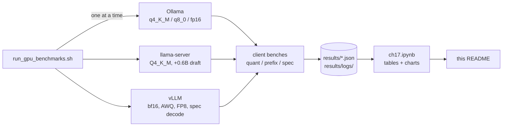

## Concepts

### Where the memory goes

A GPU serving an LLM holds four things in its memory (VRAM):

1. **Weights.** Parameters × bytes per parameter. Qwen3-8B has 8.19 billion parameters; in
   bf16 (2 bytes each) that is 15.3 GiB before anything else happens.
2. **The KV cache.** For every token in every active conversation, each layer stores a *key* and
   a *value* vector so it doesn't have to recompute them for the next token. It is the model's
   short-term memory, and it grows with context length × concurrent users:
   `2 × layers × kv_heads × head_dim × bytes × tokens × sequences`.
3. **Activations.** The scratch space of one forward pass. It is reused layer after layer, so
   it's small and roughly constant.
4. **Overhead.** The CUDA context, kernel workspaces and CUDA graphs: about 1 GiB.

Qwen3-8B uses *grouped-query attention*: 32 query heads share 8 KV heads, so its cache is
4× smaller than the same model with one KV head per query head. Per token it costs
2 × 36 × 8 × 128 × 2 bytes = 144 KiB. A 32k-token conversation is 4.5 GiB of cache.

[`ch17_vram.py`](01_main-chapter-code/ch17_vram.py) turns those formulas into a calculator that
reads a model's `config.json`:

```text
# ch17/01_main-chapter-code/ch17.ipynb, section 1 (saved output)
           model  params_B  active_B  layers  kv_heads  head_dim  as_shipped_GiB  KV_KiB_per_token  KV_GiB_32k
0   gpt-oss-120b    116.79      5.13      36         8        64            60.7              72.0        1.13
1  llama-3.3-70b     70.55     69.50      80         8       128           131.4             320.0       10.00
2     qwen3-1.7b      1.72      1.72      28         8       128             3.2             112.0        3.50
3       qwen3-8b      8.19      7.57      36         8       128            15.3             144.0        4.50
```

What fits next to the co-tenant, with vLLM at 80% of the card (`max_context_batch1` is the
longest single conversation; `max_batch_at_4k` the number of 4k-token conversations at once):

```text
            model weights  weights_GiB  max_context_batch1  max_batch_at_4k
5        qwen3-8b    bf16         15.3               16619                4
6        qwen3-8b     fp8          7.6               72164               17
8        qwen3-8b  q4_k_m          4.6               94035               22
9        qwen3-8b    int4          3.8               99936               24
13  llama-3.3-70b  q4_k_m         39.8                   0                0
```

A 70B model doesn't fit on this card in any format, so the rest of the chapter uses Qwen3-8B.
In bf16 it fits with room for about 16k tokens of conversation, *in total*. That number is the
first thing that bites in [Measuring v0](#measuring-v0).

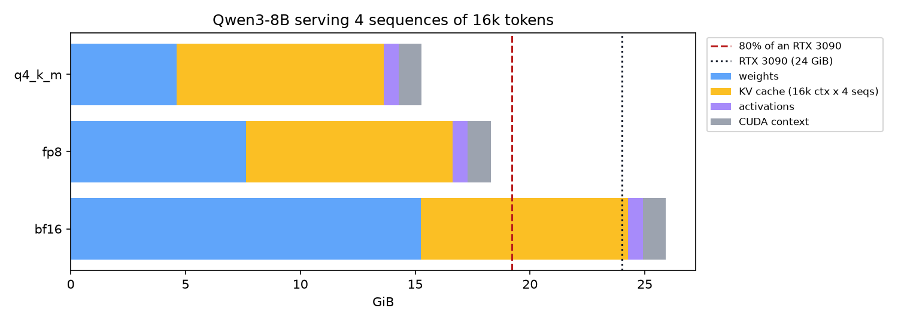

> [!NOTE]
> **In the wild:** OpenAI shipped gpt-oss with its mixture-of-experts weights already in 4-bit
> MXFP4, which is what makes the 117B-parameter model "run on a single 80GB GPU" and the 20B one
> "within 16GB of memory"
> ([gpt-oss-120b model card](https://huggingface.co/openai/gpt-oss-120b)). Our calculator
> agrees: 60.8 GiB for gpt-oss-120b as shipped, against 218 GiB if every weight were bf16.

### Decode is a memory-bandwidth problem

Generating one token means running the whole network once, and for a single conversation that
means reading every weight from VRAM once. The arithmetic is trivial next to the reading. So the
speed limit at batch size 1 is simply **memory bandwidth ÷ bytes of weights**. That is the
*roofline* of decode.

The RTX 3090 moves 936 GB/s
([NVIDIA GA102 whitepaper](https://www.nvidia.com/content/PDF/nvidia-ampere-ga-102-gpu-architecture-whitepaper-v2.pdf)).
Qwen3-8B in bf16 is 16.4 GB, so no software can decode faster than 936 / 16.4 = 57 tokens/s for
one user on this card. In 4-bit it's about 5 GB, so the ceiling roughly triples. Quantization
isn't only about fitting; on a bandwidth-bound workload it is *the* speed knob.

Two consequences follow:

- **Batching is nearly free.** Reading the weights once and applying them to 32 conversations
  costs barely more than applying them to one. Throughput scales with batch size until compute
  or KV-cache reads catch up.
- **Prefill is different.** Processing the prompt handles thousands of tokens per weight read,
  so it is compute-bound. Long prompts hurt *time to first token*; long answers hurt total time.

### Continuous batching

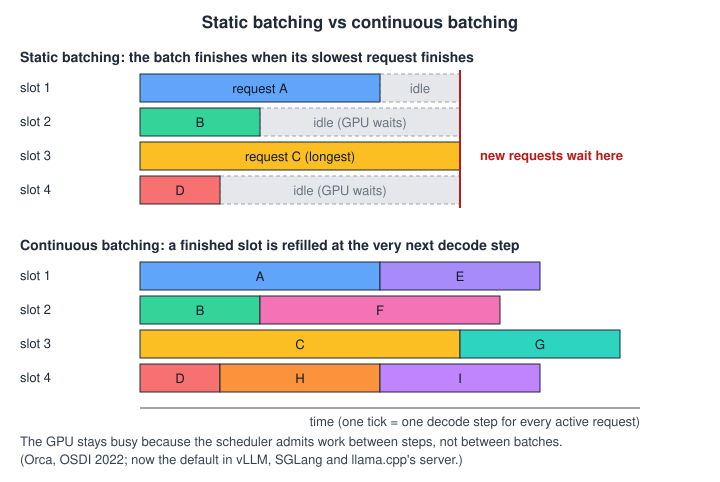

A naive server batches requests like a bus: everyone leaves together and the bus returns when the
last passenger is dropped off. Short answers wait for long ones, and new requests wait for the
whole batch. *Continuous batching* (also called iteration-level scheduling) re-forms the batch at
every decode step: a finished sequence leaves, a waiting one joins, and the GPU never idles.

> [!NOTE]
> **In the wild:** The Orca paper (OSDI 2022) introduced iteration-level scheduling and reported
> a 36.9× throughput improvement over NVIDIA FasterTransformer on GPT-3 175B at the same latency
> ([USENIX](https://www.usenix.org/conference/osdi22/presentation/yu)). Anyscale later measured up
> to 23× with continuous batching plus vLLM's memory management on an A100
> ([Anyscale](https://www.anyscale.com/blog/continuous-batching-llm-inference), 2023).

### PagedAttention

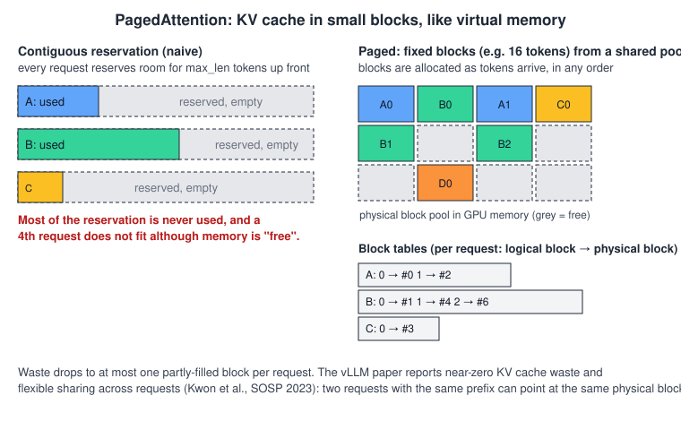

Continuous batching needs memory to come and go per token. Early servers reserved one contiguous
KV-cache slab per request, sized for the maximum length, and most of it stayed empty.
*PagedAttention* stores the cache in small fixed-size blocks, like an operating system's virtual
memory pages. A request holds a table of block numbers, blocks are allocated as tokens arrive, and
two requests with the same prefix can point at the same blocks. That last property is what makes
prefix caching cheap.

> [!NOTE]
> **In the wild:** When the vLLM team introduced PagedAttention they found that existing systems
> "waste 60% – 80% of memory due to fragmentation and over-reservation", against under 4% with
> paging ([vLLM blog](https://vllm.ai/blog/2023-06-20-vllm), June 2023). The SOSP paper reports
> 2–4× the throughput of FasterTransformer and Orca at the same latency
> ([arXiv:2309.06180](https://arxiv.org/abs/2309.06180)).

### Number formats: bf16, FP8, INT4, MXFP4, NVFP4

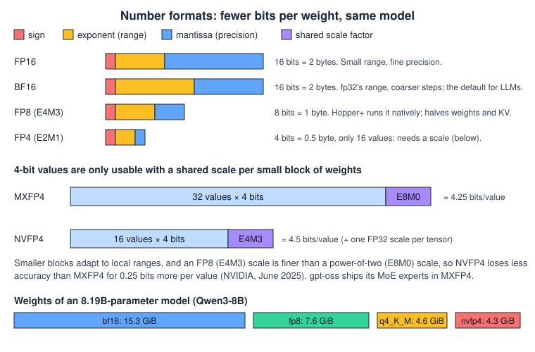

*Quantization* stores weights in fewer bits. Two families matter:

- **Integer formats with scales** (GGUF `q8_0`/`q4_K_M`, AWQ, GPTQ): small integers plus a
  scale per block of 32–128 weights. The GPU expands them back to 16-bit before multiplying.
  They save memory and bandwidth, not arithmetic.
- **Floating-point formats with hardware support** (FP8, MXFP4, NVFP4): newer GPUs multiply them
  natively. FP8 tensor cores arrived with Ada and Hopper (compute capability 8.9+), FP4 with
  Blackwell.

Our RTX 3090 is Ampere (8.6): it has neither. vLLM still loads FP8 checkpoints on it, as
*weight-only* FP8 through its Marlin kernel (W8A16: 8-bit weights, 16-bit activations). We get
the memory saving, not the faster math.

> [!NOTE]
> **In the wild:** NVIDIA reports NVFP4 (4-bit values with an FP8 scale per 16 values) at about
> 3.5× smaller than FP16 and 1.8× smaller than FP8, with 1% or less accuracy loss on key tasks
> when DeepSeek-R1-0528 is quantized from FP8
> ([NVIDIA](https://developer.nvidia.com/blog/introducing-nvfp4-for-efficient-and-accurate-low-precision-inference/),
> June 2025). That 1% is *their* model on *their* benchmarks. Ours is below.

### Prefix caching

Two requests that start with the same tokens produce the same KV cache for those tokens. A
server that keeps the cache around can skip that part of the prefill for the second request.
The prefix must be byte-for-byte identical *from the first token*: one changed character at the
start invalidates everything after it.

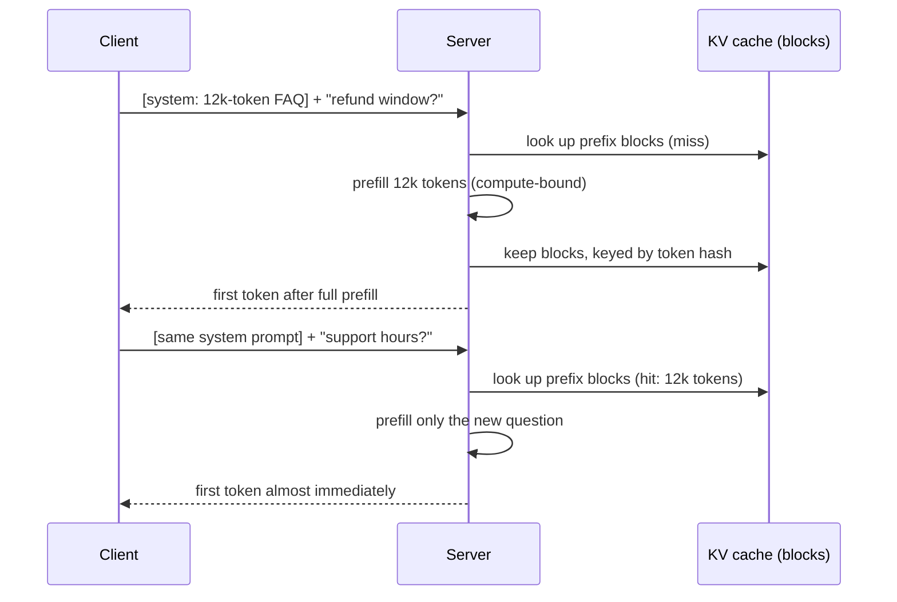

llama-server keeps the previous prompt of each slot and reuses the longest common prefix
(`cache_prompt`, on by default). vLLM hashes every 16-token block and shares blocks across all
requests (automatic prefix caching, on by default since its V1 engine). Hosted APIs bill this:
Anthropic charges 0.1× the input price for cache reads
([Anthropic docs](https://platform.claude.com/docs/en/build-with-claude/prompt-caching)), and
Chapter 1 saw `cached_tokens` on OpenRouter.

### Speculative decoding

Decode is bandwidth-bound, so checking 5 tokens at once costs about the same as generating 1.
*Speculative decoding* exploits that: a cheap *drafter* guesses the next few tokens, the big
model verifies all of them in one forward pass, and keeps the longest correct run plus one token
of its own. With greedy sampling, the output is identical to what the big model alone would write.

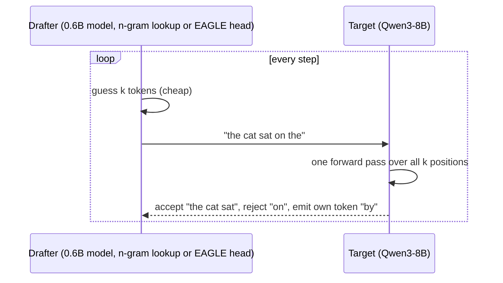

The speedup depends on the *acceptance rate* (how often the guesses are right) and on how much
the drafter costs. Three drafters exist in practice: a small model of the same family (needs the
same tokenizer), *n-gram* lookup (copies spans from the prompt; free, great for edits and
extraction), and *EAGLE*-style heads trained on the target's hidden states.

> [!NOTE]
> **In the wild:** Google uses speculative decoding in AI Overviews in Search, "while maintaining
> the same quality of responses"
> ([Google Research](https://research.google/blog/looking-back-at-speculative-decoding/),
> December 2024). The original paper reported 2–3× on T5-XXL with identical outputs
> ([Leviathan et al.](https://arxiv.org/abs/2211.17192)). EAGLE-3 reports up to 6.5×, falling to
> 1.38× throughput at batch 64 ([arXiv:2503.01840](https://arxiv.org/abs/2503.01840)).

### When one GPU isn't enough: tensor and pipeline parallelism

> [!CAUTION]
> **Not executed by the author** — tensor/pipeline parallelism and disaggregated prefill/decode
> require 2+ GPUs. Written against https://docs.vllm.ai/en/latest/serving/parallelism_scaling/
> (accessed 2026-11-07) and checked only against that page's flags; no command in this
> subsection and the next was run.

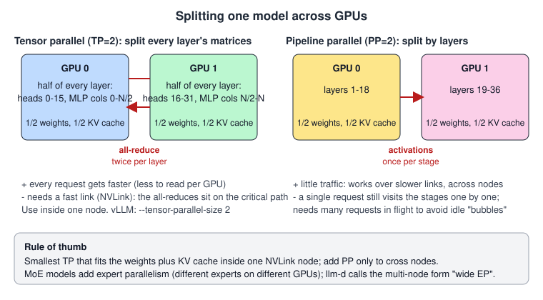

A model that doesn't fit one GPU is split. *Tensor parallelism* (TP) cuts every layer's matrices
across GPUs, so each reads half the weights per token: every request gets faster, but GPUs
exchange partial results twice per layer and need NVLink. *Pipeline parallelism* (PP) gives each
GPU a contiguous range of layers: little traffic, works across nodes, but one request visits the
stages in turn. Rule of thumb: the smallest TP that fits inside one NVLink node, PP only across
nodes. In vLLM that is two flags on `vllm serve`: `--tensor-parallel-size` and
`--pipeline-parallel-size`.

### Disaggregated prefill and decode

> [!CAUTION]
> **Not executed by the author** — tensor/pipeline parallelism and disaggregated prefill/decode
> require 2+ GPUs. Written against https://docs.vllm.ai/en/latest/serving/parallelism_scaling/
> (accessed 2026-11-07); nothing in this section was run.

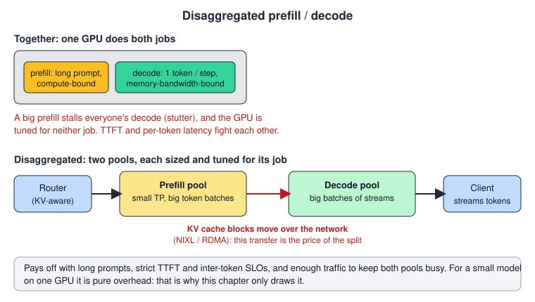

Prefill is compute-bound and bursty; decode is bandwidth-bound and steady. On one GPU, a big
prefill stalls every running decode. *Disaggregated serving* runs them on separate GPU pools and
ships the KV cache between them.

> [!NOTE]
> **In the wild:** Kimi's serving platform, Mooncake, separates prefill and decode clusters
> around a shared KV cache and "enables Kimi to handle 75% more requests" under real workloads
> ([arXiv:2407.00079](https://arxiv.org/abs/2407.00079)). DistServe (OSDI 2024) reports 7.4×
> more requests or 12.6× tighter latency targets ([arXiv:2401.09670](https://arxiv.org/abs/2401.09670)).

## v0: the naive solution

v0 is what most teams start with: the full-precision checkpoint, the engine's defaults, and
only the memory settings a shared card forces on us.

```bash
# ch17/01_main-chapter-code/run_gpu_benchmarks.sh (phase_vllm_bf16, simplified)
VLLM_USE_FLASHINFER_SAMPLER=0 HF_HUB_OFFLINE=1 \
  .venv-cuda/bin/vllm serve Qwen/Qwen3-8B --host 127.0.0.1 --port 8217 \
  --gpu-memory-utilization 0.80 --max-model-len 12288 --enable-prompt-tokens-details
```

Two settings in that command are not defaults, and both came from failures:

- `--gpu-memory-utilization 0.80`. vLLM claims a fixed share of the card at startup
  (`--gpu-memory-utilization` × total VRAM) and refuses to start if that much isn't free.
  Another user's process held 2,322 MiB of our 24,576 MiB (`results/logs/environment.txt`),
  so the default doesn't fit.
- `VLLM_USE_FLASHINFER_SAMPLER=0`. vLLM's FlashInfer top-k/top-p sampler compiles itself at
  startup with `nvcc` and `ninja`; neither is on this host's PATH, and every log says
  "FlashInfer kernels are disabled". The variable selects the PyTorch sampler instead. The run
  script now exports it.

## Measuring v0

We run the Chapter 2 eval one request at a time, then 1, 8 and 32 concurrent requests of 256
output tokens each:

```text
# results/logs/run_all.1225.log
vllm-bf16        category  80.3% [75.5, 84.4]  priority  58.0%  hard 81.7%  parse fails 0  p50 1067 ms  decode 48.9 tok/s  memory {'weights_gib': 15.27, 'kv_cache_gib': 1.77, 'kv_cache_tokens': 12912}
  concurrency   1:    48.2 tok/s total,  48.4 tok/s per stream
  concurrency   8:   378.0 tok/s total,  47.6 tok/s per stream
  concurrency  32:  1298.8 tok/s total,  41.5 tok/s per stream
```

Three things are wrong.

**1. It barely starts.** The first attempt used `--max-model-len 14336`, which the longest
prefix-cache prompt (10,883 tokens) needs with headroom. At 0.80 utilization vLLM failed at
startup because the KV cache left over after 15.27 GiB of weights couldn't hold one
14,336-token request. The rerun at 12,288 started and reports, in its own log:

```text
# results/logs/vllm-bf16.log
[gpu_worker.py:772] Available KV cache memory: 1.77 GiB
[kv_cache_utils.py:1147] GPU KV cache size: 12,912 tokens, Maximum concurrency for 12,288 tokens per request: 1.05x
```

"Maximum concurrency 1.05x" means one full-length user at a time. Our VRAM calculator predicts
the same thing from first principles: 1.77 GiB ÷ 144 KiB per token = 12,888 tokens, against
vLLM's 12,912 (notebook section 1). (The prefix-cache-off server started at 14,336 tokens in
the earlier run, with 19,488 tokens of cache; its startup profile measured 0.68 GiB of peak
activation memory against 1.59 GiB for the bf16 rerun. The margin is that thin.)

**2. Decode is slow, and it's not vLLM's fault.** 48.9 tokens/s is 85.6% of the 57.1 tokens/s
that 936 GB/s of bandwidth allows when every token reads 16.4 GB of weights (notebook
section 2). No setting makes bf16 decode much faster on this card. Only fewer bytes per weight,
or more tokens per weight read, can.

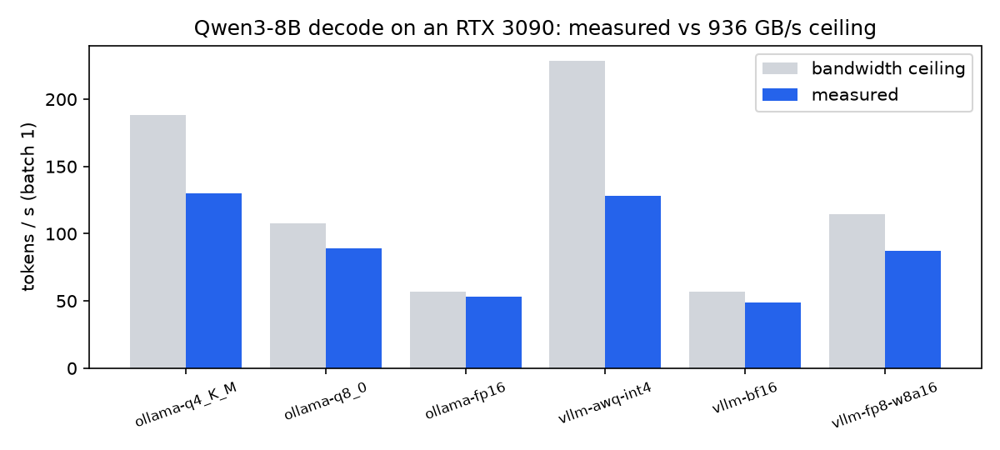

**3. Long prompts are expensive every time.** With prefix caching off, a 10,883-token system
prompt costs 3,004.5 ms of time to first token (TTFT) *on every request*, even though the
prompt is identical.

## Iterating

### 1. Quantization: fewer bytes per weight

**What's wrong.** Decode reads every weight for every token, and bf16 weights are 2 bytes each.
They also eat 15.27 GiB of the 18.85 GiB vLLM may use, which starves the KV cache.

**Options.** Same model, same prompt, same tickets, five other formats: Ollama's GGUF builds of
`qwen3:8b` (q4_K_M, q8_0, f16, context 8192), Qwen's official AWQ int4 checkpoint and RedHat's
FP8-dynamic checkpoint on vLLM. On Ampere, FP8 is *weight-only* (W8A16): 8-bit weights,
16-bit math through the Marlin kernel.

```text
# ch17/01_main-chapter-code/ch17.ipynb, section 3 (saved output)
           config      weights  category_acc          ci95  priority_acc  hard_cat_acc  parse_fail  p50_ms  p95_ms  decode_tok_s  memory
0   ollama-q4_K_M  GGUF q4_K_M          79.0  [74.0, 83.2]          62.7          83.3           0     421     484         130.1    9.94
1     ollama-q8_0    GGUF q8_0          80.7  [75.8, 84.7]          57.3          81.7           0     596     698          89.0   13.25
2     ollama-fp16     GGUF f16          79.3  [74.4, 83.5]          57.7          81.7           0     970    1140          53.1   20.09
3   vllm-awq-int4     AWQ int4          84.7  [80.2, 88.3]          60.7          81.7           0     421     478         128.3    5.71
4       vllm-bf16         bf16          80.3  [75.5, 84.4]          58.0          81.7           0    1067    1256          48.9   15.27
5  vllm-fp8-w8a16  FP8 (W8A16)          80.3  [75.5, 84.4]          57.3          81.7           0     586     705          87.0    8.80
```

(`memory` is GB loaded for Ollama, as `/api/ps` reports it with an 8,192-token context, and GiB
of weights for vLLM, from its log.)

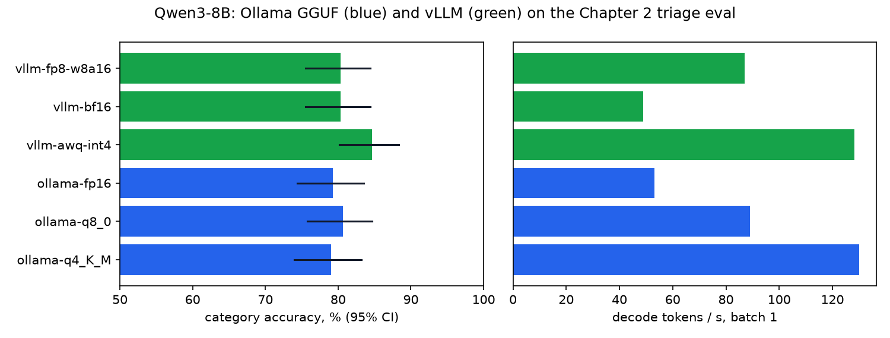

Speed did what the roofline predicts. 4-bit decodes at 128–130 tokens/s on both engines,
2.6× bf16; 8-bit at 87–89 tokens/s, 1.8×. Five of the six category accuracies sit within
1.7 points of each other (79.0–80.7%). AWQ is the outlier at 84.7%, *higher* than bf16.

Headline accuracies hide which tickets moved, so we compared the runs ticket by ticket:

```text
# ch17/01_main-chapter-code/ch17.ipynb, section 3 (saved output)
                ollama-q4_K_M  ollama-q8_0  ollama-fp16  vllm-awq-int4  vllm-bf16  vllm-fp8-w8a16
ollama-q4_K_M               0            7            3             19          6               6
ollama-q8_0                 7            0            4             12          7               5
ollama-fp16                 3            4            0             16          5               3
vllm-awq-int4              19           12           16              0         13              13
vllm-bf16                   6            7            5             13          0               2
vllm-fp8-w8a16              6            5            3             13          2               0

           config  differs_from_bf16  bf16_right  config_right
0   ollama-q4_K_M                  6           5             1
1     ollama-q8_0                  7           3             4
2     ollama-fp16                  5           4             1
3   vllm-awq-int4                 13           0            13
4       vllm-bf16                  0           0             0
5  vllm-fp8-w8a16                  2           1             1
```

The 16-bit and 8-bit runs agree with bf16 on all but 2–7 of 300 tickets, and the q4_K_M GGUF
build is no further away (6). AWQ disagrees with bf16 on 13 tickets and is right on all 13.
That accounts for its whole 4.4-point lead (13 of 300), and it isn't spread across the eval:
all 13 come from 3 of the 30 ticket templates. Nine are "Discount code not applied" and three
"Do you accept PayPal?", both labelled `payment`; bf16 called them `refund` or `other`. The
last is "Partial refund request", labelled `refund`, which bf16 called `shipping`. Read it as
"AWQ happens to resolve three ambiguous templates the gold way", not "4-bit is smarter".
Quantization moved individual answers, and on this eval none of the moves cost accuracy.

> [!IMPORTANT]
> **Decision: AWQ int4 on vLLM over bf16 and FP8** — 2.6× the single-stream speed of bf16, a
> third of the weight memory (5.71 vs 15.27 GiB, so 88,624 tokens of KV cache instead of
> 12,912), and no ticket where bf16 was right and AWQ wrong. FP8 (W8A16) is the
> pick on an Ada/Hopper card, where it gets real FP8 math; on Ampere it saves memory but
> decodes 32% slower than AWQ. Stay on bf16 only if your own eval shows a regression you can't
> accept.

### 2. Batching: more tokens per weight read

**What's wrong.** At one request at a time the GPU spends almost all its time reading weights.
Reading them once for 32 sequences costs barely more than reading them for one.

**Options.** vLLM batches continuously by default, so there's nothing to turn on. The question
is how much concurrency the KV cache allows, which is exactly what quantization freed up.

```text
# ch17/01_main-chapter-code/ch17.ipynb, section 4 (saved output)
           config  concurrency  output_tokens  wall_s  output_tok_s  per_stream_tok_s
0   vllm-awq-int4            1            256    2.02         126.6             127.0
1   vllm-awq-int4            8           2048    2.17         944.2             119.6
2   vllm-awq-int4           32           8192    3.40        2411.6              77.4
3       vllm-bf16            1            256    5.31          48.2              48.4
4       vllm-bf16            8           2048    5.42         378.0              47.6
5       vllm-bf16           32           8192    6.31        1298.8              41.5
6  vllm-fp8-w8a16            1            256    2.91          88.1              88.4
7  vllm-fp8-w8a16            8           2048    3.08         665.1              84.0
8  vllm-fp8-w8a16           32           8192    3.73        2196.2              70.5
```

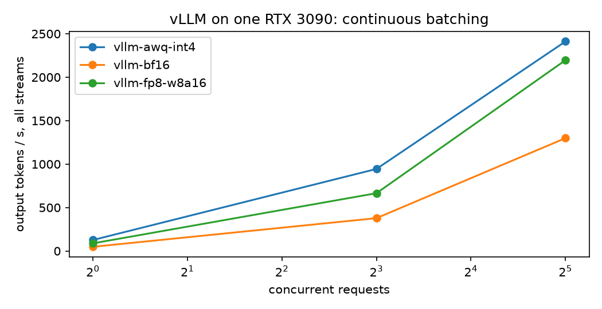

From 1 to 32 concurrent requests, total throughput grows 27× on bf16 and 19× on AWQ, while each
user's stream slows by 14% (bf16) and 39% (AWQ). AWQ at 32 streams produces 2,411.6 tokens/s,
50× v0's single stream on the same card.

> [!IMPORTANT]
> **Decision: serve concurrent traffic through one continuously batching server over one
> process per request or a request queue** — throughput is where the cost per token is made,
> and every user still gets 77.4 tokens/s at 32 streams, faster than anyone reads. Cap
> concurrency lower (8 here: 944.2 tokens/s, 119.6 per stream) if your product sells
> per-stream speed rather than total throughput.

### 3. Prefix caching: don't prefill the same prompt twice

**What's wrong.** Long, identical system prompts are re-processed on every request.

**Options.** Both engines keep the KV cache of earlier prompts: llama-server per slot
(`cache_prompt`, on by default), vLLM across all requests (automatic prefix caching, on by
default in V1). We measured each engine three ways: cache off, cache on with a stable prompt,
and cache on with a per-request id at the *start* of the system prompt, the most common way
teams break it. The bench builds the prompt like this:

```python
# ch17/01_main-chapter-code/ch17_prefix_bench.py
    nonce = f"[session {time.time_ns()}]\n"
    ...
        for i, q in enumerate(QUESTIONS[:n_questions]):
            head = f"[request-id {time.time_ns()}]\n" if bust else nonce
            r = stream_chat(client, base_url, request_body(model, head + prefix, q, cache_prompt))
```

```text
# ch17/01_main-chapter-code/ch17.ipynb, section 5 (saved output)
   engine  prefix_chars                      scenario  prompt_tokens  first_ttft_ms  later_median_ttft_ms  server_cached_2nd
0   llama         12000                     cache off           2788          609.1                 606.6                  0
1   llama         12000       cache on, stable prefix           2788          607.6                  22.4               2773
2   llama         12000  cache on, timestamp at start           2789          608.1                 720.0                  0
3   llama         48000                     cache off          10883         2767.4                2775.4                  0
4   llama         48000       cache on, stable prefix          10883         2784.3                  36.0              10868
5   llama         48000  cache on, timestamp at start          10884         2789.7                3149.6                  0
6    vllm         12000                     cache off           2788          669.8                 671.3                  0
7    vllm         48000                     cache off          10883         2984.7                3004.5                  0
8    vllm         12000       cache on, stable prefix           2788          700.9                  39.2               2768
9    vllm         12000  cache on, timestamp at start           2789          702.0                 703.2                 16
10   vllm         48000       cache on, stable prefix          10883         3112.3                  64.9              10864
11   vllm         48000  cache on, timestamp at start          10884         3106.3                3056.0                 16
```

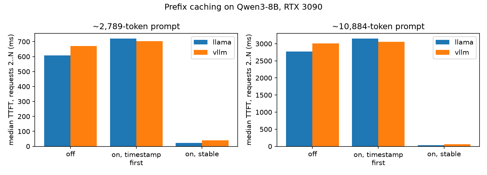

With a stable prefix, TTFT on a 10,883-token prompt drops from 2,775.4 ms to 36.0 ms on
llama-server (77×) and from 3,004.5 ms to 64.9 ms on vLLM (46×). The server confirms it: 10,868
tokens reused, only the question prefilled. One id at the front wipes that out entirely: vLLM
reuses 16 tokens (presumably the chat-template header before the system text), llama-server none, and llama-server
was 13% *slower* than with the cache off (3,149.6 vs 2,775.4 ms). We didn't dig into why. The
lesson doesn't depend on it.

The cache isn't free on the first request either: on vLLM the cold 10,883-token prompt took
3,112.3 ms with caching on and 2,984.7 ms with it off.

> [!IMPORTANT]
> **Decision: keep prefix caching on and make the prompt cache-friendly, over turning it off or
> adding an external cache** — stable instructions and documents first, byte-identical across
> requests; anything per-request (time, user, request id) in the last user message. Turn it off
> only for a workload with no shared prefixes at all, where it costs about 4% of cold TTFT for
> nothing.

### 4. Speculative decoding: more than one token per weight read, for one user

**What's wrong.** Batching helps the fleet, not the single user waiting on one stream. At
concurrency 1, bf16 decodes at 48.8 tokens/s.

**Options.** Three drafters on vLLM (bf16 target): n-gram prompt lookup (no extra weights),
RedHat's EAGLE-3 head for Qwen3-8B, and Qwen3-0.6B as a draft model. Plus the 0.6B draft
model on llama-server, against its Q4_K_M target.

```text
# ch17/01_main-chapter-code/ch17.ipynb, section 6 (saved output)
              label  concurrency  median_stream_tok_s  aggregate_tok_s  speedup_vs_baseline  acceptance
0    llama/baseline            1                130.2            121.7                 1.00         NaN
1  llama/draft-0.6b            1                125.9            118.6                 0.97         NaN
2        vllm/ngram            1                 57.5             56.2                 1.18       0.047
3        vllm/ngram            8                 39.2            297.1                 0.82       0.047
4     vllm/baseline            1                 48.8             47.4                 1.00         NaN
5     vllm/baseline            8                 47.9            366.5                 1.00         NaN
6       vllm/eagle3            1                126.5            103.5                 2.59       0.535
7       vllm/eagle3            8                107.6            712.1                 2.25       0.526
8   vllm/draft-0.6b            1                122.1             81.6                 2.50       0.473
9   vllm/draft-0.6b            8                 94.1            500.8                 1.96       0.480
```

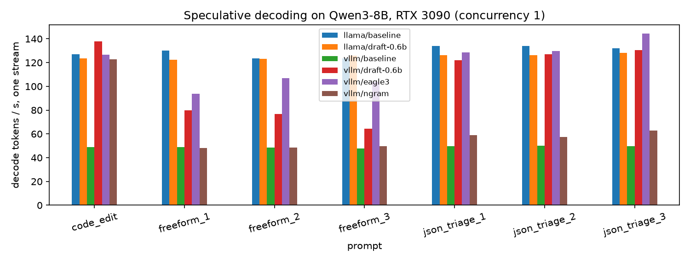

- **EAGLE-3: 2.59× per stream** at concurrency 1, 53.5% of drafted tokens accepted, and still
  712.1 tokens/s total at 8 streams against 366.5 without it. On bf16 it matches what AWQ gets
  without speculation (126.6 tokens/s).
- **0.6B draft model on vLLM: 2.50×**, acceptance 0.47, but at 8 streams the per-stream gain
  shrinks to 1.96×, and its aggregate throughput is lower than EAGLE-3's at both concurrencies.
- **n-gram: 1.18× alone, 0.82× at 8 streams.** It accepted 4.7% of its guesses: our prompts
  don't copy spans from their input, except the code edit, where it ran at 122.89 tokens/s
  against 48.79.
- **0.6B draft on llama-server: 0.97×, a slowdown.** The Q4_K_M target already runs at 130
  tokens/s, and the server's `timings` had no `draft_n` fields, so there was nothing to compute
  an acceptance rate from.

Greedy speculation is supposed to produce exactly the target's text. llama-server did on 7 of
7 prompts; every vLLM method did on 6 of 7, each time diverging on a free-form prompt
("interacts with" instead of "collides with" in one Rayleigh-scattering answer). The JSON
answers were identical everywhere.

The memory fight was worse than the speedup fight. Each method needed its own budget on the
shared card (details in [Results](#how-each-number-was-produced)): EAGLE-3 needed 0.88 of the
card; the 0.6B draft model failed at 0.80 (no room for KV cache), ran out of memory at 0.88 and
only started at 0.84 with a 2,048-token context and
`PYTORCH_CUDA_ALLOC_CONF=expandable_segments:True`; n-gram, which adds no weights, worked at
0.80 and ran out of memory at 0.88:

```text
# results/logs/vllm-ngram.log (the 0.88 attempt)
torch.OutOfMemoryError: CUDA out of memory. Tried to allocate 742.00 MiB. GPU 0 has a total capacity of 23.56 GiB of which 538.94 MiB is free. Process 2093901 has 2.27 GiB memory in use. ...
```

```bash
# ch17/01_main-chapter-code/run_gpu_benchmarks.sh
  spec_run ngram '{"method": "ngram", "num_speculative_tokens": 4, "prompt_lookup_max": 4}' \
    0.80 4096
  spec_run eagle3 '{"method": "eagle3", "model": "RedHatAI/Qwen3-8B-speculator.eagle3",
                    "num_speculative_tokens": 3}' 0.88 4096
  spec_run draft-0.6b '{"method": "draft_model", "model": "Qwen/Qwen3-0.6B",
                        "num_speculative_tokens": 4}' 0.84 2048
```

> [!IMPORTANT]
> **Decision: no speculative decoding in the default deployment; EAGLE-3 when single-stream
> latency is the product** — it gave 2.59× per stream here, but on bf16 that only matches
> what AWQ does with no drafter, it needs 0.88 of the card and a 4,096-token context, and its
> advantage shrinks as concurrency grows (2.25× at 8). A separate draft model costs more memory
> for less; n-gram only pays on copy-heavy prompts (code edits, extraction). We didn't measure
> EAGLE-3 on top of AWQ; that's the experiment to run before turning it on.

> [!NOTE]
> **In the wild:** Practitioners keep reporting the slowdown we saw on llama-server. A vLLM user
> measured about 30% *slower* generation with a 135M draft for a 1.7B target
> ([vllm#15025](https://github.com/vllm-project/vllm/issues/15025)), and an RTX 3090 owner found
> no llama.cpp speculative mode that beat baseline for a Q4 Qwen MoE, one at −54% despite
> 100% acceptance ([HackMD, 2026](https://hackmd.io/ODXuOQNzSiyUITz7g9mtBw)).

## Production hardening

- **Set the memory budget explicitly, and know what else is on the card.** vLLM pre-allocates
  `--gpu-memory-utilization` × total VRAM at startup and fills whatever the weights don't use
  with KV cache. On our shared card another tenant's 2.3 GB process meant the default doesn't
  fit; we ran at 0.80, and each speculative method needed its own value (0.80, 0.84, 0.88). Treat
  utilization and `--max-model-len` as a pair you tune per model, and record them with every
  result. Older vLLM versions attributed other processes' memory to
  themselves and failed with "No available memory for the cache blocks"
  ([vllm#2248](https://github.com/vllm-project/vllm/issues/2248)).
- **Let vLLM pick the kernel.** Forcing `--quantization awq` on an AWQ checkpoint selects the
  slow legacy kernel; leaving it unset picks `awq_marlin`. The maintainers' advice is not to pass
  `--quantization` "if it isn't required"
  ([vllm#20112](https://github.com/vllm-project/vllm/issues/20112)). We didn't pass it, and
  `results/logs/vllm-awq.log` shows the fast path: "Using MarlinLinearKernel for
  AutoAWQMarlinLinearMethod".
- **Keep the stable part of the prompt first and byte-identical.** No timestamps, request IDs or
  user names in the system prompt; put them in the last message. Basedash found a timestamp in
  its system prompt meant "the cache never matched"
  ([Basedash](https://www.basedash.com/blog/how-a-timestamp-was-busting-our-prompt-cache), 2026).
  Our measurement of the same mistake is in the prefix-cache table above.
- **Watch the acceptance rate, not just "speculation on".** vLLM exports
  `vllm:spec_decode_num_accepted_tokens_total` and `..._num_draft_tokens_total`; llama-server
  returns `draft_n` / `draft_n_accepted` in `timings`, but only when it actually drafted: our
  llama-server draft run returned neither, which is itself the signal. A falling acceptance rate after a prompt
  change turns speculation into a slowdown.
- **Pin the engine version and the image.** Flags move: llama.cpp removed `--draft-max` /
  `--draft-min` in favor of `--spec-draft-n-max` / `--spec-draft-n-min`, and `--port` no longer
  defaults to 8080 ([llama.cpp server README](https://github.com/ggml-org/llama.cpp/blob/master/tools/server/README.md)).
  Pin `vllm==` in `requirements-cuda.txt` and the image digest in production manifests.
- **Re-run the eval after every quantization or engine change, and diff it per item.** Every
  format changed some answers (2–13 of 300 against bf16); a headline number can't tell you
  which. Store a hash of each eval item's content with the results: our seeded tickets keep
  their ids across reseeds while their text and labels change, and only a rerun on one dataset
  made the six configurations comparable.
- **Make unloads synchronous.** Ollama's `keep_alive: 0` returns before the model leaves VRAM.
  Our first run moved straight on to llama-server, found 2,309 MiB free and stopped. The script
  now polls `/api/ps` until nothing is loaded.
- **Ship the CUDA runtime pieces your kernels JIT-compile with.** vLLM's FP8 path compiles with
  NVRTC at startup and first failed because `libnvrtc-builtins.so.13.0` wasn't on the loader
  path; it lives in the venv's `nvidia/cu13/lib`, which the script now prepends to
  `LD_LIBRARY_PATH`. In a container, bake it in and test the startup in CI.

## Serving it

The configuration we'd ship from these measurements is AWQ int4 on vLLM with default
continuous batching and prefix caching, and no speculative decoding:

```bash
# from ch17/01_main-chapter-code/ (run_gpu_benchmarks.sh, phase_vllm_awq, plus its environment)
export VLLM_USE_FLASHINFER_SAMPLER=0
LD_LIBRARY_PATH=".venv-cuda/lib/python3.12/site-packages/nvidia/cu13/lib:$LD_LIBRARY_PATH" \
HF_HUB_OFFLINE=1 .venv-cuda/bin/vllm serve Qwen/Qwen3-8B-AWQ --host 127.0.0.1 --port 8217 \
  --gpu-memory-utilization 0.80 --max-model-len 16384 --enable-prompt-tokens-details
```

The CUDA-only packages live in a chapter-local venv, never in the repo's main environment:

```bash
uv venv ch17/01_main-chapter-code/.venv-cuda --python 3.12
UV_CACHE_DIR=$HOME/.cache/uv-cuda-ch17 uv pip install \
  -r ch17/01_main-chapter-code/requirements-cuda.txt --python ch17/01_main-chapter-code/.venv-cuda
```

Its startup log is the capacity plan, so read it before sending traffic:

```text
# results/logs/vllm-awq.log
[gpu_worker.py:772] Available KV cache memory: 12.17 GiB
[kv_cache_utils.py:1147] GPU KV cache size: 88,624 tokens, Maximum concurrency for 16,384 tokens per request: 5.41x
[gpu_worker.py:1066] Free memory on device (20.95/23.56 GiB) on startup. Desired GPU memory utilization is (0.8, 18.85 GiB). Actual usage is 5.95 GiB for consumed memory (weights + non-torch), 0.72 GiB for peak activation, and 0.27 GiB for CUDAGraph memory. ...
```

It speaks the OpenAI Chat Completions API, so the Chapter 2 triage code points at it by
changing `LLM_BASE_URL` to `http://localhost:8217/v1` and `LLM_MODEL` to `Qwen/Qwen3-8B-AWQ`.
That's how `ch17_quant_bench.py` ran the 300-ticket eval above (p50 421 ms, p95 478 ms, 0
parse failures).

The same command gave a different KV cache on a different start. The first AWQ start
(12:19) profiled 1.62 GiB of peak activation memory and got 11.28 GiB / 82,096 tokens of
cache; the rerun (13:48) profiled 0.72 GiB and got 12.17 GiB / 88,624 tokens. Plan capacity
from the smaller number, or pin it with `--kv-cache-memory`, which the log line above suggests. To run everything yourself, on a GPU you have to yourself:

```bash
bash ch17/01_main-chapter-code/run_gpu_benchmarks.sh                  # all phases
bash ch17/01_main-chapter-code/run_gpu_benchmarks.sh llama vllm_spec   # just some phases
cd ch17/01_main-chapter-code && uv run jupyter nbconvert --to notebook --execute --inplace ch17.ipynb
```

On a dedicated 24 GB card, raise `VLLM_UTIL` (environment variable) and `--max-model-len`.

## Results

### Where we ended up

| | v0: bf16, 1 stream | AWQ, 1 stream | AWQ, 32 streams |
|---|---|---|---|
| Category accuracy (300 tickets, 95% CI) | 80.3% [75.5, 84.4] | 84.7% [80.2, 88.3] | same server |
| Tickets where bf16 was right and this was wrong | n/a | 0 of 300 | same server |
| p50 / p95 per ticket | 1,067 / 1,256 ms | 421 / 478 ms | n/a |
| Output tokens/s (whole card) | 48.2 | 126.6 | 2,411.6 |
| Output tokens/s per user | 48.4 | 127.0 | 77.4 |
| Weights / KV cache | 15.27 / 1.77 GiB | 5.71 / 12.17 GiB | same |
| KV cache tokens | 12,912 | 88,624 | same |
| TTFT, 10,883-token prompt, cached | 64.9 ms (vLLM, bf16) | not measured on AWQ | |

All against the requirements: 0 parse failures, p95 478 ms, 2,411.6 tokens/s and 80% of the
shared card. The cost requirement is next.

### What a million tokens costs

[`ch17_cost.py`](01_main-chapter-code/ch17_cost.py) turns throughput into dollars. Utilization
is the share of rented hours the card is busy; idle hours still cost money:

```python
# ch17/01_main-chapter-code/ch17_cost.py
    node_per_hour = gpu_hourly_usd * n_gpus
    tokens_per_hour = tokens_per_second * 3600 * utilization
    return node_per_hour / tokens_per_hour * 1_000_000
```

Priced with `gpu_prices.json` (RunPod RTX 3090: $0.50/h Secure Cloud, $0.22/h Community
Cloud, page updated 2026-11-04):

```text
# ch17/01_main-chapter-code/ch17.ipynb, section 7 (saved output, trimmed)
                                                setup    tok_s  utilization  usd_per_M_secure  usd_per_M_community
0             vllm-awq-int4 on 1x RTX 3090, 1 streams   126.60          1.0            1.0971               0.4827
4             vllm-awq-int4 on 1x RTX 3090, 32 streams  2411.60          1.0            0.0576               0.0253
5             vllm-awq-int4 on 1x RTX 3090, 32 streams  2411.60          0.3            0.1920               0.0845
6                 vllm-bf16 on 1x RTX 3090, 1 streams    48.20          1.0            2.8815               1.2679
10               vllm-bf16 on 1x RTX 3090, 32 streams  1298.80          1.0            0.1069               0.0471
16           vllm-fp8-w8a16 on 1x RTX 3090, 32 streams  2196.20          1.0            0.0632               0.0278
20  Qwen3-8B on 1x H100 SXM, vLLM 0.11.0, ShareGPT...   496.88          1.0            2.2306               1.5038
```

```text
vllm-awq-int4 at 2411.6 tok/s on a $0.5/h RTX 3090 vs qwen/qwen3-14b output price $0.24/M: break-even utilization = 0.24
vllm-awq-int4 at 2411.6 tok/s on a $0.5/h RTX 3090 vs openai/gpt-6-luna output price $0.5/M: break-even utilization = 0.115
```

v0 cost $2.8815 per million output tokens on Secure Cloud even with the card 100% busy. The
tuned server costs $0.0576 at 100% and $0.1920 at 30% busy, under the $0.50 target either way.
The break-even is the honest number: the card has to be busy at least 11.5% of every hour to
beat `openai/gpt-6-luna`'s output price, and 24.0% to beat `qwen/qwen3-14b` on OpenRouter
($0.12 / $0.24 per 1M input/output, as of 2026-11). And those API models aren't Qwen3-8B: the
comparison is only fair if the 8B model passes your eval, which for ShopFlow's triage it does
at 79.0–84.7%.

The published H100 row (from GPUStack's latency-tuned Qwen3-8B run at concurrency 4) is a
reminder that "faster GPU" and "cheaper token" are different questions: at concurrency 4 an
H100 costs $2.23 per million tokens; batching, not the card, sets the price.

### How each number was produced

Several phases ran more than once on 2026-11-09 (failed starts, then reruns with other memory
settings, then an Ollama + AWQ rerun on the reseeded database). The JSON files keep the latest
successful result per label:

| Result | Server settings that produced it | Run |
|---|---|---|
| Ollama q4_K_M / q8_0 / fp16 | Ollama 0.40.15, context 8192 | `run_all.1337.log` |
| llama-server prefix cache, baseline, 0.6B draft | `server-cuda` image, `-ngl 99 -c 32768`, draft `--spec-draft-n-max 8` | `run_all.1211.log` |
| vLLM prefix cache **off** | bf16, util 0.80, max-model-len 14,336, `--no-enable-prefix-caching` | `run_all.1211.log` |
| vLLM n-gram | util 0.80, max-model-len 4,096 | `run_all.1211.log` |
| vLLM AWQ int4 (eval + batching) | util 0.80, max-model-len 16,384 | `run_all.1337.log` |
| vLLM bf16 (eval, batching, prefix cache **on**, spec baseline) | util 0.80, max-model-len 12,288 | `run_all.1225.log` |
| vLLM EAGLE-3 | util 0.88, max-model-len 4,096 | `run_all.1225.log` |
| vLLM FP8 (W8A16) | util 0.80, max-model-len 16,384, venv `nvidia/cu13/lib` on `LD_LIBRARY_PATH` | `run_all.1225.log` |
| vLLM 0.6B draft model | util 0.84, max-model-len 2,048, `PYTORCH_CUDA_ALLOC_CONF=expandable_segments:True` | manual retry after `run_all.1225.log` |

Every vLLM run had `VLLM_USE_FLASHINFER_SAMPLER=0`. The failures along the way:

| Attempt | What happened | Fix |
|---|---|---|
| Ollama → llama phase (12:11) | Ollama's unload was asynchronous; the free-memory check saw 2,309 MiB and stopped the run | script waits until `/api/ps` is empty |
| vLLM bf16, util 0.80, max-model-len 14,336 | not enough KV cache for one max-length request | max-model-len 12,288 |
| vLLM EAGLE-3, util 0.80 | died at startup | util 0.88 |
| vLLM FP8, first start | NVRTC couldn't find `libnvrtc-builtins.so.13.0` | venv's `nvidia/cu13/lib` on `LD_LIBRARY_PATH` |
| vLLM n-gram, util 0.88 | CUDA OOM during startup (742 MiB allocation) | util 0.80 |
| vLLM 0.6B draft, util 0.80 | no memory left for KV cache | — |
| vLLM 0.6B draft, util 0.88 | CUDA OOM | util 0.84, max-model-len 2,048, expandable segments |
| Ollama ×3 and AWQ evals (12:00–12:23) | graded against the ShopFlow data seeded on 2026-11-07; the database was reseeded at about 12:26, before the bf16 eval, and the seed's ticket stream depends on the anchor date, so 209 of the 240 templated eval tickets got new text (152 a new gold category) under the same ids | both phases rerun at 13:37–13:51; all six configurations now grade the same 300 tickets |

`run_gpu_benchmarks.sh` now encodes the per-method settings. The logs in `results/logs/` are
from the latest start of each configuration, so `vllm-ngram.log` is the failed 0.88 attempt,
`vllm-bf16-noapc.log` the 14,336-token run and `vllm-awq.log` the 13:48 rerun; notebook section 0 reads their arguments back.
Its `EngineDeadError` at 12:15:00 is the script stopping the server after the bench, not a crash.

## Exercises

1. **FP8 KV cache.** Start vLLM with `--kv-cache-dtype fp8` on the bf16 model. Predict the new
   "GPU KV cache size" with `ch17_vram.py` first, then check the log. Re-run the triage eval:
   does accuracy move? (On Ampere the cache is stored in FP8 and converted for the math.)
2. **Where prefix caching stops paying.** Re-run `ch17_prefix_bench.py --prefix-chars 2000 8000
   48000` and plot TTFT saved vs prefix length. Below what prompt length is the saving smaller
   than your network round trip?
3. **Tune the drafter.** Re-run the llama-server draft experiment with `--spec-draft-n-max 2`,
   `4` and `16`. Which value is best for the JSON prompts, and which for the free-form ones? Why
   would they differ?
4. **Your own break-even.** Put your real traffic into `ch17_cost.breakeven_utilization`: average
   output tokens per day, peak concurrency, and the API you'd replace. At what utilization does a
   rented RTX 3090 beat the API, and is your traffic ever that busy?

## What we learned

- On one GPU, decode speed is memory bandwidth divided by bytes of weights. bf16 Qwen3-8B
  reached 85.6% of that ceiling; the only big levers were fewer bytes (quantization) and more
  tokens per read (batching, speculation).
- AWQ int4 on vLLM was 2.6× faster per stream than bf16, used a third of the weight memory, and
  was never wrong where bf16 was right; its 4.4-point accuracy lead came from 3 ambiguous
  ticket templates.
- FP8 on Ampere is weight-only: it saved memory (8.80 GiB) but decoded at 87.0 tokens/s, between
  bf16 and int4.
- Continuous batching is where cost per token is made: 2,411.6 tokens/s at 32 streams, 50× v0,
  for $0.0576 per million output tokens on a $0.50/h card.
- Prefix caching cut TTFT on a 10,883-token prompt 46× on vLLM and 77× on llama-server, and one
  request id at the start of the prompt erased all of it.
- Speculative decoding paid only with a trained drafter (EAGLE-3, 2.59×) and cost memory we
  barely had; the same 0.6B draft model was a 2.50× win on vLLM and a 0.97× loss on llama-server.
- On a shared card, the memory budget is the real configuration: every method needed its own
  utilization and context length, and the first try of half of them failed.
- Diff evals per item, not per headline: every quantized format changed 2–13 answers against
  bf16, and the one with the biggest accuracy gain changed the most.

## References

- "Optimizing AI Inference at Character.AI" — Character.AI, 2024-06-20. https://blog.character.ai/optimizing-ai-inference-at-character-ai-2/
- "Efficient Memory Management for Large Language Model Serving with PagedAttention" — Kwon et al., SOSP 2023. https://arxiv.org/abs/2309.06180
- "vLLM: Easy, Fast, and Cheap LLM Serving with PagedAttention" — vLLM team, 2023-06-20. https://vllm.ai/blog/2023-06-20-vllm
- "Orca: A Distributed Serving System for Transformer-Based Generative Models" — USENIX OSDI 2022. https://www.usenix.org/conference/osdi22/presentation/yu
- "How continuous batching enables 23x throughput in LLM inference" — Anyscale, 2023-06-22. https://www.anyscale.com/blog/continuous-batching-llm-inference
- "DistServe: Disaggregating Prefill and Decoding for Goodput-optimized LLM Serving" — arXiv, 2024-01-18. https://arxiv.org/abs/2401.09670
- "Mooncake: A KVCache-centric Disaggregated Architecture for LLM Serving" — arXiv, 2024-06-24. https://arxiv.org/abs/2407.00079
- "Introducing NVFP4 for Efficient and Accurate Low-Precision Inference" — NVIDIA Technical Blog, 2025-06-24. https://developer.nvidia.com/blog/introducing-nvfp4-for-efficient-and-accurate-low-precision-inference/
- "openai/gpt-oss-120b" model card — OpenAI on Hugging Face, 2025. https://huggingface.co/openai/gpt-oss-120b
- "Fast Inference from Transformers via Speculative Decoding" — Leviathan et al., ICML 2023. https://arxiv.org/abs/2211.17192
- "Looking back at speculative decoding" — Google Research, 2024-12-06. https://research.google/blog/looking-back-at-speculative-decoding/
- "EAGLE-3: Scaling up Inference Acceleration of Large Language Models via Training-Time Test" — arXiv, 2025-03-03. https://arxiv.org/abs/2503.01840
- "Prompt caching" — Anthropic docs, accessed 2026-11-07. https://platform.claude.com/docs/en/build-with-claude/prompt-caching
- "NVIDIA Ampere GA102 GPU Architecture" whitepaper — NVIDIA. https://www.nvidia.com/content/PDF/nvidia-ampere-ga-102-gpu-architecture-whitepaper-v2.pdf
- vllm-project/vllm issue #15025 (draft model about 30% slower than the target alone) — GitHub, 2025-03-18. https://github.com/vllm-project/vllm/issues/15025
- Speculative-decoding experiments on an RTX 3090 with llama.cpp and vLLM — HackMD (thc1006), 2026-04, updated 2026-05-17. https://hackmd.io/ODXuOQNzSiyUITz7g9mtBw
- vllm-project/vllm issue #42390 (FP8 on an RTX 3090 falls back to Marlin W8A16) — GitHub, 2026-05-12. https://github.com/vllm-project/vllm/issues/42390
- vllm-project/vllm issue #20112 (forcing `--quantization awq` skips `awq_marlin`) — GitHub, 2025-06-26. https://github.com/vllm-project/vllm/issues/20112
- vllm-project/vllm issue #2248 ("No available memory for the cache blocks") — GitHub, 2023-12-24. https://github.com/vllm-project/vllm/issues/2248
- "How a timestamp was busting our prompt cache" — Basedash, 2026-07-07. https://www.basedash.com/blog/how-a-timestamp-was-busting-our-prompt-cache
- earendil-works/pi issue #1873 (a timestamp makes every system prompt unique) — GitHub, 2026-03-06. https://github.com/earendil-works/pi/issues/1873
- "Automatic Prefix Caching" — vLLM docs, accessed 2026-11-07. https://docs.vllm.ai/en/latest/features/automatic_prefix_caching/
- "vLLM V1: A Major Upgrade to vLLM's Core Architecture" — vLLM blog, 2025-01-27. https://blog.vllm.ai/2025/01/27/v1-alpha-release.html
- "Speculative Decoding" — vLLM docs, accessed 2026-11-07. https://docs.vllm.ai/en/latest/features/speculative_decoding/
- "FP8 W8A8 / W8A16" — vLLM docs, accessed 2026-11-07. https://docs.vllm.ai/en/latest/features/quantization/llm_compressor/fp8/
- "Quantization" support matrix — vLLM docs, accessed 2026-11-07. https://docs.vllm.ai/en/latest/features/quantization/
- "Engine Arguments" — vLLM docs, accessed 2026-11-07. https://docs.vllm.ai/en/latest/configuration/engine_args/
- "Parallelism and Scaling" — vLLM docs, accessed 2026-11-07. https://docs.vllm.ai/en/latest/serving/parallelism_scaling/
- "llama.cpp HTTP Server" README — ggml-org, accessed 2026-11-07. https://github.com/ggml-org/llama.cpp/blob/master/tools/server/README.md
- "RunPod GPU pricing" — RunPod, page updated 2026-11-04. https://www.runpod.io/pricing
- "GPUStack performance lab: Qwen3-8B on H100 (latency)" — GPUStack, accessed 2026-11-07. https://github.com/gpustack/gpustack/blob/main/docs/performance-lab/qwen3-8b/h100-latency.md
- "GPUStack performance lab: gpt-oss-120b on H100" — GPUStack, accessed 2026-11-07. https://github.com/gpustack/gpustack/blob/main/docs/performance-lab/gpt-oss-120b/h100.md
- "OpenRouter models API" (prices) — OpenRouter, fetched 2026-11-07. https://openrouter.ai/api/v1/models
