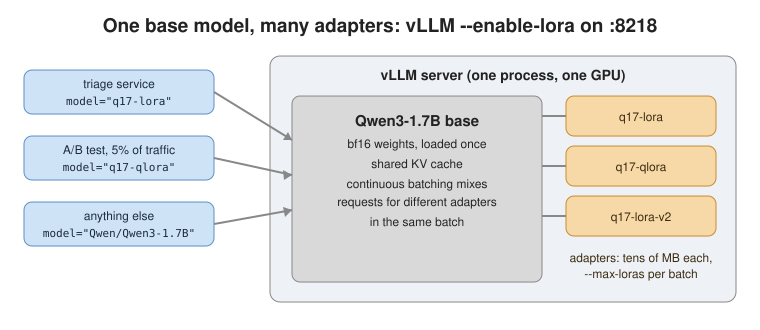
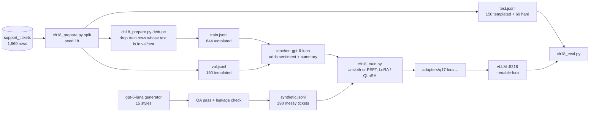
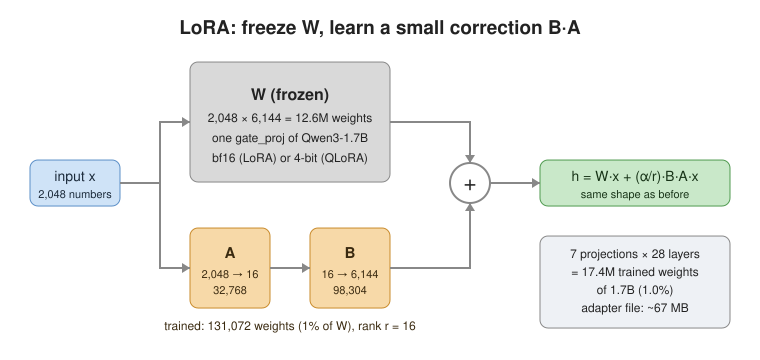
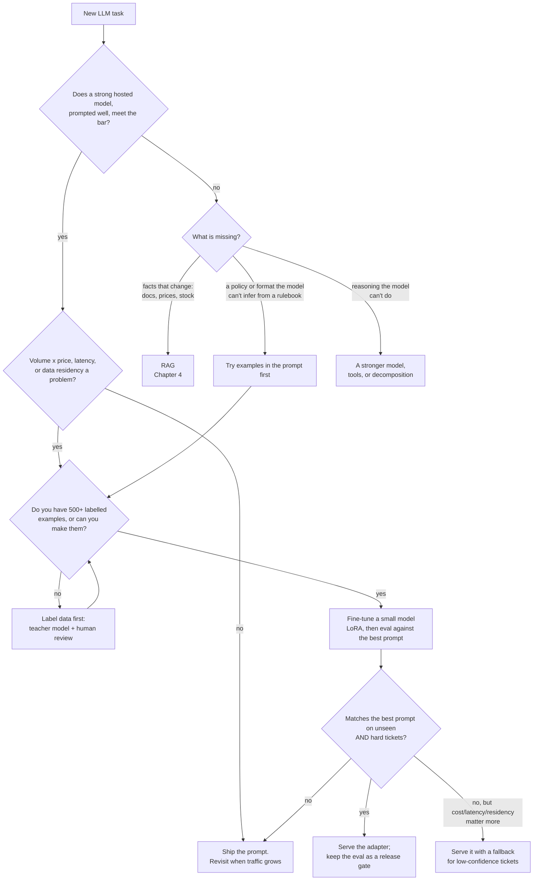
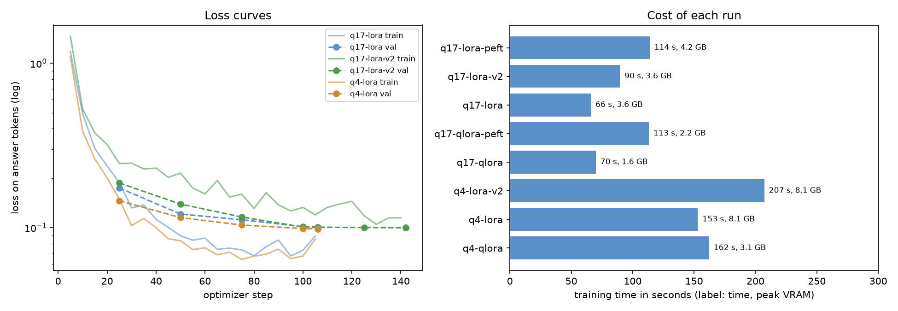
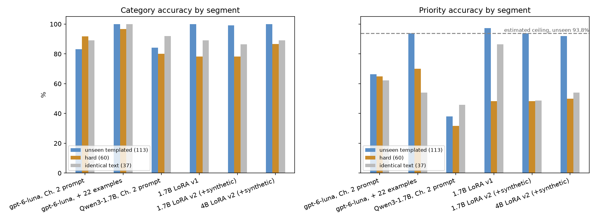
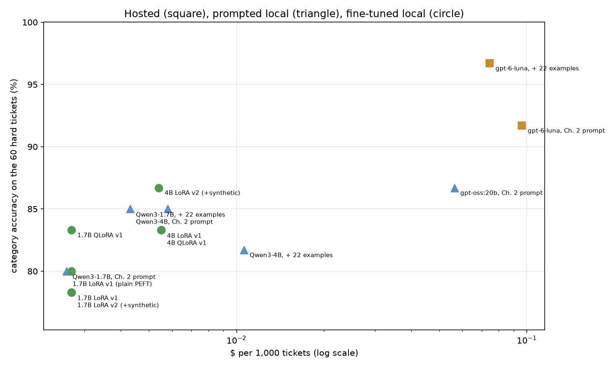

# Chapter 18: Fine-tuning your own model

> **Tested on:** 2026-11-07 to 2026-11-09 · Ubuntu 22.04 (NVIDIA RTX 3090, 24 GB; a single RTX
> 3090, shared with another process using about 2.3 GB) · Python 3.12 · training in
> `.venv-cuda`: Unsloth 2026.11.3, PEFT 0.21.2, TRL 1.15.0, transformers 5.17.0, torch
> 2.14.0+cu130, bitsandbytes 0.50.2 · serving: vLLM 0.33.0 · Qwen/Qwen3-1.7B and Qwen/Qwen3-4B ·
> openai/gpt-6-luna via OpenRouter · gpt-oss:20b via Ollama 0.40.15 (measured 2026-11-09)

Checkr runs background checks. A logistic-regression model already handled 98% of its records,
but the remaining 2% had to be sorted into 230 categories, and that's where GPT-4 reached only
80–82% accuracy. The team fine-tuned small open models on its own labelled records instead and
served them as LoRA adapters. They reported 90% accuracy on those hard cases, 5× lower cost than
GPT-4, and 0.15-second responses, "30x faster than their GPT-4 experiments"
([ZenML LLMOps database](https://www.zenml.io/llmops-database/streamlining-background-check-classification-with-fine-tuned-small-language-models),
summarising Predibase's case study). It's a vendor's story, so treat the numbers as a best case.
The shape is typical, though: a narrow, high-volume classification task, a house taxonomy, and
years of labelled history.

Chapter 17 squeezed speed out of a model we didn't change: quantization, batching, prefix caching
and speculative decoding. This chapter opens up the model itself. Fine-tuning used to mean a
cluster. In 2026 a 1.7-billion-parameter model trains on one gaming GPU in about a minute. The
open-source stack for it is mature: Unsloth or Hugging Face TRL to train, vLLM to serve. The hard
questions are now *should we?* and *how do we know it worked?*

This chapter answers both for Chapter 2's ticket triage, with every number measured on one
RTX 3090. The short answer surprised us. On tickets no model trained on, our fine-tuned models
**did not beat a well-prompted gpt-6-luna on accuracy**. They won on latency (about 0.4 s against
2.8 s) and on cost (about 28 times cheaper per ticket). They also kept tickets on our own GPU.
That's the case for fine-tuning this chapter can honestly make.

The picture below shows where we end up: one base model on one vLLM server, with several small
adapters on top.



## The problem

Let's start with the task we want to improve. Chapter 2 built ShopFlow's ticket triage: every
incoming support ticket gets a `category`, a `priority`, a `sentiment`, the `order_id` it
mentions and a one-line `summary`, as a validated JSON object. On `openai/gpt-6-luna` with a
strict JSON schema, the *format* problem was solved:
every reply parsed. The *labels* weren't. Priority agreed with ShopFlow's own labels only about
two times in three, and Chapter 2 traced it to policy: the support team has conventions ("a
wrong colour is a product defect, not a shipping problem"; "a discount code that didn't apply is
a payment issue") that no general rulebook spells out.

The support lead now has three asks:

> *Make the labels match how my team labels.*
> *It runs on every ticket, 24/7, so make it cheap and fast.*
> *Customer tickets shouldn't leave our infrastructure if we can avoid it.*

That's the classic fine-tuning brief. It's a narrow, high-volume task with a fixed output format
and a house policy, and we have 1,500 labelled examples sitting in a database table.

## Requirements

Before we train anything, let's turn the support lead's three asks into checks we can measure.
First, what the model must get right:

- **Match the team's categories.** On tickets nobody trained on, category accuracy must be at
  least as good as the best prompted gpt-6-luna. We check unseen tickets and hard tickets
  separately.
- **Match the team's priorities.** On tickets nobody trained on, priority accuracy must be at
  least as good as the best prompted baseline, and close to the label-noise ceiling (the best
  score possible when some labels are random; we estimate it below).
- **Cope with messy tickets.** On sarcasm, other languages and prompt injections, it must do no
  worse than the prompted baseline.
- **Keep Chapter 2's contract.** 100% of replies must be valid `TicketTriage` JSON, unchanged.

Then, how well it must run:

- **Answer fast.** p95 latency under 1 s per ticket at concurrency 1. p95 means 95% of tickets
  are faster than this.
- **Cost less.** Fewer dollars per 1,000 tickets than gpt-6-luna.
- **Train cheaply.** Under 30 min and under 24 GB of memory on one RTX 3090.
- **Keep data at home.** Tickets are processed on our own GPU.

Spoiler for the [Results](#results): every item in the second list passes by a wide margin. The
first and third items in the first list don't.

## The data

With the targets set, we need tickets to train and test on. We use the same `support_tickets`
table as Chapter 2 ([datasets/shopflow](../datasets/shopflow/README.md)):
1,500 tickets generated from 30 seed templates, plus 60 hand-written hard ones (sarcasm, several
issues in one ticket, Indonesian, Spanish, German, French, Portuguese and Japanese, forwarded
threads, prompt injections, a base64 blob). Each has a gold `label_category`, `label_priority` and
`order_id`.

The diagram traces each ticket from the database to the eval. Look for where the test set
branches off: it never reaches training.



```bash
docker compose -f datasets/shopflow/docker-compose.yml up -d
cd ch18/01_main-chapter-code
uv run python ch18_prepare.py split      # DB -> data/train.jsonl, val.jsonl, test.jsonl
uv run python ch18_prepare.py dedupe     # the leak fix below; writes results/dedupe.json
uv run python ch18_prepare.py teacher    # + sentiment and summary from gpt-6-luna ($0.12)
uv run python ch18_prepare.py synth      # data/synthetic.jsonl for v2 ($0.06)
```

The split files are committed in [`data/`](01_main-chapter-code/data/) (Chapter 19 reuses them).
The [notebook](01_main-chapter-code/ch18.ipynb) counts tickets per split and category. Check that
every split has every category:

```
split  tickets  hard  templates seen  product_defect  shipping  refund  payment  other  account
train      844     0              30             185       185     152      138    137       47
  val      150     0              29              36        21      30       26     23       14
 test      210    60              30              34        46      34       37     25       34
```

### The leak we shipped, and the fix

The counts above look balanced, but they hide a problem we only found later. The first version
of this split went 1,200 / 150 / 150 by ticket id. Chapter 19 ran its dataset validators on our
files and found that 43 test and 41 validation tickets had exact copies in train. Templates
without an order number or product name produce the same text every time, so a split by id leaks
them. A fine-tuned model could answer those by memory. So could our few-shot baseline, whose
examples came from train. We fixed it before any training run. Here is what the fix dropped:

```
train: 1200 rows, 364 dropped, 8 restored -> 844
identical-text templates (one training row kept each):
   8 What is your return policy?
  16 Change my email address
  17 Someone else used my account
  18 Delete my account
  19 Unsubscribe from marketing emails
  21 Payment keeps failing
  22 Do you accept PayPal?
  27 Store opening hours
test segments: {'unseen_templated': 113, 'identical_text': 37, 'hard': 60}
```

`dedupe` drops every training row whose text (stripped, lower-cased) also appears in val or test.
Eight templates consist *only* of identical text, so dropping them entirely would delete their
intents from training. We keep exactly one row each. That means their 37 test tickets can never
be "unseen". They become a separate segment, and that defines how this chapter reports every
number:

| segment | tickets | what it measures |
|---|---|---|
| **unseen templated** | 113 | known templates, text nobody trained on: did the model learn the policy? |
| **hard** | 60 | hand-written, never in train: traffic that doesn't look like the training data |
| identical text | 37 | text that is in train word for word: memorisation, shown separately |

Unseen and hard are the headline, always as **two separate columns**. Averaging them would let a
model hide a weak hard score behind an easy unseen one. The segment definitions live in
`results/test_segments.json`, and Chapter 19 computes the same three.

> [!IMPORTANT]
> **Decision: fix the split at the source and report identical text separately, over re-splitting
> by template.** Holding out whole templates would give a cleaner "never seen this kind of
> ticket" exam, but ShopFlow's real traffic *is* the known templates, so per-template accuracy is
> what the support lead asked about. We'd re-split by template if new intents appeared every
> month, because then generalising to an unseen template is the job.

### Half the target comes from a teacher

Clean splits give us inputs, but the training targets are still incomplete. The table has no
`sentiment` or `summary`, yet Chapter 2's contract has both, and we want the fine-tuned model to
be a drop-in replacement. So `openai/gpt-6-luna` triaged the train and val tickets with Chapter
2's prompt. We kept its `sentiment` and `summary` and **kept the gold routing labels**. Here is
one row of `train.jsonl`:

```json
{"id": 1, "subject": "Unsubscribe from marketing emails",
 "body": "I keep getting promo emails even though I unsubscribed. Please remove me from the list.",
 "channel": "email", "category": "account", "priority": "low", "order_id": null, "hard": false,
 "template_id": 19, "source": "shopflow", "sentiment": "negative",
 "summary": "The customer continues receiving promotional emails after unsubscribing and asks to be removed from the mailing list.",
 "text_labels_by": "openai/gpt-6-luna"}
```

The teacher pass also measured something useful. On the 994 train and val tickets it agreed with
ShopFlow's gold labels on **85.8%** of categories and **62.9%** of priorities. It also disagreed
on whole templates at once. That's a difference in policy, not random noise. In the output, look
at the last column: the disagreement is often total:

```
                          template                  gold gpt-6-luna says (most often) share
             Wrong colour received product_defect/medium              shipping/medium 44/44
Question about {product} materials    product_defect/low                    other/low 39/39
         Discount code not applied   payment/medium/high                  refund/high 41/47
               Item arrived broken   product_defect/high        product_defect/medium 40/40
          Bulk order for my office          other/medium                    other/low 49/49
...
13 of 30 templates: the teacher's usual answer differs from ShopFlow's label
```

"Wrong colour received" is a product defect at ShopFlow, but Chapter 2's own rulebook lists
"wrong/missing item" under shipping. The model followed the rulebook, and the rulebook was wrong.
That's what "house policy" means. It's exactly what fine-tuning (or showing examples) can teach.

### The priority ceiling is an estimate

Some of the label noise isn't policy at all, and no model can learn it. Four templates draw their
priority at random between two values. "Where is my order?" is `low` or `medium` no matter what
the text says. No model can predict a coin flip. The best *systematic* strategy is to learn each
template's more frequent value from train. The notebook computes what that strategy would score,
per segment:

```
templates with a random priority: ['Where is my order #{order_id}?', 'Return request for order #{ord', '{product} stopped working', 'Discount code not applied']
train counts: {'Where is my order #{': {'medium': 21, 'low': 18}, 'Return request for o': {'low': 16, 'medium': 9}, '{product} stopped wo': {'medium': 22, 'high': 20}, 'Discount code not ap': {'medium': 29, 'high': 14}}
unseen_templated: 113 tickets, 20 from those templates, estimated priority ceiling 93.8%
identical_text: 37 tickets, 0 from those templates, estimated priority ceiling 100.0%
```

It's an estimate, not a bound. The 1.7B LoRA scored 97.3% on unseen priority, above it. With
only 20 coin-flip tickets, a model that guesses a few of them "wrong" relative to the majority
can still land right. Read anything above about 90% on unseen priority as "learned the policy";
the remaining points are noise.

## Concepts

We now know what we want the model to learn and how we'll score it. Before training, let's be
clear about what fine-tuning changes and which tools make it fit on one card.

### Fine-tuning changes the weights, not the prompt

Everything in this book so far has changed what goes *into* the model: instructions, examples,
retrieved documents, tool results. *Fine-tuning* changes the model itself. We show it a few
hundred input→output pairs and nudge its weights so that, for inputs like these, the outputs we
want become the likely ones. It's the difference between handing a new support agent the
rulebook every morning and training them for a week until they don't need it.

That's why fine-tuning suits house policy. Two consequences matter in production:

1. **What a fine-tune can learn is form and policy, not facts.** It learns the shape of the
   answer, the vocabulary, the labelling conventions, the tone. It's a poor way to add knowledge
   that changes (prices, policies, stock): that's retrieval's job (Chapter 4).
2. **You now own a model.** It has a version, a training set, an eval, and a deploy pipeline. When
   the taxonomy changes, a prompt edit takes minutes; a fine-tune takes a new dataset and a run.

### LoRA: train 1% of the weights

Changing the weights sounds expensive, and done naively it is. Full fine-tuning updates all 1.7
billion weights. It needs memory for the weights, their gradients and the optimizer's two running
averages per weight. That's roughly 16 bytes per parameter, about 27 GB for a 1.7B model, more
than our card. *LoRA* (low-rank adaptation) freezes the original weights and learns a small
correction next to each big matrix: two thin matrices, A and B, whose product has the same shape
as the original. Only A and B are trained.



The *rank* r is how thin A and B are. With r = 16 on all seven projection matrices of every
layer, Qwen3-1.7B gets 17.4 million trainable weights out of 1.74 billion, 1% of the model. The
result, the *adapter*, is a 66.5 MB file that sits on top of the unchanged base model, like a
patch on top of a release.

### QLoRA: freeze the base in 4 bits

LoRA makes training fit, but the frozen part can be stored more cheaply. LoRA still keeps the
frozen base in 16 bits. *QLoRA* stores it in 4 bits (the NF4 format) and dequantizes each layer
on the fly; the adapter itself still trains in 16 bits. It's the trick that made 65B models
trainable on one 48 GB GPU ([Dettmers et al., 2023](https://arxiv.org/abs/2305.14314)). The
price is speed (dequantizing isn't free) and a mismatch. The adapter learned to correct a
*4-bit* base, and if we serve it on the 16-bit base, it's correcting a slightly different model.

> [!NOTE]
> **In the wild:** that mismatch bites people when they *merge*. A Hugging Face Transformers
> issue reports that merging a QLoRA adapter into its base raised eval loss from 0.12 to 0.56 on
> a grammar task, while plain LoRA merged with almost no change
> ([transformers#31293](https://github.com/huggingface/transformers/issues/31293)). In September
> 2026 a TRL user reported a 33-point exact-match drop serving a QLoRA adapter on a bf16 base in
> vLLM; the first reply pointed at a vLLM bug where the adapter silently isn't applied at all
> ([trl discussion #7231](https://github.com/huggingface/trl/discussions/7231)). Either way, the
> lesson is the same: only a field-level eval catches it. We serve unmerged and we measured it
> (QLoRA on a bf16 base was fine *for us*, see [Results](#results)).

### What the model actually trains on

Whichever method we pick, the model learns from text, so the exact text matters. A chat model
doesn't see messages. It sees one string built by its *chat template*. For Qwen3 with thinking
switched off, one training example is:

```
<|im_start|>system
You triage customer-support tickets for ShopFlow, an online shop. ...
<|im_end|>
<|im_start|>user
<ticket> ... </ticket><|im_end|>
<|im_start|>assistant
<think>

</think>

{"category": "account", "priority": "low", ...}<|im_end|>
```

Three details decide whether a fine-tune works at all:

- **Loss only on the answer.** We don't want the model to get better at *writing tickets*. The
  ticket tokens are masked out of the loss (TRL's `completion_only_loss`).
- **The end-of-turn token is part of the answer.** If `<|im_end|>` isn't in the loss, the model
  never learns to stop and generates until `max_tokens`.
- **Train on exactly the string we'll serve.** vLLM renders the same template with
  `enable_thinking=False`, which inserts the empty `<think>` block. If training rendered it
  differently, every request would start from a prefix the model has never seen.

`prompt_completion` enforces the third rule by rendering both and refusing to build an example
if they disagree:

```python
# ch18/01_main-chapter-code/ch18_data.py
def prompt_completion(record: dict[str, Any], render: Callable[..., str],
                      end_of_turn: str = "<|im_end|>") -> dict[str, str]:
    messages = to_example(record)["messages"]
    prompt = render(messages[:-1], tokenize=False, add_generation_prompt=True,
                    enable_thinking=False)
    full = render(messages, tokenize=False, enable_thinking=False)
    completion = messages[-1]["content"] + end_of_turn
    if not full.startswith(prompt + completion):
        raise ValueError(
            "chat template mismatch: training text does not start with the inference prompt "
            f"plus the answer.\nprompt tail: {prompt[-80:]!r}\nfull: {full[len(prompt) - 80:]!r}"
        )
    return {"prompt": prompt, "completion": completion}
```

### Prompt, RAG or fine-tune?

With the mechanics clear, the remaining question is when to use them at all. The flowchart below
is our decision path. Follow the branch for your own task:



Our triage lands on the "cost/latency/residency matter more" branch, and the rest of the chapter
shows the measurements that put it there.

## v0: the naive solution

Before paying for any training, let's see how far a small local model gets on its own. The
cheapest way to keep tickets on our GPU is to skip training: serve stock Qwen3-1.7B with
vLLM and send it Chapter 2's prompt, unchanged. The client is Chapter 2's `triage_one`, pointed
at a different `base_url`, with strict `json_schema` (vLLM enforces it with guided decoding) and
Qwen3's thinking switched off:

```python
# ch18/01_main-chapter-code/ch18_eval.py
VLLM_EXTRA = {"temperature": 0,
              "extra_body": {"chat_template_kwargs": {"enable_thinking": False}}}
```

```bash
cd ch18/01_main-chapter-code
./serve_vllm.sh Qwen/Qwen3-1.7B            # vLLM 0.33 on 127.0.0.1:8218, .venv-cuda
uv run python ch18_eval.py --endpoint vllm --model Qwen/Qwen3-1.7B --prompt ch02
```

## Measuring v0

v0 runs, but we don't yet know how it compares with the hosted model. We ran two baselines on
the same 210 tickets with the same scorer (from the notebook; "identical" is the memorisation
segment):

| system | category unseen / hard | priority unseen / hard | cat / pri, identical text | p50 | $ per 1k |
|---|---|---|---|---|---|
| gpt-6-luna, Chapter 2 prompt | 83.2 / 91.7 | 66.4 / 65.0 | 89.2 / 62.2 | 2838 ms | 0.0961 |
| Qwen3-1.7B, Chapter 2 prompt (v0) | 84.1 / 80.0 | 38.1 / 31.7 | 91.9 / 45.9 | 310 ms | 0.0026 |

v0 is nine times faster and 37 times cheaper, and it's bad at exactly the thing the support lead
cares about: priority, at 38.1% on unseen tickets. It's also 11.7 points behind on hard
categories. Every reply parsed (guided decoding), so the failures are all judgment.

A fair test needs a strong opponent, not just the default prompt. Before training anything, we
gave both models the strongest prompt-only competitor: Chapter 2's rulebook plus one labelled
training ticket per template. After the dedupe that's 22 examples. The 8 identical-text
templates have no row whose text isn't also in test, and we never show a test ticket as an
example.

| system | category unseen / hard | priority unseen / hard | cat / pri, identical text | p50 | $ per 1k |
|---|---|---|---|---|---|
| gpt-6-luna + 22 examples | 100 / 96.7 | 93.8 / 70.0 | 100 / 54.1 | 2764 ms | 0.0744 |
| Qwen3-1.7B + 22 examples | 99.1 / 85.0 | 92.0 / 41.7 | 89.2 / 37.8 | 299 ms | 0.0043 |

Examples close almost the whole gap on unseen templated tickets, for both models. The policy is
easier to *show* than to *describe*. Examples don't fix the hard tickets for the small model
(41.7% priority). And gpt-6-luna + 22 examples is now the bar a fine-tune has to clear: 100% /
96.7% category, 93.8% / 70.0% priority. Note what examples cost on the identical-text segment:
54.1% priority. Those 8 templates have no example, and the long prompt pulls the model toward the
other templates' conventions.

> [!IMPORTANT]
> **Decision: compare against the best prompt, not the default one.** Beating Chapter 2's
> rulebook (66.4% unseen priority) would have been an easy headline for fine-tuning, and a
> misleading one: 22 examples get gpt-6-luna to 93.8% for a quarter less money per ticket than
> the rulebook alone. We'd compare against the plain prompt only if the examples didn't fit the
> context window or the per-token price, which isn't the case at 1,919 input tokens.

## Iterating

We now have a clear bar to clear and a small model that falls short of it. Each iteration below
starts from the weakest number of the one before. All training runs used the same recipe: rank
16 on all seven linear projections, alpha 16, 2 epochs, learning rate 2e-4, effective batch 16
(8 × 2 gradient accumulation), 8-bit AdamW, loss on the answer only. `ch18_train.py` writes
`results/train__<name>.json`; `run_gpu.sh train` runs all eight in order.

### 1. A LoRA adapter on Qwen3-1.7B with Unsloth

We start with the cheapest training run that could close v0's priority gap.

**What's wrong:** v0 can't learn ShopFlow's priority policy from a rulebook, and the examples
prompt is 1,900 tokens on every request.

**Options:** full fine-tuning (doesn't fit in 24 GB at 16 bytes per parameter), LoRA with plain
Hugging Face PEFT + TRL, or LoRA with Unsloth, which wraps TRL with its own kernels.

> [!IMPORTANT]
> **Decision: Unsloth over plain PEFT/TRL as the default trainer.** Same adapter format, same TRL
> `SFTTrainer`, so the switch costs one import, and it trained 1.7× faster in less memory here
> (iteration 3). We'd use plain PEFT for a base model Unsloth doesn't support yet, or when a
> trainer feature we need isn't covered by Unsloth's patches.

Here is the Unsloth path, executed on our RTX 3090 for every Unsloth run below:

```python
# ch18/01_main-chapter-code/ch18_train.py
from unsloth import FastLanguageModel  # must be imported before transformers / trl

model, tok = FastLanguageModel.from_pretrained(
    model_name=args.model, max_seq_length=args.max_len, dtype=None,
    load_in_4bit=args.load_in_4bit, use_exact_model_name=True,
)
model = FastLanguageModel.get_peft_model(
    model, r=args.rank, lora_alpha=args.alpha, lora_dropout=0, bias="none",
    target_modules=TARGET_MODULES, use_gradient_checkpointing="unsloth",
    random_state=args.seed,
)
```

Before training, the script decodes exactly the tokens that carry loss in the first example. It
refuses to train if anything other than the answer and its end token is in there. We added this
check after finding that Unsloth marks the loss with `labels = -100` while plain TRL uses a
`completion_mask`. A check that only knew one convention would have silently passed the other.
The output below shows only the answer and `<|im_end|>`, which is what we want:

```python
# ch18/01_main-chapter-code/ch18_train.py
row = trainer.train_dataset[0]
if row.get("labels") is not None:
    mask = [lab != -100 for lab in row["labels"]]
else:
    mask = row.get("completion_mask") or row["assistant_masks"]
trained = tok.decode([t for t, m in zip(row["input_ids"], mask, strict=True) if m])
print(f"tokens in loss for example 0: {trained!r} (keys: {sorted(row)})")
if not trained.endswith("<|im_end|>") or "<ticket>" in trained:
    raise SystemExit("loss mask is wrong: it must cover the answer and <|im_end|> only")
```

```
--- in the loss: '{"category": "account", "priority": "low", "sentiment": "negative", "order_id": null, "summary": "The customer continues receiving promotional emails after unsubscribing and asks to be removed from the mailing list."}<|im_end|>'
```

```bash
cd ch18/01_main-chapter-code
.venv-cuda/bin/python ch18_train.py --model Qwen/Qwen3-1.7B --name q17-lora
```

**Measured effect:** 106 optimizer steps in **66.0 s**, peak 3.61 GB of VRAM, final validation
loss 0.1007, a 66.5 MB adapter. Served on vLLM with the one-line training prompt (no rulebook,
no examples):

| system | category unseen / hard | priority unseen / hard | cat / pri, identical text | p50 | $ per 1k |
|---|---|---|---|---|---|
| Qwen3-1.7B, Chapter 2 prompt (v0) | 84.1 / 80.0 | 38.1 / 31.7 | 91.9 / 45.9 | 310 ms | 0.0026 |
| **1.7B LoRA** | **100 / 78.3** | **97.3 / 48.3** | 89.2 / 86.5 | 394 ms | 0.0027 |
| gpt-6-luna + 22 examples | 100 / 96.7 | 93.8 / 70.0 | 100 / 54.1 | 2764 ms | 0.0744 |

On unseen templated tickets the adapter learned the policy: 100% category and 97.3% priority.
That's level with gpt-6-luna + examples, at 7× lower latency and 28× lower cost. On the hard
tickets it learned nothing: 78.3% category, *below* v0's 80.0%, and 48.3% priority against
gpt-6-luna's 70.0%. That's the expected shape of a fine-tune on templated data. It gets very good
at the distribution it saw and no better at the one it didn't.

The notebook lists the misses. Of the 13 hard tickets the 1.7B LoRA gets wrong on category,
three are sarcastic ("Oh fantastic, my order #2943 is 'out for delivery' for the 9th day in a
row") and come out as `other`. A German refund request comes out as `payment`. A GDPR data
request comes out as `other`. Two tickets carry an instruction aimed at the AI; the model doesn't
obey them in the sense of leaking anything (it can only emit the schema), but it does take their
bait on priority (`urgent`).

### 2. QLoRA: the same adapter in less than half the memory

Before chasing the hard tickets, we check whether training can get even cheaper, because the
next fixes may need a bigger model.

**What's wrong:** nothing yet at 1.7B, but a bigger base model or a longer context won't fit in
bf16 on a 24 GB card with other tenants on it.

```bash
.venv-cuda/bin/python ch18_train.py --model Qwen/Qwen3-1.7B --name q17-qlora --4bit
```

**Measured effect:** peak VRAM dropped from 3.61 GB to **1.65 GB**, training took 70.0 s instead
of 66.0 s, and validation loss rose slightly (0.1091 against 0.1007). We served the QLoRA adapter
on the **bf16** base model, which is the mismatch from the In-the-wild note. It held up:

| system | category unseen / hard | priority unseen / hard | cat / pri, identical text |
|---|---|---|---|
| 1.7B LoRA | 100 / 78.3 | 97.3 / 48.3 | 89.2 / 86.5 |
| 1.7B QLoRA, served on bf16 | 100 / 83.3 | 95.6 / 45.0 | 100 / 73.0 |
| 4B LoRA | 100 / 83.3 | 93.8 / 36.7 | 100 / 81.1 |
| 4B QLoRA, served on bf16 | 100 / 83.3 | 92.9 / 48.3 | 100 / 81.1 |

With 60 hard tickets, one ticket is 1.7 points, so 78.3 vs 83.3 is three tickets. No ranking
between LoRA and QLoRA survives that noise. What we can say is that serving a QLoRA adapter on
the full-precision base did not cost us accuracy on this task. That's one task and two model
sizes, not a law. Keep the eval as a release gate (see
[Production hardening](#production-hardening)).

> [!IMPORTANT]
> **Decision: train QLoRA only when bf16 doesn't fit.** It saved 2 GB at 1.7B and 5 GB at 4B,
> and cost 6% more training time. On this card with this data, bf16 LoRA fits easily, so LoRA
> stays the default. We'd switch to QLoRA for an 8B+ base, long contexts, or a shared GPU where
> the 4.95 GB difference decides whether the job starts at all.

### 3. Unsloth vs plain PEFT/TRL

Both runs so far used Unsloth, and we chose it on the promise of speed. That promise deserves a
measurement too.

**What's wrong:** the comparison everyone quotes ("Unsloth is 2× faster") was measured on other
people's data. We trained the same two configurations with plain PEFT + TRL:

```bash
.venv-cuda/bin/python ch18_train.py --model Qwen/Qwen3-1.7B --name q17-lora-peft --backend peft
.venv-cuda/bin/python ch18_train.py --model Qwen/Qwen3-1.7B --name q17-qlora-peft --backend peft --4bit
```

| run | backend | frozen base | train time | peak VRAM | val loss |
|---|---|---|---|---|---|
| q17-lora | Unsloth | bf16 | 66.0 s | 3.61 GB | 0.1007 |
| q17-lora-peft | plain PEFT/TRL | bf16 | 113.8 s | 4.16 GB | 0.1040 |
| q17-qlora | Unsloth | 4-bit | 70.0 s | 1.65 GB | 0.1091 |
| q17-qlora-peft | plain PEFT/TRL | 4-bit | 113.2 s | 2.22 GB | 0.1131 |

Unsloth was 1.72× faster on LoRA and 1.62× on QLoRA, with 0.55–0.57 GB less memory. The LoRA
PEFT adapter scored within noise of the Unsloth one (100 / 80.0 category, 96.5 / 46.7 priority).
Before you quote that speed-up, read the caveat:

> [!WARNING]
> **This is not a kernel-for-kernel comparison.** Unsloth switched on *padding-free batching*
> by itself (`🦥 Unsloth: Padding-free auto-enabled, enabling faster training.` in
> `results/train_all.log`), and our PEFT runs didn't use it. Our tickets vary a lot in length, so
> part of the 1.7× is simply not computing padding. Unsloth documents padding-free as on by
> default ([Unsloth docs](https://unsloth.ai/docs/blog/3x-faster-training-packing)). TRL has its
> own `padding_free` option; we didn't run that configuration, so we can't split the gap
> between kernels and batching. The PEFT runs also used standard gradient checkpointing, which
> trades speed for memory.

The notebook plots the loss curves and the time and memory of every run
(`images/18-training.png`):



### 4. A bigger base: Qwen3-4B

The trainer choice didn't move accuracy, so the hard tickets are still the open problem.

**What's wrong:** the 1.7B adapter is weak on hard tickets. Maybe it's capacity.

```bash
.venv-cuda/bin/python ch18_train.py --model Qwen/Qwen3-4B --name q4-lora
.venv-cuda/bin/python ch18_train.py --model Qwen/Qwen3-4B --name q4-qlora --4bit
```

| system | category unseen / hard | priority unseen / hard | cat / pri, identical text | p50 | $ per 1k |
|---|---|---|---|---|---|
| Qwen3-4B, Chapter 2 prompt | 81.4 / 85.0 | 54.9 / 50.0 | 75.7 / 51.4 | 703 ms | 0.0058 |
| Qwen3-4B + 22 examples | 100 / 81.7 | 93.8 / 60.0 | 89.2 / 64.9 | 621 ms | 0.0106 |
| 4B LoRA | 100 / 83.3 | 93.8 / 36.7 | 100 / 81.1 | 805 ms | 0.0055 |
| 4B QLoRA | 100 / 83.3 | 92.9 / 48.3 | 100 / 81.1 | 805 ms | 0.0055 |

**Measured effect:** 153.1 s and 8.10 GB to train, twice the latency and half the throughput
(about 25 tickets/s at concurrency 32, against 51 for 1.7B). Hard category went from 78.3% to
83.3%, three tickets. Hard priority didn't improve: 36.7% for the 4B LoRA is the worst of any
adapter. The best small-model score on hard priority in this whole chapter is **60.0%, from
Qwen3-4B with 22 examples and no training at all**. A bigger base helps less than a better prompt
on the tickets that don't look like training data.

### 5. v2: add 290 synthetic messy tickets

A bigger model didn't fix the hard tickets, so perhaps the training data is the problem.

**What's wrong:** training contains no sarcasm, no foreign languages, no injections, so the
adapters can't learn them. We can't use the 60 hard tickets (they're the exam), so we generated
look-alikes.

`ch18_prepare.py synth` asked gpt-6-luna for 300 messy tickets in 15 styles with requested
labels. A second, independent triage pass, which never saw the requested labels, had to agree on
the category. Every ticket was also checked for word-trigram overlap with the hard test tickets.
The low overlap below means the look-alikes don't copy the exam:

```
300 generated, 290 kept after the QA pass; cost $0.0639
...
max word-trigram Jaccard to any hard test ticket: {'50%': 0.0, 'max': 0.075}
```

```bash
.venv-cuda/bin/python ch18_train.py --model Qwen/Qwen3-1.7B --name q17-lora-v2 --train train.jsonl synthetic.jsonl
.venv-cuda/bin/python ch18_train.py --model Qwen/Qwen3-4B --name q4-lora-v2 --train train.jsonl synthetic.jsonl
```

| system | category unseen / hard | priority unseen / hard | cat / pri, identical text |
|---|---|---|---|
| 1.7B LoRA | 100 / 78.3 | 97.3 / 48.3 | 89.2 / 86.5 |
| 1.7B LoRA v2 (+ synthetic) | 99.1 / 78.3 | 93.8 / 48.3 | 86.5 / 48.6 |
| 4B LoRA | 100 / 83.3 | 93.8 / 36.7 | 100 / 81.1 |
| 4B LoRA v2 (+ synthetic) | 100 / 86.7 | 92.0 / 50.0 | 89.2 / 54.1 |

**Measured effect:** for the 1.7B model, nothing changed on hard tickets. Category stayed at
78.3% with the same 13 misses in number but a different 13 in content: two of the three sarcasm
misses went away and payment vs refund confusions appeared. For the 4B, hard category rose +3.4
points (two tickets) and hard priority +13.3. There was also a cost we didn't expect:
identical-text priority fell from 86.5% to 48.6% on the 1.7B. Our reading, which we haven't
tested: the eight identical-text templates have one training row each, and 290 synthetic tickets
with their own priority conventions drown those single examples.

> [!IMPORTANT]
> **Decision: ship v1 (no synthetic data) for the 1.7B adapter.** v2 bought nothing on hard
> tickets for the 1.7B and cost 38 points on the memorised segment. Synthetic data from the same
> model family that we're trying to replace mostly teaches that model's conventions, which is
> what the teacher table above showed don't match ShopFlow's. We'd use synthetic data with
> human-reviewed labels, or real production tickets once we log agent corrections.

## Production hardening

We have an adapter worth shipping, along with a list of ways it failed or nearly failed. Each
lesson from the iterations becomes a rule for running it safely:

- **The template parity check is a release gate.** `prompt_completion` refuses to build a
  training example unless the training text starts with exactly the prompt vLLM will render, and
  `test_served_prompt_is_the_trained_prompt` checks that the eval client sends the system prompt
  the adapter was trained with. A silent mismatch here doesn't crash anything; it just costs
  accuracy you'll never find in a log.
- **Check that the adapter is applied.** A vLLM bug that silently serves the base model behind an
  adapter name has been reported in the wild (see the In-the-wild note above). Our cheapest proof
  is in the tables: Qwen3-1.7B with the one-line prompt couldn't do priority, and `q17-lora`
  scores 97.3%. Run the base and the adapter on the same 20 tickets after every deploy; identical
  outputs mean the adapter isn't loaded.
- **Keep guided decoding on.** Every reply from every adapter parsed, but strict `json_schema` on
  vLLM costs almost nothing and turns "almost always valid" into "always valid". The one invalid
  reply we saw per few-shot run (gpt-6-luna on ticket #1543, Qwen3-4B on ticket #1549, both
  injection tickets) hit the 300-token `max_tokens` mid-JSON; the 4B one was emitting a 60-digit
  `order_id`. Chapter 2's retry handles it; a length check on integer fields would too.
- **Version adapters like code.** `q17-lora` should map to a commit of the training data, the
  training config and the eval report (`results/train__q17-lora.json`,
  `results/eval__vllm__q17-lora__ft__c1.json`). vLLM serves many adapters at once, so a new
  version can take 5% of traffic next to the old one (Chapter 21 covers canaries).
- **Serve the unmerged adapter.** Merging a QLoRA adapter into 16-bit weights is where the
  degradation in transformers#31293 came from. Unmerged, we keep the eval we ran.
- **Label policy has an owner.** The whole accuracy gain came from the support team's labelling
  conventions. When they change ("VAT invoices are now high priority"), the training set has to
  change, and the old adapter becomes wrong overnight. Log predictions and agent corrections, and
  retrain from the corrections.
- **Hard tickets need a fallback.** Our adapters are 20+ points behind gpt-6-luna on hard
  priority. Route tickets the small model is unsure about (non-English, very short, very long,
  or containing text aimed at the AI) to the hosted model; Chapter 15's router is the place.
- **Don't expose runtime adapter loading.** vLLM can load adapters at runtime
  (`VLLM_ALLOW_RUNTIME_LORA_UPDATING=True` and `POST /v1/load_lora_adapter`), and its docs warn
  not to use that in production outside an isolated, fully trusted environment
  ([vLLM docs](https://docs.vllm.ai/en/latest/features/lora/)). Anyone who can reach that
  endpoint can swap the model.

## Serving it

Those rules assume a server that can run the adapter next to the base model. One vLLM process
serves the base model and every adapter. Each adapter is just another model name on the same
OpenAI-compatible API:

```bash
# ch18/01_main-chapter-code/serve_vllm.sh (what it runs)
.venv-cuda/bin/vllm serve Qwen/Qwen3-1.7B --host 127.0.0.1 --port 8218 \
  --max-model-len 4096 --gpu-memory-utilization 0.85 \
  --enable-lora --max-loras 4 --max-lora-rank 16 \
  --lora-modules q17-lora=adapters/q17-lora q17-qlora=adapters/q17-qlora \
                 q17-lora-peft=adapters/q17-lora-peft q17-lora-v2=adapters/q17-lora-v2
```

> [!WARNING]
> vLLM 0.33's FlashInfer sampler JIT-compiles a CUDA kernel on first use and needs `nvcc` and
> `ninja` on the `PATH`. Our host has neither on the default `PATH`, so the first request failed.
> `serve_vllm.sh` sets `VLLM_USE_FLASHINFER_SAMPLER=0`; the PyTorch sampler is plenty fast here.

The server log (`results/vllm_Qwen3-1.7B.log`) shows how much room is left for the KV cache (the
per-request memory vLLM keeps), with about 2.3 GB of the card held by another process:

```
INFO 11-09 11:34:57 [gpu_worker.py:772] Available KV cache memory: 13.92 GiB
INFO 11-09 11:34:57 [kv_cache_utils.py:1147] GPU KV cache size: 130,272 tokens, Maximum concurrency for 4,096 tokens per request: 31.80x
```

The last line says the cache holds about 32 requests of 4,096 tokens at once. Throughput with 32
requests in flight (from `results/eval_17b.log`):

```
vllm__Qwen_Qwen3-1.7B__ch02__c32: 210 tickets in 3.86 s (54.416/s)
vllm__q17-lora__ft__c32: 210 tickets in 4.1 s (51.225/s)
vllm__q17-qlora__ft__c32: 210 tickets in 4.06 s (51.67/s)
```

The adapter costs about 6% of throughput against the base model. That's the number behind the
self-hosted cost column: an RTX 3090 at $0.50/h (RunPod, as of 2026-11) divided by 51 tickets/s
is $0.0027 per 1,000 tickets. It assumes the GPU is busy. An idle 3090 waiting for tickets costs
the same $0.50/h.

Every GPU step, in the order we ran it, is in [`run_gpu.sh`](01_main-chapter-code/run_gpu.sh).
The CUDA stack lives in a chapter-local venv so it never touches the book's main environment:

```bash
cd ch18/01_main-chapter-code
uv venv .venv-cuda --python 3.12
UV_CACHE_DIR=$HOME/.cache/uv-cuda-ch18 uv pip install -r requirements-cuda.txt --python .venv-cuda
./run_gpu.sh train        # 8 runs, about 21 minutes including model loads
./run_gpu.sh eval-1.7b    # vLLM + 4 adapters, all evals at concurrency 1 and 32
./run_gpu.sh eval-4b
```

## Results

Now we can put every system side by side. All numbers come from `results/eval__*.json` through
the [notebook](01_main-chapter-code/ch18.ipynb), on the same 210 tickets. Latency is p50 (the
median) per ticket at concurrency 1 on the 173 unseen + hard tickets. Hosted cost is
OpenRouter's billed `usage.cost`. Self-hosted cost is $0.50/h divided by throughput with requests
in flight (concurrency 32 on vLLM, 4 on Ollama). Compare the hard columns first: that's where the
systems differ most.

| system | category unseen / hard | priority unseen / hard | cat / pri, identical text | p50 | $ per 1k |
|---|---|---|---|---|---|
| gpt-6-luna, Chapter 2 prompt | 83.2 / 91.7 | 66.4 / 65.0 | 89.2 / 62.2 | 2838 ms | 0.0961 |
| gpt-6-luna + 22 examples | **100 / 96.7** | 93.8 / **70.0** | 100 / 54.1 | 2764 ms | 0.0744 |
| Qwen3-1.7B, Chapter 2 prompt | 84.1 / 80.0 | 38.1 / 31.7 | 91.9 / 45.9 | 310 ms | 0.0026 |
| Qwen3-1.7B + 22 examples | 99.1 / 85.0 | 92.0 / 41.7 | 89.2 / 37.8 | 299 ms | 0.0043 |
| 1.7B LoRA | 100 / 78.3 | **97.3** / 48.3 | 89.2 / 86.5 | 394 ms | 0.0027 |
| 1.7B QLoRA | 100 / 83.3 | 95.6 / 45.0 | 100 / 73.0 | 387 ms | 0.0027 |
| 1.7B LoRA (plain PEFT) | 100 / 80.0 | 96.5 / 46.7 | 89.2 / 81.1 | 390 ms | 0.0027 |
| 1.7B LoRA v2 (+ synthetic) | 99.1 / 78.3 | 93.8 / 48.3 | 86.5 / 48.6 | 387 ms | 0.0027 |
| Qwen3-4B, Chapter 2 prompt | 81.4 / 85.0 | 54.9 / 50.0 | 75.7 / 51.4 | 703 ms | 0.0058 |
| Qwen3-4B + 22 examples | 100 / 81.7 | 93.8 / 60.0 | 89.2 / 64.9 | 621 ms | 0.0106 |
| 4B LoRA | 100 / 83.3 | 93.8 / 36.7 | 100 / 81.1 | 805 ms | 0.0055 |
| 4B QLoRA | 100 / 83.3 | 92.9 / 48.3 | 100 / 81.1 | 805 ms | 0.0055 |
| 4B LoRA v2 (+ synthetic) | 100 / 86.7 | 92.0 / 50.0 | 89.2 / 54.1 | 781 ms | 0.0054 |
| *Local, no fine-tuning, larger model (Ollama)* | | | | | |
| gpt-oss:20b, Chapter 2 prompt | 79.6 / 86.7 | 50.4 / 48.3 | 86.5 / 62.2 | 658 ms | 0.0563 |

Valid JSON was 100% on the headline tickets for every system except the two few-shot runs that
truncated one injection ticket each (99.4%). Order-id accuracy was 99.4–100% everywhere except
Qwen3-1.7B with Chapter 2's prompt (88.4%).

The gpt-oss:20b row comes from a later run on the same shared card: Ollama 0.40.15, fully on the
GPU, context 8192, `reasoning_effort="low"` (its minimum) and `max_tokens=1500`, because its
reasoning counts toward the limit. With no examples, it does no better than a much smaller
prompted base: it's level with Qwen3-4B on Chapter 2's prompt (81.4 / 85.0 category,
54.9 / 50.0 priority). It's the opposite of the 1.7B adapter: 8 points better on hard
categories (86.7% vs 78.3%), far worse on unseen tickets (50.4% vs 97.3% priority), and 21×
more expensive per ticket. Its cost was measured at concurrency 4 on Ollama, not 32 on vLLM, so
part of that gap is the serving stack. Its 100% validity also needed Chapter 2's retry. On the
first attempt, 36 of 210 replies failed: 25 came back empty with a normal finish (not
`length`, so it wasn't the token budget), and 11 were plain `category: payment` lines instead of
JSON despite the strict schema. Every one of them parsed on the second attempt, and the p50
latency includes those retries. We didn't find out why Ollama let those replies through the
schema.

The two charts show the same results visually: accuracy per segment, and hard-ticket accuracy
against cost.





Now we check the 1.7B LoRA against the requirements we set at the start:

| Requirement | Target | 1.7B LoRA | Met? |
|---|---|---|---|
| Category, unseen / hard | ≥ 100 / 96.7 (best prompt) | 100 / 78.3 | unseen yes, **hard no** |
| Priority, unseen / hard | ≥ 93.8 / 70.0 | 97.3 / 48.3 | unseen yes, **hard no** |
| Valid JSON | 100% | 100% | yes |
| p95 latency | < 1 s | 457 ms | yes |
| Cost | < $0.0744 per 1k | $0.0027 | yes, 28× cheaper |
| Training | < 30 min, < 24 GB | 66 s, 3.61 GB | yes |
| Data residency | own GPU | yes | yes |

So the fine-tune is the right tool for the templated 90% of traffic and the wrong one for the
messy rest. At ShopFlow's volume the honest design is the 1.7B adapter for everything, with
hard-looking tickets routed to gpt-6-luna + examples. Two published studies help put this result
in context:

> [!NOTE]
> **In the wild:** Predibase fine-tuned 310 LoRA adapters across 10 base models and 31 tasks and
> reported that 4-bit LoRA models beat GPT-4 by 10 points on average, serving 25 of them on a
> single A100 ([LoRA Land, arXiv 2405.00732](https://arxiv.org/abs/2405.00732)). Our result is
> the other side of that average: on in-distribution tickets the adapters match the hosted model,
> and on out-of-distribution ones they don't. Averages over many tasks hide which side your
> traffic is on; a segment split shows it.

> [!NOTE]
> **In the wild:** a Databricks and Columbia study found that LoRA "learns less and forgets less"
> than full fine-tuning: it underperforms on new skills but better preserves the base model's
> behaviour outside the target domain ([Biderman et al., TMLR 2024](https://arxiv.org/abs/2405.09673)).
> That fits our hard-ticket numbers: the adapters changed the templated behaviour a lot and the
> hard-ticket behaviour very little, for better and for worse.

**Spend.** Every OpenRouter call in this chapter, summed from the cached replies in the
notebook: teacher labels $0.1227, synthetic generation and QA $0.0639, the two gpt-6-luna evals
$0.0199 and $0.0154, total **$0.2219**. The key's usage counter moved $0.2386 over the chapter,
the difference being development calls on small subsets. Training and self-hosted evals cost GPU
time only: 1,272 s (21 minutes) for the eight training runs, model loads included.

## Exercises

The results leave several questions open. These exercises test them on your own GPU:

1. Train a 1.7B LoRA with TRL's own padding-free batching (`padding_free=True` in `SFTConfig`)
   and compare its time and VRAM with `q17-lora` and `q17-lora-peft`. How much of Unsloth's 1.7×
   was batching?
2. Hold out whole templates instead of ticket ids (for example templates 0, 7 and 21), retrain
   `q17-lora`, and evaluate on those templates only. How much of the 97.3% unseen priority
   survives a template the model has never seen?
3. Write a router: `q17-lora` by default, gpt-6-luna + 22 examples when the ticket isn't English,
   is under 8 words, or contains text addressed to an AI. Measure hard-ticket accuracy and the
   blended cost per 1,000 tickets on the 210 test tickets.
4. Replace the 290 synthetic tickets with 290 that you relabel by hand from Chapter 2's
   rulebook, keeping the same styles. Does v2 still lose identical-text priority?

## What we learned

Here is what the measurements taught us:

- Fine-tuning a small model didn't beat a well-prompted gpt-6-luna on accuracy. A 1.7B LoRA
  matched it on unseen templated tickets (100% category, 97.3% priority) and fell far behind on
  hard ones (78.3% vs 96.7% category, 48.3% vs 70.0% priority).
- The case for fine-tuning here is latency (394 ms vs 2.8 s), cost ($0.0027 vs $0.0744 per 1,000
  tickets, 28× less) and keeping tickets on our own GPU, not accuracy.
- Compare against the best prompt. 22 examples got gpt-6-luna from 66.4% to 93.8% unseen priority
  for less money than the plain rulebook; that's the bar, not Chapter 2's prompt.
- Split by text, not by id, and report memorisation separately. Our first split leaked 43 test
  tickets into training; after the fix, 37 identical-text tickets stay a separate segment, and
  unseen and hard stay separate columns.
- LoRA on one RTX 3090 is cheap: 66 s and 3.6 GB for a 1.7B adapter, 153 s and 8.1 GB for a 4B.
  QLoRA halved the memory for a few seconds more, and serving it on the bf16 base cost nothing
  measurable on this task.
- Unsloth was 1.7× faster than plain PEFT/TRL, partly because it switched on padding-free
  batching by itself. Compare trainers with the same batching, or say which one you used.
- Synthetic data from the model we're replacing didn't help the 1.7B on hard tickets and diluted
  rare intents (identical-text priority 86.5% → 48.6%).
- Check the loss mask by decoding it. Unsloth and TRL mark it differently, and a missing
  `<|im_end|>` in the loss produces a model that never stops.
- Label-noise ceilings are estimates. Ours said 93.8% and a model scored 97.3%; treat points near
  the ceiling as noise, not progress.

Everything here ran on our own GPU, which is also the part someone has to look after. Chapter 19
asks whether we can hand the same dataset to a cloud provider and get an endpoint back instead.
It prepares this triage data for OpenAI, Bedrock, Vertex and SageMaker, and its validators are
the ones that found the leak we fixed above.

## References

- "Streamlining Background Check Classification with Fine-tuned Small Language Models" (Checkr) — ZenML LLMOps Database, 2024. https://www.zenml.io/llmops-database/streamlining-background-check-classification-with-fine-tuned-small-language-models
- Zhao et al., "LoRA Land: 310 Fine-tuned LLMs that Rival GPT-4, A Technical Report" — arXiv, 2024-04-29. https://arxiv.org/abs/2405.00732
- Biderman et al., "LoRA Learns Less and Forgets Less" — TMLR, 2024. https://arxiv.org/abs/2405.09673
- Dettmers et al., "QLoRA: Efficient Finetuning of Quantized LLMs" — arXiv, 2023. https://arxiv.org/abs/2305.14314
- Hu et al., "LoRA: Low-Rank Adaptation of Large Language Models" — arXiv, 2021. https://arxiv.org/abs/2106.09685
- "`merge_and_unload` for a quantized model ruins its quality" — huggingface/transformers issue #31293, GitHub, 2024-06-06. https://github.com/huggingface/transformers/issues/31293
- "LoRA adapters trained on a 4-bit base degrade when served on a BF16 base" — huggingface/trl discussion #7231, GitHub, 2026-09-16. https://github.com/huggingface/trl/discussions/7231
- "3x Faster LLM Training with Unsloth Kernels + Packing" — Unsloth docs, accessed 2026-11-09. https://unsloth.ai/docs/blog/3x-faster-training-packing
- "LoRA Adapters" — vLLM docs, accessed 2026-11-09. https://docs.vllm.ai/en/latest/features/lora/
- Unsloth — GitHub. https://github.com/unslothai/unsloth
- TRL `SFTTrainer` — Hugging Face docs. https://huggingface.co/docs/trl/sft_trainer
