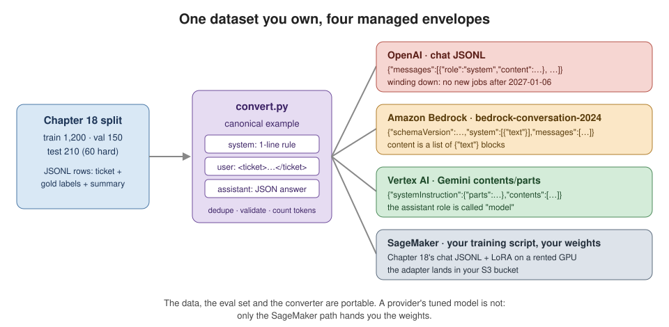
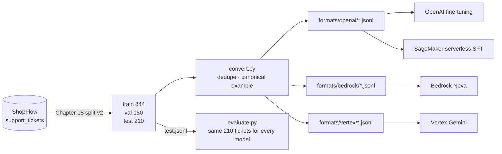
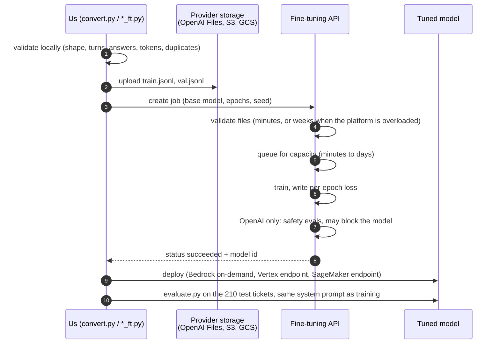
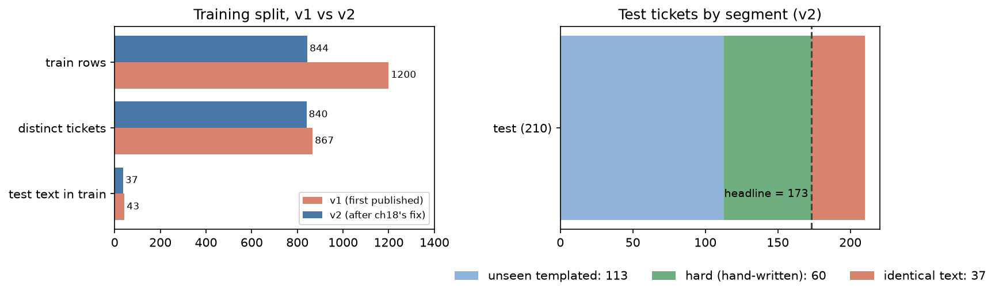
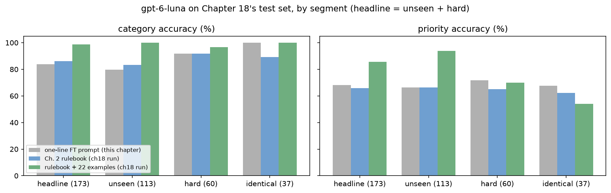
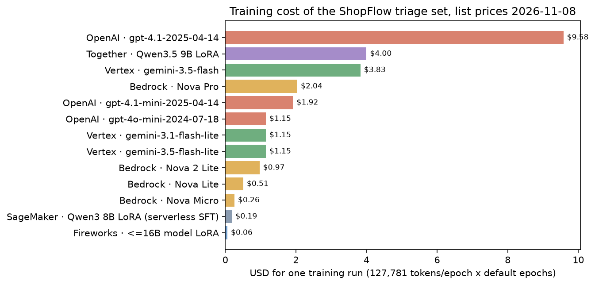
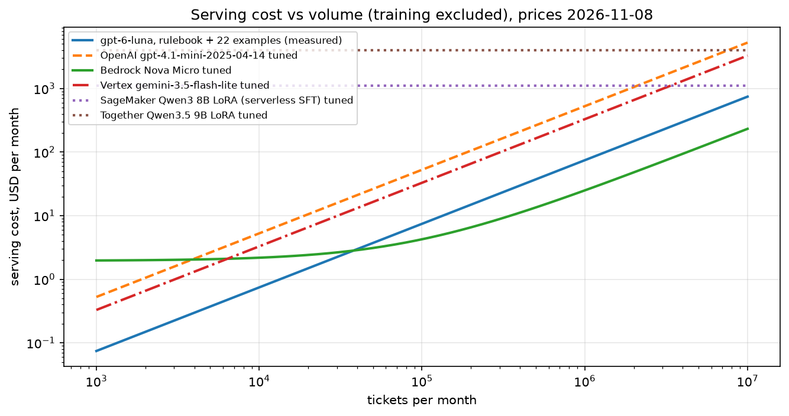

# Chapter 19: Managed fine-tuning

> **Tested on:** 2026-11-08 · Ubuntu 22.04 (NVIDIA RTX 3090, 24 GB; no GPU used) · Python 3.12 ·
> openai/gpt-6-luna via OpenRouter · openai 3.46, tiktoken 0.14 · cloud launchers checked offline
> against boto3 1.43.126, sagemaker 3.29.0, google-genai 3.0.0 · fine-tuning jobs on OpenAI,
> Bedrock, Vertex and SageMaker: **not executed** (no `OPENAI_API_KEY`, no cloud accounts; see
> [Serving it](#serving-it))

In [Chapter 18](../ch18/README.md) we fine-tuned a small model on our own GPU. The first thing the
platform team asked afterwards was: *"Can't we just upload the JSONL to a cloud and get an
endpoint back? Nobody here wants to babysit a GPU."* This chapter, the last one in Part V on
models and compute, answers that question.

In 2024 the answer was a five-line script against OpenAI's fine-tuning API. In 2026 it's a
different question. On May 7, 2026 OpenAI told customers it was winding down self-serve
fine-tuning. Organisations that haven't run a fine-tuned model in the last 60 days can't start
new jobs, and nobody can after January 6, 2027. Every tunable base model shuts down on
January 14, 2027 ([OpenAI deprecations](https://developers.openai.com/api/docs/deprecations)).
AWS and Google still sell managed fine-tuning, but both retired tunable models in the same
months.

So this chapter takes Chapter 18's triage dataset to three managed providers. We convert it to
each provider's format and validate it, price every option, and write the launch scripts. Along
the way our validators found two problems in the split as first published. 19% of it was exact
duplicates, and 43 supposedly unseen test tickets were in the training set word for word.
Chapter 18 fixed its split as a result. The part we build here is the one thing that survives a
provider shutting down: a clean dataset, a converter and an eval.

The picture below sums up the idea: one dataset, wrapped four different ways.



## The problem

Before we look at any provider, let's pin down the job we want a tuned model to take over.
ShopFlow's support desk routes every ticket with the triage model from Chapter 2. It assigns a
category, a priority, a sentiment, an order id and a one-line summary. Here is one request and
the answer we expect:

```text
<ticket>
channel: email
subject: Unsubscribe from marketing emails
body: I keep getting promo emails even though I unsubscribed. Please remove me from the list.
</ticket>
```

```json
{"category": "account", "priority": "low", "sentiment": "negative", "order_id": null,
 "summary": "The customer continues receiving promotional emails after unsubscribing and asks to be removed from the mailing list."}
```

Today that runs on `openai/gpt-6-luna`. Its prompt holds Chapter 2's rulebook plus 22 labelled
examples. We score it on the 173 *headline* test tickets: the ones whose text the model can't
have seen in training (defined in [The data](#the-data)). There it reaches 98.8% category
accuracy and 85.5% priority accuracy, at $0.0744 per 1,000 tickets. Chapter 18 showed that a
fine-tuned small model can learn the labelling policy instead of reading it every time. The ask
for this chapter: *get a fine-tuned model without running GPUs, and know what we sign up for.*

## Requirements

That ask is vague, so let's turn it into checks we can run. First, what the pipeline must do:

- **Pass every provider's checks.** Our training files produce 0 errors before we upload
  anything.
- **One dataset, several providers.** We build the OpenAI, Bedrock and Vertex formats from one
  source, and SageMaker reads one of them too.
- **Beat the prompt it replaces.** A tuned model must reach at least 98.8% category accuracy
  and more than 85.5% priority accuracy on the 173 headline tickets. Tickets whose text also
  appears in training are reported separately.

Then, what it may cost and how long it must last:

- **Cheap to train.** Under $5 per training run.
- **Cheap to serve.** At most $0.08 per 1,000 tickets, which is what today's prompt costs.
- **Live long enough.** At least 12 months of serving after training, or a plan for
  re-training when the model goes away.
- **Keep the exam honest.** No test ticket's text appears in the training data. If some does,
  those tickets are scored separately.

We come back to this list when we price the options in [Results](#results).

## The data

The accuracy and eval targets are measured on Chapter 18's tickets, so we start from its data.
Chapter 18 snapshotted the `support_tickets` table into JSONL. The current split is Chapter 18's
*v2*: the version that exists after the fix described in [Measuring v0](#measuring-v0). It has
844 train, 150 validation and 210 test tickets. All 60 hand-written "hard" tickets are in test
only; the rest come from 30 templates. Train and validation rows carry the gold routing labels
plus a teacher-written `sentiment` and `summary`. We copy the three files into
[`01_main-chapter-code/data/`](01_main-chapter-code/data) so this chapter stands alone. We also
copy the first published training file (`ch18_split_v1_train.jsonl`) to show the before and
after.

Not every test ticket measures the same thing, so we split the 210 test tickets into three
segments. They match Chapter 18's `results/test_segments.json` exactly, and the notebook checks
that our computation agrees. The table says what each segment tells us:

| segment | tickets | what it measures |
|---|---|---|
| unseen templated | 113 | templated tickets whose text isn't in train: generalisation within known templates |
| hard | 60 | hand-written, never in train: traffic that doesn't look like the training data |
| **headline** = unseen + hard | **173** | the number every table leads with |
| identical text | 37 | 8 templates with no order number or product name produce the same text every time, so these tickets are in train word for word; a model can answer them from memory |

The headline row is the one to watch. It's the only score a model can't raise by remembering
training text.

Here is how the data moves through the chapter. One converter feeds every provider, and one
eval scores every model on the same 210 tickets:



Each training row is a flat record, not a conversation. Here is one, as Chapter 18 wrote it
(from the notebook):

```json
{"id": 1, "subject": "Unsubscribe from marketing emails",
 "body": "I keep getting promo emails even though I unsubscribed. Please remove me from the list.",
 "channel": "email", "category": "account", "priority": "low", "order_id": null, "hard": false,
 "template_id": 19, "source": "shopflow", "sentiment": "negative",
 "summary": "The customer continues receiving promotional emails after unsubscribing and asks to be removed from the mailing list.",
 "text_labels_by": "openai/gpt-6-luna"}
```

The converter turns rows like this into each provider's format with one command:

```bash
cd ch19/01_main-chapter-code
uv run python -m ch19_ft.convert        # writes formats/{openai,bedrock,vertex}/{train,val}.jsonl
```

## Concepts

Before we convert anything, it helps to know what a provider actually does with our file and
what we get back.

### What "managed" fine-tuning hands over

*Managed fine-tuning* means you upload training examples and the provider runs the training on
its own hardware. It's like a dry cleaner: you hand over the clothes and get a ticket back. The
ticket here is a **model id** (`ft:gpt-4.1-mini-...:shopflow-triage:...`, a Bedrock model ARN, a
Vertex endpoint). You can call it, but you don't get the weights. Under the hood the providers
mostly train small adapters on top of a frozen base model, the LoRA idea from Chapter 18
(Vertex even exposes the adapter size as a parameter). The base model stays theirs, so the
adapter only works on their servers.

This has two practical consequences:

- **Billing is tokens × epochs.** An *epoch* is one pass over the training set. OpenAI, Bedrock
  and Vertex all bill training as the number of tokens in your file times the number of epochs.
  Duplicate rows aren't free; you pay for them on every pass.
- **Serving comes in two shapes.** The first is *per token* on shared infrastructure (OpenAI,
  Bedrock on-demand, Vertex). There an idle model costs nothing or a small storage fee. The
  second is a *dedicated GPU per hour* (SageMaker endpoints, Together, Fireworks). That costs
  the same at 10 requests a month as at 10 million.

### A job's life

Knowing what we get back is half the picture. The other half is how long it takes to get it.
A job goes through these steps (step 7 is OpenAI only):



Steps 4 and 5 are where practitioners lose days, on every platform. In October 2026 OpenAI jobs
sat in "validating files" for weeks
([OpenAI community](https://community.openai.com/t/fine-tuning-is-stuck-in-validating-files/1406992)).
Vertex jobs waited in "Queuing for capacity" for hours
([Google forum](https://discuss.google.dev/t/fine-tuning-queue-jobs-taking-several-hours-to-start-with-gemini-vertex-ai/180327)).
Bedrock Nova jobs stayed at `trainingDetails = NotStarted` for 14 hours
([re:Post](https://repost.aws/questions/QU71n1MTIGQNakWhIWelgQOg/nova-pro-finetune-job-keeps-stuck)).
So training belongs in a background job with alerts. Never put it in a deploy pipeline that
waits for it to finish.

### A tuned model is a lease

Slow queues cost days. The bigger risk is that the tuned model itself has an end date.

> [!NOTE]
> **In the wild:** OpenAI is winding down its fine-tuning platform. Since July 2, 2026, "Creating
> fine-tuning jobs is no longer available to organizations that have not run inference on a
> fine-tuned model in the past 60 days." On January 6, 2027 existing customers lose it too.
> `gpt-4.1`, `gpt-4.1-mini`, `gpt-4o` and `gpt-4o-mini`, and every model tuned from them, shut
> down on January 14, 2027 ([OpenAI deprecations](https://developers.openai.com/api/docs/deprecations)).
> A model trained on the day of our run would serve for 67 days. OpenAI's model pages list
> fine-tuning as "Not supported" for every GPT-5 and GPT-6 model.

The other clouds have the same clock, just slower. On Bedrock, Claude 3 Haiku (the only
Anthropic model you could tune there) reached end of life on September 10, 2026. Every Llama 3.x
model went *Legacy* on September 30, 2026, which means "you cannot create new fine-tuning jobs
on that model" ([AWS model lifecycle](https://docs.aws.amazon.com/bedrock/latest/userguide/model-lifecycle-legacy.html)).
On Vertex, Gemini 2.5 Pro, Flash and Flash-Lite retired on October 20, 2026
([Google model versions](https://docs.cloud.google.com/gemini-enterprise-agent-platform/models/model-versions)).
When the base model goes, your adapter goes with it, and you re-train on whatever is still
tunable. Plan for that from day one. Keep the dataset, the converter and the eval, and treat the
tuned model as disposable.

## v0: upload Chapter 18's rows as they are

With that in mind, let's try the simplest thing: point a provider at Chapter 18's `train.jsonl`
as it is. Our validators (described in the next sections) give the answer every provider would:

```text
openai   errors=  844  first: line 1: unknown_key: row has unknown keys ['body', 'category', 'channel', 'hard',...
bedrock  errors=  844  first: line 1: unknown_key: row has unknown keys ['body', 'category', 'channel', 'hard',...
vertex   errors=  844  first: line 1: unknown_key: row has unknown keys ['body', 'category', 'channel', 'hard',...
```

Fair enough: the rows are records, not conversations. So we wrap each one as a three-turn chat:
Chapter 18's one-line system prompt, the delimited ticket, and the JSON answer. Then we validate
again and get zero errors on all three formats. That looks done. The first time we ran it, it
wasn't.

## Measuring v0

Zero errors only tells us the files have the right *shape*. Provider-side validation stops
there, but ours also checks what's in the file. We first ran it on the 1,200-row training split
that Chapter 18 had published (v1). It flagged 333 warnings in a file every provider would have
accepted. We reported them to Chapter 18, which fixed its split (v2). The notebook keeps the v1
file so the before and after are reproducible. Watch the duplicate and overlap rows:

```text
                    v1 (first published)  v2 (ch18 fix)
rows                                1200            844
distinct tickets                     867            840
duplicate                            228              0
conflict                             105              4
tokens/epoch                      178227         127781
test text in train                    43             37
val text in train                     41             37
templates                             30             30
```

Here is what those warnings were about in v1:

- **228 exact duplicates.** Templates without an order number or product name produce identical
  tickets with identical labels. The 1,200 rows held 867 distinct tickets. The worst offender,
  "Do you accept PayPal?", appeared 21 times. Every copy is billed on every epoch.
- **105 conflicts.** These are the same ticket with a different answer. None disagreed on
  category, priority or order id. They differed in the teacher-written summary, and in one group
  ("Payment keeps failing") in sentiment.
- **43 test and 41 validation tickets present word for word in train.** Chapter 18 had split by
  ticket id, not by text, so a tuned model could score on those by memory.

The notebook also lists the most repeated tickets and what Chapter 18's fix did:

```text
v1: most repeated tickets
                     subject  copies  distinct summaries       sentiments
       Do you accept PayPal?      21                   2  {'neutral': 21}
Someone else used my account      20                  10 {'negative': 20}
 What is your return policy?      19                  10  {'neutral': 19}
           Delete my account      17                   2  {'neutral': 17}
       Payment keeps failing      17                  13 {'negative': 17}
repeated tickets with conflicting category/priority/order_id: 0
ch18 fix (results/dedupe.json): {'train_before': 1200, 'dropped': 364, 'restored': 8, 'train_after': 844}
identical-text templates kept once each: ['Change my email address', 'Delete my account', 'Do you accept PayPal?', 'Payment keeps failing', 'Someone else used my account', 'Store opening hours', 'Unsubscribe from marketing emails', 'What is your return policy?']
```

Chapter 18's fix dropped every training row whose text also appears in validation or test (364
rows). It then put back one row for each of the 8 placeholder-free templates; without that,
those 8 templates would vanish from training. Their text is the same every time, so their 37
test tickets can't be made unseen. They form the separate *identical text* segment. The v2
training set has no exact duplicates and 28% fewer tokens per epoch. The 4 remaining conflicts
are summary wording again.

The chart puts both splits side by side, with the v2 test segments next to them:



### The "before" number

With a clean split, we need a number to compare a tuned model against. A fine-tuned model is
called with the short training prompt, not the rulebook. So the honest baseline is what a base
model does with that same prompt. We ran it once on `gpt-6-luna` through OpenRouter ($0.10 /
$0.50 per 1M input/output tokens, as of 2026-11). The run sent 210 tickets at concurrency 8,
took 88 s and cost $0.01568. The test set didn't change in v2, so the run stands; we only
re-scored it into the v2 segments.

The two rulebook rows are Chapter 18's runs on the same tickets with the same scorer. Its
few-shot prompt now holds 22 examples: one per template, and never a row whose text appears in
validation or test. So the 8 identical-text templates have no example. Read the **headline**
rows first, then the segments below each one:

| prompt (gpt-6-luna) | segment | n | category % | priority % | in tok | out tok | $/1k | p50 ms | p95 ms |
|---|---|---|---|---|---|---|---|---|---|
| one-line FT prompt | **headline** | 173 | 83.8 | 68.2 | 254 | 101 | 0.0761 | 3347 | 4389 |
| one-line FT prompt | unseen | 113 | 79.6 | 66.4 | 255 | 100 | 0.0753 | 3324 | 4408 |
| one-line FT prompt | hard | 60 | 91.7 | 71.7 | 253 | 105 | 0.0776 | 3380 | 4169 |
| one-line FT prompt | identical | 37 | 100.0 | 67.6 | 249 | 86 | 0.0678 | 3072 | 3691 |
| Ch. 2 rulebook | **headline** | 173 | 86.1 | 65.9 | 486 | 95 | 0.0961 | 2838 | 3786 |
| Ch. 2 rulebook | unseen | 113 | 83.2 | 66.4 | 487 | 88 | 0.0925 | 2690 | 3780 |
| Ch. 2 rulebook | hard | 60 | 91.7 | 65.0 | 485 | 109 | 0.1029 | 2889 | 4157 |
| Ch. 2 rulebook | identical | 37 | 89.2 | 62.2 | 481 | 81 | 0.0887 | 2605 | 3452 |
| rulebook + 22 examples | **headline** | 173 | 98.8 | 85.5 | 1919 | 97 | 0.0744 | 2764 | 3978 |
| rulebook + 22 examples | unseen | 113 | 100.0 | 93.8 | 1920 | 84 | 0.0687 | 2609 | 3967 |
| rulebook + 22 examples | hard | 60 | 96.7 | 70.0 | 1918 | 121 | 0.0852 | 3081 | 4078 |
| rulebook + 22 examples | identical | 37 | 100.0 | 54.1 | 1914 | 92 | 0.0676 | 2713 | 3322 |

Order-id accuracy and JSON validity were 100% in every run except one hard ticket with the
few-shot prompt (99.4% valid on headline). Latency is end to end through OpenRouter, so it
measures the provider and the network, not this host. Over all 210 tickets together, category /
priority accuracy was 86.7% / 68.1% for the one-line prompt, 86.7% / 65.2% for the rulebook and
99.0% / 80.0% for few-shot.

The chart shows the same accuracy numbers by prompt and segment:



Four things stand out:

- **The one-line prompt and the rulebook are close** on the headline (83.8% vs 86.1% category,
  68.2% vs 65.9% priority). Chapter 2's rules don't teach Luna ShopFlow's priority policy.
  Examples do: priority jumps to 85.5%.
- **Examples teach exactly what they cover.** With the few-shot prompt, priority is 93.8% on
  unseen templated tickets, whose templates all have an example. It is 54.1% on the
  identical-text tickets, whose 8 templates have none. That's lower than the one-line prompt
  (67.6%) on the same tickets.
- **Identical-text tickets are easy on category even without memory.** They score 100% with the
  one-line prompt vs 79.6% on unseen tickets, because they're short, unambiguous templates. A
  score that mixes them in flatters any model, which is why the headline excludes them.
- **Hard-ticket priority stays around 70%**: 71.7% with the one-line prompt, 70.0% with 22
  examples. That is the gap a fine-tuned model would have to close. The training data has no
  hard tickets at all, so whether any tuned model closes it is an open question until we run one.

Cost tells a surprising story too. The few-shot prompt is 1,919 tokens and still the cheapest of
the three on the headline: $0.0744 per 1,000 tickets, vs $0.0961 for the 486-token rulebook.
The reason is that the repeated prefix is billed at a cached rate. At the full $0.10 per
million, 1,919 input tokens alone would cost $0.19 per 1,000 tickets. Chapter 15 covers caching.

## Iterating

Measuring v0 gave us a bar to beat and a list of problems in the data. We fix them one at a
time, starting with the data itself, then the formats, then the launch.

### 1. Fix the split at the source, keep a dedupe guard

The duplicates cost money, the conflicts cost consistency, and the overlap made the test score
meaningless. We had three options. We could drop exact duplicates in our converter (v1 → 972
rows), but the 43 test tickets would stay in train. We could drop every training row whose text
is in validation or test. Or we could re-split from scratch by template.

> [!IMPORTANT]
> **Decision: fix the split where it's made (Chapter 18), and keep `dedupe` in the converter as
> a guard.** A converter that silently repairs data hides the problem from everyone else who
> uses the split. Here that was Chapter 18's own LoRA eval and its few-shot baseline (8 of its
> 30 examples were test tickets). Chapter 18 dropped the 364 overlapping rows and kept one copy
> of each placeholder-free template. That took 1,200 → 844 rows, 178,227 → 127,781 training
> tokens per epoch (28% off every training bill) and 228 → 0 duplicates. On v2 our `dedupe`
> drops nothing, which is the point of a guard. A full re-split by template would give a cleaner
> exam, but it would change every number Chapter 18 has published. We'd do it before collecting
> production data, not mid-book.

The guard itself is short. It compares whole training examples, prompt and answer together:

```python
# ch19/01_main-chapter-code/ch19_ft/convert.py (excerpt)
def dedupe(records: list[dict[str, Any]]) -> tuple[list[dict[str, Any]], int]:
    """Drop records whose training example (prompt and answer) equals an earlier one."""
    keep, seen = [], set()
    for r in records:
        key = _digest(to_openai(r))
        if key not in seen:
            seen.add(key)
            keep.append(r)
    return keep, len(records) - len(keep)
```

### 2. One canonical example, three envelopes

With clean data, the next step is to write each provider's format without three copies of the
logic. Every format carries the same three strings: system prompt, ticket, answer. Only the
wrapping differs. Bedrock wants `content` as a list of `{"text"}` blocks and a `schemaVersion`.
Vertex calls the assistant `model`, the content `parts` and the system prompt
`systemInstruction`:

```python
# ch19/01_main-chapter-code/ch19_ft/convert.py (excerpt)
def to_openai(record: dict[str, Any]) -> dict[str, Any]:
    system, user, assistant = _parts(record)
    return {"messages": [{"role": "system", "content": system},
                         {"role": "user", "content": user},
                         {"role": "assistant", "content": assistant}]}


def to_bedrock(record: dict[str, Any]) -> dict[str, Any]:
    system, user, assistant = _parts(record)
    return {"schemaVersion": BEDROCK_SCHEMA,
            "system": [{"text": system}],
            "messages": [{"role": "user", "content": [{"text": user}]},
                         {"role": "assistant", "content": [{"text": assistant}]}]}


def to_vertex(record: dict[str, Any]) -> dict[str, Any]:
    system, user, assistant = _parts(record)
    return {"systemInstruction": {"role": "system", "parts": [{"text": system}]},
            "contents": [{"role": "user", "parts": [{"text": user}]},
                         {"role": "model", "parts": [{"text": assistant}]}]}
```

`_parts` is Chapter 18's `to_example`, copied into `previous_chapters.py`. So the cloud models
would train on exactly the tokens Chapter 18's LoRA saw. Each validator parses its format *back*
into `(system, [(role, text), ...])`, and the shared rules run on that. Turns alternate, the
user goes first and the assistant goes last. The answer is a valid `TicketTriage` with no code
fence, and the example fits the token limit. A unit test round-trips every format to the same
three strings.

Here are the converted files after validation. Check the errors column first, then the tokens:

```text
provider split  examples  errors  warnings  tokens_total  tokens_mean  tokens_max  file_kb
  openai train       844       0         4        127781        151.4         172    604.9
  openai   val       143       0        12         21435        149.9         170    102.1
 bedrock train       844       0         4        127781        151.4         172    655.2
 bedrock   val       143       0        12         21435        149.9         170    110.6
 vertex train       844       0         4        127781        151.4         172    643.6
 vertex   val       143       0        12         21435        149.9         170    108.6
```

All three formats pass with 0 errors and carry the same tokens. Tokens are counted with
`o200k_base` plus OpenAI's per-message overhead. Nova and Gemini use their own tokenizers, so for
them it's an estimate. The envelopes add 8% (Bedrock) and 6% (Vertex) to the file size, not to
the billed tokens. The validation file is Chapter 18's, which v2 left unchanged. The guard drops
its 7 exact duplicates (150 → 143), and 12 conflicts remain.

> [!IMPORTANT]
> **Decision: our own converter and validators over each provider's tooling.** OpenAI had a
> data-prep cookbook, though its token limit is stale (16,385 vs the documented 65,536). AWS
> publishes a Nova dataset-validation script, and Together's SDK checks files on upload. That's
> three tools, three sets of rules, and three places for a dataset to drift. Our 420-line
> `convert.py` has one canonical form and 30 unit tests, and it runs in 2 seconds before
> anything leaves the building. If you only ever use one provider, its own validator is enough.
> Run it as well, because the provider's rules change and ours won't notice.

### 3. Provider-specific rules

Our shared rules catch mistakes every platform cares about. Some rules, though, exist on one
platform only. To find them, we broke one row five ways and ran all three validators (real
output from the notebook):

```text
                                     openai        bedrock        vertex
pasted chat log in the ticket      accepted  reserved_text      accepted
OpenAI role name                   accepted       accepted      bad_role
plain-string content               accepted    bad_content   bad_content
answer in a code fence           bad_answer     bad_answer    bad_answer
ends on the user turn          no_assistant   no_assistant  no_assistant
```

Read across a row to see which platform's rules catch that mistake. Three rows need a note:

- **Nova's reserved words.** The Nova data-prep guide lists `User:`, `Bot:`, `Assistant:`,
  `System:`, `<image>`, `<video>` and `[EOS]`. Any of them anywhere in a prompt fails the job
  ([Nova user guide](https://docs.aws.amazon.com/nova/latest/userguide/fine-tune-prepare-data-understanding.md)).
  A customer who pastes a chat transcript into a ticket ("Assistant: we will refund you") is
  ordinary data for OpenAI and a failed Bedrock job. None of the 1,204 tickets in the v2 split
  contains one today. A validator is how we keep it that way.
- **`model`, not `assistant`, on Vertex.** The classic mistake is to copy an OpenAI row into
  Vertex and rename keys by hand. Our error message says so: `unsupported role 'assistant'
  (Vertex calls it 'model')`.
- **Fenced answers are accepted by every provider.** They would teach the model to wrap its JSON
  in markdown. That's our rule, not theirs: the training answer must parse as a `TicketTriage`
  with no leniency.

> [!IMPORTANT]
> **Decision: validate stricter than the providers.** We reject unknown keys, fenced answers and
> answers outside the schema, which every provider would happily train on. A rejected upload
> costs a minute. A model trained on bad answers costs a training run, a queue wait (hours, on a
> bad day), and an eval to find out. We'd relax a rule only when a provider adds a field we
> want. One example is OpenAI's per-message `weight`, which our parser already accepts.

### 4. A launcher that refuses to waste money

Valid files are half of a safe launch. The other half is not spending money by accident.
[`openai_ft.py`](01_main-chapter-code/ch19_ft/openai_ft.py) validates the files and prices the
job *before* it uploads anything. It refuses if the estimate is over `--max-usd` (default $5),
and it warns when the base model will shut down soon. The dry run needs no key, so it ran here:

```bash
cd ch19/01_main-chapter-code
uv run python -m ch19_ft.openai_ft launch --dry-run
```

```text
{
  "model": "gpt-4.1-mini-2025-04-14",
  "epochs": 3,
  "train_examples": 844,
  "val_examples": 143,
  "train_tokens_per_epoch": 127781,
  "estimated_training_usd": 1.92,
  "shutdown": "2027-01-14",
  "days_of_service_left": 67
}
WARNING: gpt-4.1-mini-2025-04-14 and every model tuned from it shut down on 2027-01-14 (67 days from today).
{
  "model": "gpt-4.1-mini-2025-04-14",
  "training_file": "file-<train>",
  "suffix": "shopflow-triage",
  "seed": 19,
  "method": {"type": "supervised", "supervised": {"hyperparameters": {"n_epochs": 3}}},
  "metadata": {"book": "llm-in-production", "chapter": "19"},
  "validation_file": "file-<val>"
}
```

The estimate is $1.92, under the $5 limit, and the warning shows only 67 days of service left.
Without `--dry-run`, the launcher stops at the key:

```text
OPENAI_API_KEY is not set in .env. Fine-tuning needs a direct OpenAI key: OpenRouter (LLM_API_KEY) has no fine-tuning API.
```

The book's only key is an OpenRouter key, and OpenRouter has no fine-tuning API. Its
documentation never mentions one. Through the OpenAI SDK, the fine-tuning endpoint returns 404,
while the files endpoint next to it answers:

```text
files.list: 0 files
fine_tuning.jobs.list: 404 {'message': 'Not Found', 'code': 404}
```

OpenRouter's Enterprise plan can *route* to a model you fine-tuned elsewhere, through
["Private Endpoints"](https://openrouter.ai/blog/announcements/private-endpoints/), launched on
2026-10-14. It can't train one.

> [!CAUTION]
> **Not executed by the author** — `openai_ft.py launch`, `poll` and `eval` on a fine-tuned model
> require an `OPENAI_API_KEY` from an organisation that is still allowed to fine-tune (see the
> wind-down above). Written against https://developers.openai.com/api/docs/guides/supervised-fine-tuning
> and https://developers.openai.com/api/reference/resources/fine_tuning (accessed 2026-11-08) and
> checked with `python -m py_compile` and `check_cloud_sdks.py` (job request vs the `openai`
> 3.46 signature). The dry run, the key check and `eval --provider openrouter` were executed.

The real launch path uploads both files, waits for them to be processed, and creates the job.
If OpenAI refuses, the error explains the 60-day rule:

```python
# ch19/01_main-chapter-code/ch19_ft/openai_ft.py (excerpt of cmd_launch)
client = openai.OpenAI(api_key=openai_key())
ids = {}
for name, path in (("train", train), ("val", val)):
    if path.exists():
        f = client.files.create(file=path, purpose="fine-tune")
        ids[name] = client.files.wait_for_processing(f.id).id
try:
    job = client.fine_tuning.jobs.create(**job_request(args.model, args.epochs, ids["train"],
                                                       ids.get("val")))
except openai.APIStatusError as e:
    raise SystemExit(f"OpenAI refused the job ({e.status_code}): {e.message}\nSince "
                     "2026-07-02 only organisations that ran inference on a fine-tuned "
                     "model in the last 60 days can create jobs.") from e
```

`poll` prints new job events oldest first. It saves `fine_tuned_model` and the checkpoints
(OpenAI keeps the last three epochs). `eval` runs the same 210 tickets through
[`evaluate.py`](01_main-chapter-code/ch19_ft/evaluate.py) with the training system prompt and
strict `json_schema`, priced at the tuned model's rates. With `--provider openrouter`, it is the
command that produced the baseline above.

## Production hardening

The launcher stops the obvious mistakes. A tuned model in production meets less obvious ones,
and the most common is also the simplest:

> [!WARNING]
> Call the tuned model with **exactly** the system prompt it was trained with. A Bedrock user
> reported that a tuned Nova 2 Lite "looks like it comes from the base model not my fine-tuned
> version" when called through the SDK
> ([re:Post](https://repost.aws/questions/QUlMCRME6TRkK6XQoBSjP4pw/bedrock-fine-tuned-inference-bug)).
> Every launcher here imports `FT_RULES + FORMAT_HINT` from the same place the training files
> were built from.

Beyond the prompt, these are the traps we found across the platforms:

- **Write the shutdown date next to the model id.** `openai_ft.py` records it in
  `results/openai_job.json` and warns under 90 days. Put the re-training date in the team
  calendar the day you ship.
- **Quotas start at zero or one.** Vertex runs one tuning job per project by default, shared
  across regions. Bedrock's no-commitment Provisioned Throughput quota for custom models is 0.
  A new AWS account can have a quota of 0 GPU instances on SageMaker. Request increases before
  the project, not during it.
- **Regions are pinned.** Nova fine-tuning runs in us-east-1 only, and S3 data must be in the
  job's region. Gemini 3.x tunes only on the `us` and `eu` multi-region endpoints. If your
  tickets must stay in Europe, half the table below is gone.
- **OpenAI screens the tuned model.** After training it runs safety evals in 13 categories and
  can block deployment. A dental team saw its dataset flagged, probably for the word "oral",
  while estimating $33,000 for the full run
  ([OpenAI community](https://community.openai.com/t/dataset-flagged-for-sexual-content/1310016)).
  Support tickets contain angry, sometimes abusive text, so test with a small job first.
- **No structured output on tuned Gemini.** Google's tuning docs warn that controlled generation
  (`response_schema`) on a tuned model can lower quality. So `vertex_ft.py eval` parses the JSON
  the model learned to write instead.
- **SDKs move under you.** SageMaker SDK v3 dropped `Estimator` and `JumpStartEstimator`.
  Importing its `SFTTrainer` already creates a boto3 client, so without `AWS_DEFAULT_REGION`
  the *import* fails with `NoRegionError`. `vertexai.tuning` is deprecated in favour of
  `google-genai`. Google's own Gemini tuning sample passes `TuningDataset` as the validation
  set, but google-genai 3.0.0 declares `TuningValidationDataset`. It only *prints* "Type
  mismatch" instead of raising.
  [`check_cloud_sdks.py`](01_main-chapter-code/check_cloud_sdks.py) caught that in our own
  Vertex script.
- **Customer text leaves your boundary.** Uploading tickets to a provider is a data transfer
  like any other. Check your data-processing agreement, and strip what you don't need. Our
  training answers keep order ids (needed) and no emails or names.

> [!NOTE]
> **In the wild:** Together's case study with XY.AI Labs reports training runs of "10–20 minutes
> at roughly $10 per run" and parsing accuracy up from 77% to 87%. It credits Together's
> "Managed multi-LoRA serverless capability"
> ([Together](https://www.together.ai/customers/xy-ai-labs)). Together has since discontinued
> serverless LoRA inference, including multi-LoRA
> ([Together docs](https://docs.together.ai/docs/fine-tuning/lora-vs-full.md)). Tuned models now
> need a dedicated endpoint, billed per minute while it runs. The serving model you design
> around can change under a case study that's still online.

## Serving it

Everything so far assumes a job actually runs. Here we hit our own limit. None of the cloud
scripts ran, because they need an AWS account, a GCP project or an eligible OpenAI organisation.
What did run is an offline check of every call against the real SDKs. It runs in a
chapter-local venv, because the cloud SDKs are not in the book's `pyproject.toml`:

```bash
uv venv ch19/01_main-chapter-code/.venv-cloud --python 3.12
UV_CACHE_DIR=$HOME/.cache/uv-cloud-ch19 uv pip install \
    -r ch19/01_main-chapter-code/requirements-cloud.txt --python ch19/01_main-chapter-code/.venv-cloud
cd ch19/01_main-chapter-code
AWS_DEFAULT_REGION=us-east-1 .venv-cloud/bin/python -W ignore check_cloud_sdks.py
```

```text
ok  py_compile convert, openai_ft, bedrock_ft, vertex_ft, sagemaker_ft
    openai==3.46.0
    boto3==1.43.126
    sagemaker==3.29.0
    google-genai==3.0.0
    google-cloud-storage==3.17.1
ok  openai fine_tuning.jobs.create(model, training_file, suffix, seed, method, metadata, validation_file)
ok  boto3 bedrock.CreateModelCustomizationJob(jobName, customModelName, roleArn, baseModelIdentifier, customizationType, trainingDataConfig, validationDataConfig, outputDataConfig, hyperParameters, jobTags)
ok  boto3 bedrock.GetModelCustomizationJob(jobIdentifier)
ok  boto3 bedrock.CreateCustomModelDeployment(modelDeploymentName, modelArn)
ok  boto3 bedrock.GetCustomModelDeployment(customModelDeploymentIdentifier)
ok  boto3 bedrock-runtime.Converse(modelId, system, messages, inferenceConfig)
ok  bedrock job statuses: ['InProgress', 'Completed', 'Failed', 'Stopping', 'Stopped']
ok  google-genai CreateTuningJobConfig(epoch_count=3, adapter_size=ADAPTER_SIZE_FOUR, validation_dataset=TuningValidationDataset); Tunings.tune/get; states ['JOB_STATE_PENDING', 'JOB_STATE_QUEUED', 'JOB_STATE_RUNNING']
ok  sagemaker SFTTrainer(model, training_type, model_package_group, training_dataset, validation_dataset, s3_output_path, accept_eula).train(dry_run=...)
```

Every line reads `ok`. The check proves that every operation, parameter and status we use exists
in the shipped SDK. It can't prove the cloud accepts the job.

Once a job does finish, the four platforms differ in where the data goes, what you can watch,
and how you serve the result:

| | OpenAI | Bedrock (Nova) | Vertex (Gemini) | SageMaker (open weights) |
|---|---|---|---|---|
| upload to | OpenAI Files | S3 (job region) | Cloud Storage | S3 |
| progress | job events, 3 checkpoints | status only; loss files in S3 | state, checkpoints | logs, MLflow metrics |
| serve | same API, model `ft:...` | on-demand deployment ARN, or Provisioned Throughput | tuned endpoint (copy to `global` for base price) | SageMaker endpoint, Bedrock import, or download |
| you get the weights | no | no | no | yes (in your account) |

Only SageMaker leaves the weights in your account, which matters given the lease problem above.
The next three subsections show each launcher.

### Bedrock: Nova Micro, on demand

We start with Bedrock, because a tuned Nova Micro can be served per token, like a base model.

> [!CAUTION]
> **Not executed by the author** — requires an AWS account with Bedrock access in us-east-1, an
> S3 bucket and an IAM role. Written against
> https://docs.aws.amazon.com/bedrock/latest/userguide/model-customization-submit.md and
> https://docs.aws.amazon.com/bedrock/latest/userguide/deploy-custom-model-on-demand.md (accessed
> 2026-11-08) and checked with `python -m py_compile` and `check_cloud_sdks.py` (botocore
> 1.43.126 service model).

The launcher creates the customization job and, once it finishes, an on-demand deployment:

```python
# ch19/01_main-chapter-code/ch19_ft/bedrock_ft.py (excerpt)
job = bedrock.create_model_customization_job(
    jobName=name, customModelName=name, roleArn=args.role,
    baseModelIdentifier=BASE_MODELS[args.model], customizationType="FINE_TUNING",
    trainingDataConfig={"s3Uri": uris[0]},
    validationDataConfig={"validators": [{"s3Uri": uris[1]}]},
    outputDataConfig={"s3Uri": f"s3://{args.bucket}/{args.prefix}/output/"},
    hyperParameters=hyperparameters(args.epochs, reports[0].n, args.model),
    jobTags=[{"key": "book", "value": "llm-in-production-ch19"}],
)
...
dep = bedrock.create_custom_model_deployment(modelDeploymentName="shopflow-triage-od",
                                             modelArn=saved["outputModelArn"])
```

`baseModelIdentifier` is `amazon.nova-micro-v1:0:128k` by default. The job status enum is
`Completed`, not `COMPLETE` as one of AWS's own code samples checks. On-demand deployment means
per-token pricing at the base model's rates, plus $1.95 a month to store the custom model.

> [!NOTE]
> **In the wild:** Parcel Perform fine-tuned Nova Micro for data extraction, on training sets of
> 1,300 and 4,900 samples. The tuned model reached "up to 94.77% extraction accuracy", 16.6
> points above the baseline. It also cut latency by more than 30% and halved costs compared with
> its previous model
> ([AWS Machine Learning Blog](https://aws.amazon.com/blogs/machine-learning/fine-tune-amazon-nova-models-for-accurate-email-data-extraction/)).
> That's a dataset the size of ours, and a task like ours: fixed labels, short inputs.

### Vertex: Gemini Flash-Lite through google-genai

Google's managed option follows the same pattern, with Gemini Flash-Lite as the base model.

> [!CAUTION]
> **Not executed by the author** — requires a GCP project with the Vertex AI API and a Cloud
> Storage bucket. Written against
> https://docs.cloud.google.com/gemini-enterprise-agent-platform/models/tuning/supervised-tuning/use
> and https://docs.cloud.google.com/gemini-enterprise-agent-platform/machine-learning/python-sdk/sdk-migration
> (accessed 2026-11-08) and checked with `python -m py_compile` and `check_cloud_sdks.py`
> (google-genai 3.0.0).

The script builds a google-genai client for Vertex and starts the tuning job:

```python
# ch19/01_main-chapter-code/ch19_ft/vertex_ft.py (excerpt)
def client(project: str, location: str) -> Any:
    from google import genai
    from google.genai import types

    # vertexai=True: without it the client silently targets the Gemini Developer API, which has
    # no tuning (and rejects gcs_uri).
    return genai.Client(vertexai=True, project=project, location=location,
                        http_options=types.HttpOptions(api_version="v1beta1"))
...
job = client(args.project, args.location).tunings.tune(
    base_model=args.model,
    training_dataset=types.TuningDataset(gcs_uri=train_uri),
    config=tune_config("shopflow-triage", args.epochs, args.adapter_size, val_uri),
)
```

> [!IMPORTANT]
> **Decision: the Google Gen AI SDK (`google-genai`) over `vertexai.tuning`.** The old
> `vertexai.tuning.sft.train()` in `google-cloud-aiplatform` is deprecated. Google's migration
> page gives June 24, 2026 as the removal date, though 2.7.0 still ships it. `client.tunings` is
> the documented path for Gemini tuning. The one trap is the client constructor. Leave out
> `vertexai=True` and you're on the Gemini Developer API, where `gcs_uri` fails with "not
> supported in Gemini API"
> ([python-genai #1324](https://github.com/googleapis/python-genai/issues/1324)). We'd still use
> `vertexai.tuning` for Vertex's *open-model* tuning, whose docs haven't moved yet.

The poll loop treats `JOB_STATE_QUEUED` as running too. Google's sample loops only while the
state is `PENDING` or `RUNNING`, but the SDK's state enum has a `QUEUED` member.

### SageMaker: the same LoRA, on AWS's GPU, weights in your account

Bedrock and Vertex both keep the tuned model on their side. SageMaker is different: it trains
the same kind of LoRA as Chapter 18 on AWS's GPUs and leaves the weights in our account.

> [!CAUTION]
> **Not executed by the author** — requires an AWS account, an S3 bucket and an execution role
> with `AmazonSageMakerModelCustomizationCoreAccess`. Written against
> https://docs.aws.amazon.com/sagemaker/latest/dg/model-customize-open-weight.html and the SDK v3
> serverless SFT example notebook
> (https://github.com/aws/sagemaker-python-sdk/blob/master/v3-examples/model-customization-examples/serverless/sft_finetuning_example_notebook_pysdk_prod_v3.ipynb,
> accessed 2026-11-08) and checked with `python -m py_compile` and `check_cloud_sdks.py`
> (sagemaker 3.29.0).

The trainer takes our files, a base model and a place to register the adapter. With no
`compute=` argument it runs serverless:

```python
# ch19/01_main-chapter-code/ch19_ft/sagemaker_ft.py (excerpt)
trainer = SFTTrainer(
    model=args.model,                            # "huggingface-reasoning-qwen3-8b"
    training_type=TrainingType.LORA,
    model_package_group=args.package_group,     # where the tuned adapter is registered
    training_dataset=train_uri,
    validation_dataset=val_uri,
    s3_output_path=f"s3://{args.bucket}/{args.prefix}/output/",
    accept_eula=True,                           # the base model's licence
    # no ``compute=``: serverless. Pass TrainingJobCompute(instance_type="ml.g5.2xlarge",
    # instance_count=1) to choose (and pay for) the instance yourself.
)
trainer.hyperparameters.max_epochs = args.epochs
if args.dry_run:
    trainer.train(dry_run=True)  # checks IAM, data paths and hyperparameters, no job
```

It reads `formats/openai/` as is, because SageMaker's serverless SFT takes OpenAI-style
`messages` with the system message first.

> [!IMPORTANT]
> **Decision: SDK v3's serverless `SFTTrainer` over `JumpStartEstimator` or a custom training
> container.** `JumpStartEstimator` only exists in `sagemaker==2.*`, which v3 replaced. A custom
> `ModelTrainer` running Chapter 18's script would work, but then we own the container, the
> instance choice and the GPU quota. The serverless trainer takes our chat JSONL, bills $0.50
> per 1M training tokens for an 8B LoRA, and leaves the adapter in our account. That makes it
> the one managed option here where a provider's retirement schedule can't take the model away.
> Pick the custom container when you need a model the serverless list doesn't have, or Chapter
> 18's exact training code.

## Results

We now have checked files, launchers and SDK calls for every platform, but no trained model. So
the results are prices, and the decision they support.

### What the providers charge (researched, 2026-11-08)

Start with what each provider charges. Training cost is for the v2 training set (127,781 tokens
per epoch) at each provider's default epochs. The $/1k tickets column uses the tokens we
measured on the headline tickets with the one-line prompt on `gpt-6-luna`: 254 in, 101 out.
Other tokenizers will differ by a few percent. Nothing in this table was run. Compare the
training run column with the $/1k tickets column:

| provider · model | train $/1M | epochs | our training run | tuned serving $/1M in / out | $/1k tickets | fixed $/month | limits | status (2026-11-08) |
|---|---|---|---|---|---|---|---|---|
| OpenAI · gpt-4.1-mini | 5.00 | 3 | $1.92 | 0.80 / 3.20 | 0.5264 | 0 | ≥ 10 examples, 65,536 tok/example, 512 MB file | no new orgs; jobs end 2027-01-06; model shuts down 2027-01-14 |
| OpenAI · gpt-4o-mini | 3.00 | 3 | $1.15 | 0.30 / 1.20 | 0.1974 | 0 | same | same |
| OpenAI · gpt-4.1 | 25.00 | 3 | $9.58 | 3.00 / 12.00 | 1.9740 | 0 | same | same |
| Bedrock · Nova Micro | 1.00 | 2 | $0.26 | 0.035 / 0.14 | 0.0230 | 1.95 storage | 8–20,000 records, 32k context, epochs 1–5, us-east-1 | available |
| Bedrock · Nova Lite | 2.00 | 2 | $0.51 | 0.06 / 0.24 | 0.0395 | 1.95 | same | available |
| Bedrock · Nova 2 Lite | 3.78 | 2 | $0.97 | 0.30 / 2.50 | 0.3287 | 1.95 | same | available |
| Bedrock · Nova Pro | 8.00 | 2 | $2.04 | 0.80 / 3.20 | 0.5264 | 1.95 | same | available |
| Vertex · gemini-3.1-flash-lite | 3.00 | 3 | $1.15 | 0.25 / 1.50 | 0.2150 | 0 | 131,072 tok/example, 1 GB, val ≤ 5,000; 1 job/project | tune on `us`/`eu`; base price on `global`, 1.5× elsewhere |
| Vertex · gemini-3.5-flash-lite | 3.00 | 3 | $1.15 | 0.30 / 2.50 | 0.3287 | 0 | same | same |
| Vertex · gemini-3.5-flash | 10.00 | 3 | $3.83 | 1.50 / 9.00 | 1.2900 | 0 | same | same |
| SageMaker · Qwen3 8B LoRA (serverless) | 0.50 | 3 | $0.19 | endpoint ml.g5.2xlarge $1.515/h | flat | 1,105.95 | JSONL `messages` or prompt/completion | available; weights are yours |
| Together · Qwen3.5 9B LoRA | 0.34 | 3 | $4.00 (job minimum) | dedicated H100 $5.49/h | flat | 4,007.70 | — | serverless LoRA discontinued |
| Fireworks · ≤16B LoRA | 0.50 | 1 (default) | $0.06 | dedicated H100 $8/h, scales to zero after 1 h idle | flat | up to 5,840 | 3 to 3M lines | serverless LoRA in preview for one model |

Sources: [OpenAI pricing](https://developers.openai.com/api/docs/pricing),
[OpenAI deprecations](https://developers.openai.com/api/docs/deprecations),
[Bedrock pricing](https://aws.amazon.com/bedrock/pricing/),
[Bedrock fine-tuning models](https://docs.aws.amazon.com/bedrock/latest/userguide/custom-model-fine-tuning.md),
[Vertex pricing](https://cloud.google.com/gemini-enterprise-agent-platform/generative-ai/pricing),
[Vertex SFT limits](https://docs.cloud.google.com/gemini-enterprise-agent-platform/models/tuning/supervised-tuning),
[SageMaker pricing](https://aws.amazon.com/sagemaker/ai/pricing/),
[Together fine-tuning pricing](https://docs.together.ai/docs/fine-tuning/pricing.md),
[Fireworks pricing](https://fireworks.ai/pricing), all accessed 2026-11-08. "Fixed $/month" for
dedicated endpoints is 730 hours always on. The table lives in
[`pricing.py`](01_main-chapter-code/ch19_ft/pricing.py), and the notebook recomputes every
number from it.

The same training costs as a chart:



### Training is cheap, serving decides

The training column is small everywhere. Every training run on this dataset costs between $0.06
and $10, which is less than an hour of an engineer's time. So the training price shouldn't drive
the choice. Serving does, because it's paid every month:



The table compares each option with today's prompt. The last column is the monthly volume where
the option starts to cost less:

| option | $/1k tickets | fixed $/month | cheaper than today's prompt above |
|---|---|---|---|
| gpt-6-luna, rulebook + 22 examples (measured, headline) | 0.0744 | 0 | — |
| Bedrock Nova Micro, tuned | 0.0230 | 1.95 | 37,938 tickets/month |
| Bedrock Nova Lite, tuned | 0.0395 | 1.95 | 55,874 tickets/month |
| OpenAI gpt-4.1-mini, tuned | 0.5264 | 0 | never |
| Vertex gemini-3.5-flash-lite, tuned | 0.3287 | 0 | never |
| SageMaker endpoint (ml.g5.2xlarge, always on) | flat | 1,105.95 | 14.9M tickets/month |
| Together dedicated H100 | flat | 4,007.70 | 53.9M tickets/month |

The break-evens come from `pricing.breakeven`, in the notebook. The dedicated rows assume one
GPU absorbs the volume; capacity isn't modelled.

What the tables say:

- **A tuned OpenAI or Gemini model costs 2.7× to 27× more per ticket than prompting Luna.** The
  tunable models are older and dearer than the newest small model. Tuning also doubles OpenAI's
  price: tuned gpt-4.1-mini is $0.80 / $3.20, base is $0.40 / $1.60. The few-shot prompt is
  1,919 tokens long and *still* wins, because caching makes repeated prefixes cheap.
- **Nova Micro is the one tuned option that's cheaper per ticket**, 3.2× below today's prompt.
  It pays back its $1.95 storage fee above 37,938 tickets a month. At ShopFlow's volume, the
  whole difference is a few dollars a month either way.
- **Dedicated GPUs only make sense at millions of tickets a month**, or when the weights must be
  yours. At low volume, Chapter 18's approach is the cheap way to own the weights: adapters on a
  GPU you already run for other models.
- **We have not measured a single tuned model's accuracy in this chapter.** The tables price an
  option. Only an eval on the 210 tickets, and especially on the 60 hard ones, can justify one.

Put together with the requirements, that leads to a clear call for now:

> [!IMPORTANT]
> **Decision: keep prompting `gpt-6-luna` with 22 examples for now, over managed fine-tuning.**
> On the 173 headline tickets it scores 98.8% category and 85.5% priority for $0.0744 per 1,000
> tickets, and it has no shutdown date we know of. Nova Micro is the only tuned option that is
> both cheaper and available beyond January 2027. Nothing tells us a tuned Nova Micro beats
> 85.5% priority on tickets it has never seen. Two gaps would justify a training run:
> hard-ticket priority (70.0% with examples, 71.7% with the one-line prompt), and the 8
> templates the few-shot prompt has no example for (54.1% priority). Then the next step is a
> Nova Micro job ($0.26) evaluated with `evaluate.py`-equivalent scoring, or Chapter 18's local
> adapter. We would not start a new project on OpenAI fine-tuning in November 2026.

> [!NOTE]
> **In the wild:** NextNet tuned Gemini on Vertex: "We were able to leverage Gemini fine-tuning
> to improve accuracy by 80% and reduce cost by 90%." The cost part came from shrinking prompt
> templates from 2,000 to 200 tokens ([Google Cloud](https://cloud.google.com/transform/top-five-gen-ai-tuning-use-cases-gemini-hundreds-of-orgs)).
> That was the classic argument: fine-tune once, send short prompts forever. With prompt caching
> and $0.10-per-million models, the long prompt has become cheap. A practitioner on Hacker News
> put it as "LLMs got a *lot* cheaper but fine tuning didn't"
> ([HN](https://news.ycombinator.com/item?id=44242737)).

To reproduce every number in this chapter:

```bash
cd ch19/01_main-chapter-code
uv run python -m ch19_ft.convert
uv run python -m ch19_ft.openai_ft eval --provider openrouter --model openai/gpt-6-luna   # cached; delete results/ to re-run (~$0.016)
uv run jupyter nbconvert --to notebook --execute --inplace ch19.ipynb
uv run pytest ch19
```

The chapter spent $0.01568 on OpenRouter, for the one 210-ticket eval. Every other number comes
from local computation and published price lists.

## Exercises

The exercises extend the converter, the dedupe and the pricing model. One of them runs a real
tuning job, if you have an AWS account.

1. Together and Fireworks both take OpenAI chat JSONL. Add a `"together"` entry to `LIMITS`
   (minimum 1 example per its SDK) and run `validate_file("together", ...)` on
   `formats/openai/train.jsonl`. Which of our rules are stricter than Together's?
2. Write `dedupe_by_prompt`, which keeps one answer per ticket (the first). How many examples
   and tokens remain, and how much does a Nova Micro run cost now? What do you lose?
3. If you have an AWS account: run `bedrock_ft.py train` on Nova Micro, then score the tuned
   model on all 210 tickets with the same scorer (adapt `vertex_ft.py`'s `cmd_eval` loop to
   `converse`). Does it beat 85.5% priority on the headline, and 70.0% on the hard segment?
   Report the 37 identical-text tickets separately.
4. Change `pricing.py` so dedicated endpoints have a capacity (tickets per second per GPU) and
   the monthly cost steps up with volume. Use Chapter 18's measured throughput. Where does the
   SageMaker line cross Nova Micro now?

## What we learned

- Managed fine-tuning rents you a model id, not a model. The base model's retirement date is
  your model's retirement date: OpenAI's tunable models shut down on 2027-01-14, Bedrock's
  Claude 3 Haiku and Llama 3.x tuning are gone, Gemini 2.5 retired on 2026-10-20.
- What you own is the dataset, the converter and the eval. Keep them provider-neutral: one
  canonical example, thin envelopes, round-trip tests.
- Provider validators check shape, not quality. Ours found 228 duplicate rows (19%), 105
  conflicting answers and 43 test tickets present word for word in training, in a file every
  provider would have accepted. Fix that where the split is made (Chapter 18's v2), and keep a
  guard in the converter.
- Lead with a headline segment the model can't have memorised (173 of 210 tickets here), and
  report identical-text tickets separately. Even an untrained model scored 100% category on
  them vs 79.6% on unseen templated tickets.
- The baseline for a fine-tuned model is the base model with the *training* prompt, and the bar
  to beat is your best prompt: 85.5% headline priority with 22 examples. Examples teach exactly
  what they cover: 93.8% priority on templates with an example, 54.1% on those without.
- Training is cheap ($0.06–$10 here); serving decides. Tuned OpenAI and Gemini models cost
  2.7–27× more per ticket than prompting Luna; only Nova Micro is cheaper, by 3.2×.
- Each platform has its own traps: Nova's reserved words, Vertex's `model` role and region
  pins, OpenAI's safety screening, SDKs that drop classes between major versions. Encode each
  one as a validator rule or a static check, so you find it before a job does.
- Plan for queues of hours to days. Training is a background job with alerts.

This chapter closes Part V. We can now run, speed up and tune models, on our own GPU or on a
provider's. Chapter 20 opens Part VI on scale and turns to shipping: it deploys Chapter 1's
support bot and Chapter 6's data bot with containers, Kubernetes, an eval gate in CI and a
canary for new prompts. A prompt or model change can alter behaviour without any code diff,
and Chapter 20 shows how to catch that before every customer sees it.

## References

- "Deprecations: Update to OpenAI's self-serve fine-tuning" — OpenAI, 2026-05-07 (updated 2026-10-14), accessed 2026-11-08. https://developers.openai.com/api/docs/deprecations
- "Pricing" — OpenAI, accessed 2026-11-08. https://developers.openai.com/api/docs/pricing
- "Supervised fine-tuning" — OpenAI, accessed 2026-11-08. https://developers.openai.com/api/docs/guides/supervised-fine-tuning
- "Fine-tuning best practices" — OpenAI, accessed 2026-11-08. https://developers.openai.com/api/docs/guides/fine-tuning-best-practices
- "Fine-tuning" API reference — OpenAI, accessed 2026-11-08. https://developers.openai.com/api/reference/resources/fine_tuning
- "Upload file" API reference (512 MB limit) — OpenAI, accessed 2026-11-08. https://developers.openai.com/api/reference/resources/files/methods/create
- openai-python 3.46.0 — PyPI, 2026-11-05. https://pypi.org/project/openai/
- "Fine-tuning is stuck in validating files" — OpenAI Developer Community, 2026-10/11. https://community.openai.com/t/fine-tuning-is-stuck-in-validating-files/1406992
- "Dataset flagged for sexual content" — OpenAI Developer Community, 2025-07. https://community.openai.com/t/dataset-flagged-for-sexual-content/1310016
- Comment by muzani in "Fine-tuning LLMs is a waste of time" — Hacker News, 2025-06. https://news.ycombinator.com/item?id=44242737
- "Private Endpoints: Route Your Own Model Deployments Through OpenRouter" — OpenRouter, 2026-10-14. https://openrouter.ai/blog/announcements/private-endpoints/
- "Customize a model with fine-tuning in Amazon Bedrock" (supported models and ids) — AWS, accessed 2026-11-08. https://docs.aws.amazon.com/bedrock/latest/userguide/custom-model-fine-tuning.html
- "Preparing data for multimodal fine-tuning" (Nova, `bedrock-conversation-2024`, reserved keywords) — AWS, accessed 2026-11-08. https://docs.aws.amazon.com/nova/latest/userguide/fine-tune-prepare-data-understanding.html
- "Custom model hyperparameters" — AWS, accessed 2026-11-08. https://docs.aws.amazon.com/bedrock/latest/userguide/custom-models-hp.md
- "Submit a model customization job for fine-tuning" — AWS, accessed 2026-11-08. https://docs.aws.amazon.com/bedrock/latest/userguide/model-customization-submit.html
- "Deploy a custom model for on-demand inference" — AWS, accessed 2026-11-08. https://docs.aws.amazon.com/bedrock/latest/userguide/deploy-custom-model-on-demand.md
- "Model lifecycle (Legacy)" — AWS, accessed 2026-11-08. https://docs.aws.amazon.com/bedrock/latest/userguide/model-lifecycle-legacy.html
- "Amazon Bedrock endpoints and quotas" — AWS, accessed 2026-11-08. https://docs.aws.amazon.com/general/latest/gr/bedrock.html
- "Amazon Bedrock pricing" — AWS, accessed 2026-11-08. https://aws.amazon.com/bedrock/pricing/
- "Resolve errors when I fine-tune models on Amazon Bedrock" — AWS re:Post Knowledge Center, accessed 2026-11-08. https://repost.aws/knowledge-center/bedrock-fine-tuning-errors
- "Nova Pro finetune job keeps stuck" — AWS re:Post, accessed 2026-11-08. https://repost.aws/questions/QU71n1MTIGQNakWhIWelgQOg/nova-pro-finetune-job-keeps-stuck
- "Bedrock - Fine-Tuned Inference Bug" — AWS re:Post, accessed 2026-11-08. https://repost.aws/questions/QUlMCRME6TRkK6XQoBSjP4pw/bedrock-fine-tuned-inference-bug
- "Fine-tune Amazon Nova models for accurate email data extraction" (Parcel Perform) — AWS Machine Learning Blog. https://aws.amazon.com/blogs/machine-learning/fine-tune-amazon-nova-models-for-accurate-email-data-extraction/
- "Customize Amazon Nova models with Amazon Bedrock fine-tuning" — AWS Machine Learning Blog. https://aws.amazon.com/blogs/machine-learning/customize-amazon-nova-models-with-amazon-bedrock-fine-tuning/
- "Open weight model customization" — Amazon SageMaker AI, accessed 2026-11-08. https://docs.aws.amazon.com/sagemaker/latest/dg/model-customize-open-weight.html
- SFT fine-tuning example notebook (SDK v3, serverless) — aws/sagemaker-python-sdk, accessed 2026-11-08. https://github.com/aws/sagemaker-python-sdk/blob/master/v3-examples/model-customization-examples/serverless/sft_finetuning_example_notebook_pysdk_prod_v3.ipynb
- "[v3] FrameworkProcessor and ModelTrainer: 4 regressions ... from v2 migration" — aws/sagemaker-python-sdk issue #5765, 2026-04. https://github.com/aws/sagemaker-python-sdk/issues/5765
- "Amazon SageMaker AI pricing" — AWS, accessed 2026-11-08. https://aws.amazon.com/sagemaker/ai/pricing/
- sagemaker 3.29.0, boto3 1.43.126, google-genai 3.0.0 — PyPI, accessed 2026-11-08. https://pypi.org/project/sagemaker/ · https://pypi.org/project/boto3/ · https://pypi.org/project/google-genai/
- "Tune Gemini models with supervised fine-tuning" — Google Cloud, accessed 2026-11-08. https://docs.cloud.google.com/gemini-enterprise-agent-platform/models/tuning/supervised-tuning/use
- "About supervised fine-tuning for Gemini models" (limits) — Google Cloud, accessed 2026-11-08. https://docs.cloud.google.com/gemini-enterprise-agent-platform/models/tuning/supervised-tuning
- "Agent Platform SDK for Python: version 2.0.1 migration guide" — Google Cloud, accessed 2026-11-08. https://docs.cloud.google.com/gemini-enterprise-agent-platform/machine-learning/python-sdk/sdk-migration
- "Model versions and lifecycle" — Google Cloud, accessed 2026-11-08. https://docs.cloud.google.com/gemini-enterprise-agent-platform/models/model-versions
- "Agent Platform Pricing" — Google Cloud, accessed 2026-11-08. https://cloud.google.com/gemini-enterprise-agent-platform/generative-ai/pricing
- "Tuning gen-AI? Here's the top 5 ways hundreds of orgs are doing it" (NextNet) — Google Cloud Blog, 2025-02-06. https://cloud.google.com/transform/top-five-gen-ai-tuning-use-cases-gemini-hundreds-of-orgs
- "Fine-Tuning Queue/Jobs Taking Several Hours to Start With Gemini/Vertex AI" — Google Developer forums. https://discuss.google.dev/t/fine-tuning-queue-jobs-taking-several-hours-to-start-with-gemini-vertex-ai/180327
- "Unable to finetune model following the official guide" — googleapis/python-genai issue #1324. https://github.com/googleapis/python-genai/issues/1324
- "Pricing" (fine-tuning) — Together AI docs, accessed 2026-11-08. https://docs.together.ai/docs/fine-tuning/pricing
- "LoRA vs. full fine-tuning" (serverless LoRA discontinued) — Together AI docs, accessed 2026-11-08. https://docs.together.ai/docs/fine-tuning/lora-vs-full
- "How XY.AI Labs Built Customer-Specific EOB Parsers with Serverless Fine-Tuning" — Together AI, accessed 2026-11-08. https://www.together.ai/customers/xy-ai-labs
- "Pricing" — Fireworks AI, accessed 2026-11-08. https://fireworks.ai/pricing
- "Supervised Fine-Tuning - Text" — Fireworks AI docs, accessed 2026-11-08. https://docs.fireworks.ai/fine-tuning/fine-tuning-models
