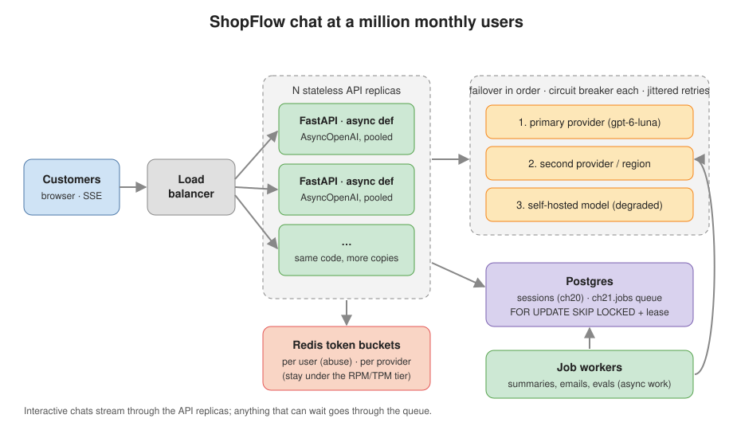
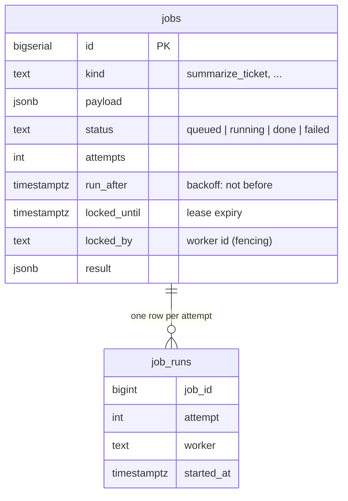
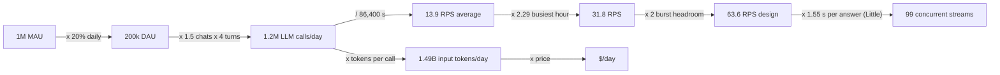
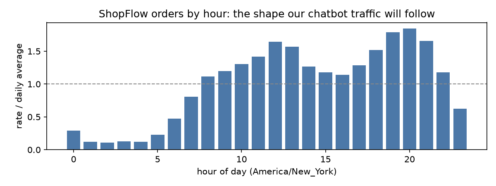
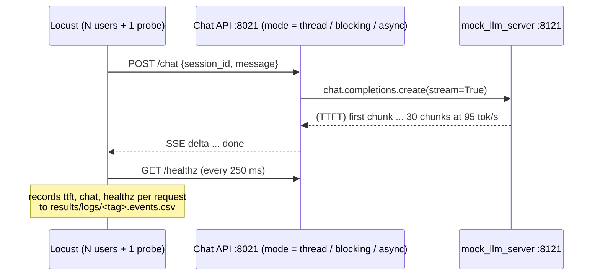
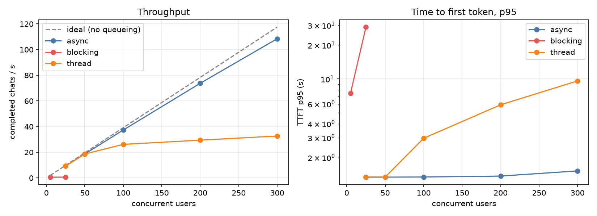
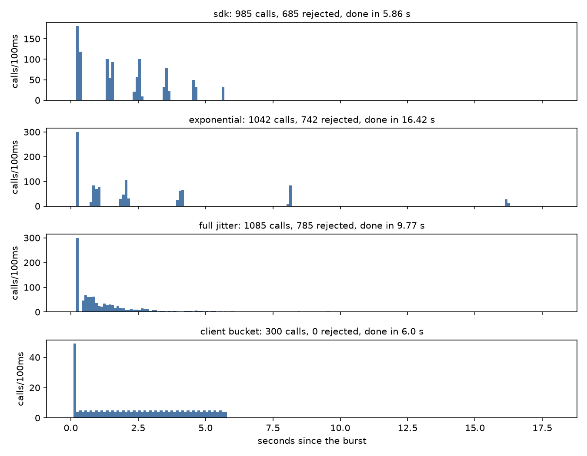
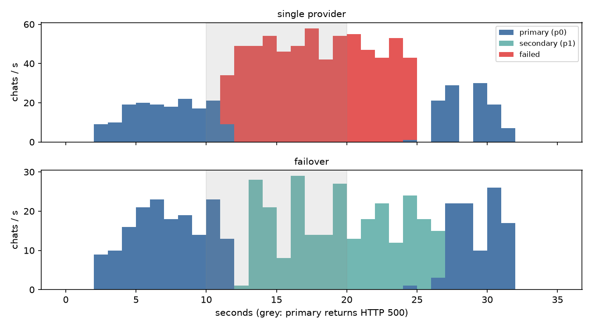
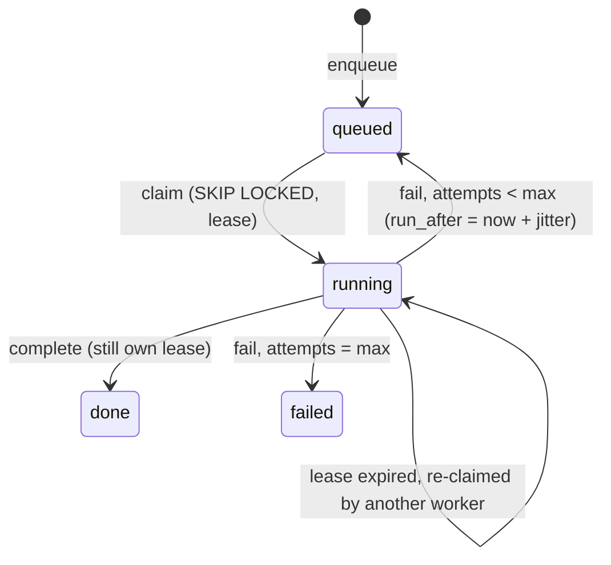
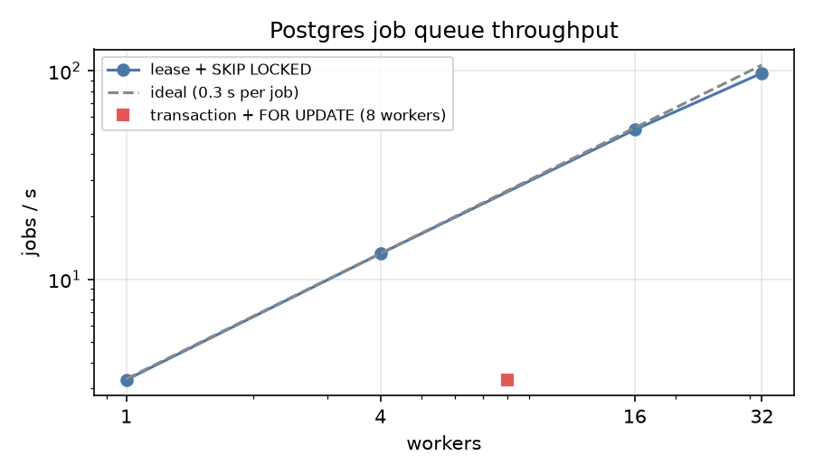

# Chapter 21: Scaling to a million users

> **Tested on:** 2026-11-09 · Ubuntu 22.04 (NVIDIA RTX 3090, 24 GB, shared with other workloads
> using ~15 GB during this run; 16 CPUs) · Python 3.12 · openai/gpt-6-luna via OpenRouter
> (calibration and failover only) · load tests against a mock LLM server · openai 3.46,
> fastapi 0.162, uvicorn 0.54, sse-starlette 3.6, locust 2.47, redis-py 8.1 + Redis 8.10,
> psycopg 3.3, Postgres 18 · local fallback measured: qwen3:1.7b on Ollama 0.40.15 (GPU, context
> 8192), see [Fail over](#5-fail-over-to-another-provider) · ShopFlow data: 2026-11-09 seed

ChatGPT has 800 million users, and its core database is a single Postgres primary with nearly 50
read replicas. OpenAI's engineers didn't get there by sharding everything on day one. They got
there with connection pooling, caching, and rate limits "across multiple layers—application,
connection pooler, proxy, and query"
([OpenAI](https://openai.com/index/scaling-postgresql/), January 2026). Boring tools, applied in
the right order, after measuring.

That's the spirit of this chapter. ShopFlow's support bot from Chapter 1 works for one person
clicking around. Marketing now wants it on every product page, in the app and in the order
confirmation emails: about a million monthly users. Before anyone says "Kubernetes" or "Kafka",
we do the napkin math, load-test the Chapter 1 API against a fake LLM, find out exactly where it
breaks, and fix each bottleneck with the smallest tool that works.



## The problem

The Chapter 1 API is about 90 lines of FastAPI. It streams answers over Server-Sent Events, keeps
conversations in an in-process dictionary, and calls the model with the synchronous OpenAI client
from a worker thread. That last choice came with a promise in Chapter 1's decision box: "Chapter 21
load-tests this and switches to `AsyncOpenAI`." Time to pay up.

Four questions decide whether it survives a million users:

1. **How much traffic is a million users, really?** Requests per second at the busiest minute,
   tokens per day, dollars per day, and the rate limits we must buy from the provider.
2. **Where does one server process stop scaling?** Event loop, thread pool, connection pool:
   each is a queue with a fixed size, and each one hides until load finds it.
3. **What happens when the provider says no?** 429s, 500s and full outages are normal at this
   volume. Retries can help or make things much worse.
4. **What doesn't need to happen while the customer waits?** Ticket summaries, follow-up emails
   and nightly evals should go through a queue, not through the request path.

## Requirements

| Type | Requirement | Target |
|---|---|---|
| Functional | Same chat behavior as Chapter 1 (streaming, memory, FAQ grounding) | unchanged |
| Functional | Survive a primary-provider outage | 0 failed chats while a second provider is up |
| Functional | Async jobs run exactly once to completion, even if a worker dies | 0 jobs lost, 0 run twice concurrently |
| Non-functional | Throughput per API process | ≥ 90% of the closed-loop ideal at 300 concurrent users |
| Non-functional | Added latency under load | TTFT p95 within 10% of the model's own TTFT |
| Non-functional | Health checks under load | `/healthz` p95 < 100 ms (or the load balancer kills healthy pods) |
| Non-functional | Rate limits | stay under the provider's limit instead of bouncing off it |
| Non-functional | Cost | known in $/day before launch |

## The data

There's no new dataset. We reuse two things:

- **ShopFlow's 180 days of orders** (`orders.placed_at`, [schema](../datasets/shopflow/schema.sql))
  to find the shape of a day: when do customers show up? Chat traffic follows shopping traffic.
- **Chapter 1's system prompt and FAQ**, copied into
  [`previous_chapters.py`](01_main-chapter-code/previous_chapters.py), so the API we load-test
  is the real one.

The queue lives in its own schema, `ch21`, in the same database. `ch21_jobqueue.setup()` creates it
idempotently:



```bash
docker compose -f datasets/shopflow/docker-compose.yml up -d      # Postgres on :5433
cd ch21/01_main-chapter-code
uv run jupyter nbconvert --to notebook --execute --inplace ch21.ipynb   # ~20 min, starts Redis on :6386
```

## Concepts

### Little's law: the one formula of capacity planning

**Little's law** says that the average number of requests *inside* a system equals the arrival
rate times the time each one spends there: $L = \lambda W$
([Wikipedia](https://en.wikipedia.org/wiki/Little%27s_law)). It's the checkout line at a
supermarket: if 2 customers arrive per minute and each spends 5 minutes in line and at the till,
there are 10 people in the store on average.

For an LLM app it's the most useful formula there is, because $W$ is huge. A normal API call
takes 20 ms; a streamed LLM answer takes one to several **seconds**. At 100 chats per second and
1.5 s per chat, 150 streams are open at any moment. Every one of them holds a socket, a slot in
some connection pool and, in Chapter 1's design, a thread. Requests per second sells the
dashboard. *Concurrent streams* sizes the servers.

### Three queues inside one Python process

A FastAPI process has three fixed-size queues between a customer and the model. Each looks
infinite until load finds it.

| Queue | What waits in it | Default size | Symptom when full |
|---|---|---|---|
| **Event loop** | every `async def` request, every health check | 1 thread runs them all | everything stalls, even `/healthz` |
| **Worker-thread pool** (AnyIO) | `def` endpoints and sync generators | 40 threads ([AnyIO](https://anyio.readthedocs.io/en/stable/threads.html)) | requests queue up; TTFT grows |
| **HTTP connection pool** (httpx in the OpenAI SDK) | outgoing calls to the provider | 1,000 connections (SDK's `DEFAULT_CONNECTION_LIMITS`) | calls wait for a free connection |

The **event loop** is a single thread that juggles thousands of waiting requests, as long as
every one of them *awaits* when it waits. One blocking call (a sync HTTP client, `time.sleep`, a
big JSON parse) and the juggler holds one ball while the others drop. FastAPI's docs spell out
the escape hatch: a plain `def` endpoint "is run in an external threadpool that is then awaited"
([FastAPI](https://fastapi.tiangolo.com/async/)). That's what Chapter 1 relied on, and that pool
has 40 threads.

> [!WARNING]
> **The most common FastAPI performance bug.** A Stack Overflow question titled "FastAPI runs API
> calls in serial instead of parallel fashion" has a score of 118. Its accepted answer: "a blocking
> operation such as `time.sleep()` in an `async def` endpoint would block the entire server"
> ([Stack Overflow](https://stackoverflow.com/questions/71516140)). A synchronous OpenAI client
> inside `async def` is exactly that blocking operation, just with a network call instead of
> `sleep`.

### Rate limits are token buckets

Providers don't count "60 requests per minute" by resetting a counter every minute. Anthropic's
docs: "The API uses the token bucket algorithm to do rate limiting. This means that your capacity
is continuously replenished up to your maximum limit, rather than being reset at fixed intervals"
([Anthropic](https://platform.claude.com/docs/en/api/rate-limits)). A **token bucket** holds up
to *capacity* tokens and refills at a steady *rate*. Each request spends one token (or, for a TPM
limit, one per LLM token). An empty bucket means 429.

The practical consequence is on the same page: "a rate of 60 requests per minute (RPM) might be
enforced as 1 request per second." Twenty requests in the same second can be rejected while
the minute's total is far below 60. Practitioners hit this all the time without knowing why. One
OpenAI forum thread is titled "Dreaded 429 rate limit errors when our usage is well-under the
limits" ([OpenAI community](https://community.openai.com/t/dreaded-429-rate-limit-errors-when-our-usage-is-well-under-the-limits/207653)).
OpenAI measures limits in RPM, TPM and RPD, and tells you to fall back to "exponential backoff
with jitter" when there's no usable `Retry-After` header
([OpenAI](https://developers.openai.com/api/docs/guides/rate-limits)).

> [!NOTE]
> **In the wild:** Stripe runs four kinds of limiters in production. The first, a request rate
> limiter, uses the same algorithm: "We use the token bucket algorithm to do rate limiting." They
> implement it in Redis, and their main operational lesson is to keep kill switches so a buggy
> limiter can be turned off ([Stripe](https://stripe.com/blog/rate-limiters), 2017).

### Retries, backoff and jitter

A **retry** re-sends a failed request. **Exponential backoff** waits longer each time (0.5 s,
1 s, 2 s, 4 s...). **Jitter** randomizes the wait, so a thousand clients that failed together
don't retry together. Marc Brooker's AWS post is the reference: "The solution isn't to remove
backoff. It's to add jitter"
([AWS](https://aws.amazon.com/blogs/architecture/exponential-backoff-and-jitter/), 2015). Its
"full jitter" waits a uniform random time between 0 and the exponential cap.

The OpenAI Python SDK retries connection errors, 408, 409, 429 and 5xx twice by default
([openai-python](https://github.com/openai/openai-python)). Reading its source
(`_base_client.py`, version 3.46) shows two details the README doesn't mention. Without a
`Retry-After` header it waits `0.5 · 2^n` seconds minus up to 25% jitter. With one, it waits
**exactly** the server-given time, up to two minutes, with no jitter at all. Keep that in mind for
the retry-storm experiment below.

### Napkin math for a million monthly users

Monthly active users (MAU) is a marketing number. Servers care about the busiest second. The
chain is short:



The peak factor isn't a guess. ShopFlow's 180 days of orders say when customers show up:

```
orders: 30,433  busiest hour: 20:00 ET (7.7% of the day)
peak-hour factor 1.84 x busiest-weekday factor 1.24 = 2.29
```



The rest are assumptions, and the notebook prints them so nobody mistakes them for data: 20% of
monthly users chat on a given day, 1.5 chats each, 4 messages per chat, 20 tokens per customer
message, the 1,144-token system prompt (counted with `tiktoken`), and 29 output tokens per answer
(the mean of our calibration calls below). The ×2 burst on top of the busiest hour covers
minute-level spikes: a promotion email, or a competitor's outage sending you their customers.

Two things make LLM napkin math different from normal web math. First, **every turn resends the
whole conversation**, so input tokens grow with the square of the conversation length.
`input_tokens_per_session` sums it up turn by turn:

```python
# ch21/01_main-chapter-code/ch21_napkin.py
def input_tokens_per_session(system: int, user: int, output: int, turns: int) -> int:
    if turns < 1:
        raise ValueError("turns must be >= 1")
    return sum(system + k * user + (k - 1) * output for k in range(1, turns + 1))
```

Second, **latency is long**, so concurrency is high. The output, from the notebook:

```
daily active users                          200,000.0
chats / day                                 300,000.0
messages (LLM calls) / day                1,200,000.0
input tokens / day                    1,485,000,000.0
output tokens / day                      34,800,000.0
average RPS                                      13.9
busiest-hour RPS                                 31.8
design RPS (x2 burst)                            63.6
design RPM                                    3,818.5
design input TPM                          4,725,390.3
design output TPM                           110,736.4
design concurrent streams (Little)               98.8
```

Then dollars, with OpenRouter prices as of 2026-11. The system prompt is 92% of the average
call's input and identical every time, so it's a perfect prompt-cache candidate. gpt-6-luna bills
cached input at 10% of the input price (Chapter 1 saw `cached_tokens` on every repeated call). We
don't assume caching for the Claude models, because through OpenRouter that needs explicit cache
breakpoints (Chapter 15).

| model | prompt cache | $/day | $/month | $/1k messages |
|---|---|---|---|---|
| openai/gpt-6-luna | no | 165.90 | 4,977 | 0.1383 |
| anthropic/claude-haiku-5.5 | no | 165.90 | 4,977 | 0.1383 |
| anthropic/claude-sonnet-5.5 | no | 3,318.00 | 99,540 | 2.7650 |
| openai/gpt-6-luna | yes (92% of input) | 42.35 | 1,270 | 0.0353 |

A reality check against the real bill: our five calibration calls averaged **$0.000054** per
first-turn message on gpt-6-luna, but that average hides a cold cache. The first call had 0 of
1,160 prompt tokens cached and cost $0.000158; the other four had 1,143 cached and cost
$0.000019–0.000026. The napkin's $0.0353 per 1,000 messages ($0.000035 each) is an average over
all four turns of a warm-cache conversation, so later, longer turns cost a little more than the
warm first turns. The napkin is in the right place, as long as the cache stays warm.

The last line is what you ask your provider for. At design peak we need **3,819 RPM** and
**4.73M input TPM**, or **357,029 uncached input TPM** where the provider counts only uncached
tokens (Anthropic does: "Claude's default ITPM rate limits count only uncached input tokens",
[Anthropic](https://platform.claude.com/docs/en/api/rate-limits)). Check those against your tier
*before* launch day. Tier upgrades often depend on spend history and take days.

> [!TIP]
> Prompt caching is the biggest cost lever here: −74% on the bill, from putting the stable
> system prompt first. Concurrency is the biggest *engineering* number: 99 open streams is a
> design input for every pool, limit and timeout below.

## v0: the naive solution

v0 is Chapter 1's API, copied to
[`ch21_chat_api.py`](01_main-chapter-code/ch21_chat_api.py) with one change: the LLM call is
selected by `CH21_MODE`, so the same file can run the original design and its alternatives.
`thread` is Chapter 1 as shipped: a `def` endpoint returning a sync generator, which
sse-starlette iterates in AnyIO's worker threads. `blocking` is what many people write first
when they "make it async":

```python
# ch21/01_main-chapter-code/ch21_chat_api.py
elif MODE == "blocking":

    @app.post("/chat")
    async def chat(req: ChatRequest) -> EventSourceResponse:
        async def events() -> AsyncIterator[dict]:
            for event in _sync_events(req):  # DON'T: blocking I/O on the event loop
                yield event

        return EventSourceResponse(events())
```

The load test needs a model that is fast, free and predictable, with the *shape* of a real one.
[`mock_llm_server.py`](01_main-chapter-code/mock_llm_server.py) is a 200-line FastAPI app that
speaks enough of `POST /v1/chat/completions` (streaming, `stream_options.include_usage`,
`max_tokens`) for the OpenAI SDK to accept it. Everything is configurable: time to first token,
tokens per second, answer length, a random 429/500 rate with `Retry-After`, and a provider-side
token bucket. `POST /admin/config` changes behavior mid-test (we use it to stage an outage), and
`GET /admin/stats` counts every call it saw, including how many were in flight at once.

[`ch21_locustfile.py`](01_main-chapter-code/ch21_locustfile.py) simulates customers. Each one
keeps a session, asks FAQ questions with 0.5–1.5 s of think time, and reads the SSE stream to the
end. A streamed response isn't done when its headers arrive, so it records two custom metrics,
`ttft` and `chat` (until the `done` event). A single `HealthProbe` user calls `/healthz` four
times a second, like a load balancer would.



[`ch21_loadtest.py`](01_main-chapter-code/ch21_loadtest.py) starts the mock and the API with
uvicorn, runs `locust --headless` for 30 s, drops the first 5 s as ramp-up, and computes exact
percentiles from the per-request CSV.

## Measuring v0

### Calibrating the mock

A mock is only useful if it behaves like the model. Five streaming calls to `openai/gpt-6-luna`
with Chapter 1's full system prompt:

```
                                question  ttft_s  total_s  prompt_tokens  cached  completion_tokens  decode_tok_s  cost_usd
   How long do I have to return an item?   2.604    2.850           1160       0                 26         101.4  0.000158
           Who pays for return shipping?   1.446    1.735           1156    1143                 26          86.5  0.000026
                  Do you ship to Canada?   1.037    1.296           1156    1143                 22          81.2  0.000024
           How much is express shipping?   1.333    1.553           1156    1143                 12          49.8  0.000019
My payment failed but I see a charge on    0.913    1.402           1166    1143                 61         122.6  0.000045

mock config: {'ttft_ms': 1333, 'tokens_per_s': 86, 'output_tokens': 29} | median total latency 1.55s | cost 0.000272 USD
```

The first call took 2.6 s to the first token, on a cold prompt cache. That's real provider
variance, and the mock doesn't reproduce it (it uses the medians). Real p95 latency will be worse
than anything below.

### The ladder

Then the ladder: 25 to 300 concurrent users per mode, 30 s each. The dashed line in the chart is
the closed-loop ideal: each user completes one chat per (1.55 s + 1 s mean think time).

| mode | users | chats/s | TTFT p50 | TTFT p95 | chat p95 | `/healthz` p95 | streams at the mock |
|---|---|---|---|---|---|---|---|
| blocking | 5 | 0.61 | 6,923 ms | 7,494 ms | 7,835 ms | 11,504 ms | 1 |
| blocking | 25 | 0.62 | 17,856 ms | 28,938 ms | 29,281 ms | 18,522 ms | 1 |
| thread | 25 | 9.22 | 1,338 ms | 1,340 ms | 1,690 ms | 2 ms | 23 |
| thread | 50 | 18.64 | 1,339 ms | 1,341 ms | 1,690 ms | 2 ms | 40 |
| thread | 100 | 26.16 | 2,046 ms | 2,970 ms | 5,506 ms | 995 ms | 74 |
| thread | 200 | 29.42 | 3,589 ms | 5,891 ms | 7,564 ms | 5,012 ms | 80 |
| thread | 300 | 32.66 | 5,176 ms | 9,613 ms | 10,791 ms | 6,466 ms | 80 |
| async | 25 | 9.31 | 1,338 ms | 1,339 ms | 1,690 ms | 2 ms | 21 |
| async | 50 | 18.68 | 1,338 ms | 1,340 ms | 1,690 ms | 4 ms | 39 |
| async | 100 | 37.35 | 1,338 ms | 1,343 ms | 1,686 ms | 5 ms | 81 |
| async | 200 | 73.75 | 1,341 ms | 1,369 ms | 1,711 ms | 18 ms | 157 |
| async | 300 | 108.46 | 1,392 ms | 1,521 ms | 1,884 ms | 162 ms | 233 |



What the numbers say:

- **`blocking` serves one customer at a time.** The mock never saw more than **1** request in
  flight. Throughput is 0.6 chats/s, whatever the user count, which is 1 / 1.64 s, one answer at
  a time. With 25 users, TTFT p95 is 29 s and the health check took 18.5 s to answer. In
  production the load balancer would mark the pod dead and restart it, under load, which is how
  a slow day turns into an outage.
- **`thread` (Chapter 1) plateaus at 26–33 chats/s.** The mock never saw more than 80 concurrent
  streams, against 233 for `async` at the same load. TTFT p95 reaches 9.6 s at 300 users, and
  `/healthz` takes 6.5 s at p95 because it's a `def` endpoint queuing for the same 40 threads as
  the chats. (Why 80 and not 40? sse-starlette holds a thread only while it waits for the *next*
  chunk, so a stream gives its thread back between chunks. That loosens the cap but doesn't
  remove it.)
- **`async` tracks the ideal up to 200 users** (73.8 chats/s vs 78.3 ideal, 94%) and still reaches
  108.5 chats/s at 300 (92% of 117.5). But the event loop starts to show: `/healthz` p95 jumps from
  18 ms to 162 ms and TTFT p95 to 1,521 ms, 14% over the mock's 1,333 ms. That's a different
  wall: one Python process, one core, parsing and re-sending about 3,100 SSE events per second.
  How soon you hit it depends on the CPU you get: on 2026-11-08, with the 16 cores also running
  a CPU-only Ollama for other chapters, the same process flattened at 66.5 chats/s.

> [!WARNING]
> "Async" doesn't mean "non-blocking". The event loop also stalls on CPU work: JSON parsing,
> pydantic validation, tokenizing. An OpenAI SDK user reports exactly that kind of creeping
> event-loop blockage after an SDK upgrade, with Redis and Kafka heartbeats timing out in the
> same process ([openai-python #3777](https://github.com/openai/openai-python/issues/3777), open
> as of 2026-11). Watch `/healthz` latency under load: it's the cheapest event-loop lag metric
> you'll ever have.

## Iterating

### 1. Off the event loop and onto more cores

Two candidate fixes for `thread` mode: raise AnyIO's limit from 40 to 400 threads, or switch to
`AsyncOpenAI`. And for the single-process CPU wall: run more processes (`uvicorn --workers 4`).

| configuration | users | chats/s | TTFT p50 | TTFT p95 | chat p95 | `/healthz` p95 | streams at the mock |
|---|---|---|---|---|---|---|---|
| thread, 400 threads | 300 | 103.03 | 1,400 ms | 1,459 ms | 2,174 ms | 78 ms | 228 |
| async, 1 process | 300 | 108.46 | 1,392 ms | 1,521 ms | 1,884 ms | 162 ms | 233 |
| **async, 4 processes** | 300 | **111.62** | 1,338 ms | **1,341 ms** | 1,689 ms | **3 ms** | 230 |

400 threads triples `thread` mode's throughput (32.7 → 103.0 chats/s), close to one async
process. Four async processes reach **111.6 chats/s, 95% of the 117.5 ideal**. Throughput barely
moves over one process on this run; what moves is the tail: TTFT p95 is 1,341 ms against the
mock's own 1,333 ms (+0.6%), and health checks answer in 3 ms instead of 162 ms.

> [!IMPORTANT]
> **Decision: `AsyncOpenAI` + several worker processes over a bigger thread pool.** 400 threads
> did work in this test, but every thread reserves its own stack and costs a context switch,
> the GIL still serializes the Python parts, and the right thread count moves with every change
> in answer length. With async, an idle stream costs one socket and a few KB, and concurrency is
> limited only by the pools we size on purpose. Processes give us cores. Keep the sync client
> plus threads for low-traffic internal tools, where its simpler stack traces are worth more than
> throughput.

### 2. Size the connection pool on purpose

`AsyncOpenAI` sends requests through an httpx connection pool. The SDK sets it to 1,000
connections, far above httpx's own default of 100, which has tripped up many people
([encode/httpx #1171](https://github.com/encode/httpx/issues/1171): "PoolTimeout when num tasks
in asyncio.gather() exceeds client max_connections"). We shrank it to 20 to see what a pool
limit looks like from the outside:

```python
# ch21/01_main-chapter-code/ch21_chat_api.py
limits = httpx2.Limits(max_connections=MAX_CONNECTIONS,
                       max_keepalive_connections=MAX_CONNECTIONS)
http_client = openai.DefaultAsyncHttpxClient(limits=limits)
```

| pool size | users | chats/s | TTFT p50 | TTFT p95 | `/healthz` p95 | streams at the mock |
|---|---|---|---|---|---|---|
| 20 | 100 | 12.21 | 6,951 ms | 7,458 ms | 2 ms | 20 |
| SDK default (1,000) | 100 | 37.37 | 1,338 ms | 1,344 ms | 5 ms | 76 |

A full pool is a silent queue. No errors, healthy health checks, and TTFT goes from 1.3 s to
7.0 s, because requests wait their turn for one of 20 connections. Every pool in the request path
needs a size derived from Little's law, plus a metric. Our design point is 99 streams across the
fleet, so the SDK default is fine. A connection pool in front of a database or a proxy that
allows 20 would not be.

> [!NOTE]
> **In the wild:** OpenAI put PgBouncer in front of ChatGPT's Postgres to pool connections. In
> their benchmarks, "the average connection time dropped from 50 milliseconds (ms) to 5 ms", and
> each Azure Postgres instance has a hard cap of 5,000 connections that pooling keeps them under
> ([OpenAI](https://openai.com/index/scaling-postgresql/), 2026). Pools are the first scaling
> tool, not the last.

The same trap hit us in our own code. The Redis limiter in step 4 failed 200 of 300 concurrent
calls during development with `MaxConnectionsError`. Since redis-py 8.0, the asyncio pool has
a default maximum of 100 connections, and it *raises* when they're all busy instead of waiting
([redis-py #4458](https://github.com/redis/redis-py/issues/4458)). The fix is a
`BlockingConnectionPool`, which makes callers wait up to a timeout
([redis-py docs](https://redis.readthedocs.io/en/stable/connections.html)):

```python
# ch21/01_main-chapter-code/ch21_chat_api.py
# redis-py's asyncio pool *raises* MaxConnectionsError past 100 concurrent commands by default;
# a BlockingConnectionPool makes callers wait for a free connection instead.
_redis = aredis.Redis(connection_pool=aredis.BlockingConnectionPool.from_url(
    REDIS_URL, max_connections=64, timeout=5))
```

### 3. Retries: the SDK's, and when not to rely on them

With the mock returning 429 on 10% of calls, here are 100 users with SDK retries off and on (the
default, 2):

| `max_retries` | chats/s | ok | failed | error rate | TTFT p50 | TTFT p95 | upstream calls |
|---|---|---|---|---|---|---|---|
| 0 | 34.10 | 903 | 176 | 16.31% | 1,338 ms | 1,342 ms | 1,051 |
| 2 (default) | 35.09 | 956 | 1 | 0.10% | 1,338 ms | 2,342 ms | 1,162 |

Two retries turn a 16.3% error rate into 0.1%. Without retries the damage is double: 100 chats
failed on the mock's 429 itself, and another 76 never reached it, because a few 429s in a row
opened the circuit breaker (step 5) and it failed requests fast for 10 s. Errors the provider
would have recovered from in a second count as outages to the breaker unless something retries
first. The cost of retrying: TTFT p95 grows by about 1 s, because the
mock sends `Retry-After: 1` and the SDK waits exactly that long. That's the right default for
*random* failures.

Rate limits aren't random, though. They're a bucket that empties when everybody arrives at once.
So we staged the scenario from Concepts: 300 requests in one burst against a provider that
allows 50 requests per second (the mock's own token bucket, burst 50, `Retry-After: 1`). Four
strategies:

- `sdk`: `AsyncOpenAI(max_retries=10)`, which honors `Retry-After`.
- `exponential`: our `retry_async`, waits of 0.5 · 2ⁿ s, no jitter.
- `full jitter`: our `retry_async`, waits uniform in [0, 0.5 · 2ⁿ] s.
- `client bucket`: no retries needed. Each request first takes a token from a **Redis token
  bucket at 45/s**, 90% of the provider's limit.

| strategy | time to finish all 300 | upstream calls | rejected (429) |
|---|---|---|---|
| sdk (honors `Retry-After`) | 5.86 s | 985 | 685 |
| exponential, no jitter | 16.42 s | 1,042 | 742 |
| full jitter | 9.77 s | 1,085 | 785 |
| **client-side bucket at 90%** | **6.00 s** | **300** | **0** |



The histogram shows the herd. The SDK's waves are one second apart, because every client got the
same `Retry-After: 1` and obeys it to the millisecond. Each wave gets 50 through and bounces the
rest. It finishes fast, but it sends **3.3× the necessary calls**, every one of them an error in
your logs and a request the provider had to reject. Plain exponential
backoff makes waves too, further and further apart (16.4 s). Full jitter smears the waves and
finishes in 9.8 s, but it doesn't reduce the wasted calls. That surprised us, given the AWS
article, until we noticed the difference: Brooker measured *contention*, where fewer
simultaneous callers means fewer conflicts. A rate limit is a fixed *rate*, so spreading the
retries changes when they fail, not how many. Only the client-side bucket sends what the
provider will accept: 300 calls, 0 rejected, within 0.14 s of the SDK.

> [!IMPORTANT]
> **Decision: a client-side token bucket over relying on retries for rate limits.** Retries
> (with jitter, and honoring `Retry-After`) stay on for the *unexpected*: blips, 500s,
> overloads. For the *expected* limit, the RPM/TPM tier we bought, we meter ourselves at about
> 90% of it, so the 429 becomes a rare event instead of a control signal. The exception: a
> provider with dynamic, unpublished limits (shared free tiers, Anthropic's 529 overloaded
> responses, [docs](https://platform.claude.com/docs/en/api/errors)), where only retries can
> discover the current capacity.

### 4. A Redis token bucket shared by every replica

A token bucket in process memory is exact for one process. With four API processes, each one
allows the full rate. The bucket has to live somewhere they all share, and the update has to be
atomic. A Lua script runs atomically inside Redis and uses Redis's clock, so app servers with
skewed clocks still agree:

```lua
-- ch21/01_main-chapter-code/ch21_ratelimit.py (TOKEN_BUCKET_LUA)
local t = redis.call('TIME')
local now = tonumber(t[1]) + tonumber(t[2]) / 1000000
local b = redis.call('HMGET', KEYS[1], 'tokens', 'ts')
local tokens = tonumber(b[1]) or capacity
local ts = tonumber(b[2]) or now
tokens = math.min(capacity, tokens + math.max(0, now - ts) * rate)
...
if tokens >= cost then
  tokens = tokens - cost
  allowed = 1
else
  retry_after = (cost - tokens) / rate
end
redis.call('HSET', KEYS[1], 'tokens', tokens, 'ts', now)
redis.call('PEXPIRE', KEYS[1], math.ceil(capacity / rate * 1000) + 1000)
```

`cost` is what makes it an LLM limiter: pass 1 to limit requests, or the request's estimated
tokens to stay under a TPM budget. Four processes, each trying to acquire every 2 ms for 5 s,
under a limit of 20/s with a burst of 20 (so 120 should pass):

```
    bucket  allowed per process  total allowed in 5 s  limit (20/s x 5 s + burst 20)
in-process [119, 119, 119, 119]                   476                            120
     redis     [32, 25, 34, 28]                   119                            120

Redis token-bucket call latency: p50 0.065 ms, p99 0.088 ms
```

In-process buckets let through 4× the limit. The Redis bucket lets through 119 of the 120 (the
bucket refills continuously, so a check that lands a hair early is refused), for less than a
tenth of a millisecond per check. The unit tests pin the same contract with 10 threads
and two limiter objects sharing one key: exactly `capacity` acquisitions succeed.

The same class protects us from our own users. With `CH21_USER_RPS=0.2` and a burst of 3 per
session, 50 users hammering the API with 0.1–0.3 s think time got:

```
                 tag  throughput_rps  chats_ok  chats_failed  error_rate  mock_requests  ttft_p95_ms
async-u50-user-limit           13.15       341          3229      0.9045            399         1341
{'HTTP 429': 3229}
```

3,229 requests were turned away with a 429 before they cost a single token. The provider saw 399
calls, and the customers who stayed within the limit still got a 1.3 s TTFT p95.

> [!IMPORTANT]
> **Decision: Redis over an in-process limiter or an API-gateway plugin.** In-process limiters
> multiply by the replica count (476 vs 119 above). Gateway rate limiting (nginx, Envoy, Kong)
> counts *requests*, but our scarce resource is *LLM tokens*, and only the app knows a request's
> prompt size. Redis adds one 0.1 ms round trip and an infrastructure dependency. Make the
> limiter fail open when Redis is down. Pick a gateway when you only need per-IP request limits.

### 5. Fail over to another provider

At a million users, a provider outage is a matter of *when*.

> [!NOTE]
> **In the wild:** On December 11, 2024, every OpenAI service (ChatGPT, the API, Sora) was
> degraded or down from 3:16 PM to 7:38 PM PST. "The issue stemmed from a new telemetry service
> deployment that unintentionally overwhelmed the Kubernetes control plane, causing cascading
> failures across critical systems"
> ([OpenAI status](https://status.openai.com/incidents/01JMYB483C404VMPCW726E8MET)). Four hours
> and 22 minutes is a long time for a support bot to say "something went wrong".

`stream_with_failover` tries providers in order, each behind a **circuit breaker**: after 3
consecutive failures it stops sending traffic to that provider for 10 s, then lets one trial
request through. The important rule is in the `except` branch:

```python
# ch21/01_main-chapter-code/ch21_resilience.py
        except Exception as exc:
            if not is_retryable(exc):
                p.breaker.record_success()  # the provider answered; the request was bad
                raise
            p.breaker.record_failure()
            if started:
                raise
            skipped[p.name] = f"{type(exc).__name__}: {getattr(exc, 'status_code', '')}".strip()
            continue
```

We fail over only **before the first token**. After that the customer has already seen half a
sentence from model A, and splicing in model B's answer would produce nonsense. A 400 or 401
doesn't fail over either: that's our bug, and a second provider would reject it too (or, worse,
accept it).

The test: 50 users for 30 s, and from second 10 to second 20 the primary mock answers every
request with HTTP 500.

```
single provider  during outage: 30 ok, 426 failed, served by {'p0': 30}, p95 1685 ms | whole run: 271 ok / 937
failover         during outage: 178 ok, 0 failed, served by {'p0': 36, 'p1': 142}, p95 3043 ms | whole run: 527 ok / 527
```



With failover, **zero chats failed**. The price is visible as a dip just after second 10:
the first requests to hit the dead primary spend about 1.5 s in the SDK's two retries before
failing over, until the breaker opens, so p95 during the outage is 3.0 s. Look at the single-
provider panel too: the failures continue until about second 25, five seconds *after* the
primary recovered. That's the breaker doing its job, failing fast without calling a provider
it believes is down, until its 10 s timer allows a trial request. Without a breaker, every one of
those requests would have waited for its own timeout and retries.

With real providers, the same function and a mock primary that is down. With `CH21_RUN_LOCAL=1`
the notebook adds a third, self-hosted provider: the first installed of `qwen3:1.7b`, `qwen3:8b`,
`gemma3:4b` on Ollama (here qwen3:1.7b, reasoning off, 120 output tokens max, 60 s timeout, no
retries):

```
providers: ['mock (down)', 'openrouter', 'ollama qwen3:1.7b']
[OpenRouter up] served by openrouter in 1.47s; skipped: {'mock (down)': 'InternalServerError: 500'}
  -> You can return most items within 30 days of delivery, provided they’re unused and in their original packaging.

[OpenRouter down] served by ollama qwen3:1.7b in 1.98s; skipped: {'mock (down)': 'InternalServerError: 500', 'openrouter': 'APIConnectionError:'}
  -> You can return an item within 30 days of delivery.
```

| scenario | served by | time | answer |
|---|---|---|---|
| OpenRouter up | openrouter (gpt-6-luna) | 1.47 s | 30 days, unused, original packaging |
| OpenRouter down | ollama qwen3:1.7b (local) | 1.98 s* | 30 days |

\* GPU shared with other workloads using ~15 GB during this run; one call, not a latency benchmark.

With both remote providers down, the chain no longer raises `AllProvidersFailed`: a 1.7B model
on the local GPU answered in about 2 s, with the right policy (30 days) but without the
conditions the hosted model added. That's what a last resort should be: correct and shorter, not
equivalent. One call on a shared GPU says nothing about how the local model holds up under the
load of the tests above; size it separately before counting on it. A degraded answer beats an
error page, as long as the UI says so.

> [!IMPORTANT]
> **Decision: ordered failover with circuit breakers, before the first token only, over
> load-balancing across providers.** Spreading traffic across two providers all the time sounds
> more resilient, but answers would differ in tone and quality from one message to the next, and
> each provider's prompt cache stays half as warm. Ordered failover keeps one
> consistent primary and pays for the second only during incidents. Load-balance when one
> provider's rate limit alone can't carry your peak.

### 6. Async work: a Postgres queue with `FOR UPDATE SKIP LOCKED`

Not everything has to happen while the customer waits. Summarizing a ticket for the human agent,
drafting the follow-up email, and scoring yesterday's answers with an LLM judge (Chapter 3) can all
wait seconds or minutes. Moving them off the request path flattens the peak and lets them run at
the provider's off-peak capacity.

The textbook answer is a message broker. At ShopFlow's scale, we already run Postgres, and
Postgres has had a clause built for this since 9.5. The docs say skipping locked rows "can be
used to avoid lock contention with multiple consumers accessing a queue-like table"
([PostgreSQL](https://www.postgresql.org/docs/current/sql-select.html)). One statement claims a
job atomically:

```sql
-- ch21/01_main-chapter-code/ch21_jobqueue.py (_CLAIM)
WITH next AS (
    SELECT id FROM ch21.jobs
    WHERE (status = 'queued' AND run_after <= now())
       OR (status = 'running' AND locked_until < now() AND attempts < max_attempts)
    ORDER BY run_after, id
    LIMIT %(n)s
    FOR UPDATE SKIP LOCKED
)
UPDATE ch21.jobs j
SET status = 'running', attempts = j.attempts + 1, locked_by = %(worker)s,
    locked_until = now() + make_interval(secs => %(lease)s), updated_at = now()
FROM next WHERE j.id = next.id
RETURNING j.id, j.kind, j.payload, j.attempts
```

The design choice that matters is *where the transaction ends*. Most examples lock the row and
keep the transaction open while the work runs. An LLM call takes seconds, so we commit the claim
right away and hold a **lease** (`locked_until`) instead. A crashed worker's job becomes
claimable again when the lease expires. `complete()` only succeeds if the worker still owns the
lease (same `locked_by` and `attempts`), so a slow worker whose job was re-claimed can't
overwrite the newer result. That's called *fencing*. Failures re-queue with full-jitter backoff
until `max_attempts`.



Three ways to run 8 workers over 100 "summarize ticket" jobs (about 0.3 s each against the mock),
while a sampler counted connections sitting `idle in transaction`:

| variant | jobs/s | seconds | avg claim | max idle-in-transaction | jobs run twice |
|---|---|---|---|---|---|
| transaction + `FOR UPDATE` | 3.3 | 29.90 | 1,937.1 ms | 1 | 0 |
| transaction + `SKIP LOCKED` | 25.4 | 3.93 | 0.3 ms | 8 | 0 |
| **lease + `SKIP LOCKED`** | **25.4** | **3.94** | 1.4 ms | **4** | 0 |

Plain `FOR UPDATE` turns 8 workers into 1. Every worker queues on the same first row and waits
almost 2 s per claim, and then the row it finally gets is no longer queued, so it claims nothing.
`SKIP LOCKED` fixes throughput either way. The lease version gets the same throughput **without
holding a transaction open during the LLM call**: at most 4 of 8 connections were idle in
transaction (mid-claim), against all 8 for the transactional version. At 100 workers that's the
difference between a healthy database and one with 100 long transactions blocking vacuum.

Scaling the lease worker over 300 jobs:

| workers | jobs/s | seconds | avg claim | jobs run twice |
|---|---|---|---|---|
| 1 | 3.3 | 89.85 | 1.2 ms | 0 |
| 4 | 13.3 | 22.50 | 1.5 ms | 0 |
| 16 | 52.2 | 5.74 | 1.5 ms | 0 |
| 32 | 97.6 | 3.07 | 2.0 ms | 0 |



Linear up to 32 workers, at 2 ms or less per claim, and no job ran twice in any run. The tests also
crash a worker mid-job: its lease expires, another worker re-claims the job (`attempts == 2`), and
the stale worker's late `complete()` is rejected.

> [!NOTE]
> **In the wild:** Rails 8 ships Solid Queue as its default job backend. It keeps jobs in the
> application's database and "leverages the `FOR UPDATE SKIP LOCKED` clause, if available, to
> avoid blocking and waiting on locks when polling jobs"
> ([Solid Queue](https://github.com/rails/solid_queue)). On Hacker News, one engineer describes
> their two most recent distributed job systems as "literally built around SELECT FOR UPDATE SKIP
> LOCKED" ([HN](https://news.ycombinator.com/item?id=37636841)).

> [!IMPORTANT]
> **Decision: a Postgres `SKIP LOCKED` queue over Kafka or Celery, at this stage.** We need about
> 100 jobs/s at most, and the queue above did 97.6 jobs/s with 32 workers on a shared database.
> Postgres gives us transactional enqueue (the job commits with the order that caused it), SQL for
> inspection, and no new system to operate. Celery on Redis has a trap for exactly our kind of
> slow job: "If a task isn't acknowledged within the Visibility Timeout the task will be
> redelivered to another worker and executed"
> ([Celery](https://docs.celeryq.dev/en/stable/getting-started/backends-and-brokers/redis.html)).
> Move to Kafka when you need fan-out to many consumers, replay of an event log, or sustained
> thousands of jobs per second, where queue churn starts to cost the primary database real
> write and vacuum capacity.

## Production hardening

- **Sessions out of process.** Chapter 1's `SessionStore` is a dictionary inside one process.
  With `--workers 4`, as in our best run, a customer's second message can land on a process that
  never saw the first. The load test doesn't check answers, so it can't see this, but customers
  would. Before scaling out, move sessions to Postgres (Chapter 20) or Redis, keyed by
  `session_id`.
- **One shared provider budget.** Put the per-provider token bucket in Redis at about 90% of the
  purchased RPM and TPM, and charge the *estimated* request size as the cost
  (`acquire(key, cost=prompt_tokens + max_tokens)`), because the limits are in tokens.
- **Fail open on limiter errors.** Stripe's lesson applies: the limiter must not take the API down
  with it. Our `ch21_chat_api.py` doesn't do this yet (Exercise 2). Catch the Redis error, log
  it, let the request through, and keep a flag that switches limiting off.
- **Retry budgets, not retry counts.** Retries happen at three layers here: the SDK (2 per
  provider), failover (one try per provider), and the customer pressing "try again". Never wrap
  your own retry loop around the SDK's, and alert on the ratio of upstream calls to user requests.
  In the retry table it was 1,147 / 939 = 1.22 with a 10% error rate. Well above that, something
  is retrying too much.
- **A TTFT deadline.** The 60 s SDK timeout is a ceiling, not a target. A provider that accepts
  the connection and then never sends a token is worse than one that returns 500. Put a deadline
  on the first chunk (for example 10 s) and fail over when it's missed.
- **Honest health checks.** `/healthz` must stay cheap and must not call the LLM, Redis or
  Postgres. A separate readiness check can. If liveness depends on the provider, one provider
  outage restarts your whole fleet.
- **Queue hygiene.** Keep partial indexes on the claim query's `WHERE` (we index `queued` and
  `running`). Archive `done` jobs on a schedule. Alert on the age of the oldest queued job, not
  on queue length.

## Serving it

```bash
# Redis for the limiter
docker run -d --name ch21-redis -p 127.0.0.1:6386:6379 redis:8-alpine

cd ch21/01_main-chapter-code
# two mock providers, calibrated like gpt-6-luna (one terminal each)
MOCK_TTFT_MS=1333 MOCK_TOKENS_PER_S=86 MOCK_OUTPUT_TOKENS=29 \
  uv run uvicorn mock_llm_server:app --port 8121 --no-access-log
MOCK_TTFT_MS=1333 MOCK_TOKENS_PER_S=86 MOCK_OUTPUT_TOKENS=29 \
  uv run uvicorn mock_llm_server:app --port 8221 --no-access-log

# the API: async, failover across both, 4 processes, 1 chat/s per session (burst 5)
CH21_MODE=async CH21_USER_RPS=1 \
CH21_LLM_BASE_URLS=http://127.0.0.1:8121/v1,http://127.0.0.1:8221/v1 \
  uv run uvicorn ch21_chat_api:app --port 8021 --workers 4 --no-access-log

# 100 customers + 1 health probe for a minute
uv run locust -f ch21_locustfile.py --headless -u 101 -r 20 -t 60s --host http://127.0.0.1:8021

# stage an outage while it runs
curl -X POST localhost:8121/admin/config -H 'content-type: application/json' -d '{"rate_500": 1.0}'
```

One Locust process uses one core ("you need to run one worker instance per processor core",
[Locust](https://docs.locust.io/en/stable/running-distributed.html)). It kept up with 112 chats/s
here; above that, add `--processes 4`, or the load generator becomes the bottleneck you measure.

> [!WARNING]
> `ch21_chat_api.py` sends the same `CH21_LLM_API_KEY` and `CH21_LLM_MODEL` to every base URL in
> the list. That's fine for mocks. For real providers, build one `Provider(name, client, model,
> options)` per provider, as the notebook's failover chain does.

Tests: `uv run pytest ch21` (23 tests). The Redis test needs `docker start ch21-redis` and skips
otherwise. The queue tests use the ShopFlow database and only touch the `ch21` schema.

## Results

| Requirement | Target | Measured |
|---|---|---|
| Throughput per box at 300 users | ≥ 90% of ideal | 111.62 of 117.5 chats/s (95%), async × 4 processes |
| Added TTFT under load | p95 within 10% of the model's | 1,341 ms vs 1,333 ms (+0.6%) |
| `/healthz` under load | p95 < 100 ms | 3 ms (Chapter 1's design: 6,466 ms) |
| Primary-provider outage | 0 failed chats | 0 of 178 during the outage (single provider: 426 failed) |
| Both remote providers down | an answer, not an error | served by local qwen3:1.7b in 1.98 s (shared GPU) |
| Rate limits | stay under, not bounce off | 300 calls / 0 rejected for 300 requests (SDK retries: 985 / 685) |
| Shared limit across processes | exact | 119 allowed for a limit of 120 (in-process: 476) |
| Async jobs | none lost, none run twice | 0 run twice across all runs; lease re-claim and fencing tested |
| Cost known before launch | $/day | $42.35/day on gpt-6-luna with prompt caching ($165.90 without) |

Sizing from the notebook: 99 design-peak streams. One async process kept TTFT p95 within 10% of
the model's up to 157 concurrent streams on this host. At 70% of that, one process covers the
design peak, plus one for redundancy. The 4-process run carried 230 streams, more than twice the
design peak.

Run history: these numbers are from the 2026-11-09 re-run of the whole notebook on the 2026-11-09
ShopFlow seed (30,433 orders), with the local fallback enabled. The 2026-11-08 run, with the CPUs
shared with a CPU-only Ollama, had one async process flatten at 66.5 chats/s and sized the fleet
at 2 processes plus one.

> [!CAUTION]
> These are load tests against a mock. They measure *our* stack: event loop, pools, limiter,
> queue. A real provider adds network variance (one calibration call took 2.6 s to the first
> token), its own rate limits and its own outages. Load-test against a real endpoint at low volume
> before launch, with a budget cap on the key.

## Exercises

1. Make the Chapter 1 `/healthz` an `async def` and rerun `thread` mode at 200 users. Which
   numbers change, and which don't? What does that tell you about using `/healthz` latency as a
   saturation signal?
2. Make the limiter in `ch21_chat_api.py` fail open: stop the Redis container during a Locust run
   and check that chats keep flowing. Then add a counter for "limiter bypassed" requests.
3. Add a TTFT deadline to `stream_with_failover` (fail over if no token arrives within N seconds)
   and test it with a mock started with `MOCK_TTFT_MS=30000`.
4. Change the retry-storm experiment so the provider's bucket refills at 50/s but our client
   bucket is set to 60/s (we guessed the tier wrong). How many 429s now, and which retry strategy
   would you pair with the bucket?

## What we learned

- Do the napkin math first. 1M MAU became 63.6 design RPS, 99 concurrent streams and
  $42–166/day on gpt-6-luna. The 99 streams, not the RPS, sized every pool after that.
- Prompt caching cut the napkin bill by 74%, just by putting the stable system prompt first.
- A sync client inside `async def` serves one customer at a time (0.6 chats/s). Chapter 1's
  thread-pool design plateaued at 26–33 chats/s and starved its own health checks.
- `AsyncOpenAI` scales until the process runs out of CPU, and how soon depends on the CPU you get
  (66.5 chats/s on a contended host, 108.5 on a quieter one). More processes fixed the tail:
  111.6 chats/s at +0.6% TTFT on one box.
- Every pool is a silent queue. A 20-connection pool quintupled TTFT with zero errors, and
  redis-py's async pool *raises* when it's full instead of waiting.
- The SDK's retries fix random errors (16.3% → 0.1%), and they keep transient 429s from tripping
  the circuit breaker. Under a rate limit, retries just move the
  failures around. Honoring `Retry-After` synchronizes clients into waves, and jitter spreads
  them without reducing them. A client-side token bucket at 90% of the limit sent 300 calls
  instead of 985.
- Rate limits must be shared state. Four in-process buckets allowed 4× the limit, and a Redis
  bucket costs 0.1 ms.
- Fail over before the first token, behind circuit breakers: 0 failed chats during a primary
  outage, at the cost of a p95 bump while the breaker learns. A small local model is a workable
  last resort: qwen3:1.7b answered the returns question correctly, if more tersely, in about 2 s.
- Postgres with `FOR UPDATE SKIP LOCKED` and a lease is a real queue: 97.6 jobs/s on 32 workers,
  nothing run twice, and no transaction held open during an LLM call.

## References

- "Scaling PostgreSQL to power 800 million ChatGPT users" — OpenAI (Bohan Zhang), 2026-01-22. https://openai.com/index/scaling-postgresql/
- "Scaling your API with rate limiters" — Stripe (Paul Tarjan), 2017-03-30. https://stripe.com/blog/rate-limiters
- "Exponential Backoff And Jitter" — AWS Architecture Blog (Marc Brooker), 2015-03-04. https://aws.amazon.com/blogs/architecture/exponential-backoff-and-jitter/
- "API, ChatGPT & Sora Facing Issues" (post-mortem of the 2024-12-11 outage) — OpenAI Status. https://status.openai.com/incidents/01JMYB483C404VMPCW726E8MET
- Rate limits — Anthropic Claude Platform docs, accessed 2026-11-07. https://platform.claude.com/docs/en/api/rate-limits
- Claude API errors (529 `overloaded_error`) — Anthropic docs, accessed 2026-11-07. https://platform.claude.com/docs/en/api/errors
- Rate limits — OpenAI API docs, accessed 2026-11-07. https://developers.openai.com/api/docs/guides/rate-limits
- openai-python README (retries, async client) — OpenAI, accessed 2026-11-07. https://github.com/openai/openai-python
- Solid Queue README — Rails, accessed 2026-11-07. https://github.com/rails/solid_queue
- SELECT: The Locking Clause (`SKIP LOCKED`) — PostgreSQL documentation (current). https://www.postgresql.org/docs/current/sql-select.html
- Using Redis as a broker (visibility timeout) — Celery documentation (stable). https://docs.celeryq.dev/en/stable/getting-started/backends-and-brokers/redis.html
- Working with threads (default limiter of 40) — AnyIO documentation. https://anyio.readthedocs.io/en/stable/threads.html
- Concurrency and async / await — FastAPI documentation. https://fastapi.tiangolo.com/async/
- Connection Pools (`BlockingConnectionPool`) — redis-py documentation. https://redis.readthedocs.io/en/stable/connections.html
- redis/redis-py #4458, "Document BlockingConnectionPool (easy to hit "Too many connections" since 8.0)", 2026-10-19. https://github.com/redis/redis-py/issues/4458
- openai/openai-python #3777, "Blocking the event loop since 3.x ?", 2026-09-01. https://github.com/openai/openai-python/issues/3777
- openai/openai-python #1596, "httpx client has very poor performance for concurrent requests compared to aiohttp", 2024-08-05. https://github.com/openai/openai-python/issues/1596
- encode/httpx #1171, "PoolTimeout when num tasks in asyncio.gather() exceeds client max_connections", 2020-08-11. https://github.com/encode/httpx/issues/1171
- "FastAPI runs API calls in serial instead of parallel fashion" — Stack Overflow, 2022-03-17. https://stackoverflow.com/questions/71516140
- "Dreaded 429 rate limit errors when our usage is well-under the limits" — OpenAI Developer Community, 2023-05-13. https://community.openai.com/t/dreaded-429-rate-limit-errors-when-our-usage-is-well-under-the-limits/207653
- "Choose Postgres queue technology" — Hacker News discussion, 2023-09-24. https://news.ycombinator.com/item?id=37636841
- Little's law — Wikipedia. https://en.wikipedia.org/wiki/Little%27s_law
- Configuration (headless, `--csv`) — Locust documentation. https://docs.locust.io/en/stable/configuration.html
- Distributed load generation (`--processes`) — Locust documentation. https://docs.locust.io/en/stable/running-distributed.html
- locust 2.47.0 — PyPI. https://pypi.org/project/locust/
