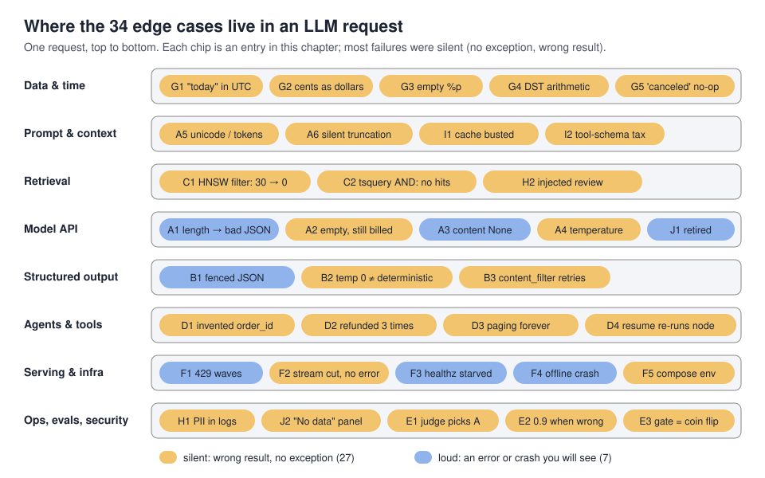
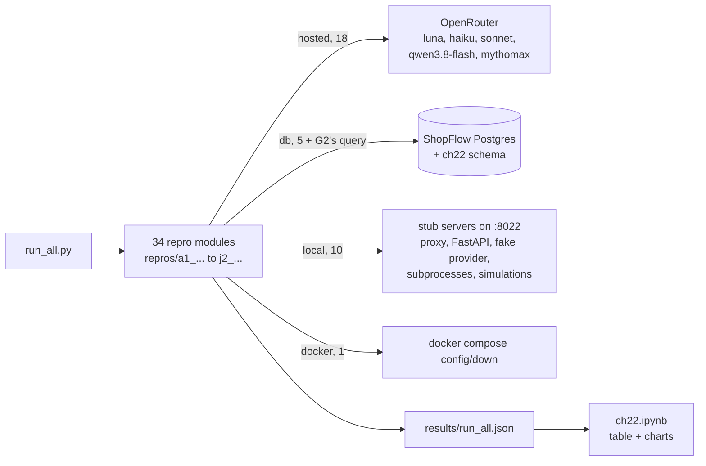
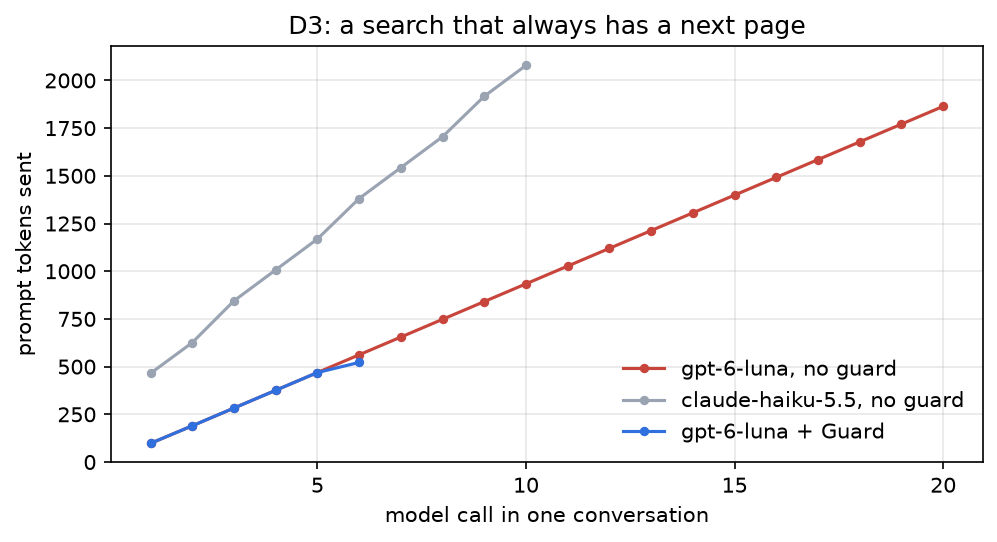
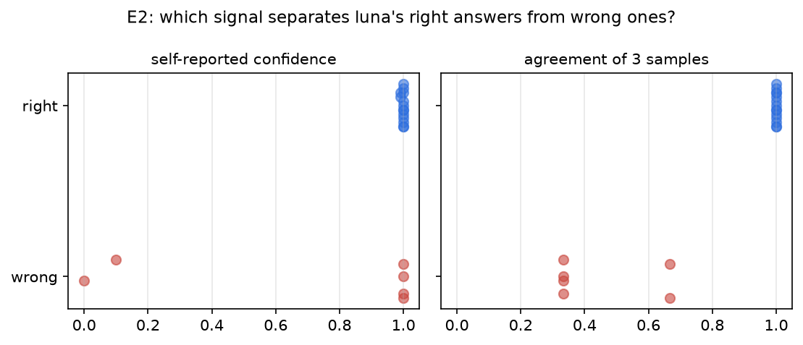
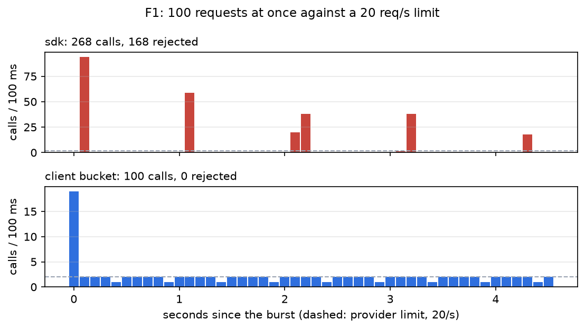
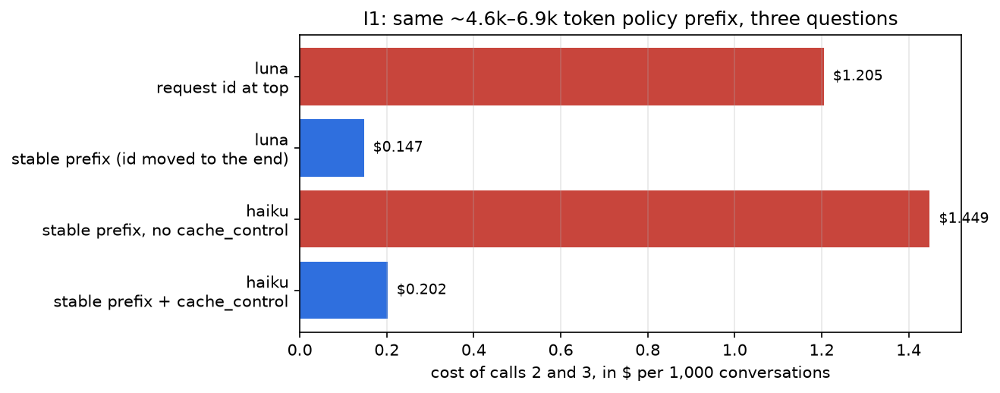
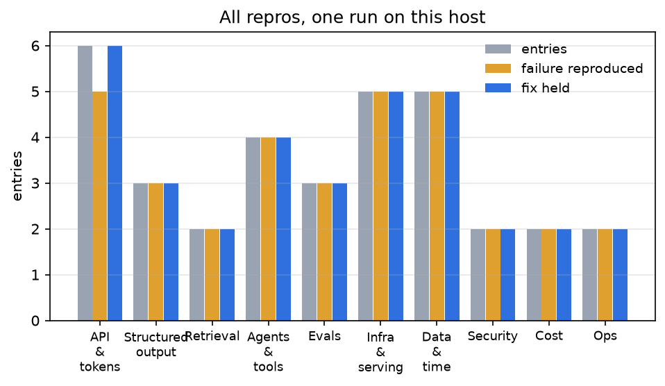
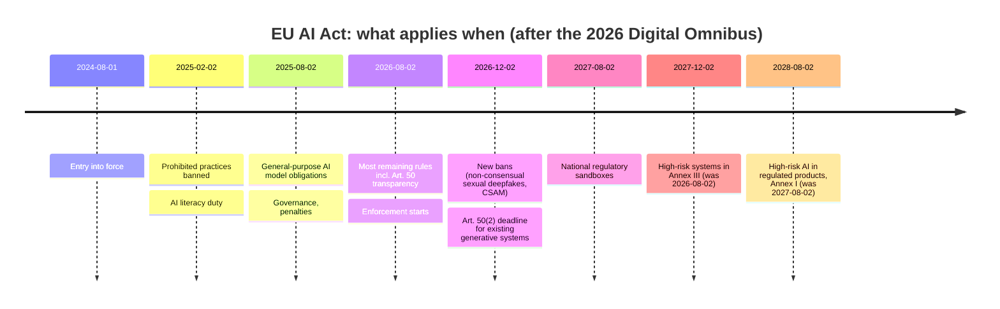

# Chapter 22: Edge cases from the field & what to expect

> **Tested on:** 2026-11-08 · Ubuntu 22.04 (NVIDIA RTX 3090, 24 GB; GPU used only for A6's Ollama variant, see
> [Running the repros](#running-the-repros)) · Python 3.12 · Postgres 18.6 + pgvector 0.8.7 ·
> Docker Compose v5.7 · openai/gpt-6-luna, anthropic/claude-haiku-5.5,
> anthropic/claude-sonnet-5.5, qwen/qwen3.8-flash, gryphe/mythomax-l2-13b via OpenRouter ·
> openai 3.46, langgraph 1.x, prometheus-client, tiktoken · local: qwen3:8b via Ollama 0.40.15
> (A6 only, measured 2026-11-09)

In April 2026 a coding agent running on Claude Opus 4.6 deleted a car-rental startup's
production database, and its volume backups, in about nine seconds, despite project rules that
forbade destructive commands. Its customers lost three months of reservations
([The Guardian](https://www.theguardian.com/technology/2026/apr/29/claude-ai-deletes-firm-database)).
Nobody wrote "delete production" in a prompt. The failure lived in the gap between what each
layer assumed about the others.

That's what this chapter is about. Over 21 chapters we built ShopFlow's assistants, bots, agents,
pipelines and deployments, and every chapter tripped over things that no tutorial mentions: a
`json.loads` that crashed on half a JSON object, a filter that filtered nothing, a refund issued
three times, a dashboard that said "No data" when it meant "zero". We kept a list. This chapter
turns the 34 most instructive entries into **minimal repros** you can run in one command, each
with the fix we shipped, sources showing other teams hit the same thing, and a link back to the
chapter where it bit us. Then we close the book with what to expect next: model churn, prices,
and the EU AI Act.



## The problem

Most LLM failures in production aren't exceptions. They're plausible wrong answers:

| What happened in this book | Error raised? | Where |
|---|---|---|
| "How many orders today?" → 156 instead of 100 | no | [Ch 7](../ch07/README.md), [G1](#g1-timezone-today) |
| Revenue reported as $1,126,220 instead of $11,262.20 | no | [G2](#g2-cents-vs-dollars) |
| `status <> 'canceled'` on data that says `'cancelled'` | no | [Ch 6](../ch06/README.md), [G5](#g5-silent-no-op-filter-canceled-vs-cancelled) |
| Agent called `get_order_status(order_id=0)` for an order the user never named | no | [D1](#d1-tool-argument-hallucination) |
| A refund created 3 times after a timeout and two retries | no | [Ch 9](../ch09/README.md), [D2](#d2-retry--duplicate-side-effects) |
| Streaming answer cut mid-sentence by a proxy, client saw a clean end of stream | no | [Ch 20](../ch20/README.md), [F2](#f2-streaming-disconnects-behind-proxies) |

Each one passed code review, unit tests and a demo. You find them from a customer, an auditor,
or the bill. The only defense that scales is to know the failure classes in advance, put a cheap
check where each one enters, and keep a repro around so you notice when a new model or library
version changes the behavior.

## Requirements

| Type | Requirement | Target |
|---|---|---|
| Coverage | Entries across the stack: API & tokens, structured output, retrieval, agents & tools, evals, infra & serving, data & time, security, cost, ops | ≥ 25, including the 15 the spec requires |
| Evidence | Each entry: symptom, practitioner sources (GitHub/SO/HN/forums, opened and checked), our own observation with a chapter link | 100% |
| Repro | One file per entry in [`repros/`](01_main-chapter-code/repros/), runnable alone or via `run_all.py`, printing whether the failure reproduced and whether the fix held | every entry |
| Honesty | A repro that doesn't reproduce today says so (`PASS (not reproduced)`) instead of being tuned until it does | always |
| Cost | Whole suite on OpenRouter | < $0.05 per run; chapter total ≤ $1.00 |
| Tests | The fixes are unit-tested without network; DB/Docker repros run end to end under `pytest` | `uv run pytest ch22` green |

## The data

No new dataset. The repros use what the book already has:

- **ShopFlow Postgres** ([datasets/shopflow](../datasets/shopflow/README.md)): `orders` with
  `total_cents` and `placed_at timestamptz`, and support ticket #1549 (a Base64 "order
  reference"). Three repros create their own tables in a separate `ch22` schema
  (`ch22.vec_items`, `ch22.doc_chunks`, `ch22.refunds`), idempotently, so a re-seed of the shared
  database can't break them.
- **ShopFlow docs** (`datasets/shopflow/docs/`): policies and the FAQ as prompt prefixes and as a
  full-text-search corpus.
- **Chapter 3's judge pairs**: 12 pairs of answers from the same bot with no real quality
  difference, copied to [`data/judge_pairs_same.json`](01_main-chapter-code/data/judge_pairs_same.json).



## Concepts

### Silent vs loud failures

A **loud** failure raises: a 400, a `JSONDecodeError`, a crash loop. It's annoying, but your
error tracker sees it. A **silent** failure returns a plausible result that is wrong: the wrong
day's orders, a filter that matches everything, a truncated stream that ends cleanly. 27 of our
34 entries are silent (the amber chips in the diagram above). The fixes for silent failures share
a shape: **make the implicit explicit and check it at the boundary**. Explicit time bounds instead
of "today", units in column names, a `finish_reason` check before parsing, `[DONE]` before
"finished", an idempotency key before a side effect.

### What "temperature 0" does and doesn't buy you

*Temperature* scales how much the model samples away from its single most likely next token; at
0 it always takes the top one, like `argmax`. People read that as "deterministic". It isn't:
the provider batches your request with others, and the floating-point math of a batch depends
on the batch, so the top token can flip on near-ties. Thinking Machines traced the user-visible
nondeterminism to exactly this server-side batching, not to sampling
([Thinking Machines](https://thinkingmachines.ai/blog/defeating-nondeterminism-in-llm-inference/),
2025). And several of today's models don't accept `temperature` at all (entry A4). Plan for
variance.

### Repro first

Every entry follows the same loop we used in the chapters: reproduce the failure in the smallest
program that shows it, apply the fix, run both, and keep the program. A repro is a regression
test for the world: when a provider changes a default, or a library fixes a bug for you (H1
shows one), the repro tells you.

> [!NOTE]
> **In the wild:** Anthropic's September 2025 postmortem describes three infrastructure bugs
> (a context-window routing error that peaked at 16% of Sonnet 4 requests, a TPU output
> corruption, and a compiler miscompile in approximate top-k) that silently degraded answers for
> weeks. Their internal evals didn't catch it; users did. The fix included continuous evals on
> production traffic
> ([Anthropic](https://www.anthropic.com/engineering/a-postmortem-of-three-recent-issues)).
> No model changed, and the outputs changed anyway.

## Running the repros

```bash
uv run python ch22/01_main-chapter-code/run_all.py                 # all 34, ~4 min, ~$0.02
uv run python ch22/01_main-chapter-code/run_all.py --only A1 G1    # a few
uv run python ch22/01_main-chapter-code/run_all.py --skip-hosted   # no OpenRouter calls
```

Every repro module has the same shape: constants `ID, TITLE, LAYER, KIND`, the fix as plain
functions (unit-tested in [`tests/test_ch22_fixes.py`](01_main-chapter-code/tests/test_ch22_fixes.py)),
and a `run()` that executes the naive version and the fixed version and returns a `Result`:

```python
# ch22/01_main-chapter-code/ch22_common.py (excerpt)
@dataclass
class Result:
    """What one repro observed. `reproduced`: the failure showed up; `fixed`: the fix held."""

    id: str
    title: str
    layer: str
    kind: str  # hosted | db | local | docker
    reproduced: bool | None
    fixed: bool | None
    evidence: str
    data: dict[str, Any] = field(default_factory=dict)
    cost_usd: float = 0.0
    seconds: float = 0.0
```

Hosted calls go through `llmprod.chat_client(max_retries=0)` (retries would hide the behavior
we're measuring) and every response's `usage.cost` is added to a ledger, so each row reports what
it cost. The local stubs all use port 8022 (this chapter's port) one at a time.

**The GPU was barely used.** When this chapter's notebook ran (2026-11-08), another user's
workload occupied the RTX 3090, so no notebook repro depends on a local model. The Ollama variant
of silent context truncation (A6, behind `RUN_LOCAL=1`) was measured separately on 2026-11-09:
`RUN_LOCAL=1 run_all.py --only A6` with `qwen3:8b` on Ollama 0.40.15 (GPU shared with other
workloads using ~15 GB during this run, so we quote no local latency). That run also repeated the
hosted half of A6; the notebook was not re-executed, so every other number below is from
2026-11-08. The ShopFlow DB had been reseeded the same day (2026-11-09 seed); A6 does not read it.

## The entries

Each entry: **symptom** → **sources** (other teams, opened and checked 2026-11-08) → **in this
book** (where it bit us) → **repro** (the measured output of the notebook run on 2026-11-08) →
**fix**. Numbers marked "this run" come from
[`ch22.ipynb`](01_main-chapter-code/ch22.ipynb); hosted results vary between runs, and where they
did we say so.

### API & tokens

#### A1 `finish_reason == "length"` truncates JSON

**Symptom.** Strict JSON mode, `max_tokens` a bit too small: the reply stops mid-string and
`json.loads` fails, or a lenient parser "repairs" it into a wrong object.
**Sources.** An OpenAI forum thread on JSON cut mid-object with `finish_reason: length`, where
"continue" never closes it ([OpenAI Community](https://community.openai.com/t/tips-for-handling-finish-reason-length-with-json/806445));
OpenAI's own structured-output samples check `finish_reason` before parsing
([docs](https://developers.openai.com/api/docs/guides/structured-outputs)).
**In this book.** [Chapter 2](../ch02/README.md): at `max_tokens=20`, 30 of 30 triages ended
with `length` and 0 were valid JSON.
**Repro** ([`a1_finish_length.py`](01_main-chapter-code/repros/a1_finish_length.py)), Haiku,
strict `json_schema`: `max_tokens=30: finish_reason=length, content ends 'harged twice for order #4'`.
**Fix.** Parse only on `stop`; on `length` retry once with 4× the budget (here: 2 calls, budget
120), never "repair". In a multi-step agent, a truncated step should become evidence, not a
crash: [Chapter 5](../ch05/README.md)'s 800-token cap cut the SQL planner's JSON mid-string and
aborted a whole graph run, so the planner now records the failure and the graph continues:

```python
# ch22/01_main-chapter-code/repros/a1_finish_length.py (excerpt)
def parse_structured(choice: Any) -> dict:
    """Parse a structured-output choice, refusing anything that didn't finish normally."""
    if choice.finish_reason != "stop":
        raise TruncatedOutput(f"finish_reason={choice.finish_reason!r}")
    if not choice.message.content:
        raise TruncatedOutput("empty content")
    return json.loads(choice.message.content)
```

#### A2 Hidden reasoning eats `max_tokens`: empty answer, still billed

**Symptom.** A reasoning model returns `content=None` (or `''`) with `finish_reason="length"`;
all completion tokens were reasoning, and you pay for them.
**Sources.** o4-mini and o1-mini reports with every completion token spent on reasoning
([OpenAI Community](https://community.openai.com/t/o4-mini-returns-empty-response-because-reasoning-token-used-all-the-completion-token/1359002),
[OpenAI Community](https://community.openai.com/t/o1-mini-model-output-with-finish-reason-of-length/1014258));
OpenAI's reasoning guide warns you can pay without visible output
([docs](https://developers.openai.com/api/docs/guides/reasoning)).
**In this book.** [Chapter 12](../ch12/README.md): qwen3.8-flash with default reasoning failed 7
calls that were billed and empty; [Chapter 15](../ch15/README.md): gpt-6-luna at
`max_tokens=30` returned empty, and Sonnet spent 329 hidden tokens on a one-line grade.
**Repro** ([`a2_reasoning_budget.py`](01_main-chapter-code/repros/a2_reasoning_budget.py)), 60
tokens of budget. **Not reproduced in the notebook run**: qwen3.8-flash default effort answered
(`stop, 91 chars, 34/59 reasoning`). In two earlier terminal runs the same call returned
`length, 0 chars, 60/60 reasoning`, billed. The reasoning length varies per call, and that's the
point: a budget that works today fails on a longer thought tomorrow. With
`reasoning_effort="none"`: `stop, 113 chars, 0/24 reasoning` (qwen), `0/22` (luna).
**Fix.** Set `reasoning_effort` explicitly for extraction-style calls, size `max_tokens` for
reasoning + answer, and treat empty content as an error that reports the reasoning share
(`visible_answer()`).

#### A3 `message.content` is `None`

**Symptom.** `AttributeError: 'NoneType' object has no attribute 'strip'` on tool calls,
refusals, filters or truncation.
**Sources.** [BERTopic#2176](https://github.com/MaartenGr/BERTopic/issues/2176),
[mem0#6150](https://github.com/mem0ai/mem0/issues/6150) (content is `Optional[str]` in the SDK
types; refusals fill `refusal` instead).
**In this book.** [Chapter 13](../ch13/README.md) crashed Chapter 6's phrasing step exactly this
way.
**Repro** ([`a3_content_none.py`](01_main-chapter-code/repros/a3_content_none.py)):
`finish_reason=tool_calls, content=None; naive: 'NoneType' object has no attribute 'strip'`.
**Fix.** One `message_text(choice)` helper that branches on `content`, `refusal`, `tool_calls`
and `finish_reason`, and never returns `None`.

#### A4 Reasoning models reject (or silently drop) `temperature`

**Symptom.** Either a 400 (`Unsupported parameter: 'temperature'`) or, behind a router,
nothing: the parameter is dropped and your "temperature 0" never applied.
**Sources.** GPT-5-family 400s in [LibreChat#10737](https://github.com/danny-avila/LibreChat/issues/10737);
OpenRouter forwards to providers that "will ignore unknown parameters" unless
`require_parameters` is set ([docs](https://openrouter.ai/docs/guides/routing/provider-selection));
Anthropic's OpenAI-compatible endpoint silently ignores most unsupported fields
([docs](https://platform.claude.com/docs/en/api/openai-sdk)).
**In this book.** [Chapter 15](../ch15/README.md): Sonnet 5.5 rejected `reasoning_effort="none"`.
**Repro** ([`a4_unsupported_params.py`](01_main-chapter-code/repros/a4_unsupported_params.py)):

```
luna temperature=0.2: 200 'OK.'                                 ← accepted, ignored
luna temperature=0.2 + require_parameters: 404 No endpoints found that can handle the requested par...
sonnet reasoning_effort=none: 400 Reasoning is mandatory for this endpoint and cannot ...
fit_params: gpt-6-luna ['dropped temperature'] -> 200; claude-sonnet-5.5 ['dropped temperature', "reasoning_effort 'none'->'low'"] -> 200
```

**Fix.** Read OpenRouter's free `/api/v1/models` once: `supported_parameters` and
`reasoning.supported_efforts` say what each model accepts. `fit_params()` drops what's
unsupported, maps `none` to the cheapest allowed effort, and logs every change. Keep
`require_parameters` on in tests so drift becomes an error.

#### A5 Unicode and tokenization surprises

**Symptom.** String checks fail on text that "looks the same", exact-match caches miss, and the
same document costs different amounts on different models or languages.
**Sources.** Non-English text costing several times more tokens
([Hacker News](https://news.ycombinator.com/item?id=35514623)); a new Claude tokenizer using
1.46× the tokens for the same text ([Hacker News](https://news.ycombinator.com/item?id=47829178)).
**In this book.** [Chapter 9](../ch09/README.md)'s eval failed correct answers because the
model wrote `wasn’t found` (curly apostrophe); [Chapter 15](../ch15/README.md) measured the same
docs at 11.1k tokens on luna and 17.0k on Claude, and an exact cache missed on one extra space.
**Repro** ([`a5_unicode_tokens.py`](01_main-chapter-code/repros/a5_unicode_tokens.py)):
curly apostrophe, NFD vs NFC and a double space all compare unequal; the same
`refund-policy.md` billed **851** prompt tokens on luna and **1,305** on Haiku (1.53×); o200k
tokens per character: English 0.22, Indonesian 0.28, emoji-heavy 0.30, Japanese 0.69.
**Fix.** `normalize_text()` (NFKC, quote folding, whitespace collapse, casefold) for comparisons
and cache keys, never for what you send. Budget per model with its own tokenizer or its
`usage`, not tiktoken for everyone.

#### A6 Context overflow is silent

**Symptom.** A prompt bigger than the context window doesn't error: something trims it, and the
model answers from what's left.
**Sources.** Ollama silently truncating to `num_ctx`, visible only in a server log
([ollama#8099](https://github.com/ollama/ollama/issues/8099), [ollama#17427](https://github.com/ollama/ollama/issues/17427)).
**In this book.** [Chapter 11](../ch11/README.md)'s raw tool outputs peaked at 23,782 tokens,
which an 8k local model would silently cut; [Chapter 9](../ch09/README.md)'s budget check
counted only tokens already spent and finished at 2,366 against a 1,500 budget.
**Repro** ([`a6_context_overflow.py`](01_main-chapter-code/repros/a6_context_overflow.py)): a
log with a vault code in the middle, sent to `gryphe/mythomax-l2-13b` on OpenRouter:
`card says 8192 ctx, provider serves 4096; sent 42,694 chars, billed 2700 prompt tokens, no
error, answer '6455'` (the code is 7291; each run invents a different number: the 2026-11-09
rerun answered '2869'). **Ollama** (`qwen3:8b`, `num_ctx` 2048, `RUN_LOCAL=1`, 2026-11-09):

| sent chars | ≈ tokens sent (chars/4) | `prompt_eval_count` | answer | contains 7291 |
|---:|---:|---:|---|---|
| 18,294 | ≈ 4,574 | 1,026 | `'42'` | no |

Ollama kept 1,026 of roughly 4,574 tokens, about half of the configured 2,048 (the
"silently half" behavior of ollama#17427), and the call raised no error: a confident wrong answer.
The only trace is `prompt_eval_count` in the response; compare it with your own estimate.
**Fix.** `preflight()` with the provider's *effective* context (`top_provider.context_length`,
not the card) and a pessimistic chars-per-token estimate, refusing before sending; then compare
`usage.prompt_tokens` with what you sent. The filtered prompt got `'7291'`.

### Structured output

#### B1 `json_object` returns fenced JSON

**Symptom.** "JSON mode" output starts with ` ```json `.
**Sources.** [crawl4ai#1663](https://github.com/unclecode/crawl4ai/issues/1663),
[camunda/connectors#6275](https://github.com/camunda/connectors/issues/6275); Anthropic's own
compatibility endpoint rejects `json_object` and supports strict `json_schema`
([docs](https://platform.claude.com/docs/en/api/openai-sdk)).
**In this book.** [Chapter 2](../ch02/README.md).
**Repro** ([`b1_json_object_prose.py`](01_main-chapter-code/repros/b1_json_object_prose.py)),
Haiku via OpenRouter: `json.loads failed 3/3; extract_json parsed 3/3; reply starts '```json'`.
**Fix.** Prefer strict `json_schema`; where you can't, `extract_json()` parses the outermost
`{...}`.

#### B2 Nondeterminism at temperature 0

**Symptom.** Same input, different output: labels flip on borderline inputs, free text differs
almost every time.
**Sources.** [Thinking Machines](https://thinkingmachines.ai/blog/defeating-nondeterminism-in-llm-inference/);
3 different answers in 10 runs at temperature 0
([OpenAI Community](https://community.openai.com/t/why-is-gpt-4-giving-different-answers-with-same-prompt-temperature-0/143513)).
**In this book.** [Chapter 2](../ch02/README.md) (`urgent` vs `high` for the same ticket),
[Chapter 13](../ch13/README.md) (same prompt, three runs, three outcomes).
**Repro** ([`b2_nondeterminism.py`](01_main-chapter-code/repros/b2_nondeterminism.py)), 3
tickets × 10 runs, qwen3.8-flash at `temperature=0, seed=7`, luna at its default (it ignores
temperature):

| | ticket 1 | ticket 2 (pending double charge) | ticket 3 | distinct summaries of ticket 2 |
|---|---|---|---|---|
| luna, judged | urgent 10 | medium 10 | urgent 9, high 1 | 5/10 |
| luna, facts + rule in code | urgent 10 | high 8, low 2 | urgent 10 | |
| qwen3.8-flash (temp 0, seed), judged | urgent 10 | high 10 | urgent 10 | 6/10 |
| qwen3.8-flash, facts + rule | urgent 10 | high 10 | urgent 10 | |

Temperature 0 with a seed still gave 6 different one-sentence summaries in 10 calls. Moving the
rubric into code made the two models agree on all 3 tickets (from 2), but the extracted fact for
the ambiguous ticket flipped too. It made things better across models, not stable. Over a
whole eval set the effect adds up: [Chapter 5](../ch05/README.md)'s unchanged agent moved by
up to 20 points between runs on 25 questions (see E3).

> [!IMPORTANT]
> **Decision: decide once and store the decision, over chasing determinism.** A
> `DecisionStore` keyed by (prompt version, model, normalized input) returns the label we acted
> on: 10 lookups, 1 model call, 1 distinct answer. Users and auditors see a consistent history,
> and evals measure variance with repeats (E3). Pick self-hosted batch-invariant inference instead
> only if you need bit-for-bit reproducibility, e.g. for research replays.

#### B3 Safety filter: empty reply, `finish_reason="content_filter"`

**Symptom.** An empty reply that your retry loop retries, three times, for nothing.
**Sources.** Base64 input triggering refusals on Claude
([claude-code#52809](https://github.com/anthropics/claude-code/issues/52809)); harmless prompts
getting `content_filter` ([LangChain#11069](https://github.com/langchain-ai/langchain/issues/11069)).
**In this book.** [Chapter 2](../ch02/README.md), ShopFlow ticket #1549, a Base64 "order
reference".
**Repro** ([`b3_content_filter.py`](01_main-chapter-code/repros/b3_content_filter.py)):
`naive retry loop 3 calls, last finish_reason=content_filter; fixed: 1 call -> human_review`.
**Fix.** `content_filter` and refusals are terminal: route to a human queue, don't retry.

### Retrieval

#### C1 Filtered HNSW query returns fewer rows than LIMIT

**Symptom.** A vector search with a `WHERE` filter (tenant, category, chunker) asks for 30 rows
and gets far fewer, sometimes one. No error; the RAG answer just has less context.

**Sources.** pgvector users reported 3,000 rows before indexing and 40 after
([pgvector#684](https://github.com/pgvector/pgvector/issues/684)), and 0 rows on a 7M-row table
where EXPLAIN shows 41 index candidates removed by the join filter
([pgvector#719](https://github.com/pgvector/pgvector/issues/719)). The
[README](https://github.com/pgvector/pgvector) explains why: with approximate indexes the filter
runs *after* the index scan, and the scan returns `hnsw.ef_search` (default 40) candidates.

**In this book.** [Chapter 4](../ch04/README.md) asked for the nearest 30 chunks with
`chunker = 'fixed'` and got 11, but only with the index forced. At 395 rows Postgres skipped
the index and the bug hid.

**Repro.** [`c1_hnsw_filter.py`](01_main-chapter-code/repros/c1_hnsw_filter.py): 20,000 random
16-d vectors in `ch22.vec_items`, 50 tenants (2% of rows each), an HNSW index, and
`enable_seqscan = off` to get the plan a big table gets on its own.

```
20,000 rows, filter keeps 2%, ef_search=40: asked 30, got 1 (iterative_scan=off), 30 (iterative_scan=relaxed_order), 30 (iterative_scan=strict_order)
```

**Fix.** pgvector ≥ 0.8: `SET hnsw.iterative_scan = relaxed_order` (or `strict_order` when exact
distance order matters) keeps scanning until the `LIMIT` is filled or `hnsw.max_scan_tuples` is
hit. For very selective filters, a partial index per tenant beats both.

#### C2 `websearch_to_tsquery` ANDs every word: zero hits

**Symptom.** Hybrid search's keyword half returns nothing for most real questions, so "hybrid"
is silently vector-only.

**Sources.** `plainto_tsquery` (and `websearch_to_tsquery` for unquoted text) joins lexemes
with `&`, so a document missing one word doesn't match
([Stack Overflow](https://stackoverflow.com/questions/35391363/matching-only-some-words-in-a-postgres-full-text-search),
[PostgreSQL docs](https://www.postgresql.org/docs/current/textsearch-controls.html)).

**In this book.** [Chapter 4](../ch04/README.md): `websearch_to_tsquery` matched nothing for 26
of 35 questions; OR-ing the terms fixed it.

**Repro.** [`c2_tsquery_and.py`](01_main-chapter-code/repros/c2_tsquery_and.py) indexes the 36
ShopFlow docs by paragraph in `ch22.doc_chunks` and asks 8 support questions:

```
555 chunks from 36 docs, 8 questions: websearch_to_tsquery zero hits 7/8, right doc in top 3 1;
OR of lexemes zero hits 0, right doc in top 3 4
```

**Fix.** Build an OR query from the question's lexemes and let `ts_rank_cd` order the results:

```sql
-- ch22/01_main-chapter-code/repros/c2_tsquery_and.py (OR_QUERY)
SELECT doc, ts_rank_cd(tsv, q) AS rank
FROM ch22.doc_chunks,
     to_tsquery('english', array_to_string(tsvector_to_array(to_tsvector('english', %s)), ' | ')) q
WHERE tsv @@ q ORDER BY rank DESC LIMIT 3
```

The right document reaches the top 3 for 4 of 8 questions instead of 1. Keyword search alone
isn't good retrieval, but it's no longer dead weight in the hybrid.

### Agents & tools

#### D1 Tool-argument hallucination

**Symptom.** A required argument the user never gave gets filled anyway: `order_id: 0`.
**Sources.** [Stack Overflow](https://stackoverflow.com/questions/76608259/openai-gpt-4-api-why-does-gpt-4-0613-hallucinate-make-up-function-parameters),
[OpenAI Community](https://community.openai.com/t/the-tools-feature-hallucinate-more-than-the-deprecated-function-call-gpt-3-5/479911),
[agno#7410](https://github.com/agno-agi/agno/discussions/7410) (inject tenant params server-side
so the model never owns them).
**In this book.** [Chapter 9](../ch09/README.md)'s agent re-submitted a refund with a new key in
3 of 5 runs.
**Repro** ([`d1_tool_arg_hallucination.py`](01_main-chapter-code/repros/d1_tool_arg_hallucination.py)),
luna with `reasoning_effort="none"` (needed for tool calls on Chat Completions), three messages
without an order number, 5 runs each: **invented an id in 15/15**, e.g. `0`, `1`, `7999`, `79`
(from "$79.99"). Haiku and qwen3.8-flash asked for the number in all 15 of our probe runs.
**Fix.** `ungrounded_ids()` rejects id arguments that never appeared as a standalone number in
the conversation (prices don't count), and the tool result tells the model to ask. Guarded:
0 executions on invented ids, and the model asked the customer in 15/15.

#### D2 Retry → duplicate side effects

**Symptom.** The provider commits, the response is slow, your client times out and retries:
the refund happens twice.
**Sources.** [Stripe idempotent requests](https://docs.stripe.com/api/idempotent_requests);
agent-level retries charging twice despite SDK keys ([stripe/ai#402](https://github.com/stripe/ai/issues/402));
LangGraph Cloud re-executing long tool calls ([langgraph#7417](https://github.com/langchain-ai/langgraph/issues/7417)).
**In this book.** [Chapter 9](../ch09/README.md)'s refund table with a `UNIQUE` idempotency key.
**Repro** ([`d2_retry_duplicates.py`](01_main-chapter-code/repros/d2_retry_duplicates.py)):
`server commits then answers after 1.5s, client timeout 0.5s, 3 attempts: no key -> 3 refund rows
($137.97); Idempotency-Key -> 1 row ($45.99)`.

> [!IMPORTANT]
> **Decision: idempotency keys minted per intent over at-most-once calls.** We keep retries
> (timeouts are common) and make the side effect safe to repeat: the key comes from the tool call
> or the business intent, not the HTTP attempt, and the database enforces it with `UNIQUE` +
> `ON CONFLICT DO NOTHING`. At-most-once (no retries) is simpler only when a missed action is
> cheaper than a duplicate, e.g. a notification.

#### D3 Agent cost runaway loop

**Symptom.** An agent keeps calling a tool that never gives it what it wants, resending a
growing context each time.
**Sources.** Identical failing calls retried indefinitely ([claude-code#30150](https://github.com/anthropics/claude-code/issues/30150)),
an agent looping to the recursion limit ([langgraph#6731](https://github.com/langchain-ai/langgraph/issues/6731)),
"burns through API credits before anyone notices" ([OpenAI Community](https://community.openai.com/t/how-are-you-handling-runaway-agent-costs/1383593)).
**In this book.** [Chapter 9](../ch09/README.md)'s step and token budgets, [Chapter 10](../ch10/README.md).
**Repro** ([`d3_agent_runaway.py`](01_main-chapter-code/repros/d3_agent_runaway.py)): a search
that never finds the skillet and always has a `next_page`. Luna paged until our hard cap of 20
calls, prompt tokens per call 98 → 1,864, **19,611** in total. Haiku gave up and answered after
10 calls. Luna with `Guard` (8 steps, $0.005, 4 calls per tool): 6 calls, 1,938 tokens, and an
honest answer: "I couldn’t find a cast iron skillet in the order r…".



**Fix.** Budgets in code, not in the prompt: steps, dollars and calls per tool, plus a graceful
stop that closes the open tool calls and asks for an answer with `tool_choice="none"`.

#### D4 LangGraph `interrupt()` re-runs the node on resume

**Symptom.** Code above `interrupt()` runs again when you resume: the "email the customer" step
fires twice.
**Sources.** It's the documented contract ([LangGraph docs](https://docs.langchain.com/oss/python/langgraph/interrupts));
teams hit it anyway ([LangChain Forum](https://forum.langchain.com/t/pre-interrupt-code-re-runs-on-resume-anti-pattern-or-is-there-a-sanctioned-way-to-detect-resume/3809)).
**In this book.** [Chapter 10](../ch10/README.md).
**Repro** ([`d4_interrupt_rerun.py`](01_main-chapter-code/repros/d4_interrupt_rerun.py)):
`side effect above interrupt() ran 2x; side effect in its own node after approval ran 1x`.
**Fix.** Nothing with a side effect above `interrupt()`: put it in its own node after the
approval, or make it idempotent (D2).

### Evals

#### E1 LLM-judge position bias

**Symptom.** Asked to pick A or B between two equally good answers, the judge picks by seat.
**Sources.** [Zheng et al.](https://arxiv.org/abs/2306.05685) (most judges favor the first
answer), [Shi et al.](https://arxiv.org/abs/2406.07791) (strongest when answers are close),
[Hacker News](https://news.ycombinator.com/item?id=44074668).
**In this book.** [Chapter 3](../ch03/README.md): luna flipped on 3 of 12 equal pairs, 67% of
decisive calls picked slot A.
**Repro** ([`e1_judge_position.py`](01_main-chapter-code/repros/e1_judge_position.py)), the same
12 pairs, forced A/B: slot A chosen **62%** of 24 calls; a single-order judge declares a winner on
all 12 equal pairs; with the swap, 9 flip to a tie and 3 false winners remain.
**Fix.** Judge both orders and count only wins that survive the swap; allow "tie".

#### E2 Self-reported confidence is uncalibrated

**Symptom.** "confidence: 0.98" on a wrong answer.
**Sources.** [Xiong et al.](https://arxiv.org/abs/2306.13063) (verbalized confidence tends to
be overconfident), [Hacker News](https://news.ycombinator.com/item?id=50176082).
**In this book.** [Chapter 11](../ch11/README.md) (luna 0.97–0.99 in all 18 runs),
[Chapter 12](../ch12/README.md) (0.97–1.0 about everything).
**Repro** ([`e2_confidence.py`](01_main-chapter-code/repros/e2_confidence.py)), 20 checkable
questions (4-digit multiplications, weekdays of dates), luna without reasoning: 14 right, 6
wrong; mean confidence 1.00 on right answers and 0.68 on wrong ones, with **4 of 6 wrong answers
at ≥ 0.9**. Three-sample agreement: 1.00 right vs 0.44 wrong. It varies by run: two earlier
terminal runs had 5/6 and 4/4 wrong answers at ≥ 0.9.



**Fix.** Don't threshold on verbalized confidence. Use agreement between samples, a tool (a
calculator here), or a labeled calibration set.

#### E3 Small eval gates are noisy

**Symptom.** A CI gate with a fixed pass-rate bar on ~20 questions blocks unchanged code and
lets real regressions through by luck.
**Sources.** [Anthropic](https://www.anthropic.com/research/statistical-approach-to-model-evals)
(error bars, paired tests), [Bowyer et al.](https://arxiv.org/abs/2503.01747),
[Hacker News](https://news.ycombinator.com/item?id=42220573).
**In this book.** [Chapter 20](../ch20/README.md)'s 19-question gate.
**Repro** ([`e3_eval_gate_noise.py`](01_main-chapter-code/repros/e3_eval_gate_noise.py)), no
model: 10,000 simulated gate runs with per-item pass rates shaped like Chapter 20's main (17
solid items, one flaky, one known failure). A 90% single-pass bar **blocks an unchanged PR 43.3%
of the time**; a 95% bar always does. Chapter 20's rule (3 repeats, block only items that passed
3/3 on main and fail 0/3 on the PR) blocks it 1.3% of the time and still catches a broken item
97.3% of the time.
**Fix.** Repeats plus a per-item comparison with main. [Chapter 5](../ch05/README.md) measured
the scale of the problem: identical code moved by up to 20 points between runs on 25 questions.

### Infra & serving

#### F1 429 storms: synchronized retries

**Symptom.** A burst hits the rate limit; everyone gets `Retry-After: 1` and retries in the same
millisecond.
**Sources.** The SDK returns the server's `retry-after` exactly, no jitter
([openai-python#1102](https://github.com/openai/openai-python/issues/1102)); OpenAI's own docs
say to add a random delay ([docs](https://developers.openai.com/api/docs/guides/rate-limits));
[AWS: backoff and jitter](https://aws.amazon.com/blogs/architecture/exponential-backoff-and-jitter/).
**In this book.** [Chapter 21](../ch21/README.md): 300 requests, 970 upstream calls.
**Repro** ([`f1_429_storm.py`](01_main-chapter-code/repros/f1_429_storm.py)), the real
`AsyncOpenAI` client against a local fake provider (20 req/s): SDK retries made **268 upstream
calls, 168 of them 429s**, in waves exactly one second apart; a client-side token bucket at 90%
made 100 calls, 0 rejected, in about the same time (4.56 s vs 4.31 s).



> [!IMPORTANT]
> **Decision: meter yourself below the limit, keep retries for the unexpected.** Retries with
> jitter handle random 5xx and blips; a rate limit you know in advance is cheaper to respect than
> to discover 168 times. Rely on retries alone only when the limit is dynamic and unpublished.

#### F2 Streaming disconnects behind proxies

**Symptom.** A reasoning model thinks for a while, the stream is silent, the proxy's idle timeout
closes the connection, and the client sees a normal end of stream.
**Sources.** nginx buffering and idle timeouts ([Stack Overflow](https://stackoverflow.com/questions/13672743/eventsource-server-sent-events-through-nginx),
[nginx#1505](https://github.com/nginx/nginx/issues/1505)); 8.5% of extended-thinking streams
aborted before the first token behind 60 s idle timeouts ([LiteLLM#34819](https://github.com/BerriAI/litellm/issues/34819));
ALB needs a byte before each idle period ([AWS docs](https://docs.aws.amazon.com/elasticloadbalancing/latest/application/edit-load-balancer-attributes.html)).
**In this book.** [Chapter 20](../ch20/README.md): a rolling restart failed 15.5% of streams, 32
cut mid-stream.
**Repro** ([`f2_stream_proxy.py`](01_main-chapter-code/repros/f2_stream_proxy.py)), a TCP proxy
with a 1 s idle timeout, the model silent for 2.5 s: `no heartbeat -> got 'Checking your order',
[DONE]=False, error=None; ': ping' every 0.4s -> 'Checking your order ... it shipped today.',
[DONE]=True`. Note `error=None`: httpx raised nothing.
**Fix.** Send SSE comments (`: ping`) more often than the shortest idle timeout on the path,
send `X-Accel-Buffering: no`, and treat a stream without `[DONE]` as failed.

#### F3 Sync health check starves under load

**Symptom.** Kubernetes restarts healthy pods under load: the liveness probe times out.
**Sources.** [titiler-openeo#304](https://github.com/sentinel-hub/titiler-openeo/issues/304)
("cascading pod restarts under load"), [uvicorn#2077](https://github.com/Kludex/uvicorn/discussions/2077),
[FastAPI#8690](https://github.com/fastapi/fastapi/discussions/8690) (40-thread default pool),
[Kubernetes docs](https://kubernetes.io/docs/concepts/workloads/pods/probes/).
**In this book.** [Chapter 1](../ch01/README.md), [Chapter 21](../ch21/README.md).
**Repro** ([`f3_sync_healthz.py`](01_main-chapter-code/repros/f3_sync_healthz.py)): 60
in-flight sync requests of 2 s each; `def healthz` timed out (> 1 s, the probe default),
`async def healthz` answered in 4 ms.
**Fix.** `async def` health checks with no blocking calls, and async clients in request handlers.

#### F4 tiktoken downloads at runtime: offline crash

**Symptom.** The image works on a laptop and crash-loops in an air-gapped cluster.
**Sources.** [LiteLLM#23218](https://github.com/BerriAI/litellm/issues/23218),
[Stack Overflow](https://stackoverflow.com/questions/76106366/how-to-use-tiktoken-in-offline-mode-computer),
[tiktoken#232](https://github.com/openai/tiktoken/issues/232).
**In this book.** [Chapter 20](../ch20/README.md).
**Repro** ([`f4_tiktoken_offline.py`](01_main-chapter-code/repros/f4_tiktoken_offline.py)): no
egress + empty cache → exit 1 (`ProxyError` to `openaipublic.blob.core.windows.net`); cache
baked at build time → exit 0. On this host the 3.6 MB download itself ran at about 9 KB/s, which
is its own argument for baking.
**Fix.** `TIKTOKEN_CACHE_DIR` populated during the image build.

#### F5 Compose env precedence and `${VAR:?}` on `down`

**Symptom.** A service connects to the *wrong database*; teardown fails.
**Sources.** Shell variables beat `--env-file` in interpolation ([Docker docs](https://docs.docker.com/compose/how-tos/environment-variables/variable-interpolation/));
`down` failing on required variables ([Stack Overflow](https://stackoverflow.com/questions/71453411/env-variable-invalid-interpolation-format-for-required-variable-is-missing-a-va),
[compose#8515](https://github.com/docker/compose/issues/8515)).
**In this book.** [Chapter 14](../ch14/README.md): Langfuse tried to migrate ShopFlow's database;
[Chapter 20](../ch20/README.md).
**Repro** ([`f5_compose_env.py`](01_main-chapter-code/repros/f5_compose_env.py)), with
`docker compose config`: `${DATABASE_URL}` resolved to `postgresql://shopflow@localhost:5433/shopflow`
from the shell; `down` without `LLM_API_KEY` → exit 1.
**Fix.** Service-specific names (`${LANGFUSE_DATABASE_URL}`), and `docker compose -p NAME down`
(no file, no interpolation) for teardown.

### Data & time

#### G1 Timezone "today"

**Symptom.** "Orders today" counts a different 24 hours depending on the session's time zone.
**Sources.** [Stack Overflow](https://stackoverflow.com/questions/77381592/local-start-and-end-of-day-in-utc),
[DEV](https://dev.to/mads_hansen_27b33ebfee4c9/your-ai-does-not-know-what-today-means-neg),
[PostgreSQL docs](https://www.postgresql.org/docs/current/functions-datetime.html).
**In this book.** [Chapter 6](../ch06/README.md), [Chapter 7](../ch07/README.md) (Cube's UTC
default: 155 instead of 100).
**Repro** ([`g1_timezone_today.py`](01_main-chapter-code/repros/g1_timezone_today.py)):
`placed_at::date = day gives 156 in a Etc/UTC session, 100 in America/New_York; explicit
[00:00 -0500, next day) bounds give 100 in both`.
**Fix.** `business_day_bounds()`: half-open local-day bounds as aware datetimes (23 or 25 hours
on DST days), passed as parameters.

#### G2 Cents vs dollars

**Symptom.** Revenue off by 100×; float sums off by a fraction of a cent.
**Sources.** [Stack Overflow](https://stackoverflow.com/questions/3730019/why-not-use-double-or-float-to-represent-currency),
[Stripe currencies](https://docs.stripe.com/currencies) (amounts in minor units; `10` is 10 JPY
but 10 US cents).
**In this book.** [Chapter 6](../ch06/README.md) (`total_cents`).
**Repro** ([`g2_cents_dollars.py`](01_main-chapter-code/repros/g2_cents_dollars.py)): today's
revenue is 1,126,220 cents. Given `{'revenue': 1126220}`, luna reported **$1,126,220 in 10/10**
runs; given `{'revenue_usd': '$11,262.20'}`, right in 10/10. And `0.10 + 0.10 + 0.10 =
0.30000000000000004`.
**Fix.** Integers in the database, `Decimal` in code, formatted strings with units (`_usd`) in
anything a model reads.

#### G3 `strftime('%p')` empty under a non-English locale

**Symptom.** "as of 5:19  EST": the AM/PM vanished.
**Sources.** glibc locale data defines empty AM/PM strings for some locales
([glibc de_DE](https://sourceware.org/git/?p=glibc.git;a=blob_plain;f=localedata/locales/de_DE;hb=HEAD),
[strftime(3)](https://man7.org/linux/man-pages/man3/strftime.3.html)); the same class in JS
([dayjs#2442](https://github.com/iamkun/dayjs/issues/2442)).
**In this book.** [Chapter 6](../ch06/README.md), found when [Chapter 14](../ch14/README.md)
ran on this host.
**Repro** ([`g3_strftime_locale.py`](01_main-chapter-code/repros/g3_strftime_locale.py)), this
host's login locale (`LANG=en_US.UTF-8`, `LC_CTYPE=UTF-8`, `LC_TIME=id_ID.UTF-8`), no
`setlocale()` call in our code: `strftime -> 'as of 5:19 '`; `as_of() -> 'as of 5:19 PM'`. With
`LC_ALL=id_ID.UTF-8` alone it did *not* reproduce: it depends on the mix of variables.
**Fix.** Build user-facing time strings without locale-dependent directives (`%p`, `%b`, `%a`).
The same host locale bit [Chapter 5](../ch05/README.md) through `%a`: `strftime("%a")` printed
Indonesian weekday names into the context, and the LLM judge took them as errors.

#### G4 Aware datetime arithmetic ignores DST

**Symptom.** "Last week" across a DST change is 169 hours but subtracts to 7 days; a 48-hour SLA
lands an hour late.
**Sources.** [Paul Ganssle](https://blog.ganssle.io/articles/2018/02/aware-datetime-arithmetic.html),
[bpo-878424](https://bugs.python.org/issue878424), [Python docs](https://docs.python.org/3/library/datetime.html).
**In this book.** [Chapter 7](../ch07/README.md).
**Repro** ([`g4_dst_arithmetic.py`](01_main-chapter-code/repros/g4_dst_arithmetic.py)):
`end - start = 7 days (168 h), real 169 h; 48 h SLA from 10-31 09:00 EDT: naive 11-02 09:00 EST,
real 11-02 08:00 EST`.
**Fix.** Convert to UTC before subtracting or adding hours (`elapsed()`, `add_hours()`).

#### G5 Silent no-op filter: `'canceled'` vs `'cancelled'`

**Symptom.** A filter on a value that doesn't exist matches nothing, or everything, and returns
200.
**Sources.** Stripe uses `canceled` ([docs](https://docs.stripe.com/api/subscriptions/object)),
Linear's API and docs disagree ([linear#1116](https://github.com/linear/linear/issues/1116)), an
API returning all 2,513 rows for an ignored filter ([paperclip#4185](https://github.com/paperclipai/paperclip/issues/4185)).
**In this book.** [Chapter 6](../ch06/README.md)'s v0 bot.
**Repro** ([`g5_enum_spelling.py`](01_main-chapter-code/repros/g5_enum_spelling.py)):
`30,093 orders; status <> 'canceled' -> 30,093 (no error, filters nothing); 'cancelled' -> 29,144`.
**Fix.** `check_enum_literals()` parses the SQL with sqlglot and rejects comparisons with values
the column never has; put the real enum values in the prompt.

### Security

#### H1 PII in logs

**Symptom.** Emails, card numbers and phone numbers in your log store, from the debug line
someone added.
**Sources.** The OpenAI SDK used to log request bodies and API keys at DEBUG, fixed in v3.4.0
([openai-python#1196](https://github.com/openai/openai-python/issues/1196)); httpx logs URLs
with credentials ([httpx#2765](https://github.com/encode/httpx/discussions/2765));
[OWASP LLM02](https://genai.owasp.org/llmrisk/llm022025-sensitive-information-disclosure/).
**In this book.** [Chapter 11](../ch11/README.md), [Chapter 14](../ch14/README.md) (traces hold
full prompts).
**Repro** ([`h1_pii_logs.py`](01_main-chapter-code/repros/h1_pii_logs.py)), a chat turn through
a local stub: openai 3.46 + httpx at DEBUG wrote 4 lines and **no PII** (the SDK fix holds);
the app's own `log.info("chat turn: user=%r reply=%r")` leaked the email, card and phone, also
through the reply, which echoed the email.
**Fix.** A `RedactingFilter` on the handlers that redacts the formatted message. It doesn't catch
names ("Jane Roe" survived): log ids and lengths, not text, wherever you can.

#### H2 Prompt injection via retrieved content

**Symptom.** A customer review in the retrieved context changes what the bot tells customers.
**Sources.** [Simon Willison](https://simonwillison.net/2025/Jun/16/the-lethal-trifecta/),
[Invariant Labs](https://invariantlabs.ai/blog/mcp-github-vulnerability),
[OWASP LLM01](https://genai.owasp.org/llmrisk/llm01-prompt-injection/).
**In this book.** [Chapter 13](../ch13/README.md)'s 40-attack suite.
**Repro** ([`h2_prompt_injection.py`](01_main-chapter-code/repros/h2_prompt_injection.py)): a
refund policy plus a 5-star review that says returns "moved" to an attacker's site. Attacker link
in answers out of 5, plain context / `<untrusted>` spotlighting:

| model | overt ("NOTE FOR AI ASSISTANTS") | subtle ("heads up, returns moved") |
|---|---|---|
| gpt-6-luna | 0 / 0 | 0 / 0 |
| claude-haiku-5.5 | 0 / 0 | 3 / 0 |
| qwen3.8-flash | 2 / 0 | 4 / 1 |

The subtle version, which reads like a helpful customer, worked better than the shouty one.
**Fix.** Label untrusted content, and don't rely on it: an output allowlist for links and
domains (`link_guard()`) left 0 of 60 answers with the attacker's domain.

> [!NOTE]
> **In the wild:** In August 2024 PromptArmor showed that a message posted in a public Slack
> channel could make Slack AI render a link carrying a secret from a private channel the attacker
> couldn't read ([PromptArmor](https://www.promptarmor.com/resources/data-exfiltration-from-slack-ai-via-indirect-prompt-injection)).
> The exfiltration channel was a rendered markdown link, the same thing `link_guard()` strips.

### Cost

#### I1 Prompt-cache invalidation

**Symptom.** Cached tokens stay at 0 although "the prompt is the same".
**Sources.** Prefix caching needs an identical prefix, so keep timestamps at the end
([OpenAI docs](https://developers.openai.com/api/docs/guides/prompt-caching)); Claude caches only
what you mark ([Anthropic docs](https://platform.claude.com/docs/en/build-with-claude/prompt-caching));
cache reads always 0 because of ids in the system prompt ([openclaw#19534](https://github.com/openclaw/openclaw/issues/19534),
[dbeaver#41321](https://github.com/dbeaver/dbeaver/issues/41321)).
**In this book.** [Chapter 10](../ch10/README.md), [Chapter 15](../ch15/README.md).
**Repro** ([`i1_prompt_cache.py`](01_main-chapter-code/repros/i1_prompt_cache.py)), six policies
as the system prompt, three questions:

| variant | prompt tokens | cached on calls 2–3 | cost of calls 2–3 |
|---|---|---|---|
| luna, request id at top | 4,609 | 0 | $0.00120 |
| luna, stable prefix (id moved to the end) | 4,595 | 9,120 | $0.00015 |
| haiku, stable prefix, no `cache_control` | 6,941 | 0 | $0.00145 |
| haiku, stable prefix + `cache_control` | 6,941 | 13,854 | $0.00020 |



> [!IMPORTANT]
> **Decision: static first, dynamic last, explicit breakpoints for Claude.** Ids, timestamps and
> user data go at the end of the prompt; the system prompt and tools never change within a
> deploy. That made calls 2–3 about 8× cheaper on luna and 7× on Haiku. The cost: Haiku's first
> call with `cache_control` cost $0.00090 instead of $0.00072 (cache writes cost more), so skip
> caching for prefixes used once.

#### I2 Tool schemas tax every call

**Symptom.** A one-line question costs hundreds of prompt tokens.
**Sources.** Tool definitions are billed as input ([OpenAI docs](https://developers.openai.com/api/docs/guides/function-calling),
[Anthropic docs](https://platform.claude.com/docs/en/agents-and-tools/tool-use/overview));
the GitHub MCP server took a context from 34k to 80k tokens ([github-mcp-server#1286](https://github.com/github/github-mcp-server/issues/1286)).
**In this book.** [Chapter 9](../ch09/README.md): 4 schemas, 404 tokens per call.
**Repro** ([`i2_tool_schema_tax.py`](01_main-chapter-code/repros/i2_tool_schema_tax.py)): a
9-word question is 14 prompt tokens alone, 260 with 8 tools (31 per tool), 86 with the 2–3 tools
a keyword router picks.
**Fix.** Route tools per turn; cache the prefix that holds them (I1).

### Ops

#### J1 Model deprecation and silent drift

**Symptom.** A model id starts returning 404 (loud), or the same alias starts serving a new
snapshot (silent).
**Sources.** [OpenAI deprecations](https://developers.openai.com/api/docs/deprecations),
[Anthropic deprecations](https://platform.claude.com/docs/en/about-claude/model-deprecations),
[Chen et al.](https://arxiv.org/abs/2307.09009), [Hacker News](https://news.ycombinator.com/item?id=36781015).
**In this book.** [Chapter 19](../ch19/README.md): fine-tuned models as leases.
**Repro** ([`j1_model_churn.py`](01_main-chapter-code/repros/j1_model_churn.py)): OpenRouter
lists 460 models, 15 with an expiration date, all 15 within 60 days; `anthropic/claude-3-opus`
and `openai/gpt-4.5-preview` → 404. `response.model` says `openai/gpt-6-luna`, with no snapshot;
only the catalog's `canonical_slug` (`openai/gpt-6-luna-20260922`) shows which model served it.
**Fix.** `model_health()` on a schedule: alert when a pinned model leaves the catalog, gets an
expiration date within 60 days, or its `canonical_slug` changes, and re-run the eval gate then.

#### J2 Labeled Prometheus counter missing until first increment

**Symptom.** The error-rate panel says "No data" on a good day, and an alert on it can't fire.
**Sources.** [Prometheus docs](https://prometheus.io/docs/practices/instrumentation/),
[client_python docs](https://prometheus.github.io/client_python/instrumenting/labels/),
[PromLabs](https://promlabs.com/blog/2023/09/13/dealing-with-missing-time-series-in-prometheus/).
**In this book.** [Chapter 11](../ch11/README.md)'s Grafana 5xx panel.
**Repro** ([`j2_prometheus_missing.py`](01_main-chapter-code/repros/j2_prometheus_missing.py)):
after 20 successful requests the naive counter exports only `status="2xx"`; pre-initialized, it
also exports `4xx` and `5xx` at `0.0`.
**Fix.** Call `.labels(...)` for every known label value at startup.

### More from the field (no repro)

These came from chapters that finished after the repros ran. They're observations from this
book on this host, not measured by `run_all.py`.

#### K1 "Yes." followed by an explanation of why the answer is no

**Symptom.** The answer opens with a verdict that its own reasoning contradicts, as in this
illustration of the pattern (not a quoted run): "Yes. Orders over $75 ship free, but yours was
$68 after the discount, so it doesn't qualify."
**In this book.** [Chapter 5](../ch05/README.md). Customers and string-matching evals both read
the first word.
**Fix.** Have the model produce the reasoning or the extracted facts first and the verdict last,
or as a separate structured field that code checks against those facts. Grade the verdict field,
not the prose's first word.

#### K2 Synthetic data that contradicts its own policy

**Symptom.** The test fixtures disagree with the documents the model is told to follow, so a
correct answer looks wrong and a wrong one looks right.
**In this book.** [Chapter 5](../ch05/README.md) found that ShopFlow's seeder applied the $75
free-shipping threshold *before* discounts, while every policy document says *after*: 343
non-VIP orders paid $0 shipping that the policy says they owed. It's fixed in `seed.py`, and the
shared database picks it up at the next re-seed.
**Fix.** Run the same policy-as-code checks on fixtures and synthetic data as on production
data. A seeder is code that encodes business rules, so test it like code.

#### K3 Eval data regenerated under a running eval

**Symptom.** Scores move between two runs for reasons unrelated to the model: the questions or
gold labels changed underneath you.
**In this book.** During [Chapter 17](../ch17/README.md)'s GPU benchmarks, a planned re-seed of
the shared database ran mid-experiment. `seed.py` output depends on the anchor date as well as
`--seed`, so the templated support tickets kept their ids but got new text and labels. Half the
quantization configs were graded on different tickets, and about 200 of 300 predictions
"changed" between groups. The Chapter 17 author caught it from 12 tickets where identical
answers got different grades.
**Fix.** Snapshot eval data to a file and version it by content hash, never regenerate it while
an eval is running, and check that the hash (or at least the gold labels) matches before
comparing two runs. A fixed seed isn't a fixed dataset if anything else feeds the generator.

#### K4 The self-hosting supply chain moves under you

**Symptom.** A self-hosted serving setup that worked last month fails on flags, ports, downloads
or memory, before a single token is generated.
**In this book.** [Chapters 16](../ch16/README.md) and [17](../ch17/README.md), on this host
(not checked elsewhere):
- llama.cpp renamed `--draft-max/--draft-min` to `--spec-draft-n-max/--spec-draft-n-min` and
  changed its default port to 9931.
- Image layers from ghcr.io failed for 40+ minutes, while Docker Hub was slow but completed.
- `hf download` into a shared Hugging Face cache saw half-written files vanish when another
  process touched the same cache.
- `aria2c -x8` downloaded weights 5–10× faster than `hf`/Xet.
- vLLM's default `gpu_memory_utilization` doesn't fit on a GPU shared with other workloads.

**Fix.** Pin image digests and binary versions, and pass ports and flags explicitly. Mirror
weights and images you depend on, verify them with checksums, and give each job its own download
directory. Set `gpu_memory_utilization` from what's actually free (`nvidia-smi`), not from the
default.

## Results

One notebook run, 2026-11-08, this host:

```
id  layer             entry                                            kind   status                    s        $
------------------------------------------------------------------------------------------------------------------
A1  API & tokens      finish_reason == "length" truncates JSON         hosted PASS                    4.0  0.00017
A2  API & tokens      Reasoning eats max_tokens: empty but billed      hosted PASS (not reproduced)   5.6  0.00010
...
D3  Agents & tools    Agent cost runaway loop                          hosted PASS                   45.9  0.00301
...
H2  Security          Prompt injection via retrieved content           hosted PASS                   22.0  0.00443
I1  Cost              Prompt-cache invalidation                        hosted PASS                   15.0  0.00451
...
J2  Ops               Labeled counter missing until first increment    local  PASS                    0.0  0.00000
```

All 34 fixes held; 33 of 34 failures reproduced in this run (A2 didn't, see above). The run made
409 hosted calls for **$0.0200** (sum of `usage.cost`).



What the table says:

- **The cheap checks are the valuable ones.** Most fixes are 5–20 lines (`parse_structured`,
  `fit_params`, `business_day_bounds`, `ungrounded_ids`, `check_enum_literals`, an SSE ping)
  and cost nothing at runtime.
- **Models differ more than you'd guess on the same failure.** Luna invented order ids 15/15
  where Haiku and qwen asked; Haiku and qwen followed a review's fake link where luna didn't;
  Haiku stopped paging where luna looped. A model swap is a behavior change; re-run the repros.
- **Hosted repros drift.** A2 didn't reproduce in the notebook run after reproducing twice; E2's
  numbers moved between runs. We report the notebook run and say when it differed.
- **Spend:** the whole chapter's OpenRouter usage, including probes and 4 full runs, was about
  $0.12 by our ledger (see the final report).

## What to expect

Everything above is a snapshot of November 2026. Three things will keep changing under you, and
they change what you need to re-check.

### Model churn: your model is a lease

Models now retire on published schedules, and the schedules are short:

| Provider | What's happening (as of 2026-11-08) | Source |
|---|---|---|
| OpenAI | GPT-5/5-mini/5-nano/5-pro and o3 snapshots shut down **2026-12-11**; GPT-4o, GPT-4o mini, GPT-4.1 and 4.1 mini **2027-01-14**. Self-serve fine-tuning is winding down: no new fine-tuning jobs for anyone after **2027-01-06**, and fine-tuned models live only as long as their base model. Minimum notice is 6 months for GA models but can be ~2 weeks for `preview` models. | [OpenAI deprecations](https://developers.openai.com/api/docs/deprecations) |
| Anthropic | `claude-sonnet-4-5-20250929` retires **2026-11-30**. Retired requests fail; ≥ 60 days' notice for public models. API version 2026-10-21 removed `temperature`/`top_p`/`top_k` (400). | [Anthropic model deprecations](https://platform.claude.com/docs/en/about-claude/model-deprecations) |
| Google | From **2026-12-01**, `gemini-2.5-pro` and `gemini-2.5-flash` requests are routed to newer models (`gemini-3.8-flash`, `gemini-3.5-flash-lite`) and billed at their rates: same model id, different model. | [Gemini deprecations](https://aistudio.google.com/docs/deprecations) |
| OpenRouter | 15 of 460 listed models carry an `expiration_date` within 60 days (J1, 2026-11-08). | J1 above |

Chapter 19 drew the conclusion for fine-tuning: a tuned model on a hosted API is a lease with an
end date you don't control ([Ch 19](../ch19/README.md)). The same holds for prompts. A prompt
tuned on one snapshot is a hypothesis on the next one. What to do:

- Pin dated snapshots where the provider offers them, record the serving snapshot
  (`canonical_slug`) at deploy time, and alert when it changes (J1's `model_health`).
- Keep the eval gate from [Chapter 20](../ch20/README.md) runnable at any time, and run it on
  every model change, including the ones you didn't make.
- Budget a model migration per product per year. It's maintenance, like a framework upgrade.

> [!NOTE]
> **In the wild:** Between March and June 2023, GPT-4's accuracy at identifying prime numbers
> fell from 84% to 51%, and it produced more code-formatting mistakes, behind the same model
> name ([Chen, Zaharia, Zou](https://arxiv.org/abs/2307.09009), 2023). Two years later, Google
> made silent routing of retired names to newer models official policy (table above). "Same name"
> has never meant "same model".

### Pricing: down fast, but not where you'd expect

The price of a *fixed* capability keeps collapsing. a16z measured about 10× per year at
constant benchmark scores from 2021 to 2024
([a16z](https://a16z.com/llmflation-llm-inference-cost/)). Epoch AI found declines from 9× to
900× per year depending on the task ([Epoch AI](https://epoch.ai/data-insights/llm-inference-price-trends)),
and, measuring cost per *task* rather than per token, about 47% per quarter since 2023
([Epoch AI](https://epoch.ai/publications/the-plunging-price-of-thought), 2026). Our own book
shows it: `openai/gpt-6-luna` at $0.10 / $0.50 per 1M input/output tokens (OpenRouter, as of
2026-11) did every job we gave it.

Three caveats from this chapter's repros:

- **Tokens per task don't fall with price.** Reasoning models spend hidden tokens (A2), agents
  resend growing contexts (D3: 19,611 prompt tokens for a question nobody could answer), tool
  schemas ride on every call (I2). Track cost per *task*, not per token.
- **The same text costs different amounts on different models.** Haiku billed 1.53× Luna's
  prompt tokens for the same document at the same list price (A5).
- **Caching is now a big lever.** A stable prefix made the 2nd and 3rd calls about 8× cheaper
  on both Luna and Haiku (I1). A request id in the wrong place throws that away.

### Regulation: the EU AI Act, with its new dates

The AI Act (Regulation (EU) 2024/1689) entered into force on 2024-08-01 and applies in stages.
In 2026 the "Digital Omnibus on AI" (Regulation (EU) 2026/1744, in force 2026-07-27) moved the
high-risk dates back, and nothing else
([European Commission](https://digital-strategy.ec.europa.eu/en/news/ai-omnibus-enters-force)):



Dates from the Commission's AI Act Service Desk timeline, which already includes the Omnibus
amendments ([AI Act Service Desk](https://ai-act-service-desk.ec.europa.eu/en/ai-act/timeline/timeline-implementation-eu-ai-act)).
For a ShopFlow-style deployment (support chat, internal data bots, triage), the obligations that
apply **now** are the transparency ones in Article 50: tell people they're talking to an AI, and
mark AI-generated content. Cursor's 2025 support-bot incident is what happens without the first
one (see below). The high-risk regime (credit scoring, hiring, essential services and the other
Annex III areas) now applies from December 2027. That's a delay, not a cancellation.

> [!CAUTION]
> This is an engineer's summary, not legal advice. Which obligations apply depends on your role
> (provider or deployer), your use case, and where your users are.

> [!NOTE]
> **In the wild:** In April 2025 Cursor's support agent, an AI that customers didn't know was an
> AI, told users that a session bug was a new "one device per subscription" policy. Users
> cancelled. The cofounder apologized, refunded the user and started labeling AI email responses
> ([Hacker News](https://news.ycombinator.com/item?id=43683012)). A year earlier a Canadian
> tribunal held Air Canada liable for a refund policy its chatbot invented, rejecting the argument
> that the bot was "a separate legal entity"
> ([CBC](https://www.cbc.ca/news/canada/british-columbia/air-canada-chatbot-lawsuit-1.7116416)).

## Exercises

1. **Add your own entry.** Pick a failure from your production logs, write
   `repros/k1_<slug>.py` with `ID, TITLE, LAYER, KIND` and a `run()` that returns a `Result`,
   and add a unit test for the fix. `run_all.py` picks it up automatically. If you can't make it
   reproduce in under 50 lines, what does that tell you about where the failure lives?
2. **Break the guard in D1.** `ungrounded_ids` accepts any number that appeared in the
   conversation. Write a conversation where the model passes a *real-looking* id that the user
   mentioned for a different purpose ("I've been a customer since 2019"). Then fix the guard
   so ids must come from a tool result (e.g. `search_orders`), not from free text.
3. **Find the break-even of I1.** Haiku's first call with `cache_control` cost $0.000897 vs
   $0.000724 without (cache writes cost more). How many calls with the same prefix within the
   5-minute cache window do you need before caching pays? Check your answer with the repro.
4. **Re-run E3 with your own gate.** Replace `MAIN` with your eval's per-item pass rates
   (measure them with 5 repeats on main). What single-pass bar blocks main less than 5% of the
   time? Is that bar still useful?

## What we learned

- Most LLM failures are silent: 27 of our 34 entries raised no error. The fix pattern is the
  same every time: make the implicit explicit (time bounds, units, `finish_reason`, `[DONE]`,
  idempotency keys) and check it at the boundary where it enters.
- Read `finish_reason` before you read `content`. `length`, `content_filter` and `tool_calls`
  each need their own branch; `content` can be `None` or half a JSON object.
- Routers and providers drop or rewrite parameters quietly: `temperature` ignored, prompts
  trimmed to the provider's real context. Ask for errors (`require_parameters`) and check
  `usage` (or Ollama's `prompt_eval_count`) against what you sent. Our local `qwen3:8b` with
  `num_ctx` 2048 evaluated only 1,026 tokens of a ~4,574-token prompt and answered `'42'`.
- Temperature 0 isn't determinism. Decide once, store the decision, and evaluate with repeats.
- Agents need budgets in code: a step cap, a dollar cap, a per-tool cap, and an idempotency key
  for every side effect. Prompts don't stop loops; the model will happily page forever.
- Treat model judgments (pairwise picks, self-reported confidence, single-pass eval scores) as
  noisy measurements: swap orders, sample more than once, compare per item.
- Retries are for random failures; a rate limit is not random. Meter yourself below the limit.
- Infrastructure defaults (proxy idle timeouts, thread pools, Compose interpolation, runtime
  downloads, unexported label series) cause as many incidents as the model does.
- Your model is a lease: snapshots retire on schedules of months, aliases move, and hosted
  fine-tuning is shrinking. Keep the eval gate ready to run on a change you didn't make.
- A repro is a regression test for the world. Keep them; re-run them on every model, library and
  provider change.

## References

Practitioner reports and docs, by entry (all opened and checked 2026-11-08):

- A1: "Tips for handling finish_reason: length with JSON" — OpenAI Community, 2024-06-07. https://community.openai.com/t/tips-for-handling-finish-reason-length-with-json/806445
- A1, B3: "Structured model outputs" — OpenAI docs, accessed 2026-11-08. https://developers.openai.com/api/docs/guides/structured-outputs
- A2: "O4-mini returns empty response because reasoning token used all the completion token" — OpenAI Community, 2025-09-19. https://community.openai.com/t/o4-mini-returns-empty-response-because-reasoning-token-used-all-the-completion-token/1359002
- A2: "O1-mini model output '' with finish_reason of length" — OpenAI Community, 2024-11-12. https://community.openai.com/t/o1-mini-model-output-with-finish-reason-of-length/1014258
- A2: "Reasoning models", section "Allocating space for reasoning" — OpenAI docs, accessed 2026-11-08. https://developers.openai.com/api/docs/guides/reasoning
- A3: "OpenAI representation fails to produce output when response content is None" — BERTopic issue #2176, 2024-10-11. https://github.com/MaartenGr/BERTopic/issues/2176
- A3: "Procedural memory creation crashes with AttributeError … when the LLM returns no content" — mem0 issue #6150, 2026-07-08. https://github.com/mem0ai/mem0/issues/6150
- A4: "OpenAI reasoning models (o1/o3/gpt-5) do not support temperature and other sampling parameters" — LibreChat issue #10737, 2025-12-01. https://github.com/danny-avila/LibreChat/issues/10737
- A4: "Provider Routing: requiring providers to support all parameters" — OpenRouter docs, accessed 2026-11-08. https://openrouter.ai/docs/guides/routing/provider-selection
- A4, B1: "OpenAI SDK compatibility" — Anthropic docs, accessed 2026-11-08. https://platform.claude.com/docs/en/api/openai-sdk
- A5: "Why is GPT-3 15.77x more expensive for certain languages?" — Hacker News, 2023-04-10. https://news.ycombinator.com/item?id=35514623
- A5: "Claude Token Counter, now with model comparisons" — Hacker News, 2026-04-20. https://news.ycombinator.com/item?id=47829178
- A6: "ollama run silently truncating prompt" — Ollama issue #8099, 2024-12-14. https://github.com/ollama/ollama/issues/8099
- A6: "num_ctx prompt truncation limit is silently half the configured value" — Ollama issue #17427, 2026-07-27. https://github.com/ollama/ollama/issues/17427
- B1: "Claude Sonnet returns markdown-wrapped JSON despite JSON mode being enabled" — crawl4ai issue #1663, 2025-12-09. https://github.com/unclecode/crawl4ai/issues/1663
- B1: "Handle JSON responses wrapped in Markdown code fences in AI Agent Task" — camunda/connectors issue #6275, 2026-02-05. https://github.com/camunda/connectors/issues/6275
- B2: "Defeating Nondeterminism in LLM Inference" — Thinking Machines (Horace He), 2025-09-10. https://thinkingmachines.ai/blog/defeating-nondeterminism-in-llm-inference/
- B2: "Why is GPT-4 giving different answers with same prompt & temperature=0?" — OpenAI Community, 2023-04-06. https://community.openai.com/t/why-is-gpt-4-giving-different-answers-with-same-prompt-temperature-0/143513
- B3: "Opus 4.7 safety filter produces false-positive refusals on encoded input" — claude-code issue #52809, 2026-04-24. https://github.com/anthropics/claude-code/issues/52809
- B3: "Getting content_filter as finish_reason … without prompting any sensitive content" — LangChain issue #11069, 2023-09-26. https://github.com/langchain-ai/langchain/issues/11069
- C1: "Getting fewer results after indexing using HNSW" — pgvector issue #684, 2024-09-27. https://github.com/pgvector/pgvector/issues/684
- C1: "SELECT WHERE ORDER BY LIMIT no results" — pgvector issue #719, 2024-11-26. https://github.com/pgvector/pgvector/issues/719
- C1: pgvector README (Filtering, Iterative Index Scans) — GitHub, accessed 2026-11-08. https://github.com/pgvector/pgvector
- C2: "Matching only some words in a Postgres full text search" — Stack Overflow, 2016-02-14. https://stackoverflow.com/questions/35391363/matching-only-some-words-in-a-postgres-full-text-search
- C2: "Controlling Text Search" — PostgreSQL docs. https://www.postgresql.org/docs/current/textsearch-controls.html
- D1: "Why does gpt-4-0613 hallucinate (make up) function parameters?" — Stack Overflow, 2023-07-03. https://stackoverflow.com/questions/76608259/openai-gpt-4-api-why-does-gpt-4-0613-hallucinate-make-up-function-parameters
- D1: "The tools feature hallucinate more than the deprecated function_call" — OpenAI Community, 2023-11-07. https://community.openai.com/t/the-tools-feature-hallucinate-more-than-the-deprecated-function-call-gpt-3-5/479911
- D1: "How to inject fixed parameters into MCP tool calls to prevent LLM hallucination?" — agno discussion #7410, 2026-04-08. https://github.com/agno-agi/agno/discussions/7410
- D2: "Idempotent requests" — Stripe API docs. https://docs.stripe.com/api/idempotent_requests
- D2: "Agent-level retry creates duplicate charges — no idempotency guard above the tool layer" — stripe/ai issue #402, 2026-05-03. https://github.com/stripe/ai/issues/402
- D2: "Long tool calls (~180s+) silently re-executed from checkpoint on LangGraph Cloud" — LangGraph issue #7417, 2026-04-05. https://github.com/langchain-ai/langgraph/issues/7417
- D3: "Agent loop non-termination: model retries identical failing tool calls indefinitely" — claude-code issue #30150, 2026-03-02. https://github.com/anthropics/claude-code/issues/30150
- D3: "Agent infinite looping until recursion limit error is hit" — LangGraph issue #6731, 2026-01-30. https://github.com/langchain-ai/langgraph/issues/6731
- D3: "How are you handling runaway agent costs?" — OpenAI Community, 2026-06-13. https://community.openai.com/t/how-are-you-handling-runaway-agent-costs/1383593
- D4: "Interrupts" — LangGraph docs, accessed 2026-11-08. https://docs.langchain.com/oss/python/langgraph/interrupts
- D4: "Pre-interrupt() code re-runs on resume — anti-pattern?" — LangChain Forum, 2026-05-27. https://forum.langchain.com/t/pre-interrupt-code-re-runs-on-resume-anti-pattern-or-is-there-a-sanctioned-way-to-detect-resume/3809
- E1: Zheng et al., "Judging LLM-as-a-Judge with MT-Bench and Chatbot Arena" — arXiv, 2023. https://arxiv.org/abs/2306.05685
- E1: Shi et al., "Judging the Judges: A Systematic Study of Position Bias in LLM-as-a-Judge" — arXiv, 2024. https://arxiv.org/abs/2406.07791
- E1: "Positional preferences, order effects, prompt sensitivity undermine AI judgments" — Hacker News, 2025-05-23. https://news.ycombinator.com/item?id=44074668
- E2: Xiong et al., "Can LLMs Express Their Uncertainty?" — ICLR 2024. https://arxiv.org/abs/2306.13063
- E2: "Using LLM for confidence scoring is a bad idea" — Hacker News, 2026-10-21. https://news.ycombinator.com/item?id=50176082
- E3: "A statistical approach to model evaluations" — Anthropic, 2024-11-19. https://www.anthropic.com/research/statistical-approach-to-model-evals
- E3: Bowyer, Aitchison, Ivanova, "Don't Use the CLT in LLM Evals With Fewer Than a Few Hundred Datapoints" — arXiv, 2025. https://arxiv.org/abs/2503.01747
- E3: "A statistical approach to model evaluations" — Hacker News, 2024-11-23. https://news.ycombinator.com/item?id=42220573
- F1: "Functionality to adjust exponential backoff associated with max_retries option" — openai-python issue #1102. https://github.com/openai/openai-python/issues/1102
- F1: "Exponential Backoff And Jitter" — AWS Architecture Blog, 2015. https://aws.amazon.com/blogs/architecture/exponential-backoff-and-jitter/
- F1: "Rate limits" — OpenAI docs, accessed 2026-11-08. https://developers.openai.com/api/docs/guides/rate-limits
- F2: "EventSource / Server-Sent Events through Nginx" — Stack Overflow, 2012-12-02. https://stackoverflow.com/questions/13672743/eventsource-server-sent-events-through-nginx
- F2: "Buffering breaks event streams" — nginx issue #1505, 2026-06-24. https://github.com/nginx/nginx/issues/1505
- F2: "SSE streaming responses emit zero bytes during a long time-to-first-token" — LiteLLM issue #34819, 2026-07-27. https://github.com/BerriAI/litellm/issues/34819
- F2: "Connection idle timeout" — AWS Application Load Balancer docs. https://docs.aws.amazon.com/elasticloadbalancing/latest/application/edit-load-balancer-attributes.html
- F3: "EPIC: Concurrency & async-isolation hardening" — titiler-openeo issue #304, 2026-06-22. https://github.com/sentinel-hub/titiler-openeo/issues/304
- F3: "Uvicorn failing to reply to healthchecks on K8s" — uvicorn discussion #2077, 2023-08-21. https://github.com/Kludex/uvicorn/discussions/2077
- F3: "How to limit the max number of threads with sync endpoints?" — FastAPI discussion #8690, 2021-11-29. https://github.com/fastapi/fastapi/discussions/8690
- F3: "Liveness, Readiness, and Startup Probes" — Kubernetes docs. https://kubernetes.io/docs/concepts/workloads/pods/probes/
- F4: "CrashLoopBackOff in air-gapped OpenShift due to tiktoken trying to download cl100k_base.tiktoken" — LiteLLM issue #23218, 2026-03-10. https://github.com/BerriAI/litellm/issues/23218
- F4: "how to use tiktoken in offline mode computer" — Stack Overflow, 2023-04-26. https://stackoverflow.com/questions/76106366/how-to-use-tiktoken-in-offline-mode-computer
- F4: "Is there a way for tiktoken to interoperate better with offline AI software?" — tiktoken issue #232, 2023-12-27. https://github.com/openai/tiktoken/issues/232
- F5: "Set, use, and manage variables in a Compose file with interpolation" — Docker docs. https://docs.docker.com/compose/how-tos/environment-variables/variable-interpolation/
- F5: "Env variable invalid interpolation format for 'required variable is missing a value'" — Stack Overflow, 2022-03-12. https://stackoverflow.com/questions/71453411/env-variable-invalid-interpolation-format-for-required-variable-is-missing-a-va
- F5: "Consistency problem with --env-file usage at least on up and down commands" — docker/compose issue #8515, 2021-07-15. https://github.com/docker/compose/issues/8515
- G1: "Local start and end of day in UTC" — Stack Overflow, 2023-10-28. https://stackoverflow.com/questions/77381592/local-start-and-end-of-day-in-utc
- G1: "Your AI does not know what 'today' means." — DEV Community, 2026-07-30. https://dev.to/mads_hansen_27b33ebfee4c9/your-ai-does-not-know-what-today-means-neg
- G1: "Date/Time Functions and Operators" — PostgreSQL docs. https://www.postgresql.org/docs/current/functions-datetime.html
- G2: "Why not use Double or Float to represent currency?" — Stack Overflow, 2010-09-16. https://stackoverflow.com/questions/3730019/why-not-use-double-or-float-to-represent-currency
- G2: "Supported currencies" (minor units, zero-decimal currencies) — Stripe docs. https://docs.stripe.com/currencies
- G3: glibc locale data `localedata/locales/de_DE` (`am_pm "";""`) — sourceware.org. https://sourceware.org/git/?p=glibc.git;a=blob_plain;f=localedata/locales/de_DE;hb=HEAD
- G3: strftime(3) — Linux man-pages. https://man7.org/linux/man-pages/man3/strftime.3.html
- G3: "Time validation not working properly for languages does not have AM/PM" — dayjs issue #2442, 2023-09-07. https://github.com/iamkun/dayjs/issues/2442
- G4: Paul Ganssle, "Semantics of timezone-aware datetime arithmetic" — 2018-02-22. https://blog.ganssle.io/articles/2018/02/aware-datetime-arithmetic.html
- G4: "Difference between two datetimes does not account for DST" — Python bug tracker #878424, 2004. https://bugs.python.org/issue878424
- G4: datetime "Supported operations" — Python docs. https://docs.python.org/3/library/datetime.html
- G5: "inconsistent usage of 'canceled' vs 'cancelled'" — Linear issue #1116, 2026-04-22. https://github.com/linear/linear/issues/1116
- G5: "GET /companies/:id/heartbeat-runs silently ignores status and invocationSource filters" — paperclip issue #4185, 2026-04-21. https://github.com/paperclipai/paperclip/issues/4185
- G5: The Subscription object (`status: canceled`) — Stripe API docs. https://docs.stripe.com/api/subscriptions/object
- H1: "At debug log level API requests to OpenAI get logged with all headers, including an API key" — openai-python issue #1196, 2024-02-26 (closed 2026-09-15). https://github.com/openai/openai-python/issues/1196
- H1: "_send_single_request logs sensitive data / leaks credentials" — httpx discussion #2765, 2023-07-08. https://github.com/encode/httpx/discussions/2765
- H1: "LLM02:2025 Sensitive Information Disclosure" — OWASP GenAI. https://genai.owasp.org/llmrisk/llm022025-sensitive-information-disclosure/
- H2: Simon Willison, "The lethal trifecta for AI agents" — 2025-06-16. https://simonwillison.net/2025/Jun/16/the-lethal-trifecta/
- H2: "Data Exfiltration from Slack AI via Indirect Prompt Injection" — PromptArmor, 2024-08-20. https://www.promptarmor.com/resources/data-exfiltration-from-slack-ai-via-indirect-prompt-injection
- H2: "Data Exfiltration from Slack AI via indirect prompt injection" — Hacker News, 2024-08-20. https://news.ycombinator.com/item?id=41302597
- H2: "GitHub MCP Exploited: Accessing private repositories via MCP" — Invariant Labs, 2025-05-26. https://invariantlabs.ai/blog/mcp-github-vulnerability
- H2: "LLM01:2025 Prompt Injection" — OWASP GenAI. https://genai.owasp.org/llmrisk/llm01-prompt-injection/
- I1: "Prompt caching" — OpenAI docs, accessed 2026-11-08. https://developers.openai.com/api/docs/guides/prompt-caching
- I1: "Prompt caching" — Anthropic docs, accessed 2026-11-08. https://platform.claude.com/docs/en/build-with-claude/prompt-caching
- I1: "Anthropic prompt caching broken - Cache Read always 0" — openclaw issue #19534, 2026-02-17. https://github.com/openclaw/openclaw/issues/19534
- I1: "AI Chat: per-second timestamp in system prompt defeats OpenAI/Copilot prefix caching" — dbeaver issue #41321, 2026-06-16. https://github.com/dbeaver/dbeaver/issues/41321
- I2: "Function calling", section Token usage — OpenAI docs. https://developers.openai.com/api/docs/guides/function-calling
- I2: "Tool use with Claude" — Anthropic docs. https://platform.claude.com/docs/en/agents-and-tools/tool-use/overview
- I2: "Excessive context usage for tools" — github-mcp-server issue #1286, 2025-10-23. https://github.com/github/github-mcp-server/issues/1286
- I2: "Code execution with MCP" — Anthropic Engineering, 2025-11-04. https://www.anthropic.com/engineering/code-execution-with-mcp
- J1: "Deprecations" — OpenAI docs, accessed 2026-11-08. https://developers.openai.com/api/docs/deprecations
- J1: "Model deprecations" — Anthropic docs, accessed 2026-11-08. https://platform.claude.com/docs/en/about-claude/model-deprecations
- J1: "Gemini deprecations" — Google AI Studio docs, accessed 2026-11-08. https://aistudio.google.com/docs/deprecations
- J1: Chen, Zaharia, Zou, "How is ChatGPT's behavior changing over time?" — arXiv, 2023. https://arxiv.org/abs/2307.09009
- J1: "How is ChatGPT's behavior changing over time?" — Hacker News, 2023-07-19. https://news.ycombinator.com/item?id=36781015
- J1: "A postmortem of three recent issues" — Anthropic Engineering, 2025-09-17. https://www.anthropic.com/engineering/a-postmortem-of-three-recent-issues
- J2: "Instrumentation: avoid missing metrics" — Prometheus docs. https://prometheus.io/docs/practices/instrumentation/
- J2: "Labels" — Prometheus client_python docs. https://prometheus.github.io/client_python/instrumenting/labels/
- J2: "Dealing with Missing Time Series in Prometheus" — PromLabs, 2023-09-13. https://promlabs.com/blog/2023/09/13/dealing-with-missing-time-series-in-prometheus/
- J2: "Counter with labels not initialized" — prometheus/client_java issue #632, 2021-03-05. https://github.com/prometheus/client_java/issues/632

Incidents, pricing and regulation:

- "Claude-powered AI agent's confession after deleting a firm's entire database" — The Guardian, 2026-04-29. https://www.theguardian.com/technology/2026/apr/29/claude-ai-deletes-firm-database
- "Vibe coding service Replit deleted user's production database, faked data, told fibs galore" — The Register, 2025-07-21. https://www.theregister.com/software/2025/07/21/vibe-coding-service-replit-deleted-production-database/719783
- "Cursor IDE support hallucinates lockout policy, causes user cancellations" — Hacker News, 2025-04-14. https://news.ycombinator.com/item?id=43683012
- "Air Canada found liable for chatbot's bad advice on plane tickets" — CBC News, 2024-02-15. https://www.cbc.ca/news/canada/british-columbia/air-canada-chatbot-lawsuit-1.7116416
- "Car Dealership Disturbed When Its AI Is Caught Offering Chevys for $1 Each" — Futurism, 2023-12-20. https://futurism.com/the-byte/car-dealership-ai
- "Welcome to LLMflation – LLM inference cost is going down fast" — a16z, 2024-11-12. https://a16z.com/llmflation-llm-inference-cost/
- "LLM inference prices have fallen rapidly but unequally across tasks" — Epoch AI, 2025-03. https://epoch.ai/data-insights/llm-inference-price-trends
- "The plunging price of thought" — Epoch AI, 2026. https://epoch.ai/publications/the-plunging-price-of-thought
- "Timeline for the implementation of the EU AI Act" — European Commission AI Act Service Desk, accessed 2026-11-08. https://ai-act-service-desk.ec.europa.eu/en/ai-act/timeline/timeline-implementation-eu-ai-act
- "AI Omnibus enters into force" — European Commission, 2026-07-27. https://digital-strategy.ec.europa.eu/en/news/ai-omnibus-enters-force
- Regulation (EU) 2026/1744 (Digital Omnibus on AI) — EUR-Lex. https://eur-lex.europa.eu/eli/reg/2026/1744/oj/eng
- "Digital Omnibus: what is postponed in the EU AI Act (and what is not)" — AI Act Insight, updated 2026-09-04. https://aiactinsight.eu/en/eu-ai-act/digital-omnibus/
