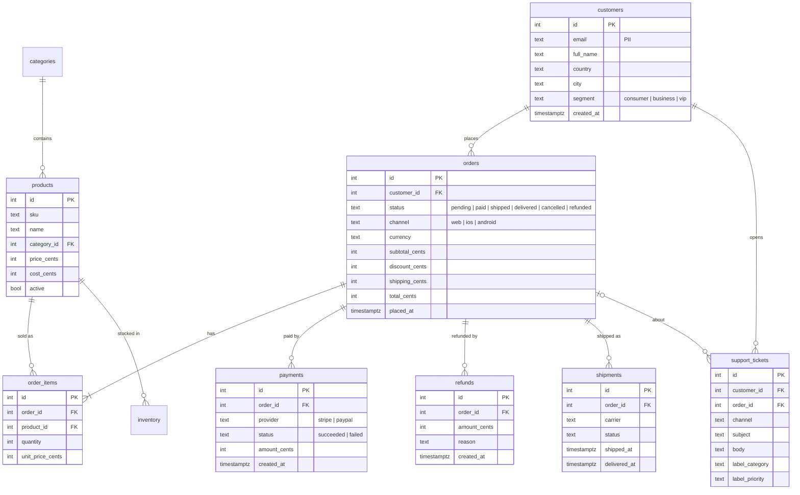

# ShopFlow: the book's running dataset

ShopFlow is a fictional US online shop. Every chapter builds something for it: a support
chatbot, a text-to-SQL bot, a RAG assistant over its docs, an incident agent for its checkout
service, and more. The data is synthetic and deterministic. The same `--seed` on the same
calendar day gives the same rows.

| Table | Rows (default seed) | Notes |
|---|---|---|
| `categories` | 12 | |
| `products` | 200 | `price_cents`, `cost_cents` |
| `customers` | 5,000 | `email` is PII and hidden from the read-only role |
| `orders` | ~30,000 + `--today-orders` | 180 days of history with weekly seasonality |
| `order_items` | ~50,000 | |
| `payments` | ~31,000 | failed attempts and successes |
| `refunds` | ~2,000 | |
| `shipments` | ~27,000 | |
| `inventory` | 600 | 3 warehouses |
| `support_tickets` | 1,560 | 1,500 templated + 60 hand-written hard cases, labelled |
| `shop_settings` | 2 | `timezone`, `currency` |

## Conventions (that trip up LLMs on purpose)

- **Money is integer cents.** `total_cents = 4599` means $45.99.
- **Timestamps are `timestamptz` stored in UTC**. The business day runs on
  `shop_settings.timezone` (default `America/New_York`). "Today" means the local calendar day.
- **"Transactions" is ambiguous.** Today has exactly `--today-orders` orders (default 100). By
  default 96 are paid or shipped, 2 were cancelled (paid, then fully refunded) and 2 are pending
  (two failed payment attempts each). That makes 100 orders, 102 payment attempts and 98
  successful payments.

## ER diagram



## Commands

```bash
# from the repo root
docker compose -f datasets/shopflow/docker-compose.yml up -d
uv run python datasets/shopflow/seed.py --reset          # schema + data, anchored to "now"

# options
uv run python datasets/shopflow/seed.py --reset --seed 42 --days 180 \
    --today-orders 100 --timezone America/New_York
```

"Today" is anchored to the moment you run the seeder. On a new calendar day, run
`seed.py --reset` again so that today has 100 orders again.

## Roles

| Role | Password | Can do |
|---|---|---|
| `shopflow` | `shopflow` | everything (owner); used by the seeder and chapter setup scripts |
| `shopflow_ro` | `shopflow_ro` | `SELECT` only, no `customers.email`, read-only transactions, 5 s statement timeout |

LLM-generated SQL always runs as `shopflow_ro`. The test suite checks this:

```bash
uv run pytest -m reseed datasets   # re-runs seed.py --reset: chapter tables are dropped
```

## Files

- `schema.sql`: tables, indexes and the read-only role (idempotent; drops `public`)
- `seed.py`: the deterministic generator (bulk-loads with `COPY`)
- `ticket_templates.json`: templates for the 1,500 routine support tickets
- `tickets_hard.json`: 60 hand-written hard tickets (sarcasm, multiple issues, non-English, prompt injection)
- `docs/`: customer-facing and internal documents (the RAG corpus)
